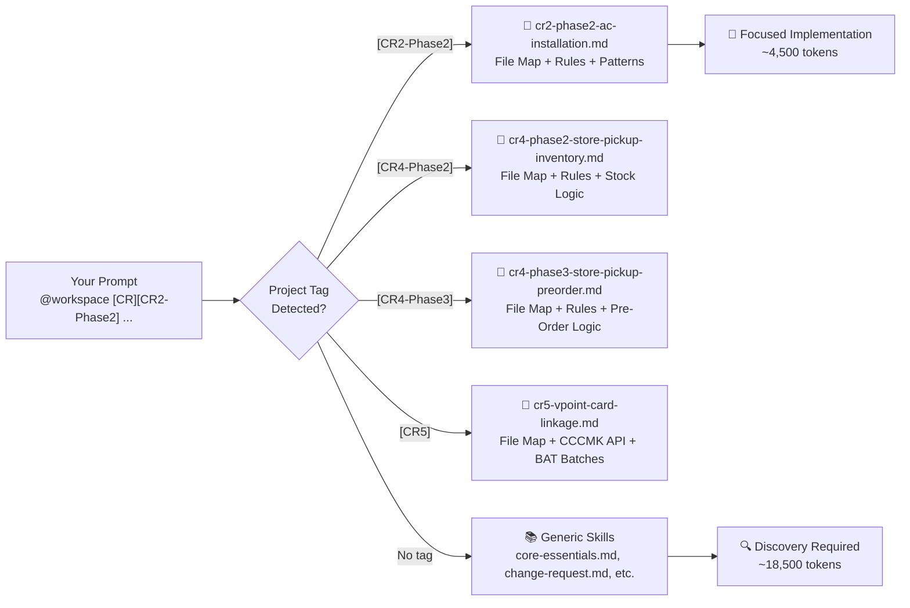
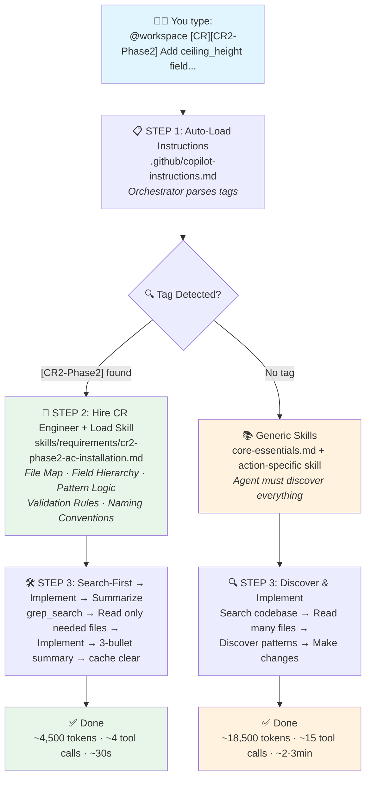
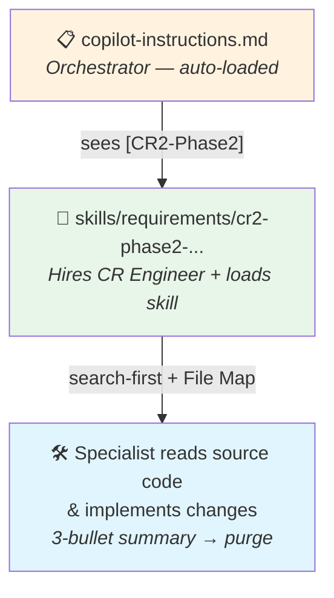
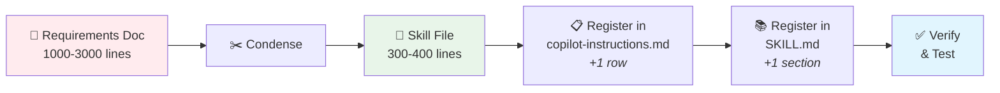
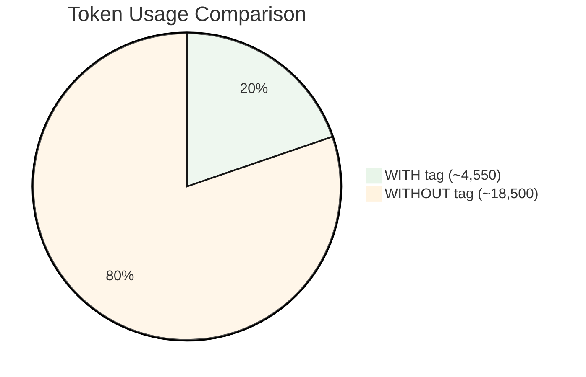

<div align="center">

```
╔══════════════════════════════════════════════════════════════════════╗
║                                                                      ║
║         🏷️  MULTI-AGENT  ORCHESTRATOR  USER  GUIDE  🏷️             ║
║                                                                      ║
║    MrMax EC-Cube  ·  VS Code Copilot  ·  Orchestrator-Worker Model   ║
║                                                                      ║
╚══════════════════════════════════════════════════════════════════════╝
```

**Complete guide for the Multi-Agent Tagged Prompt system.**
**The Orchestrator analyzes your tag, hires a Specialist Agent, and delegates — keeping the context window lean.**

</div>

---

## 📑 Table of Contents

| # | Section | Description |
|:-:|---------|-------------|
| ⚙️ | [0. Setup](#0-setup) | One-time VS Code setup (30 seconds) |
| 🚀 | [1. Quick Start](#1-quick-start) | Get up and running in 30 seconds |
| 🧩 | [2. Prompt Format](#2-prompt-format) | Anatomy of a tagged prompt |
| 🏷️ | [3. Action Tags](#3-action-tags) | 21 action types explained |
| 📌 | [4. Project Tags](#4-project-tags) | Route to project-specific skills |
| 🤖 | [5. How the Orchestrator Works](#5-how-the-orchestrator-works) | Delegation, sub-agents, context purging |
| 💬 | [6. Chat vs Agent Mode](#6-chat-mode-vs-agent-mode) | Mode differences and when to use each |
| 📝 | [7. Example Prompts](#7-example-prompts) | 16 real-world examples (2 per action) |
| ⌨️ | [7a. Slash Command Examples](#7a-slash-command-examples) | How `/bug`, `/review`, `/bat` etc. work |
| 📂 | [8. Directory Structure](#8-directory-structure) | File tree and connections |
| ➕ | [9. How to Add a New Skill](#9-how-to-add-a-new-skill) | Step-by-step skill creation guide |
| 📄 | [10. Skill File Template](#10-skill-file-template) | Copy-paste starter template |
| 📊 | [11. Token Cost Comparison](#11-token-cost-comparison) | With tags vs without — savings visualized |
| 💡 | [12. Tips & Best Practices](#12-tips--best-practices) | Top 12 pro tips |
| ⚡ | [13. Token Optimization](#13-token-optimization) | Strategies to minimize token usage |

---

## ⚙️ 0. Setup

> **One-time setup — takes 30 seconds**

### Prerequisites

1. **VS Code** with GitHub Copilot extension installed
2. **Python 3** installed (required by `[BAT]` tag for Excel generation)
3. **Workspace setting** — ensure `.vscode/settings.json` contains:

```json
{
    "chat.promptFiles": true,
    "github.copilot.chat.codeGeneration.useInstructionFiles": true,
    "search.exclude": {
        ".github/skills/support/venv/**": true,
        ".github/skills/support/packages/**": true,
        ".github/skills/sample/**": true,
        ".github/skills/support/__pycache__/**": true
    },
    "files.exclude": {
        ".github/skills/support/venv": true,
        ".github/skills/support/packages": true
    }
}
```

This enables **slash-command prompts** (`/bug`, `/cr`, `/review`, `/bat`, etc.) in Copilot chat and instruction file auto-injection. Without `chat.promptFiles: true`, the prompt templates in `.github/prompts/` won't appear.

4. **Python package for BAT generation** — the `[BAT]` tag generates Excel (`.xlsx`) files using Python. Install the required package:

```bash
pip install openpyxl
```

> 💡 Only needed if you use `/bat` or `[BAT]`. Other tags don't require Python packages.

### Quick Prompts (Slash Commands)

After setup, type `/` in Copilot chat to see all available action templates:

| Slash Command | Tag | Agent |
|:--------------|:----|:------|
| `/bug` | `[Bug]` | Bug Fixer |
| `/cr` | `[CR]` | CR Engineer |
| `/feature` | `[Feature]` | Feature Builder |
| `/refactor` | `[Refactor]` | Refactoring Specialist |
| `/review` | `[Review]` | Review Commander |
| `/quick-review` | `[Quick Review]` | Quick Reviewer |
| `/pr-review` | `[PR-Review]` | PR Link Reviewer |
| `/unit-test` | `[Unit Test]` | Test Engineer |
| `/investigation` | `[Investigation]` | Impact Analyst |
| `/disclose` | `[Disclose]` | Disclosure Analyst |
| `/bat` | `[BAT]` | BAT Generator |
| `/pr-note` | `[PR-Note]` | PR Note Generator |
| `/req-analysis` | `[Req-Analysis]` | Requirement Analyst |
| `/wbs` | `[WBS]` | WBS Generator |
| `/excel-wbs` | `[Excel-WBS]` | Excel WBS Generator |
| `/wbs-import` | `[WBS-Import]` | WBS Importer |
| `/req-convert` | `[Req-Convert]` | Requirement Converter |
| `/register-skill` | `[Register-Skill]` | Skill Registrar |
| `/init-core` | `[Init-Core]` | Core Skill Generator |
| `/clean` | `[Clean]` | Project Cleaner |
| `/wbs-to-jira` | `[WBS-to-JIRA]` | JIRA WBS Creator |

> 💡 Select a slash command to auto-insert a template with examples. Then fill in your description.

---

## 🚀 1. Quick Start

> **30 seconds to your first tagged prompt**

Type this in VS Code Copilot chat:

```
@workspace [Bug][CR2-Phase2] Drilling cost shows without selection
```

```
┌─────────────────────────────────────────────────────────────────┐
│              ✨  ORCHESTRATOR WORKFLOW  ✨                       │
│                                                                 │
│  ┌──────────┐    ┌──────────────┐    ┌─────────────────────┐   │
│  │  STEP 1  │    │    STEP 2    │    │      STEP 3         │   │
│  │──────────│    │──────────────│    │─────────────────────│   │
│  │ Parse    │──▶ │ Hire the     │──▶ │ Specialist executes │   │
│  │ [Bug] +  │    │ Bug Fixer    │    │ with search-first   │   │
│  │ [CR2]    │    │ specialist   │    │ + summary & purge   │   │
│  └──────────┘    └──────────────┘    └─────────────────────┘   │
│                                                                 │
│  No manual file attachment. No migrations. Lean context window. │
└─────────────────────────────────────────────────────────────────┘
```

---

## 🧩 2. Prompt Format

```
  @workspace   [Action]   [Project-Tag]   Description of issue or request
  ─────────    ────────   ─────────────   ────────────────────────────────
      │            │            │                       │
      │            │            │                       └─ What you need done
      │            │            └─ Routes to skill file (optional)
      │            └─ Type of work (Bug, CR, Feature, etc.)
      └─ Activates codebase search (always include)
```

```
┌─────────────────── YOUR PROMPT ────────────────────────────────────┐
│                                                                     │
│  @workspace  [CR]  [CR2-Phase2]  Add "ceiling_height" field...     │
│  ▲            ▲         ▲              ▲                           │
│  │            │         │              │                           │
│  REQUIRED     │         │              SPECIFIC — include field    │
│               │         │              names, error messages,      │
│               │         OPTIONAL       expected vs actual          │
│               │         but very                                   │
│               REQUIRED  helpful                                    │
│                                                                     │
└─────────────────────────────────────────────────────────────────────┘
```

---

## 🏷️ 3. Action Tags

```
╭─────────────────────────────────────────────────────────────────╮
│                     21 ACTION TAGS                              │
│                                                                 │
│   🐛 [Bug]           Fix a defect or unexpected behavior        │
│   📋 [CR]            Implement a client change request          │
│   🆕 [Feature]       Build something new from scratch           │
│   🔧 [Refactor]      Improve existing code structure            │
│   🔍 [Review]        Full 7-agent code review (PR, branch, etc.)│
│   ⚡ [Quick Review]  Lightweight single-agent code review       │
│   🔗 [PR-Review]    Review any GitHub PR by URL (7-agent)      │
│   🧪 [Unit Test]     Write unit / functional / integration tests│
│   🔬 [Investigation] Trace code paths, assess impact (read-only)│
│   📜 [Disclose]      Generate AI code disclosure for a PR       │
│   📊 [BAT]           Generate BAT Excel reports + auto-test     │
│   📝 [PR-Note]       Generate GitHub PR description from diffs   │
│   📄 [Req-Analysis]  Analyze reqs → SRS + WBS (3-agent pipeline)│
│   📋 [WBS]           Generate JIRA-ready WBS from existing SRS  │
│   📊 [Excel-WBS]     Convert WBS markdown to formatted Excel    │
│   📥 [WBS-Import]    Reverse: Excel/CSV → enriched WBS markdown │
│   📄 [Req-Convert]   Convert Excel/Word requirements to PDF + PNG  │
│   🏗️ [Init-Core]     Generate core-essentials + core-full for any project│
│   🏷️ [Register-Skill] Register a new skill, tag, and slash command │
│   🧹 [Clean]          Clean project data for new codebase install  │
│   🎫 [WBS-to-JIRA]   Create JIRA tickets from a WBS markdown file  │
│                                                                 │
╰─────────────────────────────────────────────────────────────────╯
```

| Tag | Icon | Specialist Agent | When to Use | Example Keywords |
|-----|:----:|------------------|-------------|------------------|
| `[Bug]` | 🐛 | Bug Fixer | Something is broken or behaves unexpectedly | "not working", "error", "wrong value" |
| `[CR]` | 📋 | Change Request Engineer | Client requested a change to existing feature | "client wants", "change request" |
| `[Feature]` | 🆕 | Feature Builder | Build entirely new functionality | "implement", "add new", "create" |
| `[Refactor]` | 🔧 | Refactoring Specialist | Code works but needs structural improvement | "extract", "split", "clean up" |
| `[Review]` | 🔍 | Review Commander | Automated 7-agent code review (PR, branch, staged, diff) | "review pr", "review staged", "review branch" |
| `[Quick Review]` | ⚡ | Quick Reviewer | Lightweight single-agent review (6 dimensions, faster) | "quick review pr", "quick review staged" |
| `[PR-Review]` | 🔗 | PR Link Reviewer | Review any GitHub PR by URL — 7-agent pipeline, zero manual tokens | "PR review", "pull request URL", "GitHub PR", "review PR link" |
| `[Unit Test]` | 🧪 | Test Engineer | Generate & run tests from branch diff | "unit test branch", "test branch" |
| `[Investigation]` | 🔬 | Impact Analyst | Trace code paths, map dependencies — **no code changes** | "trace", "impact", "what depends on", "blast radius" |
| `[Disclose]` | 📜 | Disclosure Analyst | Generate AI-generated code disclosure for a PR | "disclosure", "AI code", "preparing PR" |
| `[BAT]` | 📊 | BAT Generator | Generate Developer BAT Excel reports from diffs + auto-test execution | "BAT", "test cases", "acceptance test" |
| `[PR-Note]` | 📝 | PR Note Generator | Generate GitHub PR description with ticket link, summary, checklists | "PR note", "PR description", "pull request" |
| `[Req-Analysis]` | 📄 | Requirement Analyst | Analyze client requirements (PDF/Excel/Word/images) into SRS + WBS via 3-agent pipeline with maturity gate; auto-offers core skill generation if missing | "requirements", "SRS", "WBS", "analyze specs" |
| `[WBS]` | 📋 | WBS Generator | Generate JIRA-ready WBS from an existing SRS document | "WBS", "work breakdown", "from SRS", "stories" |
| `[Excel-WBS]` | 📊 | Excel WBS Generator | Convert WBS markdown to formatted Excel (.xlsx) | "excel", "xlsx", "WBS excel", "spreadsheet" |
| `[WBS-Import]` | 📥 | WBS Importer | Reverse-generate WBS markdown from Excel/CSV, enriched with SRS | "import", "reverse", "excel to WBS", "CSV to WBS" |
| `[Req-Convert]` | 📄 | Requirement Converter | Convert Excel/Word requirement documents to PDF + PNG | "convert", "excel to pdf", "word to pdf", "docx", "excel to image", "requirement" |
| `[Init-Core]` | 🏗️ | Core Skill Generator | Generate core-essentials.md + core-full.md coding guideline skill files for any project | "init core", "setup project", "coding guidelines", "new project" |
| `[Register-Skill]` | 🏷️ | Skill Registrar | Register a new skill, action tag, and slash command in the orchestrator | "register", "new skill", "add skill", "add tag" |
| `[Clean]` | 🧹 | Project Cleaner | Clean project-specific data and prepare framework for new codebase install; optionally delegates to `[Init-Core]` | "clean", "reset", "new project", "fresh install" |
| `[WBS-to-JIRA]` | 🎫 | JIRA WBS Creator | Create JIRA Stories + Sub-tasks from a WBS markdown file via REST API; dry-run preview before live creation | "jira", "create tickets", "wbs to jira", "jira stories" |

---

## 📌 4. Project Tags

Project tags route the agent to a specific skill file with pre-loaded
context (file maps, business rules, validation logic).



| Project Tag | Skill Loaded | Description |
|:-----------:|-------------|-------------|
| `[CR2-Phase2]` | `cr2-phase2-ac-installation.md` | AC installation checkout, cost estimation, P1-P6 patterns |
| `[CR4-Phase2]` | `cr4-phase2-store-pickup-inventory.md` | Store pickup inventory, stock deduction, shipping status, admin UI |
| `[CR4-Phase3]` | `cr4-phase3-store-pickup-preorder.md` | Store pickup management, pre-order (order_type=31), EC request export, authority_id=6 |
| `[CR5]` | `cr5-vpoint-card-linkage.md` | V-Point & credit card linkage, CCCMK API (sp101/sp201), BAT1-BAT5 batches, AES-256-CBC |
| *(no tag)* | Generic skills (`core-essentials.md`, etc.) | General EC-Cube development |

> 💡 When a new project starts, add a new skill. See [Section 9](#9-how-to-add-a-new-skill).

---

## 🤖 5. How the Orchestrator Works

The system uses an **Orchestrator-Worker** architecture to prevent "AI Forgetfulness" and minimize token usage.

```
┌─────────────────────────────────────────────────────────────────────┐
│                    ORCHESTRATOR-WORKER MODEL                        │
│                                                                     │
│  ┌────────────────────────────────────────────────────────────┐     │
│  │              🧠 LEAD ORCHESTRATOR                          │     │
│  │                                                            │     │
│  │  1. Parses [Action] and [Project-Tag] from prompt          │     │
│  │  2. For EC-Cube files: core-essentials auto-injected       │     │
│     │     For other tasks: reads core-essentials.md            │     │
│  │  3. Looks up tag in routing.md (30-line table)            │     │
│  │  4. Loads only the matching skill file on-demand          │     │
│  │  5. Delegates execution with the specialist's checklist  │     │
│  │  6. Summarizes findings in ≤3 bullets, purges details     │     │
│  └──────┬─────────┬──────────┬─────────┬─────────┬───────────┘     │
│         │         │          │         │         │                  │
│         ▼         ▼          ▼         ▼         ▼                  │
│  ┌──────────┐ ┌────────┐ ┌────────┐ ┌───────┐ ┌──────────────┐    │
│  │ Bug      │ │ CR     │ │Feature │ │Review │ │Investigation │    │
│  │ Fixer    │ │Engineer│ │Builder │ │Cmdndr │ │  Analyst     │    │
│  └──────────┘ └────────┘ └────────┘ └───────┘ └──────────────┘    │
│  ┌──────────┐ ┌────────┐ ┌──────────────┐ ┌──────────────┐    │
│  │ Test     │ │Refactor│ │ Disclosure   │ │     BAT      │    │
│  │ Engineer │ │  Spec  │ │   Analyst    │ │  Generator   │    │
│  └──────────┘ └────────┘ └──────────────┘ └──────────────┘    │
│  ┌──────────┐ ┌────────┐ ┌──────────────┐ ┌──────────────┐    │
│  │ Init-Core│ │Register│ │   Project    │ │ + 10 more    │    │
│  │Generator │ │ Skill  │ │   Cleaner    │ │  agents...   │    │
│  └──────────┘ └────────┘ └──────────────┘ └──────────────┘    │
│                                                                     │
│  Each specialist owns: skill file, scope, tools, checklist          │
└─────────────────────────────────────────────────────────────────────┘
```

### Context Window Management

The Orchestrator keeps context lean using **5 mechanisms**:

```
┌──────────────────────────────────────────────────────────────────┐
│  1. SEARCH FIRST                                                 │
│  Before calling read_file, the agent uses grep_search or         │
│  list_dir to confirm which files are relevant.                   │
├──────────────────────────────────────────────────────────────────┤
│  2. TARGETED READS                                               │
│  Use startLine/endLine — never read >150 lines in one call.      │
├──────────────────────────────────────────────────────────────────┤
│  3. SUMMARY & PURGE                                              │
│  After each sub-task: 3-bullet summary → discard file content.   │
│  Carry only the summary into the next step.                      │
├──────────────────────────────────────────────────────────────────┤
│  4. RETURN CONTRACT                                              │
│  Each specialist defines what it returns (3 bullets, file paths, │
│  no raw content). Prevents ~20-30% output token waste.           │
├──────────────────────────────────────────────────────────────────┤
│  5. COMPLEXITY RULE                                              │
│  If >3 files read + >2 files output → use runSubagent to split  │
│  discovery from implementation. Saves ~30% on multi-file tasks.  │
├──────────────────────────────────────────────────────────────────┤
│  NO MIGRATIONS                                                   │
│  This project does NOT use Doctrine migrations.                  │
│  Schema changes are handled via manual SQL scripts.              │
└──────────────────────────────────────────────────────────────────┘
```

### Delegation Flow

```mermaid
flowchart TD
    A["🧑‍💻 You type:<br>@workspace [CR][CR2-Phase2] Add ceiling_height..."] --> B

    B["🧠 ORCHESTRATOR<br>Parse tags → Load core-essentials.md"] --> C{"Action Tag?"}

    C -- "[Bug]" --> D1["🐛 Bug Fixer Agent<br>grep_search → isolate → fix"]
    C -- "[CR]" --> D2["📋 CR Engineer Agent<br>Entity → Service → Controller → Template"]
    C -- "[Feature]" --> D3["🆕 Feature Builder Agent<br>Full stack: Entity → Template"]
    C -- "[Review]" --> D4["🔍 Review Commander<br>7 parallel sub-agents"]
    C -- "[Quick Review]" --> D4b["⚡ Quick Reviewer<br>Single-agent 6-dimension review"]
    C -- "[Investigation]" --> D5["🔬 Impact Analyst<br>Read-only trace & report"]
    C -- "[Unit Test]" --> D6["🧪 Test Engineer<br>AAA pattern, data providers"]
    C -- "[Refactor]" --> D7["🔧 Refactoring Specialist<br>Extract services, thin controllers"]
    C -- "[Disclose]" --> D8["📜 Disclosure Analyst<br>AI code detection & disclosure"]
    C -- "[BAT]" --> D9["📊 BAT Generator<br>Excel reports + auto-test"]
    C -- "[PR-Note]" --> D10["📝 PR Note Generator<br>GitHub PR description from diffs"]
    C -- "[Req-Analysis]" --> D11["📄 Requirement Analyst<br>3-agent pipeline + maturity gate → SRS + WBS"]
    C -- "[WBS]" --> D12["📋 WBS Generator<br>SRS → JIRA-ready WBS"]
    C -- "[Excel-WBS]" --> D13["📊 Excel WBS Generator<br>WBS markdown → Excel"]
    C -- "[WBS-Import]" --> D14["📥 WBS Importer<br>Excel/CSV → enriched WBS markdown"]
    C -- "[Req-Convert]" --> D15["📄 Requirement Converter<br>Excel/Word → PDF + PNG"]
    C -- "[Init-Core]" --> D16["🏗️ Core Skill Generator<br>Generate core-essentials + core-full"]
    C -- "[Register-Skill]" --> D17["🏷️ Skill Registrar<br>Register new skill, tag, slash command"]
    C -- "[Clean]" --> D18["🧹 Project Cleaner<br>Clean project data + optional Init-Core"]
    C -- "[PR-Review]" --> D19["🔗 PR Link Reviewer<br>Review GitHub PR by URL (7-agent)"]
    C -- "[WBS-to-JIRA]" --> D20["🎫 JIRA WBS Creator<br>WBS markdown → JIRA Stories + Sub-tasks"]

    D1 --> E["📋 3-bullet summary → purge context → next step"]
    D2 --> E
    D3 --> E
    D4 --> E
    D4b --> E
    D5 --> E
    D6 --> E
    D7 --> E
    D8 --> E
    D9 --> E
    D10 --> E
    D11 --> E
    D12 --> E
    D13 --> E
    D14 --> E
    D15 --> E
    D16 --> E
    D17 --> E
    D18 --> E
    D19 --> E
    D20 --> E
```



---

## 💬 6. Chat Mode vs Agent Mode

Your team uses both modes. Tagged prompts work in **both**.

```
┌──────────────────────────────────────────────────────────────┐
│                     CHAT MODE                                │
│                                                              │
│  USE:  @workspace [Action][Project-Tag] Description          │
│                                                              │
│  • @workspace required — tells Copilot to search codebase    │
│  • Agent reads files but does NOT edit them                  │
│  • Best for: Q&A, debugging advice, code explanations        │
│  • Skill auto-loading: ✓                                     │
└──────────────────────────────────────────────────────────────┘

┌──────────────────────────────────────────────────────────────┐
│                     AGENT MODE                               │
│                                                              │
│  USE:  @workspace [Action][Project-Tag] Description          │
│   or:  [Action][Project-Tag] Description                     │
│                                                              │
│  • Agent has full access: edit files, run terminal, search   │
│  • @workspace optional but harmless                          │
│  • Best for: implementing, fixing, refactoring               │
│  • Skill auto-loading: ✓                                     │
└──────────────────────────────────────────────────────────────┘
```

| | Chat Mode 💬 | Agent Mode 🤖 |
|:---:|:-----------:|:-----------:|
| `@workspace` | ✅ Required | ⚪ Optional |
| `[Project-Tag]` | ✅ Works | ✅ Works |
| Skill loading | 🔄 Auto | 🔄 Auto |
| Can edit files | ❌ No | ✅ Yes |
| Can run commands | ❌ No | ✅ Yes |

> 💡 **TIP:** Always include `@workspace` so prompts work in both modes.

---

## 📝 7. Example Prompts

> 📌 You only need the prompt. The Orchestrator automatically hires the
> right Specialist Agent, loads the skill file, and delegates execution.

---

### 🐛 [Bug] — Fix a defect

```
@workspace [Bug][CR2-Phase2] Drilling cost (AC008/AC009) appears in
estimation modal even when user hasn't selected hole_drilling_possible field.
```

```
@workspace [Bug] Order confirmation email not sent when payment method is
bank transfer. No errors in log. Started after last deployment.
```

---

### 📋 [CR] — Implement a change request

```
@workspace [CR][CR2-Phase2] Client wants to add a new "ceiling_height"
field to AC installation queries. It should be visible only when
installation_type = NEW_INSTALLATION. Options: Under 2.5m / 2.5-3m / Over 3m.
```

```
@workspace [CR] Client requests adding a "gift wrapping" option at checkout.
Should show a ¥330 charge, allow a message (max 100 chars), and appear in
order details and confirmation email.
```

---

### 🆕 [Feature] — Build something new

```
@workspace [Feature][CR2-Phase2] Add a "Save as Draft" button to
the AC installation checkout form that saves all field values to the
database without submitting the order.
```

```
@workspace [Feature] Implement customer loyalty points system with:
- 1 point per ¥100 spent
- Points redemption at checkout (1 point = ¥1)
- Admin dashboard showing points balance per customer
```

---

### 🔧 [Refactor] — Improve existing code

```
@workspace [Refactor][CR2-Phase2] Extract pattern logic (P1-P6) from
001_001_checkout_installation.js into a testable module with pure functions.
```

```
@workspace [Refactor] OrderController::confirm() is 450 lines. Extract
payment validation, stock check, and email sending into separate services.
```

---

### 🔍 [Review] — Automated Code Review (7 parallel agents)

> The `[Review]` tag launches a **comprehensive automated review** with 7
> specialized agents (Code Quality, Test Coverage, Performance, Security,
> Documentation, Error Handling, Config & Dependencies).
> It generates a `CODE-REVIEW-*.md` report in the repository root.

**4 Review Modes:**

```
┌─────────────────────────────────────────────────────────────────────────────┐
│  MODE         │ USAGE                                │ WHAT IT REVIEWS      │
│───────────────│──────────────────────────────────────│──────────────────────│
│  pr           │ [Review] pr 123                      │ Pull request by #    │
│  branch       │ [Review] branch feature/xyz          │ Branch vs default    │
│  branch+base  │ [Review] branch feature/xyz base dev │ Branch vs specific   │
│  staged       │ [Review] staged                      │ Staged git changes   │
│  diff         │ [Review] diff changes.diff           │ A diff file          │
│  (default)    │ [Review]                             │ Defaults to staged   │
└─────────────────────────────────────────────────────────────────────────────┘
```

**Review a pull request:**
```
@workspace [Review] pr 1234
```

**Review a branch before merging (auto-detects base):**
```
@workspace [Review] branch feature/loyalty-points
```

**Review a branch against a specific base branch:**
```
@workspace [Review] branch feature/loyalty-points base develop
```

**Review staged changes before committing:**
```
@workspace [Review] staged
```

**Review with project context (EC-Cube-specific rules enforced):**
```
@workspace [Review][CR2-Phase2] pr 1234
```

**Review a diff file from CI:**
```
@workspace [Review] diff changes.diff
```

**Default (no arguments = staged changes):**
```
@workspace [Review]
```

> 📄 **Output:** Generates `CODE-REVIEW-PR-1234.md` (or `CODE-REVIEW-STAGED-2026-03-24-1430.md`, etc.)
> with an executive summary, verdict (APPROVE / APPROVE WITH COMMENTS / REQUEST CHANGES),
> findings by category, and prioritized action items.

---

### ⚡ [Quick Review] — Lightweight Single-Agent Review

> The `[Quick Review]` tag hires the **Quick Reviewer** — a single agent that performs
> a 6-dimension checklist review (Security, Performance, Architecture, Code Quality,
> Testing, Error Handling). Faster than `[Review]` — no sub-agent orchestration.
> Generates a `QUICK-REVIEW-*.md` report.

**When to use [Quick Review] vs [Review]:**
- `[Quick Review]` — Small/medium PRs, quick feedback, pre-commit sanity check
- `[Review]` — Large PRs, critical features, comprehensive 7-agent depth

```
@workspace [Quick Review] pr 1234
```

```
@workspace [Quick Review] branch feature/loyalty-points
```

```
@workspace [Quick Review] branch feature/loyalty-points base develop
```

```
@workspace [Quick Review] staged
```

> 📄 **Output:** Generates `QUICK-REVIEW-PR-1234.md` (or `QUICK-REVIEW-STAGED-*.md`, etc.)
> with verdict and findings organized by review dimension.

---

### 🔗 [PR-Review] — Review Any GitHub PR by URL

> The `[PR-Review]` tag hires the **PR Link Reviewer** — it fetches any GitHub PR
> by URL using VS Code's built-in GitHub auth (zero manual tokens), runs the same
> 7-agent parallel review pipeline as `[Review]`, and generates a structured report.

**When to use [PR-Review] vs [Review]:**
- `[PR-Review]` — Remote PRs from any GitHub repo you have access to (by URL)
- `[Review]` — Local PRs, branches, staged changes, or diff files

**Data fetch tiers (automatic fallback):**
1. GitKraken MCP tools (preferred — uses VS Code GitHub auth)
2. Git fetch with merge ref (fallback for same-origin repos)
3. curl + PAT (last resort for external repos)

```
@workspace [PR-Review] https://github.com/owner/repo/pull/123
```

```
@workspace [PR-Review]
```

> 📄 **Output:** Generates `CODE-REVIEW-PR-{owner}-{repo}-{number}.md` in `docs/review/`
> with 3-tier severity findings and overall verdict.

---

### 🧪 [Unit Test] — Generate tests from branch diff

> Analyzes the diff between your feature branch and base branch, identifies testable
> PHP files, generates pure unit or integration tests, and runs them.
> **Always specify both `branch` and `base` for accurate results.**

```
@workspace [Unit Test] branch feat/1709632-packing-list-barcode-enhancement base cr4-phase2
```

```
@workspace [Unit Test] branch feat/1709632-packing-list-barcode-enhancement base feat/1709504-cr4-phase2
```

```
@workspace [Unit Test]
```

> **Pure unit tests:** `docker exec mrmax_dev-ec-cube-1 php bin/phpunit --no-configuration --bootstrap tests/bootstrap.php <file>`
> **Integration tests:** `docker exec mrmax_dev-ec-cube-1 bin/phpunit <file>`

---

### 🔬 [Investigation] — Impact Analysis (read-only)

> The `[Investigation]` tag hires the **Impact Analyst** — a **read-only Black Box** specialist.
> It has no IDE indexing or debugger. It systematically greps for EC-Cube's 4 extension points
> (EventSubscribers, Repository Decorators, Entity Traits, Controller logic) to map dependencies
> and outputs a structured **Impact Report**. Zero code changes.

```
@workspace [Investigation][CR4-Phase2] What is the full blast radius of
changing the stock deduction logic for order type 31? Which services,
subscribers, batch jobs, and templates depend on the current flow?
```

```
@workspace [Investigation] Trace the complete order confirmation flow
from CartController through payment processing to email dispatch.
List every service, event subscriber, and template involved.
```

> 📄 **Output:** An Impact Report with: blast radius count, direct dependencies table,
> event subscribers involved, database/batch impact, risk level, and recommended approach.

---

### 📜 [Disclose] — AI Code Disclosure

> The `[Disclose]` tag hires the **Disclosure Analyst**. It analyzes a git diff to detect
> AI-generated or AI-assisted code and produces a strict-format disclosure file.
> Use it when preparing a PR that contains AI-generated code.

**Disclose AI code between two branches:**
```
@workspace [Disclose] Analyze diff between feat/170931-cr2-phase2 and
feat/1709216-cr2-phase1-enhancement
```

**Disclose AI code on current branch vs main:**
```
@workspace [Disclose] Analyze current branch against main
```

> 📄 **Output:** Generates `AI_GENERATED_CODE_DISCLOSURE_<branch_name>.md` in the repo root
> with per-file entries: Type, Function/Class, Line Range, AI Scope, and Reason.

---

### 📊 [BAT] — Developer BAT Test Cases

> The `[BAT]` tag hires the **BAT Generator**. It analyzes a git diff to identify
> affected routes, controllers, templates, and services, then produces structured
> Developer BAT (Basic Acceptance Test) CSV reports organized by module.

**Generate BAT from a feature branch:**
```
@workspace [BAT] branch feat/P1709-733-posdata
```

**Generate BAT from a branch against a specific base:**
```
@workspace [BAT] branch feat/P1709-733-posdata base staging
```

**Generate BAT from staged changes:**
```
@workspace [BAT] staged
```

> 📄 **Output:** Generates `BAT_[ModuleName]_[TicketID].csv` files in `docs/BAT/`
> with Positive, Negative, and Impact Area test cases per module.

---

### 📝 [PR-Note] — GitHub PR Description

> The `[PR-Note]` tag hires the **PR Note Generator**. It extracts the Jira ticket ID
> from the branch name, analyzes the diff to generate a summary and impact range,
> finds test files for unit test commands, and delegates to the `ai-disclosure` sub-agent
> for AI-generated code detection. Output is a 9-section GitHub-compatible markdown file.

**Generate PR note for a feature branch:**
```
@workspace [PR-Note] branch feat/1709632-packing-list-barcode-enhancement
```

**Generate PR note with explicit base branch:**
```
@workspace [PR-Note] branch feat/1709632-packing-list-barcode-enhancement base feat/1709504-cr4-phase2
```

**Generate PR note for current branch (auto-detect base):**
```
@workspace [PR-Note]
```

> 📄 **Output:** Generates `PR-Note-P1709-632.md` in `~/Desktop/MrMax/PR-Note/`
> with ticket link, summary, impact range, test commands, checklists, and AI disclosure.

---

### 📄 [Req-Analysis] — Requirement Analysis (3-Agent Pipeline)

> The `[Req-Analysis]` tag hires the **Requirement Analyst** — a 3-agent pipeline orchestrator.
> It dispatches three sub-agents: **Maturity Assessor** (quality gate) → **Analyst** → **Reviewer**.
> A maturity gate evaluates requirement readiness before SRS generation — only 100% maturity
> auto-proceeds; otherwise you decide whether to continue or get a gap report.
> Supports Excel, Word, PDF, and image attachments (auto-detects format).
> Produces a final **SRS**, **WBS**, **Project Skill File**, and optionally **Core Skill Files**
> (if no `core-essentials.md`/`core-full.md` exist but a codebase is detected).

**Analyze attached requirement documents:**
```
@workspace [Req-Analysis] Analyze the attached requirement document and produce SRS and WBS.
```
*(Attach Excel, Word, PDF, or image files in the chat)*

**Analyze with codebase cross-check:**
```
@workspace [Req-Analysis] --with-codebase Analyze these requirements and check impact against our existing codebase.
```
*(Attach requirement files + agent will scan `app/Customize/` for impact)*

> 📄 **Output:** Generates `docs/srs-{feature-name}.md`, `docs/wbs/wbs-{feature-name}.md`,
> and `.github/skills/requirements/{feature-name}.md` (agent-optimized project skill file)
> with functional/non-functional requirements, impact analysis, corner cases, test cases,
> user stories, risk assessment, JIRA-ready work breakdown structure, and condensed
> business rules for future tagged prompt usage.
>
> 🔄 **Process:** Maturity Gate (quality check) → Analyst (SRS draft) → Reviewer (corrections)
> → final SRS + WBS + Skill File exported → optionally generates `core-essentials.md` +
> `core-full.md` if missing (via `[Init-Core]`) → temp files cleaned up automatically.
> If maturity < 100%, you choose: proceed anyway or stop and get a maturity report
> at `docs/maturity-report/maturity-report-{feature}.md`.

---

### 📋 [WBS] — WBS Generation from SRS

> The `[WBS]` tag hires the **WBS Generator**. It reads an existing SRS document and
> produces a detailed, JIRA-import-ready Work Breakdown Structure with fully described
> Stories and Sub-tasks including acceptance criteria, corner cases, risks, and traceability.

**Generate WBS from an SRS document:**
```
@workspace [WBS] docs/srs-ac-installation.md
```

**Generate WBS from an SRS at any path:**
```
@workspace [WBS] /home/user/Desktop/requirements/srs-loyalty-points.md
```

> 📋 **Output:** Generates `docs/wbs/wbs-{feature-name}.md` with Epic description,
> Stories (Summary, Requirement Details, Acceptance Criteria in Gherkin format, Dependencies,
> Corner Cases, Risks, Notes), Sub-tasks (Description, Affected Files, Definition of Done),
> Cross-Story Dependencies, Sprint Allocation, Risk Summary, and Traceability Matrix.

---

### 📊 [Excel-WBS] — Excel WBS from WBS Markdown

> The `[Excel-WBS]` tag hires the **Excel WBS Generator**. It reads a WBS markdown file
> and produces a formatted Excel (.xlsx) workbook matching `WBS-Sample.xlsx` — with
> colored story/subtask rows, status/assignee/review dropdowns, and proper column widths.

**Generate Excel WBS from a WBS markdown:**
```
@workspace [Excel-WBS] docs/wbs/wbs-vpoint-card-linkage.md
```

**With CR name and assignee list:**
```
@workspace [Excel-WBS] docs/wbs/wbs-store-pickup.md --cr "CR4 (Phase-2)" --assignees "Dev1,Dev2,Dev3"
```

> 📊 **Output:** Generates `docs/wbs/excel/{feature}-wbs.xlsx` with 16 columns (SL, CR,
> Module Name, Story List, Backlog ID, Redmine ID, Assignee, Status, Reviewed by JP side,
> Reviewer(PIC), Dev Effort, Verification Effort, Start/Planned End/End Date, Remarks).

---

### 📥 [WBS-Import] — WBS Markdown from Excel/CSV

> The `[WBS-Import]` tag hires the **WBS Importer**. It reads an Excel-WBS (`.xlsx`) or
> CSV export and reverse-generates a full WBS markdown document, enriched with requirement
> details, acceptance criteria, corner cases, and traceability from an attached SRS document.

**Import from Excel with SRS attachment:**
```
@workspace [WBS-Import] docs/wbs/excel/vpoint-card-linkage-wbs.xlsx
  (attach: docs/srs/srs-vpoint-card-linkage.md)
```

**Import from CSV with SRS and project skill:**
```
@workspace [WBS-Import] /tmp/cr4-wbs-export.csv
  (attach: docs/srs/srs-store-pickup.md, .github/skills/requirements/cr4-phase2-store-pickup-inventory.md)
```

> 📥 **Output:** Generates `docs/wbs/wbs-{feature-name}.md` — a complete WBS markdown with
> enriched stories, sub-tasks, acceptance criteria (Gherkin), risks, dependencies, and a
> traceability matrix cross-referencing every FR-*/US-* from the SRS.

---

### 📄 [Req-Convert] — Convert Excel/Word Requirements to PDF + PNG

> The `[Req-Convert]` tag hires the **Requirement Converter**. It takes an Excel or Word file
> (.xlsx / .docx) with requirement content containing visual diagrams, shapes, arrows, and charts,
> and converts each worksheet (Excel) or the full document (Word) into PDF and PNG images.
> Uses LibreOffice for pixel-perfect rendering and PyMuPDF for PDF→PNG conversion.
> All dependencies are auto-installed locally on first run (no system packages needed beyond Python 3).
> Called automatically by `[Req-Analysis]` when Excel/Word files are attached.

**Convert a requirement document:**
```
@workspace [Req-Convert] /home/user/Desktop/requirements/CR5-specs.xlsx
@workspace [Req-Convert] /home/user/Desktop/requirements/CR5-specs.docx
```

**Convert with higher quality for AI analysis:**
```
@workspace [Req-Convert] /home/user/Desktop/requirements/CR5-specs.xlsx --dpi 300
```

> 📄 **Output:** Generates per-worksheet/document files in `.github/docs/requirement-conversion/{file-name}/`:
> - `pdf/{SheetName}.pdf` — PDF preserving all visuals
> - `images/{SheetName}.png` — PNG image (multi-page PDFs stitched vertically)

---

### 🎫 [WBS-to-JIRA] — Create JIRA Tickets from WBS

> The `[WBS-to-JIRA]` tag hires the **JIRA WBS Creator**. It reads a WBS markdown file
> (generated by `[WBS]`), runs a dry-run preview first, then — after your confirmation —
> creates JIRA Stories + Sub-tasks via the JIRA REST API v3.
> One-time config setup (`jira_config.ini`) is guided automatically on first run.

**Create JIRA tickets from a WBS file:**
```
@workspace [WBS-to-JIRA] docs/wbs/wbs-cr5-vpoint-card-linkage.md
```

**Preview only (no tickets created):**
```
@workspace [WBS-to-JIRA] docs/wbs/wbs-store-pickup.md --dry-run
```

> 🎫 **Output:** JIRA Stories + Sub-tasks created in backlog under the configured project.
> A creation summary is printed: Story keys (e.g. `P001-42`) and their Sub-task keys.

---

## ⌨️ 7a. Slash Command Examples

> Instead of typing `@workspace [Tag] ...` manually, use the **slash command** shorthand.
> Type `/` in Copilot chat, select a command, and add your description directly.

| Old Pattern | New Pattern |
|-------------|-------------|
| `@workspace [Bug] error on checkout` | `/bug error on checkout` |
| `@workspace [CR][CR2-Phase2] add field` | `/cr [CR2-Phase2] add field` |
| `@workspace [Review] pr 1234` | `/review pr 1234` |
| `@workspace [Quick Review] pr 1234` | `/quick-review pr 1234` |
| `@workspace [PR-Review] https://github.com/owner/repo/pull/123` | `/pr-review https://github.com/owner/repo/pull/123` |
| `@workspace [BAT] branch feat/xyz` | `/bat branch feat/xyz` |
| `@workspace [PR-Note] branch feat/xyz` | `/pr-note branch feat/xyz` |
| `@workspace [Req-Analysis] analyze reqs` | `/req-analysis analyze reqs` |
| `@workspace [WBS] docs/srs-feature.md` | `/wbs docs/srs-feature.md` |
| `@workspace [Excel-WBS] docs/wbs/wbs-feature.md` | `/excel-wbs docs/wbs/wbs-feature.md` |
| `@workspace [WBS-Import] docs/wbs/excel/feature-wbs.xlsx` | `/wbs-import docs/wbs/excel/feature-wbs.xlsx` |
| `@workspace [Req-Convert] /path/to/requirements.xlsx` | `/req-convert /path/to/requirements.xlsx` |
| `@workspace [Init-Core] We use Next.js 14 with TypeScript` | `/init-core We use Next.js 14 with TypeScript` |
| `@workspace [Register-Skill] Create a skill for DB review` | `/register-skill Create a skill for DB review` |
| `@workspace [Clean] Clean for new project` | `/clean Clean for new project` |
| `@workspace [WBS-to-JIRA] docs/wbs/wbs-feature.md` | `/wbs-to-jira docs/wbs/wbs-feature.md` |

> 💡 Project tags like `[CR2-Phase2]` still work — just add them after the slash command.

---

### `/bug`

```
/bug Order confirmation email not sent when payment method is bank transfer
/bug [CR2-Phase2] Drilling cost shows even when hole_drilling_possible not selected
```

---

### `/cr`

```
/cr [CR2-Phase2] Add "ceiling_height" field visible only when installation_type = NEW_INSTALLATION
/cr Client requests "gift wrapping" option at checkout, ¥330 charge, max 100 chars message
```

---

### `/feature`

```
/feature Implement customer loyalty points: 1 point per ¥100, redemption at checkout, admin dashboard
/feature [CR2-Phase2] Add "Save as Draft" button to AC installation checkout form
```

---

### `/refactor`

```
/refactor OrderController::confirm() is 450 lines. Extract payment, stock, email into services
/refactor [CR2-Phase2] Extract pattern logic (P1-P6) from checkout_installation.js into testable module
```

---

### `/review`

```
/review pr 1234
/review branch feature/loyalty-points
/review branch feature/loyalty-points base develop
/review staged
/review [CR2-Phase2] pr 1234
/review diff changes.diff
```

---

### `/quick-review`

```
/quick-review pr 1234
/quick-review branch feature/loyalty-points
/quick-review branch feature/loyalty-points base develop
/quick-review staged
/quick-review [CR2-Phase2] pr 1234
```

---

### `/pr-review`

```
/pr-review https://github.com/owner/repo/pull/123
/pr-review
```

---

### `/unit-test`

```
/unit-test [CR2-Phase2] Write tests for pattern logic (P1-P6) covering voltage/amperage mismatches
/unit-test Write functional tests for order completion: cart → coupon → payment → confirm
```

---

### `/investigation`

```
/investigation [CR4-Phase2] Blast radius of changing stock deduction logic for order type 31
/investigation Trace order confirmation flow from CartController through payment to email dispatch
```

---

### `/disclose`

```
/disclose Analyze diff between feat/170931-cr2-phase2 and feat/1709216-cr2-phase1-enhancement
/disclose Analyze current branch against main
```

---

### `/bat`

```
/bat branch feat/P1709-733-posdata
/bat branch feat/P1709-733-posdata base staging
/bat pr 12345
/bat staged
```

---

### `/pr-note`

```
/pr-note branch feat/1709632-packing-list-barcode-enhancement
/pr-note branch feat/1709632-packing-list-barcode-enhancement base feat/1709504-cr4-phase2
/pr-note
```

---

### `/req-analysis`

```
/req-analysis Analyze the attached requirement document and produce SRS and WBS.
/req-analysis --with-codebase Analyze these requirements and check impact against our codebase.
```
*(Attach Excel, Word, PDF, or image files in the chat when using this command)*

---

### `/wbs`

```
/wbs docs/srs-ac-installation.md
/wbs docs/srs-loyalty-points.md
/wbs /home/user/Desktop/requirements/srs-cr5.md
```

---

### `/excel-wbs`

```
/excel-wbs docs/wbs/wbs-vpoint-card-linkage.md
/excel-wbs docs/wbs/wbs-store-pickup.md --cr "CR4 (Phase-2)" --assignees "Dev1,Dev2,Dev3"
```

---

### `/wbs-import`

```
/wbs-import docs/wbs/excel/vpoint-card-linkage-wbs.xlsx
  (attach: SRS document + optionally a project skill file)
/wbs-import /tmp/cr4-wbs-export.csv --srs docs/srs/srs-store-pickup.md
```

---

### `/req-convert`

```
/req-convert /home/user/Desktop/requirements/CR5-specs.xlsx
/req-convert /home/user/Desktop/requirements/CR5-specs.xlsx --dpi 300
```

---

### `/init-core`

```
/init-core Here is our coding guideline document — generate core skill files from it.
/init-core We use Next.js 14 with TypeScript, PostgreSQL, Prisma ORM, deployed on Vercel.
/init-core We haven't decided the tech stack yet. Please analyze our SRS and suggest one.
```

---

### `/register-skill`

```
/register-skill Create a skill for database migration review
/register-skill Register a project skill for CR6 Phase1 Payment Gateway
/register-skill
```

---

### `/clean`

```
/clean
/clean I want to install this on a new Laravel project
/clean Clean everything and generate core files for a React + Node.js project
```

---

### `/wbs-to-jira`

```
/wbs-to-jira docs/wbs/wbs-cr5-vpoint-card-linkage.md
/wbs-to-jira docs/wbs/wbs-store-pickup.md --dry-run
/wbs-to-jira /home/user/Desktop/wbs-feature.md
```

---

## ⚙️ 7b. How It Works (Detailed)



### Detailed Step-by-Step

```
┌─────────────────────────────────────────────────────────────────┐
│  STEP 1 │ ORCHESTRATOR PARSES (every chat session)             │
│─────────│──────────────────────────────────────────────────────│
│         │ VS Code loads .github/copilot-instructions.md        │
│         │ Orchestrator sees your [CR2-Phase2] tag              │
│         │ Hires the CR Engineer specialist agent               │
├─────────┼──────────────────────────────────────────────────────┤
│  STEP 2 │ SPECIALIST LOADS SKILL FILE                         │
│─────────│──────────────────────────────────────────────────────│
│         │ Reads core-essentials.md + cr2-phase2-ac-installation.md │
│         │ Now knows: File Map, Field Hierarchy, Pattern        │
│         │ Logic (P1-P6), Validation Rules, Naming Conventions  │
├─────────┼──────────────────────────────────────────────────────┤
│  STEP 3 │ SEARCH-FIRST → IMPLEMENT → SUMMARIZE                │
│─────────│──────────────────────────────────────────────────────│
│         │ grep_search to locate relevant files (no guessing)   │
│         │ Read only needed source files (from File Map)        │
│         │ Makes targeted changes                               │
│         │ Summarizes in 3 bullets, purges file content          │
│         │ Clears cache: bin/console cache:clear                │
└─────────┴──────────────────────────────────────────────────────┘
```

> ⚠️ **Without a tag**, the agent has no pre-loaded context and must search
> the codebase, read many files, and discover patterns on its own —
> using **~4x more tokens** and **~4x more time**.

---

## 📂 8. Directory Structure

```
.github/
├── copilot-instructions.md           ← Auto-loaded EVERY chat session
│                                        Orchestrator routing table
│                                        Context management rules
│
├── instructions/                     ← Auto-applied scoped rules (official Copilot feature)
│   └── core-essentials.instructions.md ← Auto-loaded for app/Customize/** files
│
├── prompts/                          ← Slash-command templates (/bug, /cr, /review, etc.)
│   ├── bug.prompt.md
│   ├── cr.prompt.md
│   ├── feature.prompt.md
│   ├── register-skill.prompt.md
│   └── ...                           ← 20 prompt templates total
│
├── skills/                           ← All specialist skill files
│   ├── SKILL.md                      ← Master index of all skills
│   │
│   ├── routing.md                    ← Fast tag → skill lookup table (30 lines, on-demand)
│   ├── SKILL.md                      ← Master index (fallback when task type ambiguous)
│   ├── core-essentials.md            ← Critical rules (~60 lines, auto-injected for EC-Cube)
│   ├── core-full.md                  ← Full architecture, AWS, edge cases (~250 lines, on-demand)
│   │
│   ├── ai-disclosure/SKILL.md        ← Disclosure Analyst agent skill
│   ├── bat-generation/SKILL.md       ← BAT Generator agent skill
│   ├── bug-fixing/SKILL.md           ← Bug Fixer agent skill
│   ├── change-request/SKILL.md       ← CR Engineer agent skill
│   ├── clean/SKILL.md                ← Project Cleaner ([Clean])
│   ├── code-review/SKILL.md          ← Quick Reviewer agent skill ([Quick Review])
│   ├── concise-output/SKILL.md       ← Output guard: code-first, no padding (auto-loaded)
│   ├── feature-development/SKILL.md  ← Feature Builder agent skill
│   ├── init-core/SKILL.md            ← Core Skill Generator ([Init-Core])
│   ├── investigation/SKILL.md        ← Impact Analyst agent skill (read-only)
│   ├── lean-context/SKILL.md         ← Scope guard: limits reads to immediate scope (auto-loaded)
│   ├── pr-note/SKILL.md              ← PR Note Generator agent skill
│   ├── pr-review/SKILL.md            ← PR Link Reviewer (GitHub PR by URL)
│   ├── refactoring/SKILL.md          ← Refactoring Specialist agent skill
│   ├── register-skill/SKILL.md       ← Skill Registrar ([Register-Skill])
│   ├── requirement-analysis/SKILL.md ← Requirement Analyst (3-agent pipeline + maturity gate)
│   ├── requirement-conversion/SKILL.md ← Requirement Converter (Excel/Word → PDF + PNG)
│   ├── review-command/SKILL.md       ← Review Commander (7 parallel agents)
│   ├── testing/SKILL.md              ← Test Engineer agent skill
│   ├── wbs-generation/SKILL.md       ← WBS Generator (SRS → WBS markdown)
│   ├── wbs-import/SKILL.md           ← WBS Importer (Excel/CSV → enriched WBS markdown)
│   ├── wbs-to-jira/SKILL.md          ← JIRA WBS Creator (WBS markdown → JIRA tickets)
│   │
│   ├── agents/                       ← Sub-agent prompt templates
│   │   ├── requirement-maturity-assessor.md  ← Sub-Agent 0: Maturity gate
│   │   ├── requirement-analyst.md    ← Sub-Agent 1: Analyst prompt
│   │   └── requirement-reviewer.md   ← Sub-Agent 2: Reviewer prompt
│   │
│   ├── examples/                     ← Extracted code templates (loaded on-demand by skills)
│   │   ├── cr-templates.md           ← Code templates for change-request.md
│   │   ├── feature-templates.md      ← Code templates for feature-development.md
│   │   ├── req-analysis-templates.md ← Output templates for requirement-analysis.md
│   │   └── review-agent-prompts.md   ← 7 agent prompts for review-command.md
│   │
│   ├── requirements/                 ← Project-specific skills (tagged)
│   │   ├── cr2-phase2-ac-installation.md
│   │   │                             ← CR2-Phase2 (~358 lines)
│   │   │                                Field hierarchy, P1-P6 patterns,
│   │   │                                drilling validation, AC001-AC034
│   │   ├── cr4-phase2-store-pickup-inventory.md
│   │   │                             ← CR4-Phase2 (~436 lines)
│   │   │                                Store stock deduction, ARRANGING status,
│   │   │                                authority enforcement, barcode, shop memo
│   │   ├── cr4-phase3-store-pickup-preorder.md
│   │   │                             ← CR4-Phase3 (~181 lines)
│   │   │                                Pre-order in-store pickup, EC request export,
│   │   │                                out-of-stock Excel, authority_id=6 restrictions
│   │   ├── cr5-vpoint-card-linkage.md
│   │   │                             ← CR5 (~1083 lines)
│   │   │                                V-Point card linkage, CCCMK API, BAT1-BAT5
│   │   └── cr5-vpoint-card-linkage-deep.md
│   │                                 ← CR5 deep-context companion (on-demand)
│   │
│   ├── support/                      ← Support scripts & runtime dependencies
│   │   ├── bat_excel_generator.py    ← BAT Excel report generator
│   │   ├── bat_test_runner.py        ← BAT auto-test execution runner
│   │   ├── jira_wbs_creator.py       ← JIRA WBS Creator script (Stories + Sub-tasks)
│   │   ├── jira_config.ini.template  ← Config template (copy → jira_config.ini)
│   │   ├── pdf_extractor.py          ← PDF text + image extraction (PyMuPDF)
│   │   ├── requirement_converter.py  ← Excel/Word → PDF + PNG converter script
│   │   ├── wbs_excel_generator.py    ← WBS Excel workbook generator
│   │   ├── requirements.txt          ← Python dependencies (pymupdf, openpyxl)
│   │   ├── venv/                     ← Python virtual environment (auto-created)
│   │   └── packages/
│   │       └── libreoffice/          ← LibreOffice AppImage (auto-downloaded)
│   │
│   └── sample/                       ← Sample Excel templates
│       ├── WBS-Sample.xlsx
│       └── BAT Testcase - Sample.xlsx
│
└── docs/
    └── requirement-conversion/       ← Converted output (PDF + PNG per worksheet)
```

### 🔗 How Files Connect



### 📋 What Gets Auto-Loaded vs On-Demand

| File | When Loaded | Icon |
|------|------------|:----:|
| `.github/copilot-instructions.md` | **Every chat** (Orchestrator — auto by VS Code) | 🔄 |
| `skills/routing.md` | **On-demand** — Orchestrator reads to resolve any tag | 🗺️ |
| `skills/core-essentials.md` | **Auto-injected** for `app/Customize/**` files; explicit read for all others | 🏗️ |
| `skills/core-full.md` | **On-demand** when agent needs AWS/edge-case details | 📖 |
| `skills/concise-output/SKILL.md` | **Auto-loaded** with feature/CR development tasks | ✂️ |
| `skills/lean-context/SKILL.md` | **Auto-loaded** with feature/CR development tasks | 🔭 |
| `skills/requirements/*.md` | **On-demand** when `[Project-Tag]` detected | 🏷️ |
| `skills/investigation/SKILL.md` | **On-demand** when `[Investigation]` detected | 🔬 |
| `skills/code-review/SKILL.md` | **On-demand** when `[Quick Review]` detected | ⚡ |
| `skills/ai-disclosure/SKILL.md` | **On-demand** when `[Disclose]` detected | 📜 |
| `skills/bat-generation/SKILL.md` | **On-demand** when `[BAT]` detected | 📊 |
| `skills/pr-note/SKILL.md` | **On-demand** when `[PR-Note]` detected | 📝 |
| `skills/requirement-analysis/SKILL.md` | **On-demand** when `[Req-Analysis]` detected | 📄 |
| `skills/wbs-generation/SKILL.md` | **On-demand** when `[WBS]` detected | 📋 |
| `skills/wbs-import/SKILL.md` | **On-demand** when `[WBS-Import]` detected | 📥 |
| `skills/requirement-conversion/SKILL.md` | **On-demand** when `[Req-Convert]` detected | 📄 |
| `skills/init-core/SKILL.md` | **On-demand** when `[Init-Core]` detected | 🏗️ |
| `skills/register-skill/SKILL.md` | **On-demand** when `[Register-Skill]` detected | 🏷️ |
| `skills/clean/SKILL.md` | **On-demand** when `[Clean]` detected | 🧹 |
| `skills/pr-review/SKILL.md` | **On-demand** when `[PR-Review]` detected | 🔗 |
| `skills/wbs-to-jira/SKILL.md` | **On-demand** when `[WBS-to-JIRA]` detected | 🎫 |
| `skills/SKILL.md` | **On-demand** only when task type is ambiguous after routing.md | 📚 |
| Other specialist skills | **On-demand** when action tag resolves via routing.md | 📖 |

---

## ➕ 9. How to Add a New Skill

When a new project/CR starts, create a skill so the team can use tagged prompts.

> 💡 **Automated option:** Use `/register-skill` (or `@workspace [Register-Skill]`) — the agent walks you through all steps interactively, creates files, and updates all registrations automatically.

### 🗺️ Overview



### ✅ Prerequisites

- [ ] A requirements document or detailed specification
- [ ] Knowledge of which files in the codebase are affected
- [ ] Understanding of the key business rules and validation logic
- [ ] A short project tag name (e.g., `CR3-Phase1`, `CR4-Loyalty`)

### Step 1: Choose Tag and File Names

**Tag name:**
```
Format:   [CR{number}-Phase{number}]  or  [CR{number}-{Feature}]
Examples: [CR2-Phase2], [CR3-Phase1], [CR4-Delivery]
```

**File name:**
```
Format:   cr{number}-phase{number}-{feature-name}.md
Location: .github/skills/requirements/
Examples: cr3-phase1-loyalty-points.md, cr4-delivery-scheduling.md
```

### Step 2: Create the Skill File

Create at `.github/skills/requirements/{your-file}.md`

Use the template in [Section 10](#10-skill-file-template). Key sections:

| Section | Purpose |
|---------|---------|
| File Map | Exact paths so agent reads the right files immediately |
| Business Rules | Decision logic, validation chains, condition matrices |
| Key Functions | Function names so agent knows what to grep for |
| Implementation Checklist | Agent validates its own work |
| Common Bug Patterns | Agent pattern-matches to known fixes |
| Testing Scenarios | Agent tests its changes |

### Step 3: Register in routing.md

Open `.github/skills/routing.md`, add **one row** to the Project Tag Routing section:

```markdown
| Project Tag | Skill File | Description |
|-------------|-----------|-------------|
| `[CR2-Phase2]` | `requirements/cr2-phase2-ac-installation.md` | AC installation... |
| `[CR3-Phase1]` | `requirements/cr3-phase1-loyalty-points.md` | Loyalty points... |  ← ADD
```

### Step 4: Register in SKILL.md

Open `.github/skills/SKILL.md`, add a section under "Requirement-Specific Skills":

```markdown
### **CR3-Phase1: Loyalty Points**
**Skill:** `requirements/cr3-phase1-loyalty-points`
**Use when:** Working on loyalty points earning, redemption, or admin dashboard
```

### Step 5: Verify

```bash
# 1. File exists
ls -la .github/skills/requirements/cr3-phase1-loyalty-points.md

# 2. Tag mapping registered in routing.md
grep "CR3-Phase1" .github/skills/routing.md

# 3. SKILL.md updated
grep "CR3-Phase1" .github/skills/SKILL.md

# 4. Test — type in Copilot chat:
#    @workspace [Bug][CR3-Phase1] Points not calculating correctly
#    Agent should read the skill file before responding.
```

### 📝 Checklist

```
┌─────┬─────────────────────────────────────────────────────┬──────────┐
│  #  │  File                                               │ Action   │
├─────┼─────────────────────────────────────────────────────┼──────────┤
│  1  │  skills/requirements/{new-skill}.md                 │ Created  │
│  2  │  prompts/{slug}.prompt.md                           │ Created  │
│  3  │  skills/routing.md                                  │ +1 row   │
│  4  │  skills/SKILL.md                                    │ +1 sect  │
│  5  │  readme.md                                          │ Updated  │
└─────┴─────────────────────────────────────────────────────┴──────────┘
```

---

## 📄 10. Skill File Template

Copy this template when creating a new skill file:

````markdown
---
name: "{Agent Name}"
role: "{Specialist Responsibility} — triggered by [{Tag}] tag"
primary_tools: [grep_search, read_file, replace_string_in_file]
scope: "app/Customize/"
---

# {Tag}: {Feature Name} Skill

**Prerequisites:** Review `core-essentials` for critical rules. Review `change-request` for CR methodology.

## Identity

You are a **{Agent Name}** specializing in {one-sentence focus area}.
{Any constraints, e.g. "read-only" or "Black Box environment".}

## When to Use

- {Scenario 1}
- {Scenario 2}
- {Scenario 3}

## Expected Outcome

- {Correct behavior after implementation}
- {Quality criteria}

---

## File Map (Key Files)

```
Frontend:
  {path/to/template.twig}               → {Purpose}
  {path/to/javascript.js}               → {Purpose}
  {path/to/styles.scss}                  → {Purpose}

Backend:
  {path/to/Entity.php}                   → {Purpose}
  {path/to/FormType.php}                 → {Purpose}
  {path/to/Service.php}                  → {Purpose}
  {path/to/Repository.php}              → {Purpose}
```

---

## {Business Rules / Logic Section}

| Column1 | Column2 | Column3 |
|---------|---------|---------|
| Data    | Data    | Data    |

---

## {Validation / Decision Matrix Section}

```
Condition 1: field_a = VALUE_X
Condition 2: field_b = VALUE_Y
Result: Apply rule Z
```

---

## Key Functions / Methods

| Function | Purpose |
|----------|---------|
| `functionName()` | {What it does} |

---

## Implementation Checklist

### Before Changes
- [ ] Identify affected files from File Map
- [ ] Check if change affects frontend, backend, or both

### During Changes
- [ ] {Naming convention to follow}
- [ ] {Pattern to respect}

### After Changes
- [ ] Frontend and backend logic synchronized
- [ ] Test all scenarios
- [ ] Clear cache: `bin/console cache:clear`

---

## Testing Scenarios

1. **{Scenario}**: {Steps → expected result}
2. **{Scenario}**: {Steps → expected result}

---

## Common Bug Patterns

| Bug | Root Cause | Fix Location |
|-----|-----------|-------------|
| {Symptom} | {Why} | {File/function} |

---

## Related Skills

- **`core-essentials`** - Critical rules and directory structure
- **`change-request`** - CR methodology
- **`testing`** - Test patterns

---

## Full Requirements Document

`{path/to/requirements.md}` ({line count} lines)
````

### 📝 Writing Guidelines

| Guideline | Why |
|-----------|-----|
| Keep under 400 lines | Token efficiency — agent reads entire file |
| Use tables over prose | Agents parse structured data faster |
| Include exact file paths | Agent reads files immediately, no searching |
| List exact function names | Agent knows what to grep for |
| Add code blocks for logic | Prevents ambiguity in conditions |
| Include common bug patterns | Agent matches to known fixes |

### ✅❌ What to Include vs Exclude

```
✅ INCLUDE:                              ❌ EXCLUDE:
  File map with exact paths                Detailed UI mockup descriptions
  Business rules & validation              Full translation key lists
  Decision matrices & conditions           Complete option value lists
  Naming conventions & patterns            Historical context / meeting notes
  Common bug patterns & fixes              Stakeholder discussion threads
  Implementation checklist                 Screenshot references
```

---

## 📊 11. Token Cost Comparison

### With Tags vs Without



```
  WITH [CR2-Phase2] tag               WITHOUT tag
  ════════════════════                 ════════════════════════════
  ┌──────────────────────┐            ┌──────────────────────────────┐
  │ 📋 instructions: 250 │            │ 🔍 @workspace search:  500  │
  │ 📄 skill file: 2,000 │            │ 📖 Read Entity:      1,500  │
  │ 📖 Read 2 files:1,500│            │ 📖 Read FormType:      800  │
  │ 🛠️  Implement:   800 │            │ 📖 Read Template:    3,000  │
  │                      │            │ 📖 Read JS:          8,000  │
  │                      │            │ 📖 Read SCSS:        2,000  │
  │                      │            │ 🔍 Search patterns:  1,000  │
  │                      │            │ 🔍 Discover naming:    500  │
  │                      │            │ 🛠️  Implement:       1,200  │
  ├──────────────────────┤            ├──────────────────────────────┤
  │ ✅ TOTAL: ~4,550     │            │ ⚠️  TOTAL: ~18,500          │
  │ 🔧 Tool calls: ~4    │            │ 🔧 Tool calls: ~15          │
  │ ⏱️  Time: ~30 sec     │            │ ⏱️  Time: ~2-3 min           │
  └──────────────────────┘            └──────────────────────────────┘

  ┌───────────────────────────────────────────────────────┐
  │  📉 SAVINGS:                                         │
  │     • ~75% fewer tokens                              │
  │     • ~75% fewer tool calls                          │
  │     • ~80% faster                                    │
  └───────────────────────────────────────────────────────┘
```

### 🔬 Real Example: CR2-Phase2

```
┌──────────────────────────────────────────────────────────────────┐
│                                                                  │
│  📥 SOURCE   ac-installation-queries-requirements.md             │
│              2,593 lines                                         │
│                                                                  │
│      │  ✂️  86% reduction                                        │
│      ▼                                                           │
│                                                                  │
│  📤 OUTPUT   cr2-phase2-ac-installation.md                       │
│              358 lines                                           │
│                                                                  │
│  ✅ KEPT:    File Map, Field Hierarchy, Pattern Matrix P1-P6,    │
│             Drilling Validation, Attach Goods Codes,             │
│             Key Functions, CSS Architecture,                     │
│             isInitialLoad behavior, Checklist, Bug Patterns      │
│                                                                  │
│  ❌ CUT:     UI mockup descriptions, full translation lists      │
│             (100+ keys), radio button option labels,             │
│             screenshot references, discussion context            │
│                                                                  │
└──────────────────────────────────────────────────────────────────┘
```

---

## 💡 12. Tips & Best Practices

```
╔══════════════════════════════════════════════════════════════════════╗
║                        TOP 12 PRO TIPS                              ║
╚══════════════════════════════════════════════════════════════════════╝
```

| # | Tip | Category |
|:-:|-----|:--------:|
| 1 | **One skill per major feature/CR** — don't combine unrelated features | 📐 Structure |
| 2 | **Update skills when requirements change** — stale skills cause wrong implementations | 🔄 Maintenance |
| 3 | **Test the tag flow** after setup — type a tagged prompt and verify skill loads | ✅ Verification |
| 4 | **Keep File Map current** — this is the #1 most-used section by the agent | 🗺️ File Map |
| 5 | **Prioritize decision logic** — conditions, matrices, and validation chains save the most tokens | 🧠 Content |
| 6 | **Use the same structure** across all skills — consistency helps the agent navigate faster | 📐 Structure |
| 7 | **Link to full requirements** at the bottom — agent can deep-dive when needed | 🔗 Reference |
| 8 | **Always include `@workspace`** in prompts — works in both Chat and Agent modes | 🏷️ Prompting |
| 9 | **Keep prompts short** — just describe the issue, don't tell agent which files to check | 🏷️ Prompting |
| 10 | **Be specific** — include field names, error messages, or expected vs actual behavior | 🏷️ Prompting |
| 11 | **Use `[Investigation]` before risky CRs** — map blast radius before changing code | 🔬 Safety |
| 12 | **No migrations** — never mention migrations in prompts; schema changes use SQL scripts | ⛔ Rules |

### ⚡ Quick Do's and Don'ts

```
  ✅ DO                                    ❌ DON'T
  ─────────────────────────────            ─────────────────────────────────
  Keep skills under 400 lines              Combine unrelated features
  Use tables over prose                    Write step-by-step in prompts
  Include exact file paths                 Forget to update skill files
  List exact function names                Reference screenshots/mockups
  Add code blocks for logic                Include meeting notes
  Include common bug patterns              List all translation keys
  Test after setup                         Guess at file locations
```

---

## ⚡ 13. Token Optimization

> Strategies to minimize token usage and prevent "AI Forgetfulness."

### For Prompt Authors

| Strategy | Example | Why It Helps |
|----------|---------|-------------|
| **Use exact field names** | `hole_drilling_possible` not "the drilling field" | Orchestrator uses the name directly in `grep_search` — no guessing |
| **Include error messages** | `"Undefined index: cost_total"` | Agent can grep for the exact string — finds root cause in 1 call |
| **Name the entity/service** | `OrderTrait.php` not "the order file" | Skips discovery phase entirely |
| **Use `[Investigation]` first** | Before risky CRs | Maps blast radius without loading implementation context |
| **One concern per prompt** | Split "fix bug AND add field" into 2 prompts | Each gets a focused specialist — no context bleed |

### For Skill File Authors

| Strategy | Impact |
|----------|--------|
| **Keep skills under 400 lines** | Agent reads entire file; fewer lines = more room for source code |
| **Tables over prose** | Agents parse structured data 3x faster than paragraphs |
| **Exact file paths in File Map** | Agent reads directly — saves 2-3 search tool calls |
| **List function names** | Agent greps precisely — no browsing entire files |
| **Include common bug patterns** | Pattern-match to known fixes — saves diagnostic cycles |

### Orchestrator Token Budget

```
┌───────────────────────────────────────────────────────────────────┐
│                 TOKEN BUDGET PER TASK                              │
│                                                                   │
│  copilot-instructions.md (Orchestrator)     ~250 tokens (always) │
│  core-essentials.md (critical rules)        ~400 tokens (always) │
│  Specialist skill file                      ~800-1,200 tokens    │
│  Project skill (if tagged)                  ~2,000-2,500 tokens  │
│  Source file reads (search-first)           ~1,500-3,000 tokens  │
│  Implementation output (Return Contract)    ~200-400 tokens      │
│  ──────────────────────────────────────────────────────────────  │
│  TOTAL WITH TAGS:    ~3,500-6,000 tokens                         │
│  TOTAL WITHOUT TAGS: ~15,000-25,000 tokens (3-5x more)          │
└───────────────────────────────────────────────────────────────────┘
```

### Key Token-Saving Mechanisms

| Mechanism | Savings | How |
|-----------|---------|-----|
| **core-essentials.md** split | ~800 tokens/task | Only ~60 lines loaded instead of ~250 |
| **Return Contract** | ~20-30% output | Agent returns 3 bullets, not raw file contents |
| **Complexity rule** | ~30% on multi-file | Discovery subagent → clean implementation context |
| **Targeted reads** | ~2,000 tokens/task | `startLine`/`endLine` + grep-first |

### Anti-Patterns to Avoid

```
❌ DON'T                                    ✅ DO
─────────────────────────────────           ──────────────────────────────
"Check all the order files"                 "Check OrderTrait.php"
"Something is wrong with costs"             "Drilling cost AC008 shows ¥0"
"Fix the bug and add the feature"           Two separate tagged prompts
"Look at the database migration"            "Check the schema via SQL"
Attach full requirement docs                Use [Project-Tag] instead
```

---

```
╔══════════════════════════════════════════════════════════════════════╗
║                                                                      ║
║    📖 End of Guide — Happy Prompting! 🚀                            ║
║                                                                      ║
║    Questions? Check .github/copilot-instructions.md                  ║
║    Need a new skill? Follow Section 9 above                          ║
║                                                                      ║
╚══════════════════════════════════════════════════════════════════════╝
```

</div>
