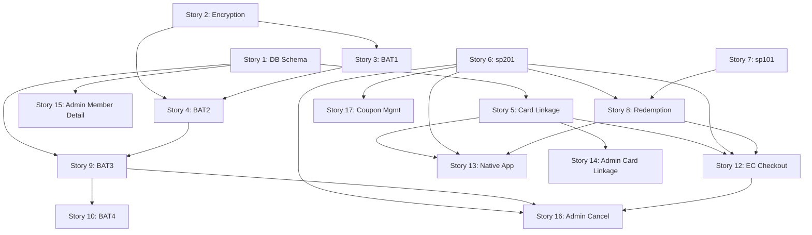

# WBS — CR5: V-Point Card Linkage

**Change Request:** CR5 — V-Point Card Linkage & Redemption System  
**Project:** MrMax EC-CUBE 4.x Enhancement  
**Generated:** WBS-Import from Excel  
**Source:** docs/wbs/excel/cr5-vpoint-card-linkage.xlsx  
**SRS:** docs/srs/CR5-Requirement-Specification.md  

---

## Summary

| Metric | Value |
|--------|-------|
| Total Stories | 23 |
| Total Sub-tasks | 189 |
| Phase 1 (Foundation + Core) | Stories 1–11 |
| Phase 2 (EC + Admin + Enhancements) | Stories 12–19 |
| Phase 3 (Testing + Security + Docs) | Stories 20–23 |
| Phase 1 STG1 Target | 2026-06-25 |
| Phase 2 STG1 Target | 2026-07-24 |
| Phase 3 STG1 Target | 2026-08-14 |

### Team Allocation

| Developer | Role | Phase 1 Stories | Phase 2 Stories | Phase 3 Stories |
|-----------|------|-----------------|-----------------|-----------------|
| Dev 1 (Shakhawat) | BAT/Infra | 3, 4 | — | 22, 23 |
| Dev 2 (Joy) | API/Schema | 1, 2, 5, 6 | 14, 15 | 20 |
| Dev 3 (Shahriar) | Services/EC | 7, 8 | 12, 13 | — |
| Dev 4 (Pavel) | BAT/Admin | 9, 10 | 16, 17, 18 | 21 |
| All Devs | Bug Fixing | 11 | 19 | — |

---

## Stories

### Story 1: Database Schema Design & Creation
**Type:** Story | **Priority:** H | **Points:** 13 | **Sprint:** 1
**Assignee:** Dev 2 (Joy) | **Status:** Pending

#### Story Overview
This story establishes the complete database foundation for the CR5 V-Point & Credit Card Linkage Integration. It includes creation of five new tables (`dct_vpoint_redeem_result`, `dtb_customer_card_info`, `dtb_affiliated_card_info`, `dtb_card_application_info`, `dct_vpoint_exchanges`), alteration of the existing `dct_coupon_target` table to add a `serial_no` column, insertion of the master coupon record (`coupon_id=999999990001`), and addition of `ext_attr_text3` to `dtb_customer`. All date/time columns in internal EC tables use UTC; the `serial_no` transaction date component uses JST. The `dct_vpoint_redeem_result` table is central to the entire V-Point redemption lifecycle — storing sp201 request/response parameters, cancel status state machine (0–5), and BAT3/BAT4 recovery data. The `dtb_customer_card_info` table enforces a one-active-card-per-member constraint (`is_valid=1`). The `dct_vpoint_exchanges` table is seeded with 9 exchange denominations used by both EC and Native App flows. All schema changes are delivered as manual SQL scripts — no Doctrine migrations. Dummy data preparation covers all 18 case scenarios from the SRS DB Sample Data matrix. Composite indexes on `dct_vpoint_redeem_result` support BAT3 eligibility queries (`cancel_status` + `error_cd`) and unique constraints on `serial_no` + `retry_cnt` + `point_kbn`.
- **Linked Requirements:** SRS §3.1–3.5, §12 (DB Sample Data), §12a (Timezone Reference), §15 (Key Constants), §2.6 (SQL Required), §2.9 (Coupon Master Record)
- **Affected Components:** `Entity/VpointRedeemResult.php`, `Entity/VpointExchange.php`, `Entity/CouponTarget.php` (modify), manual SQL scripts
- **Scope:** Backend
- **Associated Epic:** CR5 — V-Point & Credit Card Linkage Integration

#### Sub-task List
- [ ] 1.1 — Create dct_vpoint_redeem_result table (Backend, 8h)
- [ ] 1.2 — Create dtb_customer_card_info table (Backend, 6h)
- [ ] 1.3 — Create dtb_affiliated_card_info table (Backend, 8h)
- [ ] 1.4 — Dummy Data Prepare (Backend, 8h)
- [ ] 1.5 — Create dtb_card_application_info table (Backend, 3h)
- [ ] 1.6 — Create dct_vpoint_exchanges table + 9 seed rows (Backend, 4h)
- [ ] 1.7 — Add ext_attr_text3, ALTER coupon_target, INSERT master coupon (Backend, 4h)
- [ ] 1.8 — Create indexes, gyotai_cd/tenpo_cd/denpyo_no fields (Backend, 4h)
- [ ] 1.9 — Write manual SQL migration scripts + verify against specs (Backend, 8h)
- [ ] 1.10 — BAT (Backend, 4h)

---
#### Sub-tasks:

##### Sub-task 1.1: Create dct_vpoint_redeem_result table
**Type:** Sub-task | **Estimate:** 8h | **Skill:** Backend
**Assignee:** Dev 2 (Joy) | **Status:** Pending
###### Summary
Create the `dct_vpoint_redeem_result` table with all 31 columns as specified in SRS §3.1. This is the core transactional table storing sp201 API request parameters, response return codes, cancel status state machine values, and BAT3/BAT4 recovery metadata. The table has a composite unique constraint on (`serial_no`, `retry_cnt`, `point_kbn`) — the redemption record (point_kbn=73) and cancellation record (point_kbn=74) share the same `serial_no`. All internal date/time fields (`shori_date`, `shori_time`, `eigyou_date`, `create_date`, `update_date`) store UTC values; the `serial_no` transaction date component uses JST.
###### Requirement Details
31 columns: `id` INT PK AUTO, `app_member_id` VARCHAR(13) NOT NULL, `alliance_cd` VARCHAR(4), `passwd` VARCHAR(4), `gyotai_cd` VARCHAR(8) (Native=00000001, EC=00000002), `tenpo_cd` VARCHAR(13) (favorite store, zero-padded), `kaiin_id_kbn` VARCHAR(2) (fixed: 10), `kaiin_id` VARCHAR(100), `ninsho_kbn` VARCHAR(1) (fixed: 0), `ninsho_code` VARCHAR(32) NULL, `shori_date` VARCHAR(8) UTC, `shori_time` VARCHAR(6) UTC, `eigyou_date` VARCHAR(8) UTC, `serial_no` VARCHAR(20) NOT NULL UNIQUE-composite, `register_no` VARCHAR(6) (fixed: 0001), `denpyo_no` VARCHAR(20), `retry_kbn` INT(1), `retry_cnt` SMALLINT(1) UNIQUE-composite, `point_kbn` INT(2) UNIQUE-composite (73=usage, 74=cancel), `cancel_kbn` INT(1), `moto_date` VARCHAR(8) NULL, `moto_serial_no` VARCHAR(20) NULL, `kangen_point` INT(8), `uriage_kin` VARCHAR(8) (fixed: 0), `return_cd` VARCHAR(2) NULL, `get_return_date` DATETIME, `create_date` DATETIME, `update_date` DATETIME, `cancel_status` SMALLINT(1) DEFAULT 0 (0–5), `error_cd` VARCHAR(3) NULL, `program_name` VARCHAR(1) (1–5).
- **Linked Requirements:** SRS §3.1, §12a (Timezone), §15 (Key Constants)
- **Affected Files:** SQL script, `Entity/VpointRedeemResult.php`
- **Scope:** Backend
###### Acceptance Criteria
- [ ] **Given** the SQL script is executed, **When** describing `dct_vpoint_redeem_result`, **Then** all 31 columns exist with correct types, sizes, nullability, and defaults as per SRS §3.1
- [ ] **Given** a record with `serial_no=A042605060000000001`, `retry_cnt=0`, `point_kbn=73`, **When** inserting another record with the same triple, **Then** a unique constraint violation is raised
- [ ] **Given** `cancel_status` column, **When** inserting a new record without specifying it, **Then** the default value is `0`
- [ ] **Given** `shori_date` and `shori_time` columns, **When** a record is created, **Then** values are stored in UTC format
###### Dependencies
| Dependency | Type | Details |
|-----------|------|---------|
| None | — | First sub-task; no upstream dependencies |
###### Definition of Done
- [ ] DDL script creates table with all 31 columns matching SRS §3.1 exactly
- [ ] Composite unique constraint on (`serial_no`, `retry_cnt`, `point_kbn`) verified
- [ ] `cancel_status` DEFAULT 0 confirmed
- [ ] Doctrine Entity `VpointRedeemResult.php` maps all columns with correct ORM annotations

---

##### Sub-task 1.2: Create dtb_customer_card_info table
**Type:** Sub-task | **Estimate:** 6h | **Skill:** Backend
**Assignee:** Dev 2 (Joy) | **Status:** Pending
###### Summary
Create the `dtb_customer_card_info` table with 12 columns to store card linkage history per member. This table enforces the business rule that only one record may have `is_valid=1` per `app_member_id` at any time. The column `card_dislinkaged_at` (confirmed spelling per C-Q-01) records the date/time of unlinking. The `birthday` field (VARCHAR 8, YYYYMMDD format) is used for authentication during card linkage.
###### Requirement Details
12 columns: `id` INT PK AUTO, `app_member_id` VARCHAR(13), `customer_number` VARCHAR(16), `member_group_number` VARCHAR(16), `mrmax_id` VARCHAR(16) (12-digit MrMax ID), `card_linkaged_dt` DATETIME, `card_dislinkaged_at` DATETIME (confirmed naming per C-Q-01), `is_valid` TINYINT(1) (1=active, 0=historical), `is_card_cancelled` TINYINT(1) (set by BAT2 data_type=20), `birthday` VARCHAR(8) YYYYMMDD, `create_date` DATETIME, `update_date` DATETIME. Constraint: only 1 `is_valid=1` per `app_member_id`.
- **Linked Requirements:** SRS §3.2, §2.1 (Card Linkage), §2.5 (SMCC File data_type=20/40), Resolved Q C-Q-01
- **Affected Files:** SQL script, Entity class
- **Scope:** Backend
###### Acceptance Criteria
- [ ] **Given** a member with `app_member_id=28000000001` and an existing `is_valid=1` record, **When** a new card linkage is created, **Then** the old record is set to `is_valid=0` before the new `is_valid=1` record is inserted
- [ ] **Given** the table schema, **When** inspecting the `card_dislinkaged_at` column, **Then** the column name matches exactly (not `card_dislinkaged_dt`)
- [ ] **Given** `is_card_cancelled=0`, **When** BAT2 processes a `data_type=20` (cancellation) record, **Then** `is_card_cancelled` is set to `1` and `is_valid` to `0`
###### Dependencies
| Dependency | Type | Details |
|-----------|------|---------|
| None | — | Independent table creation |
###### Definition of Done
- [ ] DDL script creates table with all 12 columns matching SRS §3.2
- [ ] Application-level constraint enforcing 1 `is_valid=1` per `app_member_id` documented
- [ ] Column `card_dislinkaged_at` named correctly (not `_dt`)

---

##### Sub-task 1.3: Create dtb_affiliated_card_info table
**Type:** Sub-task | **Estimate:** 8h | **Skill:** Backend
**Assignee:** Dev 2 (Joy) | **Status:** Pending
###### Summary
Create the `dtb_affiliated_card_info` table with 30+ columns to store SMCC-provided credit card member master data. This table is populated and updated daily by BAT2 from SMCC SFTP file imports across 5 data types (10=New, 20=Cancel, 30=Change, 40=Reissue, 50=Update). The `birthday` field (YYYYMMDD) is used for birthday authentication during card linkage. The full column list is derived from the original SMCC specification (`dtb_affiliated_card_info.pdf`).
###### Requirement Details
30+ columns including: `customer_number`, `member_group_number`, `mrmax_id`, `data_type` (10/20/30/40/50), member name (kanji/kana), `sex` (1/2), `birthday` (YYYYMMDD), address fields, phone, `card_expiry_date`, `member_type`, `application_date`, status flags, `create_date`, `update_date`. Data types 30 (Change) update address/name only; type 40 (Reissue) creates new record with new mrmax_id; type 50 (Update) refreshes expiry/renewal.
- **Linked Requirements:** SRS §3.3, §2.5 (SMCC File Data Types), §6.1 (BAT2 Validation Rules)
- **Affected Files:** SQL script, Entity class
- **Scope:** Backend
###### Acceptance Criteria
- [ ] **Given** the DDL script, **When** executed, **Then** all 30+ columns are created with types matching the SMCC specification
- [ ] **Given** `data_type=10` records from BAT2, **When** imported, **Then** all required fields (●) are populated
- [ ] **Given** a `birthday` field, **When** queried for authentication, **Then** the value is in YYYYMMDD format
###### Dependencies
| Dependency | Type | Details |
|-----------|------|---------|
| None | — | Independent table creation |
###### Definition of Done
- [ ] DDL script creates table with all columns matching SMCC specification
- [ ] Column types and sizes support EBCDIC→UTF-8 converted data from BAT2
- [ ] Entity class maps all columns with ORM annotations

---

##### Sub-task 1.4: Dummy Data Prepare
**Type:** Sub-task | **Estimate:** 8h | **Skill:** Backend
**Assignee:** Dev 2 (Joy) | **Status:** Pending
###### Summary
Prepare comprehensive dummy/seed data covering all 18 case scenarios from the SRS §12 DB Sample Data matrix. This includes records for both Native (cases 1–8, 17) and EC (cases 9–16, 18) flows, spanning all `cancel_status` values (0–5), all program_name values (1–5), sp201 success/failure paths, sp201 Cancel code types 1–3, retry sequences, and BAT3/BAT4 file transmission cases. Common values use the reference data from SRS §12.1 (e.g., `kaiin_id_kbn=10`, `ninsho_kbn=0`, `register_no=0001`, `uriage_kin=0`). Also includes seed data for `dtb_customer_card_info`, `dtb_affiliated_card_info`, and `dtb_card_application_info` to support development and testing.
###### Requirement Details
18 case scenarios from SRS §12.1 DB Sample Data matrix covering: Cases 1–8 (Native: sp201 → Cancel → Retry1 → Retry2 × CodeType1/3 vs CodeType2/4), Cases 9–16 (EC: same matrix), Cases 17–18 (file transmission cases for BAT3/BAT4). Each case requires records with appropriate `point_kbn` (73/74), `retry_cnt` (0/1/2), `cancel_status` progression, and `return_cd` values. Serial number format: `A03` (Native) / `A04` (EC) + YYMMDD(JST) + 11-digit sequence.
- **Linked Requirements:** SRS §12.1 (Case Matrix), §15 (Key Constants), §12a (Timezone Reference)
- **Affected Files:** SQL seed scripts
- **Scope:** Backend
###### Acceptance Criteria
- [ ] **Given** all 18 case scenarios from SRS §12.1, **When** seed data is inserted, **Then** each case has representative records with correct `cancel_status`, `point_kbn`, `retry_cnt`, and `return_cd` values
- [ ] **Given** Native cases (1–8), **When** queried, **Then** `serial_no` prefix is `A03` and `gyotai_cd=00000001`
- [ ] **Given** EC cases (9–16), **When** queried, **Then** `serial_no` prefix is `A04` and `gyotai_cd=00000002`
- [ ] **Given** file transmission cases (17–18), **When** queried, **Then** `cancel_status IN (3,4,5)` with appropriate `error_cd` values
###### Dependencies
| Dependency | Type | Details |
|-----------|------|---------|
| Sub-task 1.1 | Schema | `dct_vpoint_redeem_result` table must exist |
| Sub-task 1.2 | Schema | `dtb_customer_card_info` table must exist |
| Sub-task 1.3 | Schema | `dtb_affiliated_card_info` table must exist |
| Sub-task 1.5 | Schema | `dtb_card_application_info` table must exist |
###### Definition of Done
- [ ] Seed SQL scripts cover all 18 case scenarios
- [ ] Data uses correct constants (`kaiin_id_kbn=10`, `ninsho_kbn=0`, `register_no=0001`)
- [ ] Serial numbers follow format rules (A03/A04 prefix, JST date, sequential)
- [ ] Scripts are idempotent (safe to re-run)

---

##### Sub-task 1.5: Create dtb_card_application_info table
**Type:** Sub-task | **Estimate:** 3h | **Skill:** Backend
**Assignee:** Dev 2 (Joy) | **Status:** Pending
###### Summary
Create the `dtb_card_application_info` table to track daily SMCC file import counts by `data_type`. This table is populated by BAT2 after each file import run and provides the data source for the admin Card Linkage Summary screen (SRS §8.1). Each record represents one import run for a specific `data_type`, recording success and error counts.
###### Requirement Details
Columns: `id` INT PK AUTO, `import_date` DATE, `data_type` (10/20/30/40/50), `record_count` INT (records imported), `error_count` INT (records failed validation), `create_date` DATETIME. Used by admin Card Linkage Summary for daily/weekly/monthly aggregation with date range filter (default: current month 1st → today, max span: 366 days).
- **Linked Requirements:** SRS §3.4, §8.1 (Admin Card Linkage Summary)
- **Affected Files:** SQL script, Entity class
- **Scope:** Backend
###### Acceptance Criteria
- [ ] **Given** the DDL script, **When** executed, **Then** the table is created with all columns matching SRS §3.4
- [ ] **Given** a BAT2 import run, **When** 100 records of `data_type=10` are processed with 5 errors, **Then** a record is insertable with `record_count=100`, `error_count=5`
###### Dependencies
| Dependency | Type | Details |
|-----------|------|---------|
| None | — | Independent table creation |
###### Definition of Done
- [ ] DDL script creates table matching SRS §3.4
- [ ] Entity class maps all columns

---

##### Sub-task 1.6: Create dct_vpoint_exchanges table + 9 seed rows
**Type:** Sub-task | **Estimate:** 4h | **Skill:** Backend
**Assignee:** Dev 2 (Joy) | **Status:** Pending
###### Summary
Create the `dct_vpoint_exchanges` master table with 5 columns and seed 9 exchange denomination rows. This table drives the V-Point exchange buttons on both the Native App and EC checkout screens. The "All" option (すべて) is listed first, followed by ascending denominations from ¥100 to ¥10,000. Note the intentional spelling of `display_staus` in the column name (confirmed per SRS).
###### Requirement Details
5 columns per SRS. 9 seed rows: すべて (All), ¥100, ¥300, ¥500, ¥1,000, ¥3,000, ¥5,000, ¥10,000, ¥30,000, ¥50,000. Column `display_staus` uses intentional spelling (not a typo — preserved for compatibility). Native API returns all 9 buttons; mobile app shows 3 by default with accordion expand to 9. Exchange rate: 1pt = ¥1.
- **Linked Requirements:** SRS §2.6 (SQL Required — T2), §2.7 (Native App Exchange Flow), §15 (Exchange rate)
- **Affected Files:** SQL script, `Entity/VpointExchange.php`, `Repository/VpointExchangeRepository.php`
- **Scope:** Backend
###### Acceptance Criteria
- [ ] **Given** the seed SQL, **When** executed, **Then** exactly 9 rows exist with correct amounts and display order ("All" first, then ascending)
- [ ] **Given** the table schema, **When** inspecting column names, **Then** `display_staus` is spelled as specified (intentional)
- [ ] **Given** the Entity class, **When** querying all exchanges sorted by display order, **Then** results match: すべて, ¥100, ¥300, ¥500, ¥1,000, ¥3,000, ¥5,000, ¥10,000, ¥30,000, ¥50,000
###### Dependencies
| Dependency | Type | Details |
|-----------|------|---------|
| None | — | Independent table creation |
###### Definition of Done
- [ ] DDL + INSERT script creates table and seeds 9 rows
- [ ] Entity `VpointExchange.php` maps all 5 columns
- [ ] Repository provides sorted query method

---

##### Sub-task 1.7: Add ext_attr_text3, ALTER coupon_target, INSERT master coupon
**Type:** Sub-task | **Estimate:** 4h | **Skill:** Backend
**Assignee:** Dev 2 (Joy) | **Status:** Pending
###### Summary
Three related schema modifications: (1) Ensure `dtb_customer.ext_attr_text3` VARCHAR(13) is available for `app_member_id` storage — this is the immutable link between EC member and card linkage data. (2) ALTER `dct_coupon_target` to add `serial_no` VARCHAR(20) NULL — linking coupon records to `dct_vpoint_redeem_result` for the V-Point redemption lifecycle. (3) INSERT the master coupon record into `dcm_coupon` with `coupon_id=999999990001`, `type1=3` (Automatic), `scope=1` (Common), `number_of_use=1`, `discount_type=1` (DISCOUNT_PRICE), `discount_price=0` (dynamic — actual discount read from `dct_vpoint_redeem_result.kangen_point` at runtime by `CouponDiscountProcess`).
###### Requirement Details
- `dtb_customer.ext_attr_text3`: VARCHAR(13), immutable once assigned, used as FK reference by `dtb_customer_card_info` and `dct_vpoint_redeem_result` (SRS §3.5)
- `dct_coupon_target.serial_no`: VARCHAR(20) NULL, links coupon to redeem result (SRS §2.6 SQL — T3)
- `dcm_coupon` master record: `coupon_id=999999990001`, `type1=3`, `type2=1`, `scope=1`, `number_of_use=1`, `discount_type=1`, `discount_price=0` (SRS §2.9 Coupon Master Record)
- **Linked Requirements:** SRS §3.5, §2.6 (T3 SQL), §2.9 (Coupon Master Record), §2.6 (T10 — CouponDiscountProcess)
- **Affected Files:** SQL ALTER/INSERT scripts, `Entity/CouponTarget.php` (modify — add `serial_no` property + ORM mapping)
- **Scope:** Backend
###### Acceptance Criteria
- [ ] **Given** `dtb_customer`, **When** inspecting schema, **Then** `ext_attr_text3` column exists as VARCHAR(13)
- [ ] **Given** `dct_coupon_target`, **When** inspecting schema, **Then** `serial_no` VARCHAR(20) NULL column exists
- [ ] **Given** `dcm_coupon`, **When** querying `coupon_id=999999990001`, **Then** record exists with `type1=3`, `scope=1`, `discount_price=0`
- [ ] **Given** the modified `Entity/CouponTarget.php`, **When** accessing `$couponTarget->getSerialNo()`, **Then** the `serial_no` value is returned
###### Dependencies
| Dependency | Type | Details |
|-----------|------|---------|
| Existing `dct_coupon_target` table | Schema | Table must exist for ALTER |
| Existing `dcm_coupon` table | Schema | Table must exist for INSERT |
###### Definition of Done
- [ ] ALTER and INSERT SQL scripts execute without error
- [ ] `Entity/CouponTarget.php` updated with `serial_no` property and ORM annotation
- [ ] Master coupon record verified in database

---

##### Sub-task 1.8: Create indexes, gyotai_cd/tenpo_cd/denpyo_no fields
**Type:** Sub-task | **Estimate:** 4h | **Skill:** Backend
**Assignee:** Dev 2 (Joy) | **Status:** Pending | **Verification:** 46h
###### Summary
Create composite indexes on `dct_vpoint_redeem_result` to support critical query patterns: BAT3 eligibility query (`cancel_status` + `error_cd` for records with `cancel_status=2` OR `cancel_status=5 AND error_cd IN (521,...,550)`), admin search by `serial_no` and `app_member_id`, and performance optimization for the cancel status state machine transitions. Verify field specifications for `gyotai_cd` VARCHAR(8) (v4: Native=00000001, EC=00000002), `tenpo_cd` VARCHAR(13) (favorite store code, left-zero-padded), and `denpyo_no` VARCHAR(20) (EC=order number left-zero-padded, Native=0-padded). The 46h verification effort covers cross-referencing all column definitions against the CCCMK specification.
###### Requirement Details
Index candidates: (1) `idx_cancel_status_error` on (`cancel_status`, `error_cd`) — BAT3 query: `WHERE cancel_status=2 OR (cancel_status=5 AND error_cd IN (...))`. (2) `idx_serial_no` on (`serial_no`) — admin search + BAT4 SE file matching. (3) `idx_app_member_id` on (`app_member_id`) — member lookup. Field specs: `gyotai_cd` differentiates Native (00000001) vs EC (00000002) per v4 update; `tenpo_cd` stores favorite store code left-zero-padded to 13 chars (0-padded if no favorite); `denpyo_no` stores EC order number left-zero-padded or 0-padded for Native.
- **Linked Requirements:** SRS §3.1 (Column specs), §4.1 (BAT3 query), §4.2 (BAT4 serial_no matching), §8.3 (Admin search)
- **Affected Files:** SQL index creation scripts
- **Scope:** Backend
###### Acceptance Criteria
- [ ] **Given** BAT3 eligibility query `WHERE cancel_status=2 OR (cancel_status=5 AND error_cd IN (521,...,550))`, **When** EXPLAIN is run, **Then** the composite index is used
- [ ] **Given** admin search by `serial_no`, **When** query is executed, **Then** index scan is used (not full table scan)
- [ ] **Given** `gyotai_cd` field, **When** a Native record is created, **Then** value is `00000001`; for EC, `00000002`
###### Dependencies
| Dependency | Type | Details |
|-----------|------|---------|
| Sub-task 1.1 | Schema | `dct_vpoint_redeem_result` table must exist |
###### Definition of Done
- [ ] Index DDL scripts execute without error
- [ ] EXPLAIN plans confirm index usage for BAT3 and admin queries
- [ ] Field value conventions documented and verified against CCCMK spec

---

##### Sub-task 1.9: Write manual SQL migration scripts + verify against specs
**Type:** Sub-task | **Estimate:** 8h | **Skill:** Backend
**Assignee:** Dev 2 (Joy) | **Status:** Pending
###### Summary
Consolidate all DDL/DML from sub-tasks 1.1–1.8 into production-ready manual SQL migration scripts. No Doctrine migrations are used — all schema changes are delivered as raw SQL per project convention. Scripts must be idempotent (safe to re-run), ordered for dependency resolution, and verified against the SRS §3.1–3.5 specifications. Includes rollback scripts for each change. Each script is annotated with the SRS section reference and sub-task number for traceability.
###### Requirement Details
Scripts to produce: (1) CREATE TABLE `dct_vpoint_redeem_result` (31 cols), (2) CREATE TABLE `dtb_customer_card_info` (12 cols), (3) CREATE TABLE `dtb_affiliated_card_info` (30+ cols), (4) CREATE TABLE `dtb_card_application_info`, (5) CREATE TABLE `dct_vpoint_exchanges` + 9 INSERTs, (6) ALTER `dct_coupon_target` ADD `serial_no`, (7) INSERT `dcm_coupon` master record, (8) CREATE INDEX statements, (9) Seed data script. Each script includes `IF NOT EXISTS` / `IF EXISTS` guards for idempotency.
- **Linked Requirements:** SRS §3.1–3.5, Project convention (no Doctrine migrations)
- **Affected Files:** `schema/` or designated SQL directory
- **Scope:** Backend
###### Acceptance Criteria
- [ ] **Given** a clean database, **When** all scripts are executed in order, **Then** the complete CR5 schema is created without errors
- [ ] **Given** an already-migrated database, **When** scripts are re-run, **Then** no errors occur (idempotent)
- [ ] **Given** each script, **When** reviewed, **Then** it contains SRS section reference and sub-task traceability
###### Dependencies
| Dependency | Type | Details |
|-----------|------|---------|
| Sub-tasks 1.1–1.8 | Schema | All individual DDL/DML must be finalized |
###### Definition of Done
- [ ] All SQL scripts consolidated and ordered
- [ ] Scripts verified against SRS §3.1–3.5 column-by-column
- [ ] Rollback scripts provided for each change
- [ ] Scripts tested on clean DB + existing DB (idempotency)

---

##### Sub-task 1.10: BAT
**Type:** Sub-task | **Estimate:** 4h | **Skill:** Backend
**Assignee:** Dev 2 (Joy) | **Status:** Pending
###### Summary
Create the Build Acceptance Test (BAT) document for Story 1, covering verification of all database schema changes. Test scenarios validate table creation, column specifications, constraints, indexes, seed data, and Entity/ORM mapping correctness for all 5 new tables, 1 altered table, and 1 master record insertion. Includes test cases for the `is_valid` constraint on `dtb_customer_card_info`, the composite unique key on `dct_vpoint_redeem_result`, and the 9 exchange denomination seed rows.
###### Requirement Details
BAT covers: (1) Table existence checks for all 5 new tables, (2) Column type/size/nullability verification against SRS §3.1–3.5, (3) Unique constraint test on (`serial_no`, `retry_cnt`, `point_kbn`), (4) `is_valid` constraint on `dtb_customer_card_info`, (5) Seed data verification (9 exchange rows, master coupon), (6) Index existence and usage verification, (7) Entity mapping round-trip tests (insert → read → verify all fields).
- **Linked Requirements:** SRS §3.1–3.5, §11 (Acceptance Test Cases)
- **Affected Files:** BAT document
- **Scope:** Backend
###### Acceptance Criteria
- [ ] **Given** the BAT document, **When** reviewed, **Then** it covers all tables, columns, constraints, indexes, and seed data from sub-tasks 1.1–1.9
- [ ] **Given** each BAT test case, **When** executed against the deployed schema, **Then** all pass
###### Dependencies
| Dependency | Type | Details |
|-----------|------|---------|
| Sub-tasks 1.1–1.9 | All | All schema work must be complete |
###### Definition of Done
- [ ] BAT document covers all Story 1 deliverables
- [ ] All test cases executable and passing

---
---

---

### Story 2: AES-256-CBC Encryption/Decryption Service
**Type:** Story | **Priority:** H | **Points:** 5 | **Sprint:** 1
**Assignee:** Dev 2 (Joy) | **Status:** Pending

#### Story Overview
This story implements the AES-256-CBC encryption and decryption service required for all CCCMK V-Point API communications (sp101 balance inquiry and sp201 point usage/cancel). The encryption scheme uses a CCCMK-issued key that undergoes MD5 key expansion (hash → repeat to 32 bytes) to produce the 256-bit AES key, combined with a fixed initialization vector (also CCCMK-issued) and PKCS5Padding. Ciphertext is Base64-encoded and then URL-encoded when used in API query strings. The service must exactly reproduce the CCCMK test vector: plaintext `1234567890123450` with key `ABCDEF0123456789abcdef0123456789` and IV `abcdefghABCDEFGH` must produce ciphertext `OZwiVXUG6xvb51YHjG4XC/1l2DrMWW2dGyBTYPgxPoQ=` (URL-encoded: `OZwiVXUG6xvb51YHjG4XC%2f1l2DrMWW2dGyBTYPgxPoQ%3d`). This service is a foundational dependency for Stories 3 (sp101 Client) and 4 (sp201 Client), and transitively blocks all downstream V-Point redemption, checkout, and native app stories.
- **Linked Requirements:** SRS §5.1 (AES-256-CBC Encryption), §16 (Test Vector), §15 (Key Constants)
- **Affected Components:** `Service/Vpoint/VpointEncryptionService.php`
- **Scope:** Backend
- **Associated Epic:** CR5 — V-Point & Credit Card Linkage Integration

#### Sub-task List
- [ ] 2.1 — Implement EncryptionService (encrypt/decrypt) (Backend, 4h)
- [ ] 2.2 — Implement MD5 key expansion (hash → repeat to 32 bytes) (Backend, 4h)
- [ ] 2.3 — Base64, URL-encoding, PKCS5 padding (Backend, 2h)
- [ ] 2.4 — Unit tests with CCCMK test vectors (Backend, 2h)
- [ ] 2.5 — Integration test: encrypt → send → decrypt round-trip (Backend, 4h)
- [ ] 2.6 — BAT (Backend, 4h)

---
#### Sub-tasks:

##### Sub-task 2.1: Implement EncryptionService (encrypt/decrypt)
**Type:** Sub-task | **Estimate:** 4h | **Skill:** Backend
**Assignee:** Dev 2 (Joy) | **Status:** Pending
###### Summary
Implement the core `VpointEncryptionService` class under `app/Customize/Service/Vpoint/` with `encrypt(string $plaintext): string` and `decrypt(string $ciphertext): string` methods. The service uses PHP's `openssl_encrypt`/`openssl_decrypt` with `aes-256-cbc` cipher, the expanded 32-byte key (from sub-task 2.2), the fixed IV from configuration, and PKCS5Padding (equivalent to PKCS7 in OpenSSL). The key and IV are injected via constructor (sourced from AWS Secrets Manager / `.env` parameters) — never hardcoded. The service is registered as a Symfony DI service for injection into `VpointApiClient`.
###### Requirement Details
Algorithm: AES, Mode: CBC, Block length: 128-bit, Key length: 256-bit (32 bytes after expansion). IV: fixed value issued by CCCMK (16 bytes). Padding: PKCS5Padding (= PKCS7 for 128-bit blocks). PHP implementation uses `openssl_encrypt($plaintext, 'aes-256-cbc', $expandedKey, OPENSSL_RAW_DATA, $iv)`. Key and IV sourced from environment configuration, not hardcoded.
- **Linked Requirements:** SRS §5.1 (Encryption Specification)
- **Affected Files:** `app/Customize/Service/Vpoint/VpointEncryptionService.php`
- **Scope:** Backend
###### Acceptance Criteria
- [ ] **Given** plaintext `1234567890123450`, key `ABCDEF0123456789abcdef0123456789`, IV `abcdefghABCDEFGH`, **When** `encrypt()` is called, **Then** Base64 output equals `OZwiVXUG6xvb51YHjG4XC/1l2DrMWW2dGyBTYPgxPoQ=`
- [ ] **Given** ciphertext `OZwiVXUG6xvb51YHjG4XC/1l2DrMWW2dGyBTYPgxPoQ=`, **When** `decrypt()` is called with the same key/IV, **Then** plaintext `1234567890123450` is returned
- [ ] **Given** the service class, **When** inspecting source code, **Then** no key or IV values are hardcoded — all injected via DI
###### Dependencies
| Dependency | Type | Details |
|-----------|------|---------|
| Sub-task 2.2 | Implementation | Key expansion logic provides the 32-byte key |
###### Definition of Done
- [ ] `VpointEncryptionService` class created with `encrypt()` and `decrypt()` methods
- [ ] Registered as Symfony DI service
- [ ] Key/IV injected via constructor parameters from configuration
- [ ] CCCMK test vector passes

---

##### Sub-task 2.2: Implement MD5 key expansion (hash → repeat to 32 bytes)
**Type:** Sub-task | **Estimate:** 4h | **Skill:** Backend
**Assignee:** Dev 2 (Joy) | **Status:** Pending
###### Summary
Implement the CCCMK-specified key expansion process within `VpointEncryptionService`. The process takes the issued encryption key value (A), applies MD5 hash to produce a 16-byte hash value (B), then repeats (B) to reach the required 256-bit (32-byte) key length — i.e., concatenate (B)+(B) to produce the actual encryption key (C). This non-standard key derivation is mandated by CCCMK and must be implemented exactly to match their server-side decryption.
###### Requirement Details
Key expansion steps per SRS §5.1: (1) Input: issued key string (A). (2) `$hashB = md5($keyA, true)` — raw 16-byte MD5 binary output. (3) `$keyC = $hashB . $hashB` — repeat to 32 bytes. (4) Use `$keyC` as the AES-256-CBC encryption key. The MD5 hash MUST produce raw binary output (not hex string). The repetition is simple concatenation (16 bytes × 2 = 32 bytes).
- **Linked Requirements:** SRS §5.1 (Key Expansion Process steps 1–4)
- **Affected Files:** `app/Customize/Service/Vpoint/VpointEncryptionService.php`
- **Scope:** Backend
###### Acceptance Criteria
- [ ] **Given** key `ABCDEF0123456789abcdef0123456789`, **When** MD5 key expansion is applied, **Then** the resulting 32-byte key produces the correct ciphertext when used with the test vector
- [ ] **Given** the expansion method, **When** called with any key string, **Then** the output is exactly 32 bytes (256 bits)
- [ ] **Given** the MD5 step, **When** inspecting implementation, **Then** raw binary MD5 is used (not hexadecimal string)
###### Dependencies
| Dependency | Type | Details |
|-----------|------|---------|
| Sub-task 2.1 | Integration | Key expansion is consumed by encrypt/decrypt methods |
###### Definition of Done
- [ ] Key expansion method produces exactly 32 bytes from any input key
- [ ] Uses raw binary MD5 (not hex)
- [ ] Test vector key expansion verified against CCCMK expected output

---

##### Sub-task 2.3: Base64, URL-encoding, PKCS5 padding
**Type:** Sub-task | **Estimate:** 2h | **Skill:** Backend
**Assignee:** Dev 2 (Joy) | **Status:** Pending
###### Summary
Implement the post-encryption encoding pipeline: (1) PKCS5Padding is handled internally by OpenSSL's `OPENSSL_RAW_DATA` flag + default PKCS7 padding (equivalent for 128-bit blocks). (2) Base64-encode the raw ciphertext bytes using `base64_encode()`. (3) URL-encode the Base64 string using `urlencode()` for inclusion in API query string parameters. Provide a convenience method `encryptForApi(string $plaintext): string` that chains encrypt → base64 → urlencode. Also provide `decryptFromApi(string $urlEncodedCiphertext): string` that reverses the pipeline.
###### Requirement Details
Encoding pipeline per SRS §5.1: Plaintext → AES-256-CBC(PKCS5) → Base64 → URL-encode. Test vector verification: Base64 = `OZwiVXUG6xvb51YHjG4XC/1l2DrMWW2dGyBTYPgxPoQ=`, URL-encoded = `OZwiVXUG6xvb51YHjG4XC%2f1l2DrMWW2dGyBTYPgxPoQ%3d`. Note: PHP's `urlencode()` encodes `/` as `%2f` and `=` as `%3d` (lowercase hex), matching the expected output.
- **Linked Requirements:** SRS §5.1 (Encryption Steps 3–4), §16 (Test Vector URL-encoded output)
- **Affected Files:** `app/Customize/Service/Vpoint/VpointEncryptionService.php`
- **Scope:** Backend
###### Acceptance Criteria
- [ ] **Given** raw ciphertext bytes from encryption, **When** Base64-encoded, **Then** output matches `OZwiVXUG6xvb51YHjG4XC/1l2DrMWW2dGyBTYPgxPoQ=`
- [ ] **Given** Base64 string, **When** URL-encoded, **Then** output matches `OZwiVXUG6xvb51YHjG4XC%2f1l2DrMWW2dGyBTYPgxPoQ%3d`
- [ ] **Given** `encryptForApi()`, **When** called with test vector plaintext, **Then** full pipeline output matches URL-encoded test vector
###### Dependencies
| Dependency | Type | Details |
|-----------|------|---------|
| Sub-task 2.1 | Integration | Builds on encrypt/decrypt core |
###### Definition of Done
- [ ] `encryptForApi()` and `decryptFromApi()` methods implemented
- [ ] URL-encoded output matches CCCMK test vector exactly
- [ ] PKCS5/PKCS7 equivalence verified for 128-bit block size

---

##### Sub-task 2.4: Unit tests with CCCMK test vectors
**Type:** Sub-task | **Estimate:** 2h | **Skill:** Backend
**Assignee:** Dev 2 (Joy) | **Status:** Pending
###### Summary
Write PHPUnit unit tests for `VpointEncryptionService` covering: (1) Test vector exact match — plaintext `1234567890123450` with specified key/IV must produce exactly `OZwiVXUG6xvb51YHjG4XC/1l2DrMWW2dGyBTYPgxPoQ=` (Base64) and `OZwiVXUG6xvb51YHjG4XC%2f1l2DrMWW2dGyBTYPgxPoQ%3d` (URL-encoded). (2) Round-trip: encrypt → decrypt returns original plaintext. (3) Key expansion: MD5 produces 32-byte key. (4) Edge cases: empty string, multibyte input, padding boundary (16-byte input exactly). (5) Negative: wrong key produces different output; wrong IV produces different output.
###### Requirement Details
Test vector from SRS §16: PT=`1234567890123450`, Key=`ABCDEF0123456789abcdef0123456789`, IV=`abcdefghABCDEFGH`, CT(base64)=`OZwiVXUG6xvb51YHjG4XC/1l2DrMWW2dGyBTYPgxPoQ=`, CT(url)=`OZwiVXUG6xvb51YHjG4XC%2f1l2DrMWW2dGyBTYPgxPoQ%3d`.
- **Linked Requirements:** SRS §5.1, §16 (Test Vector)
- **Affected Files:** `tests/` or `codeception/` test directory
- **Scope:** Backend
###### Acceptance Criteria
- [ ] **Given** the test vector, **When** unit test runs, **Then** exact match on both Base64 and URL-encoded outputs
- [ ] **Given** arbitrary plaintext, **When** encrypt → decrypt round-trip, **Then** original plaintext is recovered
- [ ] **Given** wrong key, **When** encrypt is called, **Then** output differs from test vector ciphertext
- [ ] **Given** 16-byte plaintext (block boundary), **When** encrypted, **Then** PKCS5 padding adds a full block and decrypt recovers original
###### Dependencies
| Dependency | Type | Details |
|-----------|------|---------|
| Sub-tasks 2.1–2.3 | Implementation | Encryption service must be complete |
###### Definition of Done
- [ ] All unit tests pass with PHPUnit
- [ ] Test vector exact match verified
- [ ] Round-trip test covers multiple input lengths
- [ ] Edge cases (empty, multibyte, block boundary) covered

---

##### Sub-task 2.5: Integration test: encrypt → send → decrypt round-trip
**Type:** Sub-task | **Estimate:** 4h | **Skill:** Backend
**Assignee:** Dev 2 (Joy) | **Status:** Pending
###### Summary
Create integration tests that verify the encryption service works correctly in the context of actual API request construction. Simulate the full flow: construct sp101/sp201 query parameters → encrypt sensitive fields (`kaiin_id`, etc.) using `encryptForApi()` → build URL-encoded query string → parse the query string → `decryptFromApi()` each encrypted parameter → verify original values recovered. This validates that the encoding pipeline survives HTTP transport (URL encoding/decoding) and that the service integrates correctly with the `VpointApiClient` request builder pattern.
###### Requirement Details
Integration flow: (1) Build mock sp101 request with `kaiin_id` value. (2) Encrypt via `encryptForApi()`. (3) Construct query string: `?kaiin_id={encrypted}`. (4) Parse query string with `urldecode()`. (5) Decrypt via `decryptFromApi()`. (6) Assert original `kaiin_id` value recovered. Test with realistic field values (13-char `app_member_id`, 100-char `kaiin_id`). Verify no data corruption through the URL encode/decode cycle.
- **Linked Requirements:** SRS §5.1, §2.8 (API Sequence — encrypted params)
- **Affected Files:** Integration test files
- **Scope:** Backend
###### Acceptance Criteria
- [ ] **Given** a realistic `kaiin_id` value, **When** encrypted → URL-encoded → URL-decoded → decrypted, **Then** the original value is exactly recovered
- [ ] **Given** multiple encrypted parameters in a query string, **When** parsed and decrypted, **Then** all original values are recovered without cross-contamination
- [ ] **Given** the encryption service injected into a mock `VpointApiClient`, **When** a request is built, **Then** encrypted parameters are correctly formatted for CCCMK API consumption
###### Dependencies
| Dependency | Type | Details |
|-----------|------|---------|
| Sub-tasks 2.1–2.3 | Implementation | Encryption service must be complete |
| Sub-task 2.4 | Verification | Unit tests should pass first |
###### Definition of Done
- [ ] Integration tests pass with realistic API parameter values
- [ ] Round-trip through URL encode/decode cycle verified
- [ ] No data corruption for multibyte or special characters

---

##### Sub-task 2.6: BAT
**Type:** Sub-task | **Estimate:** 4h | **Skill:** Backend
**Assignee:** Dev 2 (Joy) | **Status:** Pending
###### Summary
Create the Build Acceptance Test (BAT) document for Story 2, covering verification of the complete AES-256-CBC encryption/decryption service. Test scenarios validate: CCCMK test vector exact match (both Base64 and URL-encoded outputs), MD5 key expansion correctness (16-byte hash → 32-byte key), PKCS5 padding behavior, round-trip integrity, API query string survivability, and service DI registration. The BAT also verifies that no encryption keys or IVs are hardcoded in source code.
###### Requirement Details
BAT test cases: (1) Test vector exact match — PT/Key/IV/CT from SRS §16. (2) Key expansion — verify 32-byte output from MD5. (3) Base64 output correctness. (4) URL-encoded output correctness. (5) Decrypt reversal. (6) Round-trip with realistic API parameters. (7) Security check — no hardcoded keys/IVs in source. (8) DI registration — service injectable via Symfony container.
- **Linked Requirements:** SRS §5.1, §16
- **Affected Files:** BAT document
- **Scope:** Backend
###### Acceptance Criteria
- [ ] **Given** the BAT document, **When** reviewed, **Then** it covers test vector, key expansion, encoding pipeline, round-trip, and security checks
- [ ] **Given** each BAT test case, **When** executed, **Then** all pass
###### Dependencies
| Dependency | Type | Details |
|-----------|------|---------|
| Sub-tasks 2.1–2.5 | All | All implementation and tests must be complete |
###### Definition of Done
- [ ] BAT document covers all Story 2 deliverables
- [ ] All test cases executable and passing
- [ ] Security verification (no hardcoded secrets) included

---

### Story 3 (SL3): BAT1 — SMCC File Retrieval (SFTP)

**Type:** Story | **Priority:** High | **Points:** 8 | **Sprint:** 2
**Assignee:** Dev 1 (Shakhawat) | **Status:** Pending

#### Story Overview

BAT1 is a scheduled batch command that retrieves SMCC credit card member data files from an external SFTP server every 30 minutes and stages them in AWS S3 for downstream processing by BAT2. The SFTP server runs on port 2222 with public-key authentication. Files are retrieved from `/mrmax-prod-apn1-smcc/smcc2ec/{DATE}/`, renamed with a retrieval timestamp for traceability, and uploaded to S3. SMCC transmits member data daily on business-day afternoons; the file uses fixed-length records encoded in EBCDIC (ANK) and IBM (Kanji). Zero-record files (header-only) are valid and must not be rejected. A monitoring window of 10:00–11:00 ensures operational visibility: if no file is retrieved during this window, a one-time Slack alert fires at 11:05. The command must handle SFTP connectivity failures gracefully with structured error logging and Slack alerts.

- **Linked Requirements:** SRS §2.5 (SMCC → MrMax File Transfer Flow), §4 (Batch Processing), §9.1 (Slack Alerts), §13 (Infrastructure)
- **Affected Components:** `Command/SmccFileRetrieveCommand.php`, SFTP infrastructure (phpseclib), AWS S3 SDK, Slack notification service
- **Scope:** Backend
- **Associated Epic:** CR5 — V-Point & Credit Card Linkage Integration

#### Sub-task List

- [ ] 3.1 — Implement SmccSftpClient with public key auth (phpseclib) (Backend, 8h)
- [ ] 3.2 — Implement BAT1 command: SFTP GET → S3 upload with rename (Backend, 4h)
- [ ] 3.3 — Implement 30-minute cron scheduling (Backend/Infra, 6h)
- [ ] 3.4 — Dummy Data Prepare [URI..DAT file] (Backend, 4h)
- [ ] 3.5 — Implement 10:00–11:00 window Slack alert (Backend, 4h)
- [ ] 3.6 — Handle SFTP errors + unit/integration tests (Backend, 8h)
- [ ] 3.7 — BAT (QA, 4h)

---

#### Sub-tasks:

##### Sub-task 3.1: Implement SmccSftpClient with public key auth (phpseclib)

**Type:** Sub-task | **Estimate:** 8h | **Verification:** 4h | **Skill:** Backend
**Assignee:** Dev 1 (Shakhawat) | **Status:** Pending

###### Summary

Create a reusable SFTP client service class that wraps `phpseclib3` to connect to the SMCC SFTP server using public-key authentication. The client must support configurable host, port (default 2222), username, and private key path. Connection credentials are loaded from environment parameters or AWS Secrets Manager. The client exposes methods for listing remote directories, downloading files, and checking file existence.

###### Requirement Details

Per SRS §2.5 and §13.1: SMCC SFTP server uses port 2222 with public-key authentication. The production user is `smcc-prod`. The remote directory path is `/mrmax-prod-apn1-smcc/smcc2ec/{DATE}/` where `{DATE}` is the current date. Two static IP addresses are whitelisted for outbound connections. The staging environment SFTP endpoint is TBD (port 22).

- **Affected Files:** `app/Customize/Service/Smcc/SmccSftpClient.php`, `app/Customize/DependencyInjection/` (service registration)

###### Acceptance Criteria

- [ ] **Given** valid SFTP credentials and a reachable server, **When** `SmccSftpClient::connect()` is called, **Then** an authenticated SFTP session is established using public-key auth on port 2222
- [ ] **Given** a remote directory path with date substitution, **When** `SmccSftpClient::listFiles()` is called, **Then** all files in `/mrmax-prod-apn1-smcc/smcc2ec/{DATE}/` are returned
- [ ] **Given** a valid remote file path, **When** `SmccSftpClient::download()` is called, **Then** the file content is returned as a stream or string
- [ ] **Given** an unreachable SFTP server, **When** connection is attempted, **Then** a meaningful exception is thrown with connection error details for upstream handling

###### Dependencies

| Dependency | Type | Details |
|-----------|------|---------|
| Story 17 — SFTP & HTTPS Infrastructure Setup | Blocks | SSH keys must be generated and deployed before SFTP client can authenticate |
| phpseclib3 composer package | Technical | Must be added to `composer.json` |

###### Definition of Done

- [ ] `SmccSftpClient` connects to SFTP via public-key auth (no password fallback)
- [ ] Host, port, user, key path are configurable via DI parameters
- [ ] Connection timeout is configurable (default 10s)
- [ ] Unit tests cover connect, list, download, and connection-failure scenarios
- [ ] No credentials hardcoded in source code

---

##### Sub-task 3.2: Implement BAT1 command: SFTP GET → S3 upload with rename

**Type:** Sub-task | **Estimate:** 4h | **Verification:** 2h | **Skill:** Backend
**Assignee:** Dev 1 (Shakhawat) | **Status:** Pending

###### Summary

Implement the Symfony console command `SmccFileRetrieveCommand` that orchestrates a single BAT1 run: connect to SMCC SFTP, list files in the date-specific directory, download each file, rename it with a retrieval timestamp suffix, and upload it to the designated S3 bucket. Zero-record (header-only) files must be uploaded without rejection. The command exits gracefully if no files are found.

###### Requirement Details

Per SRS §2.5: BAT1 retrieves files from `/mrmax-prod-apn1-smcc/smcc2ec/{DATE}/`. Files are renamed with a timestamp upon retrieval (e.g., `original_name_20260514103000.dat`) and uploaded to S3. Zero-record files (header + trailer + end, no data records) are valid and must be processed normally. The file encoding is EBCDIC (ANK) + IBM (Kanji) with fixed-length records structured as Header → Data → Trailer → End record — encoding conversion is NOT performed by BAT1 (deferred to BAT2).

- **Affected Files:** `app/Customize/Command/SmccFileRetrieveCommand.php`

###### Acceptance Criteria

- [ ] **Given** the SFTP directory contains one or more files, **When** BAT1 runs, **Then** each file is downloaded, renamed with a retrieval timestamp, and uploaded to the configured S3 bucket
- [ ] **Given** the SFTP directory contains a zero-record (header-only) file, **When** BAT1 runs, **Then** the file is uploaded to S3 without error
- [ ] **Given** the SFTP directory is empty, **When** BAT1 runs, **Then** the command exits with code 0 and logs "No files found"
- [ ] **Given** a file is successfully uploaded to S3, **When** the upload completes, **Then** structured log entry records: filename, size, retrieval timestamp, S3 key

###### Dependencies

| Dependency | Type | Details |
|-----------|------|---------|
| Sub-task 3.1 — SmccSftpClient | Blocks | SFTP client must be ready for file retrieval |
| AWS S3 SDK (already in project) | Technical | S3 client for upload |

###### Definition of Done

- [ ] Command registered as `app:smcc:file-retrieve` in Symfony console
- [ ] Rename pattern includes retrieval timestamp for uniqueness
- [ ] S3 upload uses server-side encryption (AES-256-SSE)
- [ ] Structured logging for each file retrieved

---

##### Sub-task 3.3: Implement 30-minute cron scheduling

**Type:** Sub-task | **Estimate:** 6h | **Verification:** 3h | **Skill:** Backend/Infra
**Assignee:** Dev 1 (Shakhawat) | **Status:** Pending

###### Summary

Configure the BAT1 command to run every 30 minutes via cron (ECS Scheduled Task or CloudWatch Events). This includes cron expression configuration, ECS task definition updates, idempotency safeguards to prevent overlapping runs, and environment-specific scheduling (production vs staging). A Redis-based distributed lock should prevent concurrent execution if two cron triggers overlap.

###### Requirement Details

Per SRS §2.5: BAT1 runs every 30 minutes. SMCC transmits files daily on business-day afternoons, but the batch runs continuously to capture files as soon as they appear. Per SRS §4.1 (BAT3 reference pattern): Redis distributed locks with a configurable TTL prevent concurrent execution.

- **Affected Files:** `taskdef-batch.json`, cron/scheduler configuration, `app/Customize/Command/SmccFileRetrieveCommand.php` (lock logic)

###### Acceptance Criteria

- [ ] **Given** the cron schedule is active, **When** 30 minutes elapse, **Then** BAT1 is triggered automatically
- [ ] **Given** a previous BAT1 run is still executing, **When** a new cron trigger fires, **Then** the new run acquires a Redis lock or skips execution with a warning log
- [ ] **Given** production and staging environments, **When** deployed, **Then** cron schedules are environment-specific and independently configurable

###### Dependencies

| Dependency | Type | Details |
|-----------|------|---------|
| Sub-task 3.2 — BAT1 command | Blocks | Command must exist before scheduling |
| Redis infrastructure | Technical | Required for distributed lock |
| ECS/CloudWatch | Infra | Scheduling infrastructure |

###### Definition of Done

- [ ] Cron runs every 30 minutes in production
- [ ] Redis distributed lock prevents concurrent execution (TTL configurable, default 15min)
- [ ] ECS task definition updated for batch container
- [ ] Lock acquisition/release logged

---

##### Sub-task 3.4: Dummy Data Prepare [URI..DAT file]

**Type:** Sub-task | **Estimate:** 4h | **Verification:** — | **Skill:** Backend
**Assignee:** Dev 1 (Shakhawat) | **Status:** Pending

###### Summary

Create sample SMCC data files in the `URIxxxxSPyy.DAT` naming convention with realistic fixed-length records covering all 5 data types (10/20/30/40/50). Files must use correct EBCDIC (ANK) + IBM (Kanji) encoding with proper Header → Data → Trailer → End record structure. Include edge cases: zero-record file (header-only), single-record file, multi-record file with mixed data types, and a file with intentionally invalid records for BAT2 validation testing.

###### Requirement Details

Per SRS §2.5: SMCC file encoding uses ANK=EBCDIC and Kanji=IBM. Record structure is Header → Data → Trailer → End record. Five data types exist: 10 (New), 20 (Cancel), 30 (Change), 40 (Reissue), 50 (Update). Zero-record files are valid. Field presence markers: ● required, ▲ set at entry, △ set on change, ー not set.

- **Affected Files:** Test fixture files in `tests/` or `data-s3/` directory

###### Acceptance Criteria

- [ ] **Given** the dummy data set, **When** used in integration tests, **Then** BAT1 can retrieve and BAT2 can parse all 5 data types
- [ ] **Given** a zero-record dummy file, **When** processed by BAT1/BAT2, **Then** no errors occur
- [ ] **Given** dummy files with invalid records, **When** BAT2 processes them, **Then** validation correctly excludes bad records

###### Definition of Done

- [ ] At least 6 dummy files created (one per data type + zero-record + mixed/invalid)
- [ ] Files use correct EBCDIC+IBM encoding
- [ ] Files follow Header → Data → Trailer → End structure
- [ ] Documented field layout and sample values

---

##### Sub-task 3.5: Implement 10:00–11:00 window Slack alert

**Type:** Sub-task | **Estimate:** 4h | **Verification:** 2h | **Skill:** Backend
**Assignee:** Dev 1 (Shakhawat) | **Status:** Pending

###### Summary

Implement monitoring logic that tracks whether BAT1 successfully retrieved at least one file during the 10:00–11:00 JST window. If no file was received by 11:05, send a single Slack alert to the `#cr5-alerts` channel. The alert must fire at most once per day, using a Redis flag or database record to track daily alert status.

###### Requirement Details

Per SRS §2.5 and §9.1: "If no file received during 10:00–11:00 window → Slack alert at 11:05." The alert message format is: `"WARN: SMCC file not received in 10:00–11:00 window"`. SMCC transmits daily on business-day afternoons, so this window serves as an early-warning for delayed transmissions. The alert is once-per-day (not per-run).

- **Affected Files:** `app/Customize/Command/SmccFileRetrieveCommand.php` (or a separate monitoring command), Slack notification service

###### Acceptance Criteria

- [ ] **Given** no file was retrieved between 10:00–11:00 JST, **When** the 11:05 check runs, **Then** a Slack alert is posted to `#cr5-alerts` with message "WARN: SMCC file not received in 10:00–11:00 window"
- [ ] **Given** the alert has already fired today, **When** the check runs again, **Then** no duplicate alert is sent
- [ ] **Given** a file was retrieved at 10:30, **When** the 11:05 check runs, **Then** no alert is sent
- [ ] **Given** the alert logic, **When** executed, **Then** timezone-aware comparison uses JST (Asia/Tokyo)

###### Dependencies

| Dependency | Type | Details |
|-----------|------|---------|
| Sub-task 3.2 — BAT1 command | Blocks | Must track file retrieval status |
| Slack webhook / notification service | Technical | Existing Slack integration in project |
| Redis | Technical | For daily alert dedup flag |

###### Definition of Done

- [ ] Slack alert fires once per day when no file received in window
- [ ] Redis key `bat1:alert:{YYYY-MM-DD}` (TTL 24h) prevents duplicates
- [ ] Time comparisons use JST timezone
- [ ] Alert includes date and window times for operator clarity

---

##### Sub-task 3.6: Handle SFTP errors + unit/integration tests

**Type:** Sub-task | **Estimate:** 8h | **Verification:** 5h | **Skill:** Backend
**Assignee:** Dev 1 (Shakhawat) | **Status:** Pending

###### Summary

Implement comprehensive error handling for all SFTP failure modes and write unit and integration tests for the entire BAT1 pipeline. Error scenarios include: connection refused, authentication failure, timeout, remote directory not found, partial download, S3 upload failure, and permission denied. Each error must produce a structured log entry and trigger a Slack alert to `#cr5-alerts`. Tests must cover the happy path (file retrieved → renamed → uploaded), empty directory, zero-record file, and all error scenarios.

###### Requirement Details

Per SRS §9.1: Slack message for SFTP errors is `"ERROR: SMCC SFTP connection failed: {error_details}"` posted to `#cr5-alerts`. Per SRS §2.5: BAT1 must handle all failure modes gracefully — a single file error must not prevent processing of remaining files. Structured logging per SRS §2.13 (v4): log fields include Program name, Return code, Timestamp.

- **Affected Files:** `app/Customize/Command/SmccFileRetrieveCommand.php`, `app/Customize/Service/Smcc/SmccSftpClient.php`, `tests/` (unit + integration test files)

###### Acceptance Criteria

- [ ] **Given** the SFTP server is unreachable, **When** BAT1 runs, **Then** a Slack alert is sent with connection error details and the command exits with a non-zero code
- [ ] **Given** authentication fails (wrong key), **When** BAT1 connects, **Then** an auth failure error is logged and Slack-alerted
- [ ] **Given** S3 upload fails for one file, **When** BAT1 processes multiple files, **Then** remaining files continue processing and failures are reported individually
- [ ] **Given** the full test suite, **When** `phpunit` runs BAT1 tests, **Then** all unit and integration tests pass with >80% code coverage on BAT1 components

###### Dependencies

| Dependency | Type | Details |
|-----------|------|---------|
| Sub-tasks 3.1–3.5 | Blocks | All BAT1 functionality must be implemented before comprehensive testing |

###### Definition of Done

- [ ] All SFTP error types handled: connection refused, auth failure, timeout, permission denied, partial download
- [ ] Each error produces structured log + Slack notification
- [ ] Unit tests for SmccSftpClient (mocked phpseclib)
- [ ] Integration tests for SmccFileRetrieveCommand (mocked SFTP + S3)
- [ ] Edge case tests: zero-record file, empty directory, S3 upload failure

---

##### Sub-task 3.7: BAT

**Type:** Sub-task | **Estimate:** 4h | **Skill:** QA
**Assignee:** Dev 1 (Shakhawat) | **Status:** Pending

###### Summary

Execute BAT (Business Acceptance Testing) for the BAT1 SFTP file retrieval pipeline against the staging environment. Verify end-to-end flow: cron-triggered execution → SFTP connection → file download → rename → S3 upload → Slack alerts. Validate against test cases TC-BAT-01 and TC-BAT-02 from SRS §11.3.

###### Requirement Details

Per SRS §11.3 TC-BAT-01: BAT1 retrieves file within normal window and posts Slack notification. Per TC-BAT-02: When no file is received during 10:00–11:00, a Slack alert fires at 11:05 (max once/day).

- **Affected Files:** N/A (test execution only)

###### Acceptance Criteria

- [ ] **Given** a file on the staging SFTP server, **When** BAT1 runs, **Then** the file appears in S3 with correct rename and encryption
- [ ] **Given** no file on the staging SFTP server during 10:00–11:00, **When** the 11:05 check fires, **Then** Slack alert is posted exactly once
- [ ] **Given** BAT1 running on a 30-minute schedule, **When** monitored over 2 hours, **Then** exactly 4 executions occur with no overlapping runs

###### Definition of Done

- [ ] TC-BAT-01 and TC-BAT-02 pass on staging
- [ ] BAT test report documented with evidence (screenshots/logs)
- [ ] No critical or high-severity defects outstanding

---
---

---

### Story 4 (SL4): BAT2 — SMCC Data Import & Validation

**Type:** Story | **Priority:** High | **Points:** 13 | **Sprint:** 2
**Assignee:** Dev 1 (Shakhawat) | **Status:** Pending

#### Story Overview

BAT2 is the data import batch command that processes SMCC credit card member files previously staged in S3 by BAT1. It converts file encoding from EBCDIC (ANK) + IBM (Kanji) to UTF-8, parses fixed-length records, and validates each record against 11 validation checks before importing to `dtb_affiliated_card_info` and `dtb_customer_card_info`. Five data types are handled: 10 (New) inserts new card member records, 20 (Cancel) marks cards as cancelled, 30 (Change) updates address/name fields, 40 (Reissue) invalidates old cards and activates new ones, and 50 (Update) updates expiry/renewal information. The system uses partial-success processing — a single invalid record is excluded but does not reject the entire file (unless file-level or header-level validation fails, which rejects the whole file). On completion, a Slack notification is posted with success/error counts; if insert/update errors occur, a CSV attachment is included where CSV headers use E14 message key parameters.

- **Linked Requirements:** SRS §2.5 (SMCC File Transfer Flow), §6.1 (BAT2 Import Validation), §9.1 (Slack Alerts), §3.3 (dtb_affiliated_card_info), §3.2 (dtb_customer_card_info), §3.4 (dtb_card_application_info)
- **Affected Components:** `Command/SmccDataImportCommand.php`, `Entity/AffiliatedCardInfo.php`, `Entity/CardApplicationInfo.php`, `Repository/CustomerCardInfoRepository.php`, Slack notification service
- **Scope:** Backend
- **Associated Epic:** CR5 — V-Point & Credit Card Linkage Integration

#### Sub-task List

- [ ] 4.1 — Implement SMCC file parser (EBCDIC+IBM → UTF-8) (Backend, 16h)
- [ ] 4.2 — Implement validation: data_type 10 (New) (Backend, 8h)
- [ ] 4.3 — Implement validation: data_type 20 (Cancel) (Backend, 8h)
- [ ] 4.4 — Implement validation: data_type 30/50 (Change/Update) (Backend, 4h)
- [ ] 4.5 — Implement validation: data_type 40 (Reissue) (Backend, 4h)
- [ ] 4.6 — Implement dtb_affiliated/customer_card_info updates (Backend, 16h)
- [ ] 4.7 — Implement Slack CSV notification (Backend, 8h)
- [ ] 4.8 — Unit tests for each data_type + edge cases (Backend, 4h)
- [ ] 4.9 — BAT (QA, 4h)

---

#### Sub-tasks:

##### Sub-task 4.1: Implement SMCC file parser (EBCDIC+IBM → UTF-8)

**Type:** Sub-task | **Estimate:** 16h | **Verification:** 8h | **Skill:** Backend
**Assignee:** Dev 1 (Shakhawat) | **Status:** Pending

###### Summary

Build a fixed-length file parser that reads SMCC data files from S3, converts character encoding from EBCDIC (ANK fields) and IBM (Kanji fields) to UTF-8, and extracts records into structured PHP objects. The parser must handle the record structure: Header → Data records → Trailer → End record. It must correctly split each fixed-length record into named fields based on byte offsets (not character counts, since multi-byte encoding causes byte/character length differences). Zero-record files (header + trailer + end, no data records) are valid and must produce an empty data array with a successful parse result.

###### Requirement Details

Per SRS §2.5: Character encoding is ANK=EBCDIC and Kanji=IBM. Record format is fixed-length. Record structure follows Header → Data → Trailer → End record. Zero-record files (header-only) are valid — file is sent even with 0 data records. Per SRS §6.1: File format validation (fixed-length per specification) and header presence are file-level checks that reject the entire file on failure.

- **Affected Files:** `app/Customize/Service/Smcc/SmccFileParser.php`, `app/Customize/Command/SmccDataImportCommand.php`

###### Acceptance Criteria

- [ ] **Given** an SMCC file with EBCDIC-encoded ANK fields, **When** parsed, **Then** all ANK fields are correctly converted to UTF-8
- [ ] **Given** an SMCC file with IBM-encoded Kanji fields, **When** parsed, **Then** all Kanji fields are correctly converted to UTF-8
- [ ] **Given** a file with Header + 5 Data + Trailer + End records, **When** parsed, **Then** 5 structured data records are returned with correct field values
- [ ] **Given** a zero-record file (header + trailer + end only), **When** parsed, **Then** an empty data array is returned with no errors
- [ ] **Given** a file with incorrect record length, **When** parsed, **Then** the entire file is rejected with a file-format validation error

###### Dependencies

| Dependency | Type | Details |
|-----------|------|---------|
| Sub-task 3.4 — Dummy data files | Soft | Dummy files provide test data for parser development |
| Story 1 — DB Schema | Blocks | `dtb_affiliated_card_info` schema defines target field mapping |
| PHP `mbstring` / `iconv` extension | Technical | Required for EBCDIC/IBM encoding conversion |

###### Definition of Done

- [ ] Parser handles EBCDIC (ANK) + IBM (Kanji) → UTF-8 conversion
- [ ] Fixed-length field extraction by byte offset (not character count)
- [ ] Header/Trailer/End record parsing extracts metadata (record count, dates)
- [ ] Zero-record file handled without error
- [ ] Malformed file (wrong record length) rejects entire file

---

##### Sub-task 4.2: Implement validation: data_type 10 (New)

**Type:** Sub-task | **Estimate:** 8h | **Verification:** 5h | **Skill:** Backend
**Assignee:** Dev 1 (Shakhawat) | **Status:** Pending

###### Summary

Implement record-level validation for data_type 10 (New member) records. A new record represents a first-time SMCC credit card applicant. Validation includes: all required fields (●) must be non-NULL, numeric fields contain digits only, character fields are left-aligned and space-padded, numeric fields are right-aligned and zero-padded, code values are within defined ranges, dates are valid YYYYMMDD format with no future dates, and duplicate check (no existing mrmax_id + customer_number combination for type=10). Invalid records are excluded from import but processing continues for remaining records.

###### Requirement Details

Per SRS §6.1: 11 validation checks apply at record level. For data_type=10: required fields (●) include customer_number, member_group_number, mrmax_id, name fields, birthday, address, etc. Per SRS §2.5 Card Linkage Status Decision Matrix: New (data_type=10) with EC member not registered → store in `dtb_affiliated_card_info` only. New with EC member registered → store + allow barcode linkage. Duplicate mrmax_id + customer_number for type=10 → exclude record.

- **Affected Files:** `app/Customize/Service/Smcc/SmccRecordValidator.php`, `app/Customize/Command/SmccDataImportCommand.php`

###### Acceptance Criteria

- [ ] **Given** a valid data_type=10 record with all required fields, **When** validated, **Then** the record passes validation and is queued for import
- [ ] **Given** a data_type=10 record with a missing required field (●), **When** validated, **Then** the record is excluded with error "required field missing: {field_name}"
- [ ] **Given** a data_type=10 record with a duplicate mrmax_id + customer_number, **When** validated, **Then** the record is excluded with a duplicate error
- [ ] **Given** a data_type=10 record with a future date in a date field, **When** validated, **Then** the record is excluded with date validation error
- [ ] **Given** 10 records where 2 fail validation, **When** processed, **Then** 8 records import successfully and 2 are excluded (partial success)

###### Dependencies

| Dependency | Type | Details |
|-----------|------|---------|
| Sub-task 4.1 — SMCC file parser | Blocks | Records must be parsed before validation |
| Story 1 — DB Schema | Blocks | `dtb_affiliated_card_info` must exist for duplicate checks |

###### Definition of Done

- [ ] All 11 validation checks implemented for data_type=10
- [ ] Excluded records logged with check number, field name, and value
- [ ] Partial success: valid records proceed, invalid records excluded
- [ ] Validation errors collected per record for Slack CSV attachment

---

##### Sub-task 4.3: Implement validation: data_type 20 (Cancel)

**Type:** Sub-task | **Estimate:** 8h | **Verification:** 5h | **Skill:** Backend
**Assignee:** Dev 1 (Shakhawat) | **Status:** Pending

###### Summary

Implement record-level validation for data_type 20 (Cancel) records. A cancel record indicates the member has cancelled their SMCC credit card. Validation includes required-field checks on member_number and mrmax_id, plus a correlation check: a valid existing card must exist in the system for the given customer. On successful validation, the card is marked `is_card_cancelled=1` and `is_valid=0` in `dtb_customer_card_info`.

###### Requirement Details

Per SRS §2.5 Card Linkage Status Decision Matrix: Cancel (data_type=20) with Registered + Linked member → set `is_card_cancelled=1`; `is_valid=0`. Per §6.1 validation check #10 (correlation): type=20 requires existing valid card in system — exclude record if no matching card found. Per §8.3 Admin Action Button Disable Rules: V-Point member card subscription cancelled via BAT2 (data_type=20) → all three admin action buttons disabled.

- **Affected Files:** `app/Customize/Service/Smcc/SmccRecordValidator.php`, `app/Customize/Repository/CustomerCardInfoRepository.php`

###### Acceptance Criteria

- [ ] **Given** a valid data_type=20 record matching an existing linked card, **When** processed, **Then** `dtb_customer_card_info.is_card_cancelled=1` and `is_valid=0`
- [ ] **Given** a data_type=20 record with no matching card in the system, **When** validated, **Then** the record is excluded with correlation error
- [ ] **Given** a data_type=20 record with missing mrmax_id, **When** validated, **Then** the record is excluded with required-field error
- [ ] **Given** a cancelled card, **When** admin views V-Point coupon info, **Then** Refund/Approve/Cancel buttons are disabled

###### Dependencies

| Dependency | Type | Details |
|-----------|------|---------|
| Sub-task 4.1 — SMCC file parser | Blocks | Records must be parsed before validation |
| Story 1 — DB Schema | Blocks | `dtb_customer_card_info` must exist |

###### Definition of Done

- [ ] Correlation check verifies existing valid card before processing cancel
- [ ] `is_card_cancelled` and `is_valid` flags updated atomically
- [ ] Excluded records logged with error reason
- [ ] Cancel affects linked card status for admin UI button disabling

---

##### Sub-task 4.4: Implement validation: data_type 30/50 (Change/Update)

**Type:** Sub-task | **Estimate:** 4h | **Verification:** 3h | **Skill:** Backend
**Assignee:** Dev 1 (Shakhawat) | **Status:** Pending

###### Summary

Implement record-level validation for data_type 30 (Change — address/name update) and data_type 50 (Update — card renewal/expiry update). Both types perform UPDATE operations on existing `dtb_affiliated_card_info` records. Change records update address and name fields (△ set on change). Update records update expiry date and renewal information. Both require a correlation check: the target member must exist in the system.

###### Requirement Details

Per SRS §2.5: Change (data_type=30) — UPDATE address/name fields only. Update (data_type=50) — UPDATE expiry/renewal info. Per §6.1: field-level validation applies (required fields, numeric, char padding, date format). Changed fields are identified by the △ marker in the SMCC specification. Only fields present in the change/update record are overwritten; other fields remain unchanged.

- **Affected Files:** `app/Customize/Service/Smcc/SmccRecordValidator.php`, `app/Customize/Service/Smcc/SmccRecordProcessor.php`

###### Acceptance Criteria

- [ ] **Given** a valid data_type=30 record, **When** processed, **Then** only address/name fields in `dtb_affiliated_card_info` are updated
- [ ] **Given** a valid data_type=50 record, **When** processed, **Then** only expiry/renewal fields in `dtb_affiliated_card_info` are updated
- [ ] **Given** a data_type=30 record for a non-existent member, **When** validated, **Then** the record is excluded with correlation error
- [ ] **Given** a data_type=50 record with an invalid expiry date format, **When** validated, **Then** the record is excluded

###### Dependencies

| Dependency | Type | Details |
|-----------|------|---------|
| Sub-task 4.1 — SMCC file parser | Blocks | Records must be parsed |
| Story 1 — DB Schema | Blocks | `dtb_affiliated_card_info` must exist |

###### Definition of Done

- [ ] Change (30) updates only address/name fields
- [ ] Update (50) updates only expiry/renewal fields
- [ ] Unchanged fields preserved (no overwrite with NULL)
- [ ] Correlation check confirms member exists before update

---

##### Sub-task 4.5: Implement validation: data_type 40 (Reissue)

**Type:** Sub-task | **Estimate:** 4h | **Verification:** 3h | **Skill:** Backend
**Assignee:** Dev 1 (Shakhawat) | **Status:** Pending

###### Summary

Implement record-level validation for data_type 40 (Reissue — card lost/reissued). A reissue record contains both the old mrmax_id and new mrmax_id. Processing sets the old card's `is_valid=0` and creates or activates the new card with `is_valid=1`. The correlation check ensures the old card exists in the system.

###### Requirement Details

Per SRS §2.5 Card Linkage Status Decision Matrix: Reissue (data_type=40) with Registered + Linked member → old card `is_valid→0`; new card `is_valid→1`. The reissue record contains both old and new mrmax_id values. Per §11.2 TC-CL-02: After reissue, both records exist in history but only the new card is active. The constraint "only 1 record with `is_valid=1` per `app_member_id`" must be maintained.

- **Affected Files:** `app/Customize/Service/Smcc/SmccRecordValidator.php`, `app/Customize/Repository/CustomerCardInfoRepository.php`

###### Acceptance Criteria

- [ ] **Given** a valid data_type=40 record with old and new mrmax_id, **When** processed, **Then** old card `is_valid=0` and new card `is_valid=1` in `dtb_customer_card_info`
- [ ] **Given** a data_type=40 record where the old card does not exist, **When** validated, **Then** the record is excluded with correlation error
- [ ] **Given** a reissue, **When** the database is queried, **Then** only 1 record with `is_valid=1` exists per `app_member_id`
- [ ] **Given** a reissue, **When** the customer views linkage history, **Then** both old (inactive) and new (active) cards are visible

###### Dependencies

| Dependency | Type | Details |
|-----------|------|---------|
| Sub-task 4.1 — SMCC file parser | Blocks | Records must be parsed |
| Story 1 — DB Schema | Blocks | `dtb_customer_card_info` must exist |

###### Definition of Done

- [ ] Old card deactivated, new card activated atomically (transaction)
- [ ] `is_valid=1` uniqueness constraint per `app_member_id` maintained
- [ ] `dtb_affiliated_card_info` updated with new card data
- [ ] Linkage history preserved for both old and new cards

---

##### Sub-task 4.6: Implement dtb_affiliated/customer_card_info updates

**Type:** Sub-task | **Estimate:** 16h | **Verification:** 8h | **Skill:** Backend
**Assignee:** Dev 1 (Shakhawat) | **Status:** Pending

###### Summary

Implement the database persistence layer that writes validated SMCC records to `dtb_affiliated_card_info` (card master data, 30+ columns) and `dtb_customer_card_info` (linkage status). For data_type=10: INSERT new records into both tables. For data_type=20: UPDATE `is_card_cancelled` and `is_valid` flags. For data_type=30: UPDATE address/name columns. For data_type=40: deactivate old card + activate new card across both tables. For data_type=50: UPDATE expiry/renewal columns. Track import counts per data_type in `dtb_card_application_info` for admin summary reporting.

###### Requirement Details

Per SRS §3.3: `dtb_affiliated_card_info` stores SMCC-provided credit card member master data with 30+ columns including customer_number, member_group_number, mrmax_id, member name (kanji/kana), sex, birthday, address, phone, card_expiry_date, etc. Per §3.2: `dtb_customer_card_info` stores card linkage history with `is_valid` constraint (1 active per member). Per §3.4: `dtb_card_application_info` tracks daily import counts by data_type. All database writes must use parameterized queries via Doctrine DQL/QueryBuilder (no raw SQL with user data).

- **Affected Files:** `app/Customize/Entity/AffiliatedCardInfo.php`, `app/Customize/Entity/CardApplicationInfo.php`, `app/Customize/Repository/CustomerCardInfoRepository.php`, `app/Customize/Repository/AffiliatedCardInfoRepository.php`

###### Acceptance Criteria

- [ ] **Given** validated data_type=10 records, **When** persisted, **Then** new rows in `dtb_affiliated_card_info` and `dtb_customer_card_info` with correct field mappings
- [ ] **Given** validated data_type=20 records, **When** persisted, **Then** `is_card_cancelled=1` and `is_valid=0` in `dtb_customer_card_info`
- [ ] **Given** validated data_type=40 records, **When** persisted, **Then** old card `is_valid=0`, new card `is_valid=1`, and `dtb_affiliated_card_info` updated
- [ ] **Given** a file with 100 records (5 types), **When** import completes, **Then** `dtb_card_application_info` has 5 rows with correct counts per data_type for today's date
- [ ] **Given** a database error on one INSERT, **When** processing continues, **Then** the error is captured for CSV notification and remaining records proceed

###### Dependencies

| Dependency | Type | Details |
|-----------|------|---------|
| Sub-tasks 4.2–4.5 — Validation | Blocks | Only validated records are persisted |
| Story 1 — DB Schema | Blocks | All target tables must exist |

###### Definition of Done

- [ ] All 5 data types correctly mapped to INSERT/UPDATE operations
- [ ] Doctrine entities and repositories used (no raw SQL with user data)
- [ ] `dtb_card_application_info` import counts recorded per data_type per day
- [ ] Database transactions per record (one record failure doesn't roll back others)
- [ ] DB errors captured in error collection for Slack CSV

---

##### Sub-task 4.7: Implement Slack CSV notification

**Type:** Sub-task | **Estimate:** 8h | **Verification:** 4h | **Skill:** Backend
**Assignee:** Dev 1 (Shakhawat) | **Status:** Pending

###### Summary

Implement the BAT2 completion notification that posts a consolidated Slack message to `#cr5-alerts` with import results. The message includes success and error counts. If any insert/update errors occurred during record processing, a CSV file is attached to the Slack message. The CSV header uses E14 message key parameters (error category identifiers), and each CSV row contains the corresponding error data values (field values from the failed record). This provides operators with a machine-readable error report for diagnosis and potential SMCC re-send requests.

###### Requirement Details

Per SRS §9.1: BAT2 Slack message format is `"BAT2: {success_count} success, {error_count} errors"`. One consolidated message per file run. If insert/update errors occur, attach CSV where E14 message key parameters are used as headers and corresponding error data values are records. Per SRS §2.5: "If file has errors → Slack notification for SMCC re-send request."

- **Affected Files:** `app/Customize/Service/Smcc/SmccSlackNotifier.php`, `app/Customize/Command/SmccDataImportCommand.php`

###### Acceptance Criteria

- [ ] **Given** a successful import with 0 errors, **When** BAT2 completes, **Then** a Slack message posts "BAT2: 50 success, 0 errors" with no CSV attachment
- [ ] **Given** an import with 5 errors, **When** BAT2 completes, **Then** a Slack message posts "BAT2: 45 success, 5 errors" with a CSV attachment containing 5 error rows
- [ ] **Given** the CSV attachment, **When** opened, **Then** headers match E14 message key parameters and rows contain the failed record's field values
- [ ] **Given** a file-level rejection (malformed file), **When** BAT2 fails, **Then** a Slack alert requests SMCC re-send

###### Dependencies

| Dependency | Type | Details |
|-----------|------|---------|
| Sub-tasks 4.2–4.6 — Validation + persistence | Blocks | Error collection must be populated |
| Slack API / webhook | Technical | Existing Slack integration (file upload API for CSV) |

###### Definition of Done

- [ ] One consolidated Slack message per BAT2 run
- [ ] CSV attachment generated when errors > 0
- [ ] CSV headers use E14 message key parameters
- [ ] File-level rejection triggers re-send request message
- [ ] CSV file not persisted on disk (generated in-memory, uploaded via Slack API)

---

##### Sub-task 4.8: Unit tests for each data_type + edge cases

**Type:** Sub-task | **Estimate:** 4h | **Skill:** Backend
**Assignee:** Dev 1 (Shakhawat) | **Status:** Pending

###### Summary

Write comprehensive unit tests covering all 5 data types (10/20/30/40/50) and edge cases including: zero-record file, all records invalid, mixed valid/invalid records, duplicate detection, encoding edge cases (multi-byte Kanji field boundary), and date boundary validation.

###### Requirement Details

Per SRS §11.2 TC-CL-02: Card reissue test case. Per §6.1: all 11 validation checks must be individually testable. Edge cases per §2.5: zero-record files, partial success (1 error ≠ reject all).

- **Affected Files:** `tests/Unit/Smcc/SmccFileParserTest.php`, `tests/Unit/Smcc/SmccRecordValidatorTest.php`, `tests/Unit/Smcc/SmccRecordProcessorTest.php`

###### Acceptance Criteria

- [ ] **Given** the test suite, **When** run, **Then** each data_type has at least 3 test cases (valid, invalid required field, invalid format)
- [ ] **Given** edge case tests, **When** run, **Then** zero-record file, all-invalid file, and encoding boundary cases pass
- [ ] **Given** the validation tests, **When** run, **Then** each of the 11 validation checks has at least 1 dedicated test

###### Definition of Done

- [ ] ≥20 test cases covering all data types and validation checks
- [ ] Edge cases: zero-record file, encoding boundary, date boundary, duplicate detection
- [ ] All tests pass with `phpunit`

---

##### Sub-task 4.9: BAT

**Type:** Sub-task | **Estimate:** 4h | **Skill:** QA
**Assignee:** Dev 1 (Shakhawat) | **Status:** Pending

###### Summary

Execute BAT (Business Acceptance Testing) for the BAT2 import pipeline against the staging environment using dummy SMCC data files. Verify end-to-end flow: S3 file pickup → encoding conversion → validation → database import → Slack notification with CSV. Validate all 5 data types produce correct database state and that error CSV reports are accurate.

###### Requirement Details

Per SRS §11.3: BAT2 processing validates and imports records by data type. Per §2.5 Card Linkage Status Decision Matrix: verify each data_type produces the correct state in `dtb_affiliated_card_info` and `dtb_customer_card_info`.

- **Affected Files:** N/A (test execution only)

###### Acceptance Criteria

- [ ] **Given** a dummy file with all 5 data types, **When** BAT2 runs, **Then** each data type produces correct database state per the Card Linkage Status Decision Matrix
- [ ] **Given** a file with intentionally invalid records, **When** BAT2 runs, **Then** invalid records are excluded and the CSV error report matches expected failures
- [ ] **Given** a zero-record file, **When** BAT2 runs, **Then** no errors and Slack reports "0 success, 0 errors"

###### Definition of Done

- [ ] All 5 data types verified against expected database state
- [ ] CSV error report accuracy validated
- [ ] BAT test report documented with evidence
- [ ] No critical or high-severity defects outstanding

---
---

---

### Story 5 (SL5): sp101 API Client — Balance Inquiry

**Type:** Story | **Priority:** High | **Points:** 5 | **Sprint:** 2
**Assignee:** Dev 2 (Joy) | **Status:** Pending

#### Story Overview

Story 5 implements the CCCMK sp101 API client for real-time V-Point balance inquiries. The sp101 API is a critical dependency for card linkage verification, EC checkout STEP1-1 balance display, and Native App balance display. The client sends an HTTP POST to the CCCMK server with XML-encoded parameters, where only the `kaiin_id` (member ID) field is encrypted using AES-256-CBC. The API returns an XML response containing the member's V-Point balance and a return code. Twelve or more return codes must be mapped to Japanese user-facing error messages. A strict 3-second network timeout prevents checkout flow degradation. The client is environment-aware, switching between production (`https://api.tpoint.jp/sp101.do`) and staging (`https://stgapi.tpoint.jp/sp101.do`) endpoints. This story includes verification against the CCCMK test environment to confirm encryption compatibility and transport-layer connectivity.

- **Linked Requirements:** SRS §2.1–2.2 (Card Linkage Flows), §2.6 (EC Checkout STEP1-1), §2.7 (Native App Balance), §2.8 (sp101 Sequence Diagram), §2.15 (sp101 Error Messages), §5.1 (AES-256-CBC Encryption), §15 (Key Constants)
- **Affected Components:** `Service/Vpoint/VpointApiClient.php`, `Service/Vpoint/VpointEncryptionService.php`, `Service/Vpoint/VpointErrorMessageService.php`
- **Scope:** Backend
- **Associated Epic:** CR5 — V-Point & Credit Card Linkage Integration

#### Sub-task List

- [ ] 5.1 — Implement CccmkApiClient::callSp101() with encryption (Backend, 8h)
- [ ] 5.2 — Implement sp101 XML response parser (Backend, 4h)
- [ ] 5.3 — Map 12+ return codes to error messages (Backend, 4h)
- [ ] 5.4 — Timeout handling (3s) + logging (Backend, 2h)
- [ ] 5.5 — Unit tests for each return code (Backend, 4h)
- [ ] 5.6 — BAT (QA, 4h)
- [ ] 5.7 — CCCMK sp101 API Connection Verification (Infra, 2h)
- [ ] 5.8 — Call sp101 balance inquiry against CCCMK test server (QA, 1h)
- [ ] 5.9 — Document connection results + report to client (Documentation, 1h)

---

#### Sub-tasks:

##### Sub-task 5.1: Implement CccmkApiClient::callSp101() with encryption

**Type:** Sub-task | **Estimate:** 8h | **Skill:** Backend
**Assignee:** Dev 2 (Joy) | **Status:** Pending

###### Summary

Implement the `callSp101()` method in `VpointApiClient` that sends a balance inquiry request to the CCCMK sp101 API. The method builds the HTTP POST request with all required parameters, encrypts the `kaiin_id` field using the `VpointEncryptionService` (AES-256-CBC with MD5 key expansion, PKCS5Padding, base64 + URL encoding), and sends the request to the environment-specific endpoint. Parameters include: `alliance_cd`, `passwd`, `gyotai_cd`, `tenpo_cd` (favorite store left-zero-padded to 13 digits, or `0000000000000` if no favorite store), `kaiin_id_kbn=10`, `kaiin_id` (encrypted), `ninsho_kbn=0`, `ninsho_code=NULL`, `shori_date` (UTC), `shori_time` (UTC), `eigyou_date` (UTC), `serial_no`, and `register_no=0001`.

###### Requirement Details

Per SRS §2.8 (sp101 Sequence Diagram): MrMax EC sends sp101 balance inquiry with encrypted params to CCCMK V-Point Server. Per §5.1: AES-256-CBC encryption with MD5 key expansion, fixed IV from CCCMK, PKCS5Padding, 128-bit block, 256-bit key. The test vector confirms: plaintext `1234567890123450` → `OZwiVXUG6xvb51YHjG4XC/1l2DrMWW2dGyBTYPgxPoQ=`. Per §15: `tenpo_cd` is the favorite store code, left-zero-padded to 13 digits; if no favorite store, use `0000000000000`. API endpoints: PROD `https://api.tpoint.jp/sp101.do`, STG `https://stgapi.tpoint.jp/sp101.do`.

- **Affected Files:** `app/Customize/Service/Vpoint/VpointApiClient.php`, `app/Customize/Service/Vpoint/VpointEncryptionService.php`

###### Acceptance Criteria

- [ ] **Given** a valid member with a linked card, **When** `callSp101()` is invoked, **Then** an HTTP POST is sent to the correct environment endpoint with all required parameters
- [ ] **Given** the `kaiin_id` field, **When** encrypted, **Then** the output matches the test vector: plaintext `1234567890123450` → base64 `OZwiVXUG6xvb51YHjG4XC/1l2DrMWW2dGyBTYPgxPoQ=`
- [ ] **Given** a member with favorite store code `12345`, **When** `tenpo_cd` is built, **Then** it is left-zero-padded to `0000000012345` (13 digits)
- [ ] **Given** a member with no favorite store, **When** `tenpo_cd` is built, **Then** it is `0000000000000`
- [ ] **Given** `shori_date` and `shori_time`, **When** populated, **Then** they use UTC timezone

###### Dependencies

| Dependency | Type | Details |
|-----------|------|---------|
| Story 2 — AES-256-CBC Encryption Service | Blocks | `VpointEncryptionService` must implement MD5 key expansion + AES-256-CBC |
| CCCMK credentials (alliance_cd, passwd) | External | Must be provided by CCCMK — currently TBD (SRS §14, Open Item #10) |

###### Definition of Done

- [ ] `callSp101()` sends correctly structured HTTP POST
- [ ] `kaiin_id` encrypted with AES-256-CBC and passes test vector validation
- [ ] `tenpo_cd` left-zero-padded to 13 digits or `0000000000000`
- [ ] All fixed parameters (`kaiin_id_kbn=10`, `ninsho_kbn=0`, `register_no=0001`) correctly set
- [ ] Environment switching (PROD/STG) via DI parameter

---

##### Sub-task 5.2: Implement sp101 XML response parser

**Type:** Sub-task | **Estimate:** 4h | **Verification:** 1h | **Skill:** Backend
**Assignee:** Dev 2 (Joy) | **Status:** Pending

###### Summary

Implement an XML response parser that extracts the return code and point balance from the sp101 API response. The response is UTF-8 encoded XML. The parser must handle well-formed responses, malformed XML (treat as error), and empty/null responses (treat as timeout, return_cd=98).

###### Requirement Details

Per SRS §2.8: sp101 returns XML with `return_cd` and `point_balance`. Per §2.15: return_cd=00 means success (balance available). If sp101 cannot get balance, display `＊＊＊＊pt`. Per §2.12: sp101 Code Type 1 (return_cd=00) is normal; Code Type 2 (all others) means balance unavailable.

- **Affected Files:** `app/Customize/Service/Vpoint/VpointApiClient.php`

###### Acceptance Criteria

- [ ] **Given** a valid sp101 XML response with return_cd=00, **When** parsed, **Then** the return code and point balance are correctly extracted
- [ ] **Given** a valid sp101 XML response with return_cd≠00, **When** parsed, **Then** the return code is extracted and balance is null
- [ ] **Given** malformed XML, **When** parsed, **Then** the parser returns an error result (not an exception)
- [ ] **Given** an empty/null response, **When** parsed, **Then** the result is treated as timeout (return_cd=98)

###### Dependencies

| Dependency | Type | Details |
|-----------|------|---------|
| Sub-task 5.1 — callSp101() | Blocks | Response parsing follows request sending |

###### Definition of Done

- [ ] XML parsing using PHP `SimpleXMLElement` or `DOMDocument` (no regex parsing)
- [ ] Return code and balance extracted into a typed response DTO
- [ ] Malformed XML and empty responses handled without throwing

---

##### Sub-task 5.3: Map 12+ return codes to error messages

**Type:** Sub-task | **Estimate:** 4h | **Verification:** 2h | **Skill:** Backend
**Assignee:** Dev 2 (Joy) | **Status:** Pending

###### Summary

Implement the `VpointErrorMessageService` to map all sp101 return codes to Japanese user-facing error messages. At least 16 return codes must be mapped per SRS §2.15. The service provides localized messages for display in both EC web and Native App contexts.

###### Requirement Details

Per SRS §2.15 sp101 Error Messages:

| Return Code | Error Message (JP) |
|---|---|
| 00 | (no error — normal) |
| 04 | エラーが発生したため、Vポイントの利用ができません。（04） |
| 10 | このカードは利用できません。（10） |
| 11 | このカードは利用できません。（11） |
| 14 | このカードはVポイントが利用できません（14） |
| 16 | エラーが発生したため、Vポイントの利用ができません。（16） |
| 18 | エラーが発生したため、Vポイントの利用ができません。（18） |
| 22 | このカードは利用できません。（22） |
| 23 | エラーが発生したため、Vポイントの利用ができません。（23） |
| 80 | システムメンテナンス中のため、Vポイントの利用ができません。（80） |
| 90 | エラーが発生したため、Vポイントの利用ができません。（90） |
| 92 | エラーが発生したため、Vポイントの利用ができません。（92） |
| 93 | このカードは利用できません。（93） |
| 94 | このカードは利用できません。（94） |
| 98 | エラーが発生したため、Vポイントの利用ができません。（タイムアウト） |
| 99 | エラーが発生したため、Vポイントの利用ができません。（99） |

- **Affected Files:** `app/Customize/Service/Vpoint/VpointErrorMessageService.php`

###### Acceptance Criteria

- [ ] **Given** return_cd=00, **When** message is requested, **Then** null/empty is returned (no error)
- [ ] **Given** return_cd=10, **When** message is requested, **Then** `このカードは利用できません。（10）` is returned
- [ ] **Given** return_cd=98, **When** message is requested, **Then** `エラーが発生したため、Vポイントの利用ができません。（タイムアウト）` is returned
- [ ] **Given** an unmapped return code, **When** message is requested, **Then** a generic error message with the code is returned

###### Dependencies

| Dependency | Type | Details |
|-----------|------|---------|
| Sub-task 5.2 — XML response parser | Soft | Return codes come from parsed response |

###### Definition of Done

- [ ] All 16 sp101 return codes mapped to JP messages
- [ ] Fallback message for unknown codes
- [ ] Messages match SRS §2.15 exactly (character-for-character)
- [ ] Service injectable via DI

---

##### Sub-task 5.4: Timeout handling (3s) + logging

**Type:** Sub-task | **Estimate:** 2h | **Verification:** 1h | **Skill:** Backend
**Assignee:** Dev 2 (Joy) | **Status:** Pending

###### Summary

Configure a strict 3-second network timeout on the sp101 HTTP client. If the timeout is exceeded, the result is treated as return_cd=98 (timeout). Implement structured logging for every sp101 call per SRS §2.13: log fields include Trigger, Program name, Member ID, Serial Number, Point balance, Return code, and Timestamp.

###### Requirement Details

Per SRS §15: sp101 timeout is 3 seconds. Per §2.15: return_cd=98 means "No response (timeout)." Per §2.13 (v4): structured logging fields for sp101: Trigger, Program name, Member ID, Serial Number, Point balance, Return code, Timestamp.

- **Affected Files:** `app/Customize/Service/Vpoint/VpointApiClient.php`

###### Acceptance Criteria

- [ ] **Given** a 3-second timeout configuration, **When** sp101 does not respond within 3 seconds, **Then** the call returns return_cd=98 (timeout)
- [ ] **Given** a successful sp101 call, **When** completed, **Then** a structured log entry is written with all required fields (Trigger, Program name, Member ID, Serial Number, Point balance, Return code, Timestamp)
- [ ] **Given** a failed sp101 call (any return code), **When** completed, **Then** a structured log entry is written with the error return code

###### Dependencies

| Dependency | Type | Details |
|-----------|------|---------|
| Sub-task 5.1 — callSp101() | Blocks | Timeout applies to HTTP client |

###### Definition of Done

- [ ] HTTP client timeout set to 3 seconds (configurable via DI parameter)
- [ ] Timeout produces return_cd=98 result
- [ ] Structured log written for every sp101 call (success and failure)
- [ ] Log fields match SRS §2.13 specification

---

##### Sub-task 5.5: Unit tests for each return code

**Type:** Sub-task | **Estimate:** 4h | **Skill:** Backend
**Assignee:** Dev 2 (Joy) | **Status:** Pending

###### Summary

Write unit tests covering all 16 sp101 return codes, verifying correct error message mapping, response parsing, timeout behavior, and encryption output. Include edge cases: malformed XML, empty response, balance=0, and the AES-256-CBC test vector.

###### Requirement Details

Per SRS §2.12: sp101 Code Type 1 (return_cd=00) = normal. Code Type 2 (all others) = cannot get balance → display `＊＊＊＊pt`. Per §16: Encryption test vector for validation.

- **Affected Files:** `tests/Unit/Vpoint/VpointApiClientTest.php`, `tests/Unit/Vpoint/VpointErrorMessageServiceTest.php`

###### Acceptance Criteria

- [ ] **Given** the test suite, **When** run, **Then** each of the 16 return codes has a dedicated test case verifying the correct JP error message
- [ ] **Given** the encryption test vector, **When** tested, **Then** plaintext `1234567890123450` produces `OZwiVXUG6xvb51YHjG4XC/1l2DrMWW2dGyBTYPgxPoQ=`
- [ ] **Given** the timeout test, **When** run, **Then** a 3s+ delay produces return_cd=98 result
- [ ] **Given** edge case tests, **When** run, **Then** malformed XML, empty response, and balance=0 are handled correctly

###### Definition of Done

- [ ] ≥20 test cases covering all return codes + edge cases
- [ ] Encryption test vector validated
- [ ] HTTP client mocked for all scenarios
- [ ] All tests pass with `phpunit`

---

##### Sub-task 5.6: BAT

**Type:** Sub-task | **Estimate:** 4h | **Skill:** QA
**Assignee:** Dev 2 (Joy) | **Status:** Pending

###### Summary

Execute BAT (Business Acceptance Testing) for the sp101 API client in the staging environment. Verify balance inquiry returns correct data for valid members, appropriate error messages for invalid scenarios, and proper timeout behavior.

###### Requirement Details

Per SRS §2.6 (EC Checkout STEP1-1): sp101 balance inquiry drives the V-Point exchange flow. Per §2.7: Native App displays balance as `X,XXXpt` or `＊＊＊＊pt` on failure. Per §2.2: sp101 is called during card linkage to verify card validity.

- **Affected Files:** N/A (test execution only)

###### Acceptance Criteria

- [ ] **Given** a valid test member, **When** sp101 is called in staging, **Then** return_cd=00 and balance is returned
- [ ] **Given** an invalid test card, **When** sp101 is called, **Then** appropriate error return code and JP message are returned
- [ ] **Given** staging endpoint, **When** sp101 is called, **Then** response time is within 3-second SLA

###### Definition of Done

- [ ] BAT cases executed against staging (`https://stgapi.tpoint.jp/sp101.do`)
- [ ] Test report documented with request/response samples
- [ ] No critical defects outstanding

---

##### Sub-task 5.7: ★ CCCMK sp101 API Connection Verification

**Type:** Sub-task | **Estimate:** 2h | **Skill:** Infra
**Assignee:** Dev 2 (Joy) | **Status:** Pending

###### Summary

Verify network connectivity from the MrMax EC staging environment to the CCCMK sp101 test endpoint. Confirm that the EC outbound static IPs are whitelisted on CCCMK's side, TLS handshake succeeds, and the AES-256-CBC encryption parameters produce expected ciphertext on CCCMK's server.

###### Requirement Details

Per SRS §13.2: Staging sp101 endpoint is `https://stgapi.tpoint.jp/sp101.do`. Self-signed certificates are allowed in staging (shared with CCCMK). Per §13.1: Two static IP addresses for outbound connections must be whitelisted. Per §14 Open Item #10: production API credentials (alliance_cd, passwd, gyotai_cd, tenpo_cd) must be provided by CCCMK.

- **Affected Files:** N/A (infrastructure verification)

###### Acceptance Criteria

- [ ] **Given** the staging environment, **When** an HTTPS request is sent to `https://stgapi.tpoint.jp/sp101.do`, **Then** TLS handshake completes successfully
- [ ] **Given** the outbound static IPs, **When** connecting, **Then** the connection is not rejected by CCCMK's firewall

###### Dependencies

| Dependency | Type | Details |
|-----------|------|---------|
| CCCMK IP whitelisting | External | CCCMK must whitelist MrMax static IPs |
| Staging credentials | External | Test alliance_cd, passwd from CCCMK |

###### Definition of Done

- [ ] Network connectivity confirmed (TCP + TLS)
- [ ] IP whitelisting verified
- [ ] Connection test results documented

---

##### Sub-task 5.8: Call sp101 balance inquiry against CCCMK test server

**Type:** Sub-task | **Estimate:** 1h | **Skill:** QA
**Assignee:** Dev 2 (Joy) | **Status:** Pending

###### Summary

Execute an actual sp101 balance inquiry call against the CCCMK test server using test credentials. Confirm the encryption layer (AES-256-CBC with MD5 key expansion) is correctly implemented by verifying CCCMK can decrypt the `kaiin_id` field and return a valid response.

###### Requirement Details

Per SRS §5.1: Encryption uses AES-256-CBC, MD5 key expansion, fixed IV, PKCS5Padding. Per §16: Test vector must match. This sub-task confirms the full round-trip: encrypt → POST → CCCMK decrypts → returns XML.

- **Affected Files:** N/A (manual test execution)

###### Acceptance Criteria

- [ ] **Given** a test member ID encrypted with the production encryption flow, **When** sent to CCCMK test server, **Then** CCCMK successfully decrypts and returns a valid response (return_cd=00 or known error code — not a decryption failure)

###### Dependencies

| Dependency | Type | Details |
|-----------|------|---------|
| Sub-task 5.7 — Connection verification | Blocks | Network must be reachable first |
| Sub-task 5.1 — callSp101() implementation | Blocks | API client must be functional |

###### Definition of Done

- [ ] Successful round-trip confirmed (encrypt + transport + decrypt)
- [ ] No return_cd=92 (TLSC decryption error) — confirms encryption compatibility
- [ ] Response logged for documentation

---

##### Sub-task 5.9: Document connection results + report to client

**Type:** Sub-task | **Estimate:** 1h | **Skill:** Documentation
**Assignee:** Dev 2 (Joy) | **Status:** Pending

###### Summary

Document the CCCMK sp101 API connection verification results including: network connectivity status, TLS handshake details, encryption test vector validation, round-trip latency measurements, and any issues encountered. Compile results into a report for client review.

###### Requirement Details

Per SRS §14 Open Item #3: sp101 response time SLA needs confirmation with CCCMK. Latency measurement from this test provides baseline data. Test vector validation per SRS §16.

- **Affected Files:** Documentation output (report file)

###### Acceptance Criteria

- [ ] **Given** the connection test results, **When** documented, **Then** the report includes: connectivity status, TLS version, latency (avg/p95), encryption validation result, any errors encountered
- [ ] **Given** the report, **When** reviewed by client, **Then** all connection verification items are clearly addressed

###### Dependencies

| Dependency | Type | Details |
|-----------|------|---------|
| Sub-tasks 5.7–5.8 | Blocks | Test results must be available |

###### Definition of Done

- [ ] Report completed with all connection verification results
- [ ] Latency measurements included (avg and p95)
- [ ] Test vector validation result documented
- [ ] Report delivered to client/PM

---

### Story 6 (SL6): sp201 API Client — Point Operations
**Type:** Story | **Priority:** High | **Points:** 8 | **Sprint:** 3
**Assignee:** Dev 2 (Joy) | **Status:** Pending

#### Story Overview

This story implements the CCCMK sp201 API client for V-Point point usage (point_kbn=73) and cancellation (point_kbn=74) operations. The sp201 API is the transactional counterpart to sp101 — while sp101 is read-only balance inquiry, sp201 mutates point balances. The client must encrypt all parameters using AES-256-CBC (from Story 2), POST to `https://api.tpoint.jp/sp201.do` with a 3-second timeout, and parse the XML response. A critical aspect is the `serial_no` generator, which produces a 20-digit unique identifier in JST timezone using the format `[ServiceID:3][YYMMDD:6][Seq:11]`, where A03=Native and A04=EC. Every sp201 call requires a pre-INSERT into `dct_vpoint_redeem_result` with `return_cd=NULL` before the HTTP call, then an UPDATE after the response arrives. The cancel flow reuses the same `serial_no` as the original redemption and supports up to 2 retries. Cancel response codes are routed through a state machine: code 00→cancel_status=4 (completed); codes 04,11,16,18,80,98,99→cancel_status=2 (BAT3 recovery); codes 05,10,14,15,17,22,23,41-44,52,53,90,92→cancel_status=4 (treated as cancelled without V-Point API). This client is a foundational dependency for Story 8 (Redemption Service), Story 9 (BAT3), and Story 15 (Admin Cancel).

- **Linked Requirements:** SRS §2.6 (sp201 sequence), §2.8 (cancel + recovery sequence), §2.12 (return code classification), §3.1 (dct_vpoint_redeem_result schema), §5.1 (encryption)
- **Affected Components:** `VpointApiClient.php`, `SerialNoGenerator.php`, `VpointRedeemResultRepository.php`
- **Scope:** Backend
- **Associated Epic:** CR5

#### Sub-task List
- [ ] 6.1 — Implement CccmkApiClient::callSp201() with encryption (Backend, 8h)
- [ ] 6.2 — Implement sp201 XML response parser (20+ codes) (Backend, 6h)
- [ ] 6.3 — Implement serial_no generator (20-digit JST unique) (Backend, 3h)
- [ ] 6.4 — Implement retry logic (retry_kbn, max 2 retries) (Backend, 6h)
- [ ] 6.5 — Implement sp201 cancel flow (point_kbn=74) (Backend, 8h)
- [ ] 6.6 — Implement cancel response routing + state machine (Backend, 8h)
- [ ] 6.7 — Store request/response in dct_vpoint_redeem_result (Backend, 3h)
- [ ] 6.8 — Unit tests (usage/cancel/timeout/double-request) (Backend, 4h)
- [ ] 6.9 — BAT (Backend, 4h)

#### Sub-tasks

##### Sub-task 6.1: Implement CccmkApiClient::callSp201() with encryption
**Type:** Sub-task | **Estimate:** 8h | **Skill:** Backend
**Assignee:** Dev 2 (Joy) | **Status:** Pending

###### Summary
Implement the `callSp201()` method in `VpointApiClient.php` that constructs the sp201 POST request to `https://api.tpoint.jp/sp201.do`. All request parameters (alliance_cd, passwd, gyotai_cd, tenpo_cd, kaiin_id_kbn, kaiin_id, serial_no, shori_date, shori_time, eigyou_date, register_no, denpyo_no, retry_kbn, retry_cnt, point_kbn, cancel_kbn, moto_date, moto_serial_no, kangen_point, uriage_kin) must be encrypted using `VpointEncryptionService` (AES-256-CBC, MD5 key expansion, base64+URL encode). The timeout is 3 seconds. On timeout, return a synthetic response with `return_cd=98`.

###### Requirement Details
- **Affected Files:** `app/Customize/Service/Vpoint/VpointApiClient.php`

###### Acceptance Criteria
- [ ] Given valid sp201 parameters, when `callSp201()` is called, then all parameters are AES-256-CBC encrypted before transmission
- [ ] Given the sp201 endpoint, when the HTTP POST is sent, then the timeout is enforced at 3 seconds
- [ ] Given a timeout occurs, when no response is received within 3s, then a synthetic response with `return_cd=98` is returned
- [ ] Given sp201-specific parameters (point_kbn, cancel_kbn, moto_date, moto_serial_no, kangen_point, uriage_kin=0, denpyo_no), when building the request, then all fields are included per SRS §3.1 column definitions

###### Definition of Done
- [ ] `callSp201()` encrypts all parameters and POSTs to the configured endpoint
- [ ] 3-second timeout produces `return_cd=98`
- [ ] Structured logging captures: Member ID, Serial Number, point_kbn, kangen_point, return_cd, timestamp
- [ ] Code reviewed

---

##### Sub-task 6.2: Implement sp201 XML response parser (20+ codes)
**Type:** Sub-task | **Estimate:** 6h | **Skill:** Backend
**Assignee:** Dev 2 (Joy) | **Status:** Pending

###### Summary
Parse the sp201 XML response and extract `return_cd` along with other response fields. Map each return code to its CodeType classification: Type 1 (00=success), Type 2 (04=HTTP error), Type 3 (05,10,11,14,15,16,17,18,22,23,41-44,52,53,80,90,92,99=call sp201 Cancel), Type 4 (98=timeout). The parser must handle malformed XML gracefully and map unrecognized codes to a safe default (error).

###### Requirement Details
- **Affected Files:** `app/Customize/Service/Vpoint/VpointApiClient.php`

###### Acceptance Criteria
- [ ] Given a valid XML response with `return_cd=00`, when parsed, then the result is classified as Type 1 (success)
- [ ] Given `return_cd` in {05,10,11,14,15,16,17,18,22,23,41,42,43,44,52,53,80,90,92,99}, when parsed, then the result is classified as Type 3 (call sp201 Cancel)
- [ ] Given `return_cd=04`, when parsed, then the result is classified as Type 2 (HTTP error)
- [ ] Given `return_cd=98` (timeout), when parsed, then the result is classified as Type 4
- [ ] Given malformed or empty XML, when parsed, then a safe error result is returned without throwing an unhandled exception

###### Definition of Done
- [ ] All 20+ return codes from SRS §2.12 are mapped to their CodeType
- [ ] Error messages from SRS §2.15 (sp201 table) are associated with each return code
- [ ] Code reviewed

---

##### Sub-task 6.3: Implement serial_no generator (20-digit JST unique)
**Type:** Sub-task | **Estimate:** 3h | **Skill:** Backend
**Assignee:** Dev 2 (Joy) | **Status:** Pending

###### Summary
Implement `SerialNoGenerator` to produce 20-digit serial numbers in the format `[ServiceID:3][YYMMDD(JST):6][Seq:11]`. Service ID is `A03` for Native App and `A04` for EC. The date component uses JST timezone (Asia/Tokyo). The 11-digit sequence number is incremented from the last used value for the same service ID on the same JST date, queried from `dct_vpoint_redeem_result`. The sequence must be continuous per service ID per day and handle concurrent requests safely.

###### Requirement Details
- **Affected Files:** `app/Customize/Service/Vpoint/SerialNoGenerator.php`

###### Acceptance Criteria
- [ ] Given service ID `A04` on JST date 2026-06-01, when generating, then the serial_no format is `A0426060100000000001` (first of day)
- [ ] Given two concurrent requests for the same service ID and JST date, when generating, then each receives a unique sequence number (no duplicates)
- [ ] Given a date rollover at JST midnight, when generating, then the sequence resets for the new date
- [ ] Given service ID `A03` (Native), when generating, then the prefix is `A03`

###### Definition of Done
- [ ] Generator produces correctly formatted 20-digit serial numbers
- [ ] Concurrency-safe (database-level sequence or locking)
- [ ] JST timezone used for date component
- [ ] Code reviewed

---

##### Sub-task 6.4: Implement retry logic (retry_kbn, max 2 retries)
**Type:** Sub-task | **Estimate:** 6h | **Skill:** Backend
**Assignee:** Dev 2 (Joy) | **Status:** Pending

###### Summary
Implement the sp201 cancel retry mechanism. When an sp201 cancel call fails, the system retries up to 2 times using `retry_kbn=1` (resend) and incrementing `retry_cnt` (0→1→2). Each retry UPDATEs the same cancel record in `dct_vpoint_redeem_result` — no new rows are inserted. If all retries fail with CodeType 2 codes, set `cancel_status=2` (Approved, awaiting BAT3). The same `serial_no` is reused across all retries.

###### Requirement Details
- **Affected Files:** `app/Customize/Service/Vpoint/VpointApiClient.php`

###### Acceptance Criteria
- [ ] Given sp201 cancel returns a Type 2 code (04,11,16,18,80,98,99), when retry logic executes, then up to 2 additional attempts are made with `retry_kbn=1`
- [ ] Given each retry attempt, when the cancel record is updated, then `retry_cnt` increments (0→1→2) and the same DB row is UPDATEd
- [ ] Given all 3 attempts fail (initial + 2 retries), when the final retry fails, then `cancel_status` is set to 2 (Approved/BAT3)
- [ ] Given a retry succeeds with `return_cd=00`, when the retry returns success, then `cancel_status` is set to 4 (Completed) and no further retries occur

###### Definition of Done
- [ ] Retry loop caps at 2 retries (3 total attempts including initial)
- [ ] Same `serial_no` reused; same DB record UPDATEd per retry
- [ ] `cancel_status=2` set on exhaustion; `cancel_status=4` on any success
- [ ] Code reviewed

---

##### Sub-task 6.5: Implement sp201 cancel flow (point_kbn=74)
**Type:** Sub-task | **Estimate:** 8h | **Skill:** Backend
**Assignee:** Dev 2 (Joy) | **Status:** Pending

###### Summary
Implement the sp201 cancel API call using `point_kbn=74`. The cancel flow is triggered when: (a) sp201 usage returns a Type 3/4 code, or (b) GMO payment fails after sp201 usage succeeded. The cancel request reuses the same `serial_no` as the original redemption and populates `cancel_kbn=0` (full cancellation), `moto_date` (original transaction date), and `moto_serial_no` (original serial_no). The cancel record is INSERTed once on the first cancel attempt; all subsequent retries UPDATE the same record.

###### Requirement Details
- **Affected Files:** `app/Customize/Service/Vpoint/VpointApiClient.php`

###### Acceptance Criteria
- [ ] Given an sp201 usage that returned a Type 3 code, when cancel is triggered, then sp201 is called with `point_kbn=74`, `cancel_kbn=0`, `moto_date`, and `moto_serial_no` matching the original redemption
- [ ] Given the first cancel attempt, when executed, then a new record is INSERTed in `dct_vpoint_redeem_result` with `point_kbn=74` and `program_name=2`
- [ ] Given subsequent retries, when executed, then the existing cancel record is UPDATEd (no new INSERT)
- [ ] Given `cancel_kbn=0`, when the cancel is called, then it represents full cancellation of the original redemption amount (`kangen_point`)

###### Definition of Done
- [ ] Cancel flow correctly sets `point_kbn=74`, `moto_date`, `moto_serial_no`
- [ ] First cancel INSERTs; retries UPDATE the same record
- [ ] Integration with retry logic (sub-task 6.4) verified
- [ ] Code reviewed

---

##### Sub-task 6.6: Implement cancel response routing + state machine
**Type:** Sub-task | **Estimate:** 8h | **Skill:** Backend
**Assignee:** Dev 2 (Joy) | **Status:** Pending

###### Summary
Implement the cancel response routing logic that maps sp201 cancel return codes to the correct `cancel_status` and next action. CodeType 1 (return_cd=00) → `cancel_status=4` (Completed). CodeType 2 (04,11,16,18,80,98,99) → retry up to 2 times, then `cancel_status=2` (Approved, BAT3 recovery via SPxxxxxx file). CodeType 3 (05,10,14,15,17,22,23,41-44,52,53,90,92) → `cancel_status=4` (treated as cancelled without connecting V-Point — these are business-logic cancels where the V-Point system confirms no real point movement occurred).

###### Requirement Details
- **Affected Files:** `app/Customize/Service/Vpoint/VpointApiClient.php`

###### Acceptance Criteria
- [ ] Given cancel `return_cd=00`, when routing, then `cancel_status` is set to 4
- [ ] Given cancel `return_cd` in {04,11,16,18,80,98,99} after all retries exhausted, when routing, then `cancel_status` is set to 2 and the record is eligible for BAT3
- [ ] Given cancel `return_cd` in {05,10,14,15,17,22,23,41,42,43,44,52,53,90,92}, when routing, then `cancel_status` is set to 4 immediately (no retry, no BAT3)
- [ ] Given any cancel response, when routing, then the `return_cd` is stored in `dct_vpoint_redeem_result`

###### Definition of Done
- [ ] All cancel return codes from SRS §2.12 are correctly routed
- [ ] State transitions match the cancel status state machine (0→1→2→3→4/5)
- [ ] Cancel error messages from SRS §2.15 (sp201 Cancel table) are mapped
- [ ] Code reviewed

---

##### Sub-task 6.7: Store request/response in dct_vpoint_redeem_result
**Type:** Sub-task | **Estimate:** 3h | **Skill:** Backend
**Assignee:** Dev 2 (Joy) | **Status:** Pending

###### Summary
Implement the database write pattern for sp201 operations: INSERT a record with all 30 request columns and `return_cd=NULL` BEFORE the API call, then UPDATE with `return_cd` and `get_return_date` AFTER the response. This pattern ensures that even if the HTTP call times out or the process crashes, a record exists for BAT3 recovery. The `program_name` column distinguishes the source: 1=sp201(usage), 2=sp201(cancel). Use `VpointRedeemResultRepository` for all database operations.

###### Requirement Details
- **Affected Files:** `app/Customize/Repository/VpointRedeemResultRepository.php`, `app/Customize/Service/Vpoint/VpointApiClient.php`

###### Acceptance Criteria
- [ ] Given an sp201 usage call, when the request is about to be sent, then a record is INSERTed with `return_cd=NULL`, `point_kbn=73`, `program_name=1`
- [ ] Given an sp201 response arrives, when the return_cd is received, then the record is UPDATEd with `return_cd` and `get_return_date`
- [ ] Given the process crashes mid-call, when recovery runs, then the record with `return_cd=NULL` is detectable for investigation
- [ ] Given a cancel operation, when INSERTing, then `point_kbn=74` and `program_name=2` are set

###### Definition of Done
- [ ] Pre-INSERT + post-UPDATE pattern implemented for both usage and cancel
- [ ] All 31 columns of `dct_vpoint_redeem_result` correctly populated per SRS §3.1
- [ ] `serial_no` + `point_kbn` + `retry_cnt` form the unique key
- [ ] Code reviewed

---

##### Sub-task 6.8: Unit tests (usage/cancel/timeout/double-request)
**Type:** Sub-task | **Estimate:** 4h | **Skill:** Backend
**Assignee:** Dev 2 (Joy) | **Status:** Pending

###### Summary
Write unit tests covering the sp201 client's critical paths: successful usage (return_cd=00), successful cancel (return_cd=00), timeout handling (return_cd=98 → cancel → retry), double-request prevention (same serial_no), cancel response routing for all three CodeTypes, serial_no generation uniqueness, and the pre-INSERT/post-UPDATE database pattern.

###### Requirement Details
- **Affected Files:** `tests/` (new test files for VpointApiClient and SerialNoGenerator)

###### Acceptance Criteria
- [ ] Given sp201 usage with `return_cd=00`, when tested, then the flow completes without triggering cancel
- [ ] Given sp201 usage with `return_cd=98` (timeout), when tested, then cancel is triggered and retries up to 2 times
- [ ] Given sp201 cancel with CodeType 2 codes after all retries, when tested, then `cancel_status=2` is set
- [ ] Given sp201 cancel with CodeType 3 codes, when tested, then `cancel_status=4` is set immediately
- [ ] Given serial_no generator, when tested for same service ID and date, then sequential numbers are produced
- [ ] Given a duplicate serial_no request, when tested, then it is handled without creating duplicate records

###### Definition of Done
- [ ] Test coverage for all CodeType 1/2/3/4 paths
- [ ] Mocked HTTP client for deterministic testing
- [ ] Tests pass in CI

---

##### Sub-task 6.9: BAT
**Type:** Sub-task | **Estimate:** 4h | **Skill:** Backend
**Assignee:** Dev 2 (Joy) | **Status:** Pending

###### Summary
Prepare and execute Business Acceptance Testing (BAT) for the sp201 API client. Validate end-to-end flows against a staging environment: point usage → coupon issuance, cancel → retry → BAT3 recovery path, serial_no generation across date boundaries, and error code routing for all 20+ return codes.

###### Requirement Details
- **Affected Files:** BAT test scripts / documentation

###### Acceptance Criteria
- [ ] Given sp201 staging endpoint, when usage flow is tested end-to-end, then points are deducted and coupon is issued
- [ ] Given sp201 cancel staging flow, when tested with forced error codes, then retry logic and cancel_status transitions are verified
- [ ] Given serial_no generation across JST midnight, when tested, then date rolls over and sequence resets correctly
- [ ] Given all 20+ return codes, when simulated, then each maps to the correct user-facing error message per SRS §2.15

###### Definition of Done
- [ ] BAT scenarios executed on staging
- [ ] Results documented with pass/fail per scenario
- [ ] No critical defects open

---

---

### Story 7 (SL7): Card Linkage Service — Barcode & Link/Unlink
**Type:** Story | **Priority:** High | **Points:** 13 | **Sprint:** 3
**Assignee:** Dev 3 (Shahriar) | **Status:** Pending

#### Story Overview

This story implements the card linkage service enabling MrMax app members to link and unlink their SMCC credit cards. The barcode validator handles Code128 8-digit barcodes with modulus 10 check digit verification (weight 2/1 from left). The link flow involves barcode validation → sp101 card verification → birthday authentication (max 3 attempts, matching against `dtb_affiliated_card_info.birthday`) → SMS code verification → creating a `dtb_customer_card_info` record with `is_valid=1`. A strict constraint ensures only one `is_valid=1` record exists per `app_member_id` at any time. The unlink flow sets `is_valid=0` and records `card_dislinkaged_dt` after code authentication. The service also handles edge cases: card reissue (data_type=40 → old card `is_valid=0`, new card `is_valid=1`), membership withdrawal (all linked cards set to `is_valid=0`), and concurrent request prevention to avoid race conditions where two sessions attempt to link the same card simultaneously. This story depends on Story 1 (DB schema) for the `dtb_customer_card_info` and `dtb_affiliated_card_info` tables.

- **Linked Requirements:** SRS §2.1 (barcode scan & birthday auth), §2.2 (link flow), §2.3 (unlink flow), §2.4 (member withdrawal), §3.2 (dtb_customer_card_info schema), §7.1 (status matrix), §11.2 (card linkage test cases)
- **Affected Components:** `CardLinkageService.php`, `BarcodeValidator.php`, `CustomerCardInfo.php`
- **Scope:** Backend
- **Associated Epic:** CR5

#### Sub-task List
- [ ] 7.1 — Implement BarcodeValidator (Code128 modulus 10) (Backend, 10h, Verif: 5h)
- [ ] 7.2 — Implement CardLinkageService::linkCard() + birthday auth + SMS verification (Backend, 16h, Verif: 10h)
- [ ] 7.3 — Implement CardLinkageService::SMS verification (Backend, 4h)
- [ ] 7.4 — Implement unlinkCard() (Backend, 16h, Verif: 7h)
- [ ] 7.5 — Implement getCardLinkageStatus() (Backend, 2h)
- [ ] 7.6 — Handle reissue, membership withdrawal, concurrent prevention (Backend, 12h, Verif: 7h)
- [ ] 7.7 — Unit tests (barcode/birthday/reissue/concurrent) (Backend, 6h)
- [ ] 7.8 — BAT (Backend, 6h)

#### Sub-tasks

##### Sub-task 7.1: Implement BarcodeValidator (Code128 modulus 10)
**Type:** Sub-task | **Estimate:** 10h | **Verification:** 5h | **Skill:** Backend
**Assignee:** Dev 3 (Shahriar) | **Status:** Pending

###### Summary
Implement `BarcodeValidator` to validate Code128 8-digit SMCC credit card barcodes using the modulus 10 check digit algorithm with weight pattern 2/1 applied from left to right. The validator accepts the raw barcode string, verifies it is exactly 8 digits, applies the weighted sum calculation, and confirms the check digit (last digit) matches the computed value. Invalid barcodes must return specific error codes: E93 for invalid BCD conversion, E94 for expired cards.

###### Requirement Details
- **Affected Files:** `app/Customize/Service/Vpoint/BarcodeValidator.php`

###### Acceptance Criteria
- [ ] Given a valid 8-digit Code128 barcode with correct check digit, when validated, then the result is `true`
- [ ] Given a barcode with an incorrect check digit, when validated, then error code E93 is returned
- [ ] Given a barcode that is not exactly 8 digits, when validated, then validation fails with appropriate error
- [ ] Given the modulus 10 algorithm, when weights 2/1 are applied from left, then the sum modulo 10 check is computed correctly
- [ ] Given an expired card barcode, when validated, then error code E94 is returned

###### Definition of Done
- [ ] Modulus 10 check digit algorithm implemented per SRS §2.1 specification
- [ ] Error codes E93 and E94 mapped to user-facing messages per SRS §2.15
- [ ] Code reviewed

---

##### Sub-task 7.2: Implement CardLinkageService::linkCard() + birthday auth + SMS verification
**Type:** Sub-task | **Estimate:** 16h | **Verification:** 10h | **Skill:** Backend
**Assignee:** Dev 3 (Shahriar) | **Status:** Pending

###### Summary
Implement the full card linkage flow: (1) validate barcode via `BarcodeValidator`, (2) call sp101 to verify card validity and V-Point eligibility, (3) on sp101 return_cd=00, prompt for birthday authentication by matching user input against `dtb_affiliated_card_info.birthday` (YYYYMMDD format), (4) allow up to 3 birthday attempts before requiring support escalation, (5) upon birthday match, trigger SMS code verification, (6) on SMS verification success, check that no other `app_member_id` has `is_valid=1` for this card, (7) set any existing `is_valid=1` record for this `app_member_id` to `is_valid=0`, (8) INSERT new `dtb_customer_card_info` with `is_valid=1` and `card_linkaged_dt=NOW()`. The flow must handle all sp101 error codes (10, 11, 14, 22, 93, 94) with appropriate user-facing messages.

###### Requirement Details
- **Affected Files:** `app/Customize/Service/Vpoint/CardLinkageService.php`, `app/Customize/Entity/CustomerCardInfo.php`

###### Acceptance Criteria
- [ ] Given a valid barcode and sp101 return_cd=00, when birthday matches, then card is linked with `is_valid=1`
- [ ] Given birthday mismatch on first attempt, when user retries, then up to 3 total attempts are allowed
- [ ] Given 3 failed birthday attempts, when the limit is reached, then an escalation message is shown and linkage is blocked
- [ ] Given the card is already linked to another `app_member_id`, when linkage is attempted, then error M05 "Card already linked" is displayed
- [ ] Given sp101 returns code 10/11/14/22/93/94, when the card is checked, then the corresponding error message from SRS §2.15 is shown
- [ ] Given the member already has a different card with `is_valid=1`, when linking a new card, then the old record is set to `is_valid=0`

###### Definition of Done
- [ ] Full link flow: barcode → sp101 → birthday auth → SMS → DB insert
- [ ] Birthday attempt counter enforced (max 3)
- [ ] Only 1 `is_valid=1` per `app_member_id` constraint maintained
- [ ] Code reviewed

---

##### Sub-task 7.3: Implement CardLinkageService::SMS verification
**Type:** Sub-task | **Estimate:** 4h | **Skill:** Backend
**Assignee:** Dev 3 (Shahriar) | **Status:** Pending

###### Summary
Implement the SMS verification step within the card linkage flow. After successful birthday authentication, send a verification code to the member's registered phone number. The member must enter the received code to complete linkage. This adds a second factor of authentication beyond birthday to prevent unauthorized card linkage.

###### Requirement Details
- **Affected Files:** `app/Customize/Service/Vpoint/CardLinkageService.php`

###### Acceptance Criteria
- [ ] Given successful birthday authentication, when SMS verification is triggered, then a verification code is sent to the member's registered phone
- [ ] Given a valid verification code entered by the user, when verified, then the linkage proceeds to DB insert
- [ ] Given an invalid or expired verification code, when entered, then an error is displayed and the user can retry
- [ ] Given the SMS service is unavailable, when code sending fails, then an appropriate error message is shown

###### Definition of Done
- [ ] SMS code generation, sending, and verification implemented
- [ ] Integration with existing SMS infrastructure verified
- [ ] Code reviewed

---

##### Sub-task 7.4: Implement unlinkCard()
**Type:** Sub-task | **Estimate:** 16h | **Verification:** 7h | **Skill:** Backend
**Assignee:** Dev 3 (Shahriar) | **Status:** Pending

###### Summary
Implement the voluntary card unlinking flow. The member navigates to membership card settings and requests unlinkage. The system checks for active V-Point coupons and warns the member if any exist ("You have N active V-Point coupons. Unlinking will not delete them but new points cannot be exchanged."). After the member confirms via code authentication, the system sets `dtb_customer_card_info.is_valid=0` and records `card_dislinkaged_dt`. Existing issued coupons remain usable — only new V-Point exchange is blocked.

###### Requirement Details
- **Affected Files:** `app/Customize/Service/Vpoint/CardLinkageService.php`, `app/Customize/Entity/CustomerCardInfo.php`

###### Acceptance Criteria
- [ ] Given a member with an active card linkage, when unlink is requested, then `is_valid` is set to 0 and `card_dislinkaged_dt` is recorded
- [ ] Given the member has active V-Point coupons, when unlink is initiated, then a warning is shown with the count of active coupons
- [ ] Given the member confirms unlinkage after the warning, when code authentication succeeds, then the card is unlinked
- [ ] Given existing V-Point coupons after unlinkage, when the member checks coupons, then issued coupons remain usable
- [ ] Given no active linkage exists, when unlink is attempted, then an appropriate error is returned

###### Definition of Done
- [ ] Unlink flow sets `is_valid=0` and `card_dislinkaged_dt`
- [ ] Active coupon warning implemented
- [ ] Code authentication required before unlinkage
- [ ] Code reviewed

---

##### Sub-task 7.5: Implement getCardLinkageStatus()
**Type:** Sub-task | **Estimate:** 2h | **Skill:** Backend
**Assignee:** Dev 3 (Shahriar) | **Status:** Pending

###### Summary
Implement a query method that returns the current card linkage status for a given `app_member_id`. Returns the active `dtb_customer_card_info` record (where `is_valid=1`) or null if no card is linked. Used by the membership card screen, V-Point balance display, and admin member detail page to determine whether V-Point features should be enabled.

###### Requirement Details
- **Affected Files:** `app/Customize/Service/Vpoint/CardLinkageService.php`

###### Acceptance Criteria
- [ ] Given a member with an active card linkage (`is_valid=1`), when status is queried, then the active card info is returned including `customer_number`, `linkaged_dt`, and `is_card_cancelled`
- [ ] Given a member with no active linkage, when status is queried, then null is returned
- [ ] Given a member whose card is cancelled (`is_card_cancelled=1`), when status is queried, then the status reflects the cancellation

###### Definition of Done
- [ ] Query returns correct linkage status
- [ ] Used by downstream services (balance display, admin pages)
- [ ] Code reviewed

---

##### Sub-task 7.6: Handle reissue, membership withdrawal, concurrent prevention
**Type:** Sub-task | **Estimate:** 12h | **Verification:** 7h | **Skill:** Backend
**Assignee:** Dev 3 (Shahriar) | **Status:** Pending

###### Summary
Handle three edge cases: (1) **Card reissue** (data_type=40 from BAT2): when SMCC reissues a card, the old card's `is_valid` is set to 0 and the new card's `is_valid` is set to 1, preserving the linkage under the new MrMax ID. (2) **Membership withdrawal**: when a member withdraws from the app/web, all linked cards are set to `is_valid=0`; re-enrollment is treated as a new registration with a new `app_member_id`. (3) **Concurrent prevention**: use database-level locking or optimistic concurrency to prevent race conditions where two sessions attempt to link the same card or the same member attempts simultaneous linkage from multiple devices.

###### Requirement Details
- **Affected Files:** `app/Customize/Service/Vpoint/CardLinkageService.php`, `app/Customize/Entity/CustomerCardInfo.php`

###### Acceptance Criteria
- [ ] Given a card reissue (data_type=40), when processed, then the old card record has `is_valid=0` and the new card record has `is_valid=1`
- [ ] Given a member withdrawal, when processed, then all `dtb_customer_card_info` records for that `app_member_id` have `is_valid=0`
- [ ] Given a withdrawn member re-enrolling, when processed, then they receive a new `app_member_id` and can link a card fresh
- [ ] Given two concurrent linkage requests for the same card, when processed, then only one succeeds and the other receives an error
- [ ] Given two concurrent linkage requests from the same member on different devices, when processed, then only one succeeds

###### Definition of Done
- [ ] Reissue flow transitions old→new card correctly
- [ ] Withdrawal sets all linked cards to `is_valid=0`
- [ ] Pessimistic or optimistic locking prevents race conditions
- [ ] Code reviewed

---

##### Sub-task 7.7: Unit tests (barcode/birthday/reissue/concurrent)
**Type:** Sub-task | **Estimate:** 6h | **Skill:** Backend
**Assignee:** Dev 3 (Shahriar) | **Status:** Pending

###### Summary
Write unit tests covering: barcode validation (valid/invalid check digits, non-8-digit inputs), birthday authentication (match/mismatch/3-attempt limit), card linkage (new link, replace existing, card already linked to another member), unlinkage, reissue flow (old→new card), withdrawal flow, and concurrent linkage prevention. Test cases should align with SRS §11.2 acceptance test cases CL-01 through CL-07.

###### Requirement Details
- **Affected Files:** `tests/` (new test files for BarcodeValidator and CardLinkageService)

###### Acceptance Criteria
- [ ] Given test case CL-01 (valid barcode + birthday match), when tested, then linkage succeeds with `is_valid=1`
- [ ] Given test case CL-02 (invalid check digit), when tested, then E93/E94 error is returned
- [ ] Given test case CL-03 (3 birthday mismatches), when tested, then escalation is triggered
- [ ] Given test case CL-04 (card already linked), when tested, then error M05 is returned
- [ ] Given test case CL-05 (reissue), when tested, then old card `is_valid=0`, new card `is_valid=1`
- [ ] Given test case CL-06 (withdrawal), when tested, then all cards `is_valid=0`

###### Definition of Done
- [ ] All SRS §11.2 test cases covered (CL-01 through CL-07)
- [ ] Concurrent linkage race condition tested
- [ ] Tests pass in CI

---

##### Sub-task 7.8: BAT
**Type:** Sub-task | **Estimate:** 6h | **Skill:** Backend
**Assignee:** Dev 3 (Shahriar) | **Status:** Pending

###### Summary
Execute Business Acceptance Testing for the card linkage service on a staging environment. Validate barcode scanning, birthday authentication flow (success and 3-attempt failure), SMS verification, link/unlink flows, reissue handling, and concurrent access scenarios. Verify error messages match SRS §2.15 specifications.

###### Requirement Details
- **Affected Files:** BAT test scripts / documentation

###### Acceptance Criteria
- [ ] Given staging environment with test SMCC data, when linkage flow is tested end-to-end, then card is linked successfully
- [ ] Given an invalid barcode on staging, when scanned, then the correct error message is displayed
- [ ] Given birthday authentication with 3 failures on staging, when tested, then escalation message appears
- [ ] Given unlink flow on staging with active coupons, when tested, then warning is displayed and unlinkage completes after confirmation

###### Definition of Done
- [ ] BAT scenarios executed on staging
- [ ] Results documented with pass/fail per scenario
- [ ] No critical defects open

---

---

### Story 8 (SL8): V-Point Redemption Service — Orchestration
**Type:** Story | **Priority:** High | **Points:** 13 | **Sprint:** 3
**Assignee:** Dev 3 (Shahriar) | **Status:** Pending

#### Story Overview

This story implements the `VpointRedemptionService`, the central orchestrator for all V-Point exchange operations across both EC checkout and Native app flows. The service coordinates sp101 balance inquiry, sp201 point usage, coupon issuance, and cancellation handling into cohesive transaction flows. `getBalance()` calls sp101 and returns the formatted balance. `redeemPoints()` generates a `serial_no`, pre-INSERTs a `dct_vpoint_redeem_result` record, calls sp201 with `point_kbn=73`, and on success triggers coupon issuance via `VpointCouponService`. `cancelRedemption()` orchestrates the sp201 cancel flow with retry logic and handles the critical partial failure scenario where sp201 succeeds but GMO payment fails — in this case, the service must cancel the V-Point redemption to avoid charging points without completing the order. Full V-Point payment detection (coupon amount ≥ order total) skips the GMO payment gateway entirely, requiring special handling in the checkout flow. The service must also handle coupon status changes (RESERVED→ACTIVE on success, ACTIVE→CANCELLED on cancel) and record recovery data for BAT3 processing. This story depends on Stories 3 (sp101), 4 (sp201), and 5 (encryption) as foundational API clients.

- **Linked Requirements:** SRS §2.6 (EC checkout flow, STEP1-1 through STEP3), §2.7 (Native app flow), §2.8 (sp201 cancel + recovery sequence), §2.9 (coupon detail), §2.12 (return code classification), §3.1 (dct_vpoint_redeem_result schema)
- **Affected Components:** `VpointRedemptionService.php`, `VpointCouponService.php`, `VpointApiClient.php`
- **Scope:** Backend
- **Associated Epic:** CR5

#### Sub-task List
- [ ] 8.1 — Implement getBalance() — calls sp101 (Backend, 12h, Verif: 6h)
- [ ] 8.2 — Implement redeemPoints() — calls sp201 (Backend, 16h, Verif: 10h)
- [ ] 8.3 — Coupon issuance and coupon status change (Backend, 8h, Verif: 4h)
- [ ] 8.4 — Implement cancelRedemption() — sp201 cancel (Backend, 20h, Verif: 12h)
- [ ] 8.5 — Implement full V-Point payment detection (skip GMO) (Backend, 24h, Verif: 8h)
- [ ] 8.6 — Implement partial failure handling (sp201 OK + GMO fail) (Backend, 12h, Verif: 8h)
- [ ] 8.7 — Recovery data recording + unit tests (Backend, 6h)
- [ ] 8.8 — BAT (Backend, 6h)

#### Sub-tasks

##### Sub-task 8.1: Implement getBalance() — calls sp101
**Type:** Sub-task | **Estimate:** 12h | **Verification:** 6h | **Skill:** Backend
**Assignee:** Dev 3 (Shahriar) | **Status:** Pending

###### Summary
Implement `VpointRedemptionService::getBalance()` which calls `VpointApiClient::callSp101()` to retrieve the member's V-Point balance. On success (return_cd=00), return the formatted balance (e.g., "2,000pt" for display, raw integer for calculations). On failure, return "＊＊＊＊pt" with the error message mapped from the return code per SRS §2.15. This method serves both the EC checkout STEP1-1 balance display and the Native app membership card screen. It also supports the sp101 re-verification at STEP2 (before sp201 call) to confirm balance hasn't changed since STEP1-1.

###### Requirement Details
- **Affected Files:** `app/Customize/Service/Vpoint/VpointRedemptionService.php`

###### Acceptance Criteria
- [ ] Given sp101 returns return_cd=00 with balance=2000, when `getBalance()` is called, then `{balance: "2,000pt", raw_balance: 2000, error_msg: null}` is returned
- [ ] Given sp101 returns a non-00 code, when `getBalance()` is called, then `{balance: "＊＊＊＊pt", raw_balance: null, error_msg: "..."}` is returned with the SRS §2.15 error message
- [ ] Given sp101 times out (return_cd=98), when `getBalance()` is called, then the timeout error message is returned
- [ ] Given the STEP2 re-verification scenario, when balance has decreased below the reserved amount, then an insufficient balance error is returned

###### Definition of Done
- [ ] `getBalance()` wraps sp101 with formatted output
- [ ] Error messages match SRS §2.15 sp101 table
- [ ] Reusable by EC and Native API controllers
- [ ] Code reviewed

---

##### Sub-task 8.2: Implement redeemPoints() — calls sp201
**Type:** Sub-task | **Estimate:** 16h | **Verification:** 10h | **Skill:** Backend
**Assignee:** Dev 3 (Shahriar) | **Status:** Pending

###### Summary
Implement `VpointRedemptionService::redeemPoints()` which orchestrates the sp201 point usage flow. The method: (1) generates a `serial_no` via `SerialNoGenerator` (A03 for Native, A04 for EC), (2) builds the sp201 request parameters including `point_kbn=73`, `kangen_point` (exchange amount), `gyotai_cd` (00000001=Native, 00000002=EC), `tenpo_cd` (member's favorite store, left-zero-padded), and `denpyo_no` (EC=order number zero-padded, Native=zero-padded), (3) pre-INSERTs `dct_vpoint_redeem_result` with `return_cd=NULL`, (4) calls `VpointApiClient::callSp201()`, (5) UPDATEs with the return_cd. On success (return_cd=00), triggers coupon issuance. On Type 3/4 failure, triggers `cancelRedemption()`.

###### Requirement Details
- **Affected Files:** `app/Customize/Service/Vpoint/VpointRedemptionService.php`

###### Acceptance Criteria
- [ ] Given valid redemption parameters, when `redeemPoints()` is called, then `serial_no` is generated and sp201 is called with `point_kbn=73`
- [ ] Given sp201 returns return_cd=00, when processing the response, then coupon issuance is triggered via `VpointCouponService`
- [ ] Given sp201 returns a Type 3 code (e.g., 17=insufficient), when processing, then `cancelRedemption()` is called
- [ ] Given sp201 returns a Type 4 code (98=timeout), when processing, then `cancelRedemption()` is called
- [ ] Given the pre-INSERT, when `dct_vpoint_redeem_result` is written, then `return_cd=NULL` and `program_name=1`
- [ ] Given `gyotai_cd`, when the source is Native, then `00000001` is used; when EC, then `00000002`

###### Definition of Done
- [ ] Full redeem flow: serial_no → INSERT → sp201 → UPDATE → coupon/cancel
- [ ] EC and Native flows differentiated by `gyotai_cd` and `serial_no` prefix
- [ ] Structured logging per SRS §2.13
- [ ] Code reviewed

---

##### Sub-task 8.3: Coupon issuance and coupon status change
**Type:** Sub-task | **Estimate:** 8h | **Verification:** 4h | **Skill:** Backend
**Assignee:** Dev 3 (Shahriar) | **Status:** Pending

###### Summary
Implement coupon lifecycle management within the redemption flow via `VpointCouponService`. On sp201 success: (1) for EC flow, convert the session/Redis coupon reservation (RESERVED) to a permanent `dct_coupon_target` record with `status=ACTIVE`, `coupon_id=999999990001`, and the generated `serial_no`; (2) for Native flow, directly INSERT `dct_coupon_target` with `status=ACTIVE`. On sp201 cancel success: mark `dct_coupon_target.status=CANCELLED` and remove from the customer's active coupon list. The coupon discount amount is read from `dct_vpoint_redeem_result.kangen_point`, not from `dcm_coupon.discount_price` (which is 0).

###### Requirement Details
- **Affected Files:** `app/Customize/Service/Vpoint/VpointCouponService.php`

###### Acceptance Criteria
- [ ] Given sp201 success on EC flow, when coupon is issued, then `dct_coupon_target` is created with `coupon_id=999999990001`, `status=ACTIVE`, and `serial_no`
- [ ] Given sp201 success on Native flow, when coupon is issued, then `dct_coupon_target` is inserted directly (no reservation phase)
- [ ] Given sp201 cancel success, when coupon is revoked, then `dct_coupon_target.status` is set to `CANCELLED`
- [ ] Given coupon discount lookup, when `coupon_id=999999990001`, then `kangen_point` from `dct_vpoint_redeem_result` is used (not `dcm_coupon.discount_price`)

###### Definition of Done
- [ ] Coupon RESERVED→ACTIVE and ACTIVE→CANCELLED transitions implemented
- [ ] `serial_no` stored on `dct_coupon_target` for traceability
- [ ] EC (session/Redis clone) and Native (direct insert) paths both work
- [ ] Code reviewed

---

##### Sub-task 8.4: Implement cancelRedemption() — sp201 cancel
**Type:** Sub-task | **Estimate:** 20h | **Verification:** 12h | **Skill:** Backend
**Assignee:** Dev 3 (Shahriar) | **Status:** Pending

###### Summary
Implement `VpointRedemptionService::cancelRedemption()` which orchestrates the sp201 cancel flow. This is triggered when: (a) sp201 usage returns Type 3/4 codes, (b) GMO payment fails after sp201 success, or (c) admin initiates a cancel. The method: (1) calls sp201 with `point_kbn=74`, reusing the original `serial_no`, (2) INSERTs a cancel record on first attempt, (3) routes the cancel response per CodeType (Type 1→cancel_status=4, Type 2→retry up to 2 times then cancel_status=2, Type 3→cancel_status=4), (4) on success revokes the issued coupon, (5) on exhausted retries sets `cancel_status=2` for BAT3 recovery. This is the most complex method in the service due to the multi-path cancel response routing and its interaction with the retry mechanism and coupon lifecycle.

###### Requirement Details
- **Affected Files:** `app/Customize/Service/Vpoint/VpointRedemptionService.php`

###### Acceptance Criteria
- [ ] Given cancel triggered by sp201 usage failure, when `cancelRedemption()` is called, then sp201 is called with `point_kbn=74` and the original `serial_no`
- [ ] Given cancel return_cd=00, when processed, then `cancel_status=4` and the coupon is revoked
- [ ] Given cancel return_cd in CodeType 2 set after all retries, when processed, then `cancel_status=2` and the record is flagged for BAT3
- [ ] Given cancel return_cd in CodeType 3 set, when processed, then `cancel_status=4` immediately (no retry, no BAT3)
- [ ] Given admin-initiated cancel, when processed, then the same cancel flow executes with `program_name=5`
- [ ] Given cancel within 365-day window, when validated, then the cancel proceeds; beyond 365 days, it is rejected

###### Definition of Done
- [ ] Cancel flow handles all three trigger sources (auto, GMO-fail, admin)
- [ ] Response routing matches SRS §2.12 cancel code classification
- [ ] Coupon revocation on success
- [ ] `cancel_status` transitions: 1→4 (success), 1→2 (BAT3 recovery)
- [ ] Code reviewed

---

##### Sub-task 8.5: Implement full V-Point payment detection (skip GMO)
**Type:** Sub-task | **Estimate:** 24h | **Verification:** 8h | **Skill:** Backend
**Assignee:** Dev 3 (Shahriar) | **Status:** Pending

###### Summary
Implement the detection and handling of full V-Point payment scenarios where the V-Point coupon amount covers the entire order total. When the exchanged V-Point coupon amount ≥ order total at STEP2, the GMO payment gateway call must be skipped entirely. This requires modifications to the checkout flow to conditionally bypass GMO processing, handle the payment method record in `dtb_order` (potentially a new "V-Point only" payment type), and ensure order completion proceeds directly to STEP3. The `CouponDiscountProcess` must correctly apply the full discount, and the order totals must balance (payment_total = coupon_discount). This is the highest-effort sub-task due to its deep integration with the existing EC checkout pipeline.

###### Requirement Details
- **Affected Files:** `app/Customize/Service/Vpoint/VpointRedemptionService.php`, `app/Customize/Controller/ShoppingController.php` (modify)

###### Acceptance Criteria
- [ ] Given V-Point coupon amount = order total, when STEP2 processes, then GMO payment gateway call is skipped
- [ ] Given full V-Point payment, when the order is created, then the payment method reflects "V-Point only" (or equivalent)
- [ ] Given `CouponDiscountProcess` for `coupon_id=999999990001`, when discount is applied, then the full order total is covered
- [ ] Given partial V-Point payment (coupon < order total), when STEP2 processes, then GMO is called for the remaining amount
- [ ] Given full V-Point with order total changing (quantity decrease), when coupon exceeds new total, then the user is returned to STEP1-1

###### Definition of Done
- [ ] Full V-Point detection logic in checkout flow
- [ ] GMO skip path tested and verified
- [ ] Order payment records consistent for V-Point-only orders
- [ ] Quantity decrease edge case handled (return to STEP1-1)
- [ ] Code reviewed

---

##### Sub-task 8.6: Implement partial failure handling (sp201 OK + GMO fail)
**Type:** Sub-task | **Estimate:** 12h | **Verification:** 8h | **Skill:** Backend
**Assignee:** Dev 3 (Shahriar) | **Status:** Pending

###### Summary
Handle the critical partial failure scenario at STEP2 where sp201 point deduction succeeds (return_cd=00, coupon issued) but the subsequent GMO payment fails. In this case, the system must: (1) call `cancelRedemption()` to reverse the V-Point deduction via sp201 cancel (point_kbn=74), (2) revoke the issued coupon (status→CANCELLED), (3) if sp201 cancel succeeds, allow the user to retry from STEP1-1, (4) if sp201 cancel fails after all retries, set `cancel_status=2` for BAT3 recovery and show "ご利用頂いたVポイントは翌日以降に戻ります" (your points will be returned by next day). The user cannot retry V-Point usage until after BAT3/BAT4 processing when the SP file recovery path is triggered.

###### Requirement Details
- **Affected Files:** `app/Customize/Service/Vpoint/VpointRedemptionService.php`, `app/Customize/Controller/ShoppingController.php` (modify)

###### Acceptance Criteria
- [ ] Given sp201 OK then GMO NG, when partial failure occurs, then `cancelRedemption()` is triggered automatically
- [ ] Given cancel succeeds after GMO failure, when processed, then the coupon is revoked and the user can retry from STEP1-1
- [ ] Given cancel fails after all retries (cancel_status=2), when processed, then the user sees "points will be returned by next day" and cannot retry V-Point usage
- [ ] Given the SPxxxxxx file path is triggered, when BAT3/BAT4 complete, then the user can use V-Point again
- [ ] Given the order is not completed due to GMO failure, when the partial failure is handled, then no order record is persisted

###### Definition of Done
- [ ] sp201 OK + GMO NG → automatic cancel triggered
- [ ] Coupon revocation on cancel success
- [ ] User retry blocked when cancel_status=2 (BAT3 path)
- [ ] Error messages match SRS §2.15 cancel error messages
- [ ] Code reviewed

---

##### Sub-task 8.7: Recovery data recording + unit tests
**Type:** Sub-task | **Estimate:** 6h | **Skill:** Backend
**Assignee:** Dev 3 (Shahriar) | **Status:** Pending

###### Summary
Ensure all recovery-relevant data is correctly recorded in `dct_vpoint_redeem_result` for BAT3 pickup, and write unit tests for the orchestration service. Recovery data includes: `cancel_status=2` (or `cancel_status=5` with re-queue-eligible error_cd), all original redemption parameters (for SP file body), and `program_name` tracking (1=sp201, 2=sp201 Cancel). Unit tests cover: getBalance success/failure, redeemPoints success/cancel triggers, cancelRedemption all three CodeType paths, full V-Point skip-GMO flow, and partial failure (sp201 OK + GMO NG) orchestration.

###### Requirement Details
- **Affected Files:** `app/Customize/Service/Vpoint/VpointRedemptionService.php`, `tests/` (new test files)

###### Acceptance Criteria
- [ ] Given cancel_status=2 records, when BAT3 queries `dct_vpoint_redeem_result`, then all required SP file fields are present and valid
- [ ] Given unit tests for `getBalance()`, when sp101 returns various codes, then formatted results are correct
- [ ] Given unit tests for `redeemPoints()`, when sp201 returns 00, then coupon issuance is triggered; when non-00, then cancel is triggered
- [ ] Given unit tests for `cancelRedemption()`, when all three CodeType paths are tested, then cancel_status transitions are correct
- [ ] Given unit tests for partial failure, when sp201 OK + GMO NG, then cancel is triggered and coupon is revoked

###### Definition of Done
- [ ] Recovery data validated against BAT3 SP file field requirements
- [ ] Unit test coverage for all orchestration paths
- [ ] Tests pass in CI

---

##### Sub-task 8.8: BAT
**Type:** Sub-task | **Estimate:** 6h | **Skill:** Backend
**Assignee:** Dev 3 (Shahriar) | **Status:** Pending

###### Summary
Execute Business Acceptance Testing for the V-Point Redemption Service on staging. Validate end-to-end flows: EC checkout with partial V-Point payment (sp201 + GMO), EC checkout with full V-Point payment (skip GMO), Native app redemption, cancel triggered by sp201 failure, cancel triggered by GMO failure, and the BAT3/BAT4 recovery path. Verify against SRS §11.1 test cases TC-EC-01 through TC-EC-05.

###### Requirement Details
- **Affected Files:** BAT test scripts / documentation

###### Acceptance Criteria
- [ ] Given TC-EC-01 (partial V-Point + GMO), when tested on staging, then order completes with coupon applied
- [ ] Given TC-EC-02 (full V-Point, skip GMO), when tested on staging, then GMO is not called and order completes
- [ ] Given TC-EC-03 (sp201 timeout → cancel → BAT recovery), when tested on staging, then cancel_status transitions 0→1→2→3→4
- [ ] Given TC-EC-04 (insufficient points), when tested on staging, then error message "Vポイントが足りません" is displayed
- [ ] Given TC-EC-05 (sp201 code 17 mid-transaction), when tested on staging, then cancel is triggered and balance is refreshed

###### Definition of Done
- [ ] All SRS §11.1 test cases executed on staging
- [ ] Results documented with pass/fail per scenario
- [ ] No critical defects open

---

### Story 9: BAT3 — Create SP Recovery File
**Type:** Story | **Priority:** H | **Points:** 13 | **Sprint:** 4
**Assignee:** Dev 4 (Pavel) | **Status:** Pending

#### Story Overview
BAT3 is a daily Symfony console command (`SpFileCreateCommand`) scheduled at 14:30 JST that generates a fixed-length SP recovery file for CCCMK. It queries `dct_vpoint_redeem_result` for records where `cancel_status=2` (Approved after all sp201 retries failed) or `cancel_status=5` with retryable error codes (521–527, 536–538, 550). When CCCMK has not yet retrieved the previous day's SP file (detected via S3 access log), BAT3 enters merge mode, also including `cancel_status=3` records. Each SP file is named `URIxxxxSPyy.DAT` where `xxxx` is the Alliance Code from AWS Secrets Manager. The file uses Shift_JIS (CP932) encoding with CRLF line endings at 783 bytes per record. A header record contains metadata (record type, JST timestamps, body count), and body records map 31 columns from `dct_vpoint_redeem_result` to fixed-length fields. Thirteen validation checks are applied before transmission — checks 4–6 and 9–11 EXCLUDE invalid records, while checks 7–8 AUTO-FIX padding issues. The file is uploaded to S3 with AES-256-SSE encryption (contains PII in `kaiin_id`). On zero-record days, a header-only heartbeat file is still generated. A Redis distributed lock (TTL=30 min) prevents concurrent execution. Slack alerts cover validation warnings, S3 upload failures, and merge events. Included records are updated to `cancel_status=3` (Processing) with `retry_cnt=0`. The command supports `--dry-run` (no S3 upload, no DB update) and `--verbose` flags.

- **Affected Components:** `app/Customize/Command/SpFileCreateCommand.php`, `app/Customize/Service/Vpoint/VpointCouponService.php`, `app/Customize/Repository/VpointRedeemResultRepository.php`
- **Scope:** Backend
- **Associated Epic:** CR5

#### Sub-task List
- [ ] 9.1 — Create BAT3 Symfony console command scaffold (Backend, 8h)
- [ ] 9.2 — Build query logic for eligible records (Backend, 6h)
- [ ] 9.3 — Build SP file header record (Backend, 8h)
- [ ] 9.4 — Build SP file body with Shift_JIS encoding (Backend, 10h)
- [ ] 9.5 — Generate SP file name with Alliance Code (Backend, 6h)
- [ ] 9.6 — Implement validation checks 1–8 (Backend, 10h)
- [ ] 9.7 — Implement validation checks 9–13 (Backend, 6h)
- [ ] 9.8 — Build file merge logic for unretrieved files (Backend, 6h)
- [ ] 9.9 — S3 upload, heartbeat file, and Redis lock (Backend, 6h)
- [ ] 9.10 — Slack notifications for warnings and failures (Backend, 6h)
- [ ] 9.11 — Unit tests (Testing, 10h)
- [ ] 9.12 — BAT (QA, 12h)

#### Sub-tasks

##### Sub-task 9.1: Create BAT3 Symfony Console Command Scaffold
**Type:** Sub-task | **Estimate:** 8h | **Skill:** Backend
**Assignee:** Dev 4 (Pavel) | **Status:** Pending

###### Summary
Create `SpFileCreateCommand.php` extending Symfony's `Command` class, registered as `app:vpoint:sp-file-create`. Wire dependency injection for `VpointRedeemResultRepository`, S3 client, Redis client, Slack notifier, and Secrets Manager client. Define CLI arguments/options: `--dry-run` (boolean, suppresses S3 upload and DB writes), `--verbose` (boolean, enables detailed logging). Configure the command for daily 14:30 JST cron scheduling. Implement the top-level `execute()` orchestration flow: acquire Redis lock → query records → validate → build file → upload → notify → release lock. Return appropriate exit codes (0=success, 1=error).

###### Acceptance Criteria
- [ ] Given the command is registered, When `bin/console app:vpoint:sp-file-create --help` is run, Then the command shows description, `--dry-run`, and `--verbose` options
- [ ] Given all dependencies are configured, When the command is instantiated via DI, Then `VpointRedeemResultRepository`, S3 client, Redis client, Slack notifier, and Secrets Manager client are injected
- [ ] Given `--dry-run` flag is passed, When the command runs, Then the flag value is accessible throughout the execution pipeline
- [ ] Given the command completes, When no errors occur, Then exit code 0 is returned
- [ ] Given a fatal error occurs, When the exception is caught, Then exit code 1 is returned and the error is logged

###### Definition of Done
- [ ] Command class created at `app/Customize/Command/SpFileCreateCommand.php`
- [ ] Services registered in `app/Customize/Resource/config/services.yaml` with proper DI tags
- [ ] `--dry-run` and `--verbose` flags parse correctly
- [ ] Command executes without errors in local environment
- [ ] Code follows EC-CUBE Customize conventions (no modifications to `src/Eccube/`)

##### Sub-task 9.2: Build Query Logic for Eligible Records
**Type:** Sub-task | **Estimate:** 6h | **Skill:** Backend
**Assignee:** Dev 4 (Pavel) | **Status:** Pending

###### Summary
Implement the query in `VpointRedeemResultRepository` to fetch records eligible for SP file inclusion. The standard query fetches records where `cancel_status=2` (Approved — sp201 cancel failed after 2 retries) OR `cancel_status=5 AND error_cd IN (521,522,523,524,525,526,527,536,537,538,550)` (BAT4 auto-retryable failures). When merge mode is active (previous SP file not retrieved by CCCMK), additionally include `cancel_status=3` (Processing — records in the unretrieved file). After fetching, update all included records to `cancel_status=3` and reset `retry_cnt=0`. Set `program_name=3` (BAT3). Skip updates in dry-run mode.

###### Acceptance Criteria
- [ ] Given records exist with `cancel_status=2`, When BAT3 runs in normal mode, Then those records are included in the query result
- [ ] Given records exist with `cancel_status=5` and `error_cd=521`, When BAT3 runs, Then those records are included as auto-retryable
- [ ] Given records exist with `cancel_status=5` and `error_cd=120`, When BAT3 runs, Then those records are NOT included (permanent failure)
- [ ] Given CCCMK did not retrieve the previous SP file, When BAT3 runs in merge mode, Then `cancel_status=3` records are also included
- [ ] Given CCCMK retrieved the previous SP file, When BAT3 runs in normal mode, Then `cancel_status=3` records are NOT included
- [ ] Given eligible records are found, When they are included in the SP file, Then their `cancel_status` is updated to 3, `retry_cnt` set to 0, and `program_name` set to 3
- [ ] Given `--dry-run` is active, When records are fetched, Then no `cancel_status` or `retry_cnt` updates occur

###### Definition of Done
- [ ] Repository method uses parameterized DQL/QueryBuilder (no raw SQL injection)
- [ ] Merge mode detection logic implemented (S3 access log check)
- [ ] All cancel_status/error_cd filter combinations covered
- [ ] Dry-run mode skips all DB writes

##### Sub-task 9.3: Build SP File Header Record
**Type:** Sub-task | **Estimate:** 8h | **Skill:** Backend
**Assignee:** Dev 4 (Pavel) | **Status:** Pending

###### Summary
Construct the SP file header as a 783-byte fixed-length record. The header contains: record type identifier, Data ID, Data Creation Date (JST `YYYYMMDD`), Data Creation Time (JST `HH24MISS`), and Number of Data Records (body count). All fields are padded per the fixed-length spec — numeric fields right-aligned and zero-padded, character fields left-aligned and space-padded. The header is always present, even when body count is 0 (heartbeat file). The record count field is updated after all body records are finalized (post-validation). The total record length is `(body_count + 1) × 783`.

###### Acceptance Criteria
- [ ] Given the header is built, When output is measured, Then it is exactly 783 bytes in Shift_JIS encoding
- [ ] Given the server timezone is UTC, When the header timestamp is generated, Then it reflects JST (UTC+9) date and time
- [ ] Given 50 body records pass validation, When the header is finalized, Then the data record count field shows 50
- [ ] Given 0 body records exist (heartbeat), When the header is built, Then record count is 0 and the header is still 783 bytes
- [ ] Given numeric fields in the header, When they are formatted, Then they are right-aligned and zero-padded

###### Definition of Done
- [ ] Header builder produces exactly 783 bytes consistently
- [ ] JST timestamp conversion verified against UTC server clock
- [ ] Record count updates correctly after validation removes excluded records
- [ ] CRLF line ending appended after header record

##### Sub-task 9.4: Build SP File Body with Shift_JIS Encoding
**Type:** Sub-task | **Estimate:** 10h | **Skill:** Backend
**Assignee:** Dev 4 (Pavel) | **Status:** Pending

###### Summary
Map all 31 columns from `dct_vpoint_redeem_result` to the SP file body fixed-length format. Fields include `gyotai_cd`, `tenpo_cd`, `kaiin_id_kbn`, `kaiin_id`, `serial_no`, `shori_date`, `shori_time`, `point_kbn`, `kangen_point`, `cancel_kbn`, `moto_date`, `moto_serial_no`, `denpyo_no`, `register_no`, `eigyou_date`, and others as specified. Each body record is exactly 783 bytes in Shift_JIS (CP932) encoding with CRLF line endings. Convert UTF-8 database values to Shift_JIS using PHP's `mb_convert_encoding()` with `CP932` target. Handle multi-byte character width correctly — a single Shift_JIS character may occupy 2 bytes, affecting field length calculation. Apply left-alignment with space-padding for character fields and right-alignment with zero-padding for numeric fields during body construction.

###### Acceptance Criteria
- [ ] Given a complete `dct_vpoint_redeem_result` record, When mapped to SP body format, Then the output is exactly 783 bytes in Shift_JIS encoding
- [ ] Given a `kaiin_id` value stored as UTF-8, When converted to Shift_JIS, Then multi-byte characters occupy correct byte positions
- [ ] Given `kangen_point=500`, When formatted as a numeric field of 8 bytes, Then the output is `00000500`
- [ ] Given `gyotai_cd=00000001`, When mapped, Then it occupies the correct byte offset in the record
- [ ] Given all 31 columns have values, When all fields are concatenated, Then total length equals 783 bytes plus CRLF
- [ ] Given a character field shorter than its max length, When padded, Then it is left-aligned and space-padded to exact field width

###### Definition of Done
- [ ] All 31 column-to-field mappings implemented with correct byte offsets
- [ ] UTF-8 → Shift_JIS (CP932) conversion tested with multi-byte input
- [ ] Each body record is exactly 783 bytes (excluding CRLF)
- [ ] Field padding rules (numeric zero-pad, character space-pad) verified

##### Sub-task 9.5: Generate SP File Name with Alliance Code
**Type:** Sub-task | **Estimate:** 6h | **Skill:** Backend
**Assignee:** Dev 4 (Pavel) | **Status:** Pending

###### Summary
Generate the SP file name in `URIxxxxSPyy.DAT` format, where `xxxx` is the 4-character Alliance Code retrieved from AWS Secrets Manager and `yy` is the daily sequence number. The Alliance Code is currently a placeholder (`XXXX`) pending SMCC issuance — the code reads from Secrets Manager so no code change is needed when the value arrives. The sequence number increments per day. The S3 upload key follows `active/URIxxxxSPyy.DAT`. Implement Secrets Manager client call with caching (avoid repeated API calls within the same command execution).

###### Acceptance Criteria
- [ ] Given the Alliance Code `1234` is in Secrets Manager, When the file name is generated, Then the result is `URI1234SPyy.DAT`
- [ ] Given it is the first SP file of the day, When the sequence is calculated, Then `yy=01`
- [ ] Given Secrets Manager is unreachable, When the file name generation is attempted, Then an error is logged and the command fails gracefully
- [ ] Given the S3 key is constructed, When the file is uploaded, Then it is placed under `active/` prefix

###### Definition of Done
- [ ] Alliance Code retrieved from Secrets Manager with in-process caching
- [ ] File name format matches `URIxxxxSPyy.DAT` specification
- [ ] Sequence number logic implemented and tested
- [ ] S3 key path follows `active/` prefix convention

##### Sub-task 9.6: Implement Validation Checks 1–8
**Type:** Sub-task | **Estimate:** 10h | **Skill:** Backend
**Assignee:** Dev 4 (Pavel) | **Status:** Pending

###### Summary
Implement the first 8 of 13 validation checks applied to each body record before file transmission. Checks 1–3 are system-level file format validations (fixed-length conformity, header presence, header with zero body). Checks 4–6 are field consistency checks: check 4 ensures required fields are not blank (EXCLUDE on fail), check 5 detects field overflow or misalignment (EXCLUDE), check 6 verifies numeric fields contain only digits (EXCLUDE). Checks 7–8 are AUTO-FIX rules: check 7 right-aligns and zero-pads numeric fields (e.g., `"500"` → `"00000500"`), check 8 left-aligns and space-pads character fields (e.g., `"MRM"` → `"MRM     "`). Excluded records are removed from the body set and logged for Slack notification. AUTO-FIX corrections are applied in-place.

###### Acceptance Criteria
- [ ] Given a body record with a blank required field (`serial_no`), When check 4 runs, Then the record is EXCLUDED and logged
- [ ] Given a body record with a field exceeding its byte length, When check 5 runs, Then the record is EXCLUDED
- [ ] Given a numeric field containing `"12A4"`, When check 6 runs, Then the record is EXCLUDED
- [ ] Given a numeric field `"500"` with 8-byte width, When check 7 runs, Then the value is AUTO-FIXED to `"00000500"`
- [ ] Given a character field `"MRM"` with 10-byte width, When check 8 runs, Then the value is AUTO-FIXED to `"MRM       "`
- [ ] Given multiple records fail validation, When the check phase completes, Then all excluded record IDs and check numbers are collected for Slack

###### Definition of Done
- [ ] Checks 1–3 (system-level) enforce file structure invariants
- [ ] Checks 4–6 (EXCLUDE) correctly remove invalid records from body set
- [ ] Checks 7–8 (AUTO-FIX) correct padding without excluding records
- [ ] Excluded record details (ID, check number, field, value) captured for notification

##### Sub-task 9.7: Implement Validation Checks 9–13
**Type:** Sub-task | **Estimate:** 6h | **Skill:** Backend
**Assignee:** Dev 4 (Pavel) | **Status:** Pending

###### Summary
Implement the remaining 5 validation checks. Check 9 is a cross-field correlation rule — e.g., when `cancel_kbn=1`, `moto_date` and `moto_serial_no` must be populated (EXCLUDE on fail). Check 10 validates that code values fall within defined ranges (EXCLUDE). Check 11 verifies that usage date (`shori_date`) is ≤ the transmission date (EXCLUDE). Check 12 logs invalid data that was excluded from transmission. Check 13 attempts to re-include corrected data — if still invalid after correction, it is EXCLUDED. Records failing checks 9–11 are removed from the body set. Checks 12–13 handle recovery logging and re-inclusion attempts.

###### Acceptance Criteria
- [ ] Given a cancel record (`cancel_kbn=1`) with `moto_date=NULL`, When check 9 runs, Then the record is EXCLUDED
- [ ] Given a record with `point_kbn=99` (invalid range), When check 10 runs, Then the record is EXCLUDED
- [ ] Given a record with `shori_date=20260515` and transmission date `20260514`, When check 11 runs, Then the record is EXCLUDED (future usage date)
- [ ] Given an excluded record, When check 12 runs, Then the exclusion is logged with record ID and failure reason
- [ ] Given a previously excluded record is correctable, When check 13 runs, Then the corrected record is re-included if valid, or EXCLUDED if still invalid

###### Definition of Done
- [ ] Cross-field correlation rules implemented for cancel_kbn/moto_date relationship
- [ ] Code range validation covers all defined field codes
- [ ] Date comparison uses JST-aware logic
- [ ] Recovery/exclusion logging produces actionable output

##### Sub-task 9.8: Build File Merge Logic for Unretrieved Files
**Type:** Sub-task | **Estimate:** 6h | **Skill:** Backend
**Assignee:** Dev 4 (Pavel) | **Status:** Pending

###### Summary
Implement merge mode: when CCCMK has not retrieved the previous day's SP file from S3 (detected by checking the S3 access log for GET requests on the `active/` prefix key), include `cancel_status=3` records from the unretrieved Day N file alongside Day N+1's standard `cancel_status=2` and `cancel_status=5` retryable records. This is correct because unretrieved `cancel_status=3` records were never processed by CCCMK — BAT4 has no SE result for them, so they must be re-sent. Handle 3-day weekend scenarios (e.g., Friday file unretrieved → Monday merge includes Friday + Saturday + Sunday + Monday records). Update the header record count to reflect the total merged body count. Send a Slack notification: `"BAT3: Merged day N + day N+1 ({total} records)"`.

###### Acceptance Criteria
- [ ] Given Day N's SP file was not retrieved, When BAT3 runs on Day N+1, Then `cancel_status=3` records from Day N are included in the merged file
- [ ] Given a 3-day weekend, When BAT3 runs on Monday, Then all unretrieved records from Friday through Sunday are merged with Monday's records
- [ ] Given merge mode is active, When the merged SP file is created, Then the header record count equals the total of all merged body records
- [ ] Given merge occurs, When the file is uploaded, Then a Slack notification reports the merge event with total record count
- [ ] Given the previous file WAS retrieved by CCCMK, When BAT3 runs normally, Then `cancel_status=3` records are NOT included

###### Definition of Done
- [ ] S3 access log check correctly detects unretrieved files
- [ ] Merge query combines Day N `cancel_status=3` with Day N+1 `cancel_status=2/5` records
- [ ] 3-day weekend edge case handled (multi-day accumulation)
- [ ] Slack merge notification sent with accurate record counts

##### Sub-task 9.9: S3 Upload, Heartbeat File, and Redis Lock
**Type:** Sub-task | **Estimate:** 6h | **Skill:** Backend
**Assignee:** Dev 4 (Pavel) | **Status:** Pending

###### Summary
Upload the finalized SP file to S3 under the `active/` prefix with AES-256-SSE server-side encryption (the file contains PII — customer email in `kaiin_id`). On zero-record days, generate a header-only heartbeat file (body count=0, 783 bytes total) and upload it as a signal to CCCMK. Implement Redis distributed lock acquisition at command start (TTL=30 minutes) to prevent concurrent BAT3 execution — if the lock is held, exit gracefully with a log message. Release the lock on command completion or error. In dry-run mode, skip S3 upload but still generate the file locally for inspection.

###### Acceptance Criteria
- [ ] Given a valid SP file, When uploaded to S3, Then server-side encryption is AES-256-SSE
- [ ] Given 0 eligible records, When BAT3 runs, Then a header-only heartbeat file (783 bytes) is uploaded
- [ ] Given Redis lock is available, When BAT3 starts, Then the lock is acquired with TTL=30 min
- [ ] Given Redis lock is already held, When BAT3 starts, Then it exits gracefully without processing
- [ ] Given BAT3 completes or fails, When execution ends, Then the Redis lock is released
- [ ] Given `--dry-run` is active, When the SP file is generated, Then no S3 upload occurs

###### Definition of Done
- [ ] S3 upload uses `ServerSideEncryption=AES256` parameter
- [ ] Heartbeat file is valid 783-byte header with body count=0
- [ ] Redis lock acquire/release implemented with proper error handling
- [ ] Dry-run mode generates file locally without side effects

##### Sub-task 9.10: Slack Notifications for Warnings and Failures
**Type:** Sub-task | **Estimate:** 6h | **Skill:** Backend
**Assignee:** Dev 4 (Pavel) | **Status:** Pending

###### Summary
Implement three categories of Slack notifications to the `#cr5-alerts` channel. (1) Validation Warning: when records are excluded by checks 4–6 or 9–11, send a message listing excluded record IDs, the check number that failed, and the field/value that triggered exclusion. (2) S3 Upload Failure: send a critical alert when the SP file fails to upload, indicating no records were sent to CCCMK today. (3) Retrieval Warning: alert when the previous SP file has not been retrieved by CCCMK (merge mode trigger). Also send a success notification: `"BAT3: SPxxxxxx created with {record_count} records"`.

###### Acceptance Criteria
- [ ] Given 3 records are excluded by validation, When Slack is notified, Then the message lists all 3 record IDs with their failed check number and field/value
- [ ] Given S3 upload fails, When Slack is notified, Then a critical alert is sent with error details
- [ ] Given the previous file was not retrieved, When Slack is notified, Then a retrieval warning is sent
- [ ] Given BAT3 completes successfully, When Slack is notified, Then the message includes the SP file name and record count
- [ ] Given `--dry-run` is active, When BAT3 completes, Then Slack notifications are prefixed with `[DRY-RUN]`

###### Definition of Done
- [ ] All 3 notification categories implemented with correct Slack channel
- [ ] Notification messages include actionable details (record IDs, error info)
- [ ] Dry-run mode prefixes notifications appropriately
- [ ] Slack client handles connection failures gracefully (log, don't crash)

##### Sub-task 9.11: Unit Tests
**Type:** Sub-task | **Estimate:** 10h | **Skill:** Testing
**Assignee:** Dev 4 (Pavel) | **Status:** Pending

###### Summary
Write comprehensive unit tests for all BAT3 components. Test the SP header byte-level format ensuring exactly 783 bytes with correct JST date/time. Test SP body column mapping with Shift_JIS encoding, verifying multi-byte character handling and field padding. Test each of the 13 validation checks individually, covering both EXCLUDE and AUTO-FIX scenarios. Test file merge logic for Day N+1 and 3-day weekend edge cases. Verify dry-run mode produces no side effects (no S3 upload, no DB update, no lock persistence). Test Redis lock acquire (success + already-held) and release (normal + error path).

###### Acceptance Criteria
- [ ] Given header tests, When the header is generated, Then byte-level assertions confirm exactly 783 bytes with JST timestamps
- [ ] Given body mapping tests, When a record is converted, Then each field occupies correct byte offsets with proper Shift_JIS encoding
- [ ] Given validation check tests, When each of the 13 checks is tested, Then EXCLUDE checks remove records and AUTO-FIX checks correct padding
- [ ] Given merge tests, When Day N file is unretrieved, Then Day N+1 merge includes all expected records
- [ ] Given dry-run tests, When `--dry-run` is active, Then no S3 calls, DB writes, or persistent lock state occur
- [ ] Given Redis lock tests, When the lock is held by another process, Then BAT3 exits without processing

###### Definition of Done
- [ ] All test cases pass in CI environment
- [ ] Coverage includes happy path, edge cases, and error paths for each component
- [ ] Tests use mocks for S3, Redis, and Slack dependencies
- [ ] No test modifies production data or external services

##### Sub-task 9.12: BAT
**Type:** Sub-task | **Estimate:** 12h | **Skill:** QA
**Assignee:** Dev 4 (Pavel) | **Status:** Pending

###### Summary
Execute Business Acceptance Testing for the complete BAT3 workflow. Validate end-to-end scenarios including: standard SP file creation with eligible records, heartbeat file generation on zero-record days, merge mode activation when CCCMK doesn't retrieve, 3-day weekend accumulation, all 13 validation checks triggering correctly, S3 upload with encryption, Slack notification delivery, Redis lock behavior under concurrent attempts, and dry-run mode. Verify against SRS Section 4.1 requirements and acceptance test case TC-BAT-03.

###### Acceptance Criteria
- [ ] Given eligible records in staging DB, When BAT3 runs, Then a valid SP file is created and uploaded to S3
- [ ] Given TC-BAT-03 scenario, When merge mode triggers, Then merged file has correct record count and Slack reports it
- [ ] Given all 13 validation rules, When test data triggers each, Then EXCLUDE/AUTO-FIX behavior matches SRS spec
- [ ] Given concurrent execution attempt, When Redis lock is held, Then the second instance exits gracefully

###### Definition of Done
- [ ] All BAT acceptance test cases pass on staging environment
- [ ] SP file byte-level format validated against CCCMK specification
- [ ] Slack notifications received in `#cr5-alerts` with correct content
- [ ] BAT test results documented and signed off

---

---

### Story 10: BAT4 — Process SE Result File (v4 Redesign)
**Type:** Story | **Priority:** H | **Points:** 13 | **Sprint:** 4
**Assignee:** Dev 4 (Pavel) | **Status:** Pending

#### Story Overview
BAT4 is a daily Symfony console command (`SpResultProcessCommand`) scheduled at 11:30 JST that retrieves and processes the SE result file from CCCMK's EDI server. It connects via HTTPS GET with Basic Auth to `https://edi.tpoint.jp/adi010.do` (PROD) or `https://stg.edi.tpoint.jp/adi010.do` (STG), using SSL/TLS certificate handling and exponential backoff retry (0s, 5s, 15s, 45s — 4 attempts max). The retrieved SE file uses 794-byte fixed-length records in Shift_JIS encoding. BAT4 parses each body record, extracts the serial number and error code, then matches against `dct_vpoint_redeem_result` records with `cancel_status=3` (Processing). For records with no error code (empty or `000`), `cancel_status` is set to 4 (Completed) and a coupon is issued via `VpointCouponService`. For retryable error codes (521–527, 536–538, 550), `cancel_status` is set to 5 (Failed) with `error_cd` stored — BAT3 will re-pick these on the next run. For permanent error codes (110, 120, 155, 200, 286, 295, 400, and others), `cancel_status` is set to 5 with `error_cd` stored for admin investigation. Records already processed (`cancel_status≠3`) are skipped for idempotency. `program_name` is set to 4 (BAT4). Processed SE files are backed up to `mrmax-prod-apn1-SE-{YYYYMMDD}`. File-not-found is treated as a normal exit (no error). A Redis lock prevents concurrency. The command supports `--dry-run` and `--date=YYYYMMDD` for reprocessing a specific day.

- **Affected Components:** `app/Customize/Command/SpResultProcessCommand.php`, `app/Customize/Service/Vpoint/VpointCouponService.php`, `app/Customize/Repository/VpointRedeemResultRepository.php`
- **Scope:** Backend
- **Associated Epic:** CR5

#### Sub-task List
- [ ] 10.1 — Create BAT4 Symfony console command scaffold (Backend, 8h)
- [ ] 10.2 — Build HTTPS GET client for EDI server (Backend, 8h)
- [ ] 10.3 — Parse SE result files (Backend, 8h)
- [ ] 10.4 — Match serial numbers and update cancel status (Backend, 8h)
- [ ] 10.5 — Classify error codes and set retry flags (Backend, 8h)
- [ ] 10.6 — Issue coupon for recovered transactions (Backend, 6h)
- [ ] 10.7 — S3 backup, Redis lock, Slack notifications (Backend, 6h)
- [ ] 10.8 — Unit tests (Testing, 8h)
- [ ] 10.9 — BAT (QA, 8h)

#### Sub-tasks

##### Sub-task 10.1: Create BAT4 Symfony Console Command Scaffold
**Type:** Sub-task | **Estimate:** 8h | **Skill:** Backend
**Assignee:** Dev 4 (Pavel) | **Status:** Pending

###### Summary
Create `SpResultProcessCommand.php` extending Symfony's `Command` class, registered as `app:vpoint:sp-result-process`. Wire dependency injection for `VpointRedeemResultRepository`, `VpointCouponService`, HTTPS client, S3 client, Redis client, and Slack notifier. Define CLI options: `--dry-run` (boolean, suppresses DB writes and S3 backup), `--date=YYYYMMDD` (string, reprocesses a specific date's SE file instead of today's). Configure for daily 11:30 JST cron scheduling. Implement the top-level `execute()` flow: acquire Redis lock → download SE file → parse → process records → backup → notify → release lock.

###### Acceptance Criteria
- [ ] Given the command is registered, When `bin/console app:vpoint:sp-result-process --help` is run, Then `--dry-run` and `--date` options are shown
- [ ] Given all dependencies are configured, When the command is instantiated, Then all services are injected via DI
- [ ] Given `--date=20260514` is passed, When the command runs, Then it processes the SE file for that specific date
- [ ] Given the command completes normally, When no errors occur, Then exit code 0 is returned

###### Definition of Done
- [ ] Command class created at `app/Customize/Command/SpResultProcessCommand.php`
- [ ] Services registered in DI configuration with proper tags
- [ ] Both `--dry-run` and `--date` options parse correctly
- [ ] Command follows EC-CUBE Customize conventions

##### Sub-task 10.2: Build HTTPS GET Client for EDI Server
**Type:** Sub-task | **Estimate:** 8h | **Skill:** Backend
**Assignee:** Dev 4 (Pavel) | **Status:** Pending

###### Summary
Implement the HTTPS GET client to retrieve SE files from CCCMK's EDI server. Use Basic Auth credentials from environment/Secrets Manager. Handle SSL/TLS certificate verification (PROD endpoint: `https://edi.tpoint.jp/adi010.do`, IP `210.170.116.115`; STG: `https://stg.edi.tpoint.jp/adi010.do`, IP `210.160.244.19`). Implement exponential backoff retry with intervals 0s, 5s, 15s, 45s (4 attempts max). On HTTP 404 or empty response, treat as file-not-found — log info and return null (normal exit, not an error). On connection timeout or server error after all retries, throw an exception for error handling.

###### Acceptance Criteria
- [ ] Given valid credentials and a file on the EDI server, When HTTPS GET is called, Then the SE file content is returned
- [ ] Given the EDI server returns HTTP 404, When the client processes the response, Then it returns null and logs "file not found" at INFO level
- [ ] Given the first request times out, When retry logic executes, Then retries occur at 0s, 5s, 15s, 45s intervals
- [ ] Given all 4 retry attempts fail, When the final retry fails, Then an exception is thrown with connection error details
- [ ] Given PROD vs STG environment, When the client initializes, Then the correct endpoint URL is used based on configuration

###### Definition of Done
- [ ] HTTPS client uses environment-based endpoint selection (PROD/STG)
- [ ] Basic Auth credentials loaded from Secrets Manager, not hardcoded
- [ ] SSL/TLS certificate handling configured correctly
- [ ] Exponential backoff retry intervals match specification (0s, 5s, 15s, 45s)
- [ ] File-not-found handled as normal exit (exit code 0)

##### Sub-task 10.3: Parse SE Result Files
**Type:** Sub-task | **Estimate:** 8h | **Skill:** Backend
**Assignee:** Dev 4 (Pavel) | **Status:** Pending

###### Summary
Parse the downloaded SE result file by reading 794-byte fixed-length records. Decode Shift_JIS to UTF-8 for internal processing. Validate the header record for format correctness. Extract body fields from each record, including serial number (`serial_no`) and error code (`error_cd`). Handle edge cases: empty file (header only), malformed records (log and skip), and encoding errors. Return a structured array of parsed records with serial_no and error_cd for the matching phase.

###### Acceptance Criteria
- [ ] Given a valid SE file, When parsed, Then each record is exactly 794 bytes before decoding
- [ ] Given Shift_JIS encoded content, When decoded, Then UTF-8 output is correct for all character types
- [ ] Given a header record, When validated, Then format correctness is confirmed before body parsing begins
- [ ] Given a body record, When fields are extracted, Then `serial_no` and `error_cd` are correctly positioned per byte offsets
- [ ] Given a header-only SE file (0 body records), When parsed, Then an empty record array is returned (normal)
- [ ] Given a malformed record, When parsing fails, Then the record is logged and skipped without aborting the file

###### Definition of Done
- [ ] Parser reads 794-byte chunks correctly
- [ ] Shift_JIS → UTF-8 decoding implemented and tested
- [ ] Header validation logic implemented
- [ ] Body field extraction covers serial_no and error_cd at correct byte positions
- [ ] Error handling for encoding and format issues

##### Sub-task 10.4: Match Serial Numbers and Update Cancel Status
**Type:** Sub-task | **Estimate:** 8h | **Skill:** Backend
**Assignee:** Dev 4 (Pavel) | **Status:** Pending

###### Summary
For each parsed SE record, match the `serial_no` against `dct_vpoint_redeem_result` records where `cancel_status=3` (Processing). On success match (empty `error_cd` or `000`): update `cancel_status=4` (Completed), store `return_cd`, set `program_name=4`. On error match: update `cancel_status=5` (Failed), store `error_cd`, set `program_name=4`. Skip records where `cancel_status≠3` to ensure idempotency — if BAT4 runs again on the same SE file (e.g., via `--date` flag), already-processed records are not re-processed. Log matched/unmatched counts. In dry-run mode, compute matches but skip all DB updates.

###### Acceptance Criteria
- [ ] Given a SE record with `serial_no` matching a `cancel_status=3` record and empty `error_cd`, When processed, Then `cancel_status` is updated to 4 (Completed)
- [ ] Given a SE record matching a `cancel_status=3` record with `error_cd=521`, When processed, Then `cancel_status` is updated to 5 (Failed) with `error_cd=521` stored
- [ ] Given a SE record with `serial_no` matching a `cancel_status=4` record, When processed, Then the record is skipped (idempotent)
- [ ] Given a SE serial_no with no match in the DB, When processed, Then it is logged as unmatched and skipped
- [ ] Given `--dry-run` is active, When matching occurs, Then no `cancel_status` or `error_cd` updates are written
- [ ] Given `program_name`, When any record is updated by BAT4, Then `program_name` is set to 4
- [ ] Given `update_date`, When any record is updated, Then `update_date` is refreshed to current timestamp

###### Definition of Done
- [ ] Serial number matching uses parameterized queries
- [ ] Idempotency verified — reprocessing same SE file has no effect
- [ ] All seven cancel status cases from SRS covered (Cases 1–7 in Cancel Status Case Matrix)
- [ ] Dry-run mode produces no DB side effects
- [ ] Match/skip/error counts logged for monitoring

##### Sub-task 10.5: Classify Error Codes and Set Retry Flags
**Type:** Sub-task | **Estimate:** 8h | **Skill:** Backend
**Assignee:** Dev 4 (Pavel) | **Status:** Pending

###### Summary
Implement error code classification per the BAT4 Error Code Classification table. Codes are grouped into: (1) Success — empty or `000` → `cancel_status=4`, issue coupon. (2) Auto-retryable — `521,522,523,524,525,526,527,536,537,538,550` → `cancel_status=5` with `error_cd` stored; BAT3 will re-pick via `cancel_status=5 AND error_cd IN [...]`. (3) Permanent failure — `110,120,155,200,286,295,400` and any other code → `cancel_status=5` with `error_cd` stored; requires admin investigation. The classification must be configurable (not hardcoded magic numbers) and each error code's next action should be logged for traceability.

###### Acceptance Criteria
- [ ] Given `error_cd` is empty or `"000"`, When classified, Then the result is Success and `cancel_status=4`
- [ ] Given `error_cd="521"`, When classified, Then the result is auto-retryable and `cancel_status=5`
- [ ] Given `error_cd="120"`, When classified, Then the result is permanent failure and `cancel_status=5`
- [ ] Given `error_cd="400"`, When classified, Then the result is permanent failure requiring admin investigation
- [ ] Given an unknown error code `"999"`, When classified, Then it is treated as permanent failure
- [ ] Given a retryable error, When the record is updated, Then it will be eligible for BAT3 re-pick on the next run

###### Definition of Done
- [ ] Error code classification covers all codes from SRS (000, 110, 120, 155, 200, 286, 295, 400, 521–527, 536–538, 550)
- [ ] Retryable vs. permanent classification is configurable (array/constant, not scattered conditionals)
- [ ] Each classification outcome is logged with serial_no and error code
- [ ] BAT3 re-pick eligibility verified for retryable codes

##### Sub-task 10.6: Issue Coupon for Recovered Transactions
**Type:** Sub-task | **Estimate:** 6h | **Skill:** Backend
**Assignee:** Dev 4 (Pavel) | **Status:** Pending

###### Summary
For each SE record that reaches `cancel_status=4` (Completed — successful recovery), issue a coupon via `VpointCouponService`. Call `issueCoupon(customerId, amount, serialNo)` which creates a `dct_coupon_target` record with `coupon_id=999999990001`, `status=ACTIVE`, and the transaction's `serial_no`. The coupon amount comes from the original `dct_vpoint_redeem_result.kangen_point`. Look up the customer via `app_member_id` from the redeem result record. Handle edge cases: customer not found (log error, skip coupon but still mark completed), coupon service failure (log error, still update cancel_status to 4 since CCCMK confirmed success). In dry-run mode, skip coupon issuance.

###### Acceptance Criteria
- [ ] Given a recovered transaction with `cancel_status=4`, When coupon issuance runs, Then `VpointCouponService::issueCoupon()` is called with correct customer, amount, and serial_no
- [ ] Given the coupon is issued, When checking `dct_coupon_target`, Then a record exists with `coupon_id=999999990001` and `status=ACTIVE`
- [ ] Given the customer is not found by `app_member_id`, When coupon issuance is attempted, Then an error is logged and the record is still marked `cancel_status=4`
- [ ] Given `--dry-run` is active, When a transaction is recovered, Then no coupon issuance occurs
- [ ] Given the coupon amount, When issued, Then it matches `kangen_point` from the redeem result record

###### Definition of Done
- [ ] Coupon issuance calls `VpointCouponService` for each completed recovery
- [ ] Coupon `serial_no` matches the original transaction's serial number
- [ ] Error handling ensures cancel_status update is independent of coupon issuance success
- [ ] Dry-run mode verified — no coupon records created

##### Sub-task 10.7: S3 Backup, Redis Lock, and Slack Notifications
**Type:** Sub-task | **Estimate:** 6h | **Skill:** Backend
**Assignee:** Dev 4 (Pavel) | **Status:** Pending

###### Summary
After processing the SE file, move it to a dated backup folder in S3 (`mrmax-prod-apn1-SE-{YYYYMMDD}`). Acquire a Redis distributed lock at command start to prevent concurrent BAT4 execution — if the lock is held, exit gracefully. Handle file-not-found from the EDI server as a normal exit (log info, exit 0). Send Slack completion notification: `"BAT4: {success}/{total} records recovered"`. Send error notifications for EDI connection failures and processing errors. In dry-run mode, skip S3 backup.

###### Acceptance Criteria
- [ ] Given a processed SE file, When backup runs, Then the file is copied to `mrmax-prod-apn1-SE-{YYYYMMDD}` in S3
- [ ] Given Redis lock is available, When BAT4 starts, Then the lock is acquired
- [ ] Given Redis lock is held, When BAT4 starts, Then it exits with code 0 and a log message
- [ ] Given no SE file exists on EDI server, When BAT4 runs, Then it exits with code 0 (normal)
- [ ] Given BAT4 completes, When Slack is notified, Then the message shows `{success}/{total}` recovery counts
- [ ] Given `--dry-run` is active, When processing completes, Then no S3 backup occurs

###### Definition of Done
- [ ] S3 backup path follows `mrmax-prod-apn1-SE-{YYYYMMDD}` convention
- [ ] Redis lock acquire/release implemented with error-safe cleanup
- [ ] File-not-found produces exit code 0 with INFO-level log
- [ ] Slack notifications sent for completion and errors

##### Sub-task 10.8: Unit Tests
**Type:** Sub-task | **Estimate:** 8h | **Skill:** Testing
**Assignee:** Dev 4 (Pavel) | **Status:** Pending

###### Summary
Write comprehensive unit tests for all BAT4 components. Test SE file parsing with 794-byte records and Shift_JIS decode verification. Test serial number matching for all seven cancel status cases from the SRS (success, retryable error codes, permanent errors, already-processed skip, unmatched serial). Test error code routing for each specific code: empty/000 (success), 521–550 (retryable), 110/120/155/200/286/295/400 (permanent). Test exponential backoff retry intervals (0s, 5s, 15s, 45s). Test Redis lock behavior (acquire success, already-held, release). Verify dry-run mode produces no side effects. Test `--date=YYYYMMDD` flag for reprocessing.

###### Acceptance Criteria
- [ ] Given SE file parsing tests, When a 794-byte record is parsed, Then serial_no and error_cd are extracted at correct byte offsets
- [ ] Given serial number matching tests, When all seven cancel status cases are tested, Then each produces the correct cancel_status update
- [ ] Given error code routing tests, When each code (000, 110, 120, 155, 200, 286, 295, 400, 521–550) is tested, Then the correct classification (success/retryable/permanent) is applied
- [ ] Given retry tests, When EDI connection fails, Then retry intervals match 0s, 5s, 15s, 45s
- [ ] Given dry-run tests, When `--dry-run` is active, Then no DB writes, S3 backups, or coupon issuances occur
- [ ] Given date flag tests, When `--date=20260514` is passed, Then the correct date's SE file is processed

###### Definition of Done
- [ ] All test cases pass in CI environment
- [ ] Coverage includes all error codes and cancel status transitions
- [ ] Tests use mocks for EDI server, S3, Redis, and coupon service
- [ ] No external service calls made during testing

##### Sub-task 10.9: BAT
**Type:** Sub-task | **Estimate:** 8h | **Skill:** QA
**Assignee:** Dev 4 (Pavel) | **Status:** Pending

###### Summary
Execute Business Acceptance Testing for the complete BAT4 workflow. Validate end-to-end scenarios including: SE file retrieval from EDI server (STG), parsing and serial number matching, error code classification with correct cancel_status updates, coupon issuance for recovered transactions, S3 backup of processed files, file-not-found handling, Redis lock under concurrent attempts, dry-run mode, and `--date` reprocessing. Verify against SRS Section 4.2 requirements and BAT4 Error Code Classification table.

###### Acceptance Criteria
- [ ] Given a SE file on the STG EDI server, When BAT4 runs, Then the file is retrieved, parsed, and records processed correctly
- [ ] Given records with various error codes, When BAT4 processes them, Then cancel_status updates match the Error Code Classification table
- [ ] Given a successfully recovered transaction, When BAT4 completes, Then a coupon is issued via VpointCouponService
- [ ] Given file-not-found on EDI server, When BAT4 runs, Then it exits with code 0 (no error)

###### Definition of Done
- [ ] All BAT acceptance test cases pass on staging environment
- [ ] SE file parsing verified against CCCMK file format specification
- [ ] Error code → cancel_status mapping validated for all known codes
- [ ] BAT test results documented and signed off

---

---

### Story 11: Phase 1 Bug Fixing (1/4 sprint)
**Type:** Story | **Priority:** M | **Points:** 8 | **Sprint:** 5
**Assignee:** All Devs | **Status:** Pending

#### Story Overview
This story allocates a quarter-sprint buffer for fixing bugs discovered during Phase 1 development and integration of the CR5 V-Point & Credit Card Linkage feature set. The budget covers defects across all modules — card linkage (BAT1/BAT2), V-Point API integration (sp101/sp201), EC checkout flow, native app exchange, coupon management, BAT3/BAT4 recovery processing, and admin screens. Each developer is assigned a time block proportional to their scope. Bug fixes follow the standard workflow: reproduce → diagnose → fix → unit test → verify. All fixes are applied under `app/Customize/` per EC-CUBE conventions.

- **Affected Components:** `app/Customize/` (all modules as needed)
- **Scope:** Backend
- **Associated Epic:** CR5

#### Sub-task List
- [ ] 11.1 — Phase 1 Bug Fixing — Shakhawat (Backend)
- [ ] 11.2 — Phase 1 Bug Fixing — Joy (Backend, 24h)
- [ ] 11.4 — Phase 1 Bug Fixing — Pavel (Backend, 16h)

#### Sub-tasks

##### Sub-task 11.1: Phase 1 Bug Fixing — Shakhawat
**Type:** Sub-task | **Estimate:** — | **Skill:** Backend
**Assignee:** Dev 1 (Shakhawat) | **Status:** Pending

###### Summary
Dedicated bug fixing allocation for Dev 1 (Shakhawat) covering defects in Card Linkage, BAT1 SFTP file retrieval, BAT2 SMCC data import/validation, SFTP infrastructure, and configuration/environment setup (Stories 1, 5, 7, 8, 17, 18).

###### Acceptance Criteria
- [ ] Given a reported bug in Dev 1's scope, When the fix is applied, Then the bug no longer reproduces
- [ ] Given a bug fix, When committed, Then it includes a unit test covering the fixed scenario

###### Definition of Done
- [ ] All assigned bugs fixed and verified
- [ ] No regressions introduced by fixes

##### Sub-task 11.2: Phase 1 Bug Fixing — Joy
**Type:** Sub-task | **Estimate:** 24h | **Skill:** Backend
**Assignee:** Dev 2 (Joy) | **Status:** Pending

###### Summary
Dedicated bug fixing allocation for Dev 2 (Joy) covering defects in AES-256-CBC encryption, sp101/sp201 API clients, V-Point Redemption Service orchestration, and unit testing (Stories 2, 3, 4, 6, 19).

###### Acceptance Criteria
- [ ] Given a reported bug in Dev 2's scope, When the fix is applied, Then the bug no longer reproduces
- [ ] Given a bug fix, When committed, Then it includes a unit test covering the fixed scenario

###### Definition of Done
- [ ] All assigned bugs fixed and verified
- [ ] No regressions introduced by fixes

##### Sub-task 11.4: Phase 1 Bug Fixing — Pavel
**Type:** Sub-task | **Estimate:** 16h | **Skill:** Backend
**Assignee:** Dev 4 (Pavel) | **Status:** Pending

###### Summary
Dedicated bug fixing allocation for Dev 4 (Pavel) covering defects in BAT3 SP recovery file creation, BAT4 SE result processing, admin V-Point cancel/payment handling, coupon management enhancement, and integration testing (Stories 9, 10, 15, 16, 20).

###### Acceptance Criteria
- [ ] Given a reported bug in Dev 4's scope, When the fix is applied, Then the bug no longer reproduces
- [ ] Given a bug fix, When committed, Then it includes a unit test covering the fixed scenario

###### Definition of Done
- [ ] All assigned bugs fixed and verified
- [ ] No regressions introduced by fixes

---

### Story 12 (SL12): EC Checkout — V-Point Exchange Flow
**Type:** Story | **Priority:** H | **Points:** 13 | **Sprint:** 6
**Assignee:** Dev 3 (Shahriar) | **Status:** Pending

#### Story Overview
Adds V-Point exchange capability to the EC-CUBE checkout flow (STEP1-1 through STEP3). At STEP1-1, customers with a linked SMCC card see a V-Point input area; an AJAX call to sp101 retrieves available balance. The user inputs a point amount and clicks "Exchange" (交換する), which creates a temporary coupon reservation in session/Redis — no sp201 call at this stage. At STEP2, the system re-checks sp101 balance, generates a `serial_no` (prefix `A04`), inserts a `dct_vpoint_redeem_result` record, calls sp201 (point_kbn=73), and on success issues a real coupon (`coupon_id=999999990001`). If the V-Point coupon covers the full order total, GMO payment is skipped entirely. If GMO fails after sp201 success, sp201 cancel (point_kbn=74) is invoked with up to 2 retries; persistent failures trigger BAT3/BAT4 recovery. The order confirmation email must include V-Point usage lines (points used, coupon amount). This story extends the existing `ShoppingController`, `CouponDiscountProcess`, and order mail templates in `app/Customize/`.

- **Affected Components:** `Controller/ShoppingController.php` (modify), `Controller/Api/VpointController.php` (new), `Service/PurchaseFlow/Processor/CouponDiscountProcess.php` (modify), `Service/Vpoint/VpointCouponService.php`, `Service/Vpoint/VpointRedemptionService.php`, `app/template/default/Mail/order.html.twig` (modify), checkout Twig templates
- **Scope:** Backend + Frontend
- **Associated Epic:** CR5

#### Sub-task List
- [ ] 12.1 — Design V-Point input UI component (cart page) (Frontend, 16h)
- [ ] 12.2 — Implement V-Point balance display via AJAX (calls sp101) (Backend, 8h)
- [ ] 12.3 — Implement V-Point amount validation (min 1, max = balance, ≤ subtotal) (Backend+Frontend, 8h)
- [ ] 12.4 — Integrate V-Point into PurchaseFlow (STEP1-1, STEP2 sp201, STEP3) (Backend, 16h)
- [ ] 12.5 — Handle full V-Point payment (skip GMO payment) (Backend, 8h)
- [ ] 12.6 — Handle partial failure (sp201 OK + GMO fail → cancel sp201) (Backend, 16h)
- [ ] 12.7 — Order confirmation email — include V-Point usage (Backend+Frontend, 8h)
- [ ] 12.8 — Unit + integration tests (Backend, 8h)
- [ ] 12.9 — BAT (QA, 8h)

#### Sub-tasks:

##### Sub-task 12.1: Design V-Point input UI component (cart page)
**Type:** Sub-task | **Estimate:** 16h | **Skill:** Frontend
**Assignee:** Dev 3 (Shahriar) | **Status:** Pending

###### Summary
Create the V-Point exchange area in the checkout page based on Figma screens Pu2–Pu5. The component includes a radio button toggle (selected/not selected), a numeric-only input field for point amount, and a "Use" (交換する) button. When the radio is not selected the exchange area is disabled; when selected it becomes active and preserves the previously input value. The exchange area is only rendered if the logged-in customer has an active card linkage (`dtb_customer_card_info.is_valid=1`). Balance is displayed as "X,XXXpt" or "＊＊＊＊pt" on sp101 failure.

###### Acceptance Criteria
- [ ] Given a customer with a linked SMCC card, when they reach the checkout page, then the V-Point exchange area is visible with radio toggle defaulting to not-selected
- [ ] Given radio button is not selected, when the user views the exchange area, then all input fields and the "Use" button are disabled
- [ ] Given radio button is selected, when the user types in the input field, then only numeric input is accepted (numeric keyboard on mobile)
- [ ] Given radio is toggled off and back on, when the area reactivates, then the previously entered amount is preserved
- [ ] Given the customer has no linked card (`is_valid=0` or no record), when they reach checkout, then the V-Point exchange area is not rendered

###### Definition of Done
- [ ] Twig template follows existing checkout template structure under `app/template/`
- [ ] JavaScript handles radio toggle and numeric-only enforcement
- [ ] Responsive design matches Figma Pu2–Pu5 screens
- [ ] Code reviewed

##### Sub-task 12.2: Implement V-Point balance display via AJAX (calls sp101)
**Type:** Sub-task | **Estimate:** 8h | **Skill:** Backend
**Assignee:** Dev 3 (Shahriar) | **Status:** Pending

###### Summary
Create `VpointController::balance()` endpoint at the checkout page level that calls sp101 via `VpointApiClient` and returns the customer's V-Point balance as JSON `{balance: "X,XXXpt", raw_balance: 2000, error_msg: null}`. On sp101 failure (return_cd ≠ 00), return `{balance: "＊＊＊＊pt", raw_balance: null, error_msg: "..."}` with the appropriate error message from the sp101 error message map. The frontend AJAX call populates the balance display on page load and on refresh button click.

###### Acceptance Criteria
- [ ] Given a linked customer, when the checkout page loads, then AJAX calls the balance endpoint and displays formatted balance
- [ ] Given sp101 returns code 00, when balance is retrieved, then the raw and formatted balance are returned correctly
- [ ] Given sp101 returns a non-00 code (e.g. 04, 80, 98), when balance request is made, then "＊＊＊＊pt" is displayed and exchange is disabled
- [ ] Given sp101 timeout (3 seconds), when no response received, then return_cd=98 behavior applies

###### Definition of Done
- [ ] Endpoint uses parameterized queries and validates session authentication
- [ ] sp101 call reuses existing `VpointApiClient` from Story 3
- [ ] Error messages map to SRS Section 2.15 sp101 codes
- [ ] Structured log written per SRS Section 2.13

##### Sub-task 12.3: Implement V-Point amount validation (min 1, max = balance, ≤ subtotal)
**Type:** Sub-task | **Estimate:** 8h | **Skill:** Backend + Frontend
**Assignee:** Dev 3 (Shahriar) | **Status:** Pending

###### Summary
Implement both frontend and server-side validation for the V-Point input amount. Frontend validates: minimum 1 point, maximum equal to sp101 balance, and amount must not exceed the order subtotal. Server-side re-validates the same rules in `VpointController::reserveExchange()` before creating the session/Redis coupon clone. If product quantity changes reduce the total below the V-Point coupon discount, the user is returned to STEP1-1 to re-enter a valid amount.

###### Acceptance Criteria
- [ ] Given a user enters 0 or negative value, when submitting, then a validation error "1ポイント以上入力してください" is shown
- [ ] Given a user enters an amount exceeding their sp101 balance, when submitting, then "Vポイントが足りません。" (M02) is shown
- [ ] Given a user enters an amount exceeding the order subtotal, when submitting, then an appropriate error is shown
- [ ] Given server-side validation, when `reserveExchange()` is called, then input is re-validated against sp101 balance (server-side re-check)
- [ ] Given product quantity decrease makes V-Point discount > revised total, when the order is recalculated, then user returns to STEP1-1

###### Definition of Done
- [ ] Frontend validation prevents invalid submissions
- [ ] Server-side validation uses parameterized comparison (no trusting client-side only)
- [ ] Quantity decrease edge case handled per SRS flow
- [ ] Code reviewed

##### Sub-task 12.4: Integrate V-Point into PurchaseFlow (STEP1-1, STEP2 sp201, STEP3)
**Type:** Sub-task | **Estimate:** 16h | **Skill:** Backend
**Assignee:** Dev 3 (Shahriar) | **Status:** Pending

###### Summary
The core integration sub-task. At STEP1-1, `VpointController::reserveExchange()` stores a coupon clone in session/Redis (`vpoint_reserve:{customer_id}`, TTL configurable) with `status=RESERVED` and `serial_no=null`. `CouponDiscountProcess` is modified to check session/Redis for `coupon_id=999999990001` and read `discount_price` from the clone. At STEP2 (in `ShoppingController`), the system re-calls sp101, generates `serial_no` (prefix `A04` + YYMMDD JST + 11-digit sequence), inserts `dct_vpoint_redeem_result` (return_cd=NULL), calls sp201 (point_kbn=73), and on success (return_cd=00) converts the reservation to a real `dct_coupon_target` with `status=ACTIVE`. At STEP3, the order is persisted with V-Point discount applied.

###### Acceptance Criteria
- [ ] Given a user clicks "Exchange" at STEP1-1, when the reservation is created, then a coupon clone is stored in session/Redis with correct structure and no sp201 call occurs
- [ ] Given `CouponDiscountProcess` runs during checkout, when `coupon_id=999999990001` clone exists in session, then the discount is applied to the order total
- [ ] Given STEP2 execution, when sp101 re-check confirms balance, then serial_no is generated and sp201 is called with point_kbn=73
- [ ] Given sp201 returns 00, when the coupon is finalized, then `dct_coupon_target` is inserted with `status=ACTIVE` and correct `serial_no`
- [ ] Given sp201 returns non-00, when the error is handled, then the reservation is cleared and user returns to STEP1-1 with error message

###### Definition of Done
- [ ] Session/Redis reservation follows structure: `{coupon_id, customer_id, discount_price, serial_no, status, sp101_balance, reserved_at}`
- [ ] Serial number uses `A04` prefix with JST date component; sequence increments per service ID per day
- [ ] `dct_vpoint_redeem_result` record inserted before sp201 call, updated with return_cd after
- [ ] `CouponDiscountProcess` handles both temp (session) and permanent (DB) modes
- [ ] No DB write at STEP1-1 — session/Redis only
- [ ] All operations logged per SRS Section 2.13

##### Sub-task 12.5: Handle full V-Point payment (skip GMO payment)
**Type:** Sub-task | **Estimate:** 8h | **Skill:** Backend
**Assignee:** Dev 3 (Shahriar) | **Status:** Pending

###### Summary
When the V-Point coupon amount covers the entire order total (`total_price - vpoint_amount = 0`), the GMO payment gateway call must be skipped entirely. The order proceeds directly from sp201 success to STEP3. A new or existing payment method type may be needed for "V-Point only" orders. The PG Multipayment Service payment information buttons must be disabled in admin for such orders (SRS Section 8.4 Case2).

###### Acceptance Criteria
- [ ] Given V-Point amount equals order total, when sp201 succeeds, then GMO payment step is bypassed and order proceeds to STEP3
- [ ] Given a full V-Point order, when the order is recorded, then `dtb_order` stores the correct payment method
- [ ] Given a full V-Point order in admin, when viewing order details, then PG payment buttons are disabled (Case2)
- [ ] Given a full V-Point order, when viewing Payment Status List, then the order is hidden (no GMO/Paidy payment to cancel — SRS Case6)

###### Definition of Done
- [ ] Payment gateway skip logic integrated into `ShoppingController` confirm flow
- [ ] Order record consistent with admin display requirements
- [ ] Edge case: order total exactly matches V-Point amount
- [ ] Code reviewed

##### Sub-task 12.6: Handle partial failure (sp201 OK + GMO fail → cancel sp201)
**Type:** Sub-task | **Estimate:** 16h | **Skill:** Backend
**Assignee:** Dev 3 (Shahriar) | **Status:** Pending

###### Summary
When sp201 succeeds (return_cd=00) but the subsequent GMO payment fails, the system must call sp201 cancel (point_kbn=74, cancel_kbn=1) with the same `serial_no` to reverse the point deduction. The cancel record is INSERT-ed once; retries UPDATE the same record (retry_cnt=1, then retry_cnt=2). If all retries fail, `cancel_status` is set to 2 (Approved) and the record awaits BAT3/BAT4 recovery. The issued coupon is reverted from `ACTIVE` to `CANCELLED`. sp201 cancel error codes are classified: Type 1 (00) = success, Type 2 (04,11,16,18,80,98,99) = SPxxxxxx file needed, Type 3 (05,10,14,15,17,22,23,41-44,52,53,90,92) = cancel without V-Point API (cancel_status=4).

###### Acceptance Criteria
- [ ] Given sp201 OK and GMO fails, when cancel is initiated, then sp201 cancel is called with point_kbn=74 and same serial_no
- [ ] Given cancel attempt 1 fails, when retry 1 is executed, then the same cancel record is UPDATED with retry_cnt=1
- [ ] Given all 2 retries fail with Type 2 codes, when retries exhausted, then cancel_status=2 (Approved) is set for BAT3 pickup
- [ ] Given cancel returns Type 3 code (e.g. 05, 10), when processed, then cancel_status=4 (completed without V-Point API)
- [ ] Given cancel succeeds (return_cd=00), when processed, then `dct_coupon_target.status` is set to CANCELLED and cancel_status=4

###### Definition of Done
- [ ] Cancel record sharing: same serial_no for point_kbn=73 and point_kbn=74
- [ ] Retry logic: INSERT once, UPDATE for retries (max 2)
- [ ] Error code classification matches SRS Section 2.12 sp201 Cancel response routing
- [ ] Coupon revert on successful cancel
- [ ] Structured logging for all cancel attempts

##### Sub-task 12.7: Order confirmation email — include V-Point usage
**Type:** Sub-task | **Estimate:** 8h | **Skill:** Backend + Frontend
**Assignee:** Dev 3 (Shahriar) | **Status:** Pending

###### Summary
Modify the order confirmation email template (`app/template/default/Mail/order.html.twig` and `order.twig`) to include V-Point usage information when the order used a V-Point coupon. Display: V-Point points used, coupon discount amount, and coupon serial_no. The email is dispatched via `MailNotification` with action `EMAIL_ORDER_SUCCESSFULLY`. The V-Point data is read from `dct_vpoint_redeem_result.kangen_point` joined via `dct_coupon_target.serial_no`.

###### Acceptance Criteria
- [ ] Given an order that used V-Point, when the confirmation email is sent, then it includes a "Vポイント利用" section with points used and discount amount
- [ ] Given an order without V-Point usage, when the email is sent, then no V-Point section appears (backward compatible)
- [ ] Given a partial V-Point + GMO order, when the email is sent, then both V-Point and payment info are shown correctly

###### Definition of Done
- [ ] Both HTML (`order.html.twig`) and text (`order.twig`) templates updated
- [ ] Template uses Twig conditionals to check for V-Point coupon presence
- [ ] Email data passed through `MailService` / `MailNotification` dispatch
- [ ] Code reviewed

##### Sub-task 12.8: Unit + integration tests
**Type:** Sub-task | **Estimate:** 8h | **Skill:** Backend
**Assignee:** Dev 3 (Shahriar) | **Status:** Pending

###### Summary
Write unit tests for the V-Point checkout flow: `VpointController` balance/reserveExchange endpoints, `CouponDiscountProcess` with V-Point coupon clone, sp201 call/cancel retry logic, full V-Point payment skip, and partial failure cancel flow. Integration tests cover the full STEP1-1 → STEP2 → STEP3 path with mocked sp101/sp201 responses.

###### Acceptance Criteria
- [ ] Given unit tests, when executed, then balance endpoint, reservation, validation, and cancel retry logic are covered
- [ ] Given integration tests, when the full checkout flow is tested with mocked APIs, then STEP1-1 through STEP3 succeed for both full and partial V-Point scenarios
- [ ] Given edge cases (sp101 balance changed, sp201 timeout, GMO failure after sp201 OK), when tested, then correct error handling paths are verified

###### Definition of Done
- [ ] Tests placed under `tests/` following existing PHPUnit patterns
- [ ] API responses mocked (no real CCCMK calls)
- [ ] Coverage includes happy path + all failure scenarios
- [ ] All tests pass

##### Sub-task 12.9: BAT
**Type:** Sub-task | **Estimate:** 8h | **Skill:** QA
**Assignee:** Dev 3 (Shahriar) | **Status:** Pending

###### Summary
Execute Business Acceptance Testing for the EC checkout V-Point flow. Covers all SRS acceptance test scenarios: valid exchange, full V-Point payment, partial V-Point + GMO, GMO failure rollback, sp101/sp201 error handling, email content verification, and admin display of V-Point orders.

###### Acceptance Criteria
- [ ] Given BAT scenarios from SRS Section 2.6 (CL-01 through CL-04 adapted for checkout), when executed, then all pass
- [ ] Given full V-Point payment scenario, when tested end-to-end, then GMO is skipped and order completes
- [ ] Given partial failure scenario (sp201 OK + GMO fail), when tested, then cancel is triggered and coupon reverted
- [ ] Given order confirmation email, when reviewed, then V-Point usage info is displayed correctly

###### Definition of Done
- [ ] All BAT scenarios documented and executed
- [ ] Results recorded with pass/fail status
- [ ] Defects logged and triaged

---

---

### Story 13 (SL13): Native App — V-Point Exchange Screens
**Type:** Story | **Priority:** H | **Points:** 13 | **Sprint:** 6
**Assignee:** Dev 3 (Shahriar) | **Status:** Pending

#### Story Overview
Adds V-Point functionality to the native app (served via Twig + JS WebView screens). Three API endpoints are created under `VpointApiController`: `GET /api/v1/vpoint/balance` (sp101 balance inquiry returning formatted "X,XXXpt" or "＊＊＊＊pt"), `GET /api/v1/vpoint/exchanges` (9 exchange denomination buttons with disabled state per balance), and `POST /api/v1/vpoint/redeem` (sp201 call with point_kbn=73, serial_no prefix `A03`, gyotai_cd=00000001). The native app UI includes barcode scanning (Code128, modulus 10 validation), card linkage flow (birthday auth with 3 attempts + SMS verification), balance display, exchange/redeem screen with accordion (3 default → 9 expanded), transaction history, push notifications via FCM, and error handling screens. API responses include `karte_event` payloads for mobile-side analytics.

- **Affected Components:** `Controller/Api/VpointApiController.php` (new), `Service/Vpoint/VpointApiClient.php` (reuse), `Service/Vpoint/VpointRedemptionService.php` (reuse), `Service/Vpoint/VpointKarteEventService.php`, FCM push integration, Twig screens under `app/template/`
- **Scope:** Backend + Frontend
- **Associated Epic:** CR5

#### Sub-task List
- [ ] 13.1 — Create V-Point API endpoints (balance, redeem, cancel) (Backend, 12h)
- [ ] 13.2 — Implement barcode scanning screen mockup (Twig + JS) (Frontend, 6h)
- [ ] 13.3 — Implement card linkage flow screen (birthday auth + SMS) (Backend+Frontend, 16h)
- [ ] 13.4 — Implement V-Point balance & redeem screen (Backend+Frontend, 12h)
- [ ] 13.5 — Implement transaction history screen (Backend+Frontend, 8h)
- [ ] 13.6 — Push notification for linkage confirmation (Backend, 6h)
- [ ] 13.7 — Error handling screens (timeout, insufficient balance, etc.) (Frontend, 4h)
- [ ] 13.8 — Unit + integration tests (Backend, 6h)
- [ ] 13.9 — BAT (QA, 6h)

#### Sub-tasks:

##### Sub-task 13.1: Create V-Point API endpoints (balance, redeem, cancel)
**Type:** Sub-task | **Estimate:** 12h | **Skill:** Backend
**Assignee:** Dev 3 (Shahriar) | **Status:** Pending

###### Summary
Implement three API endpoints in `VpointApiController`: (1) `GET /api/v1/vpoint/balance` — calls sp101, returns `{balance, raw_balance, error_msg, is_linked}`. (2) `GET /api/v1/vpoint/exchanges` — reads `dct_vpoint_exchanges` table, returns sorted list with "All" first then ascending (¥100→¥50,000), each button with `{id, amount, label, disabled}` where `disabled = amount > raw_balance`. (3) `POST /api/v1/vpoint/redeem` — accepts `{exchange_id, amount}`, calls `VpointRedemptionService::redeem()` with gyotai_cd=00000001 (Native) and serial_no prefix `A03`, returns `{success, coupon, new_balance, karte_event}`. On failure: sp201 cancel with retry logic, returns error message.

###### Acceptance Criteria
- [ ] Given a linked customer, when GET /balance is called, then sp101 is invoked and formatted balance returned
- [ ] Given sp101 failure, when balance is requested, then `{balance: "＊＊＊＊pt", raw_balance: null}` returned
- [ ] Given GET /exchanges, when called with balance=2000, then buttons with amount > 2000 have `disabled=true`
- [ ] Given POST /redeem with valid amount, when sp201 succeeds, then coupon is issued and response includes `karte_event` payload
- [ ] Given POST /redeem and sp201 fails, when cancel is needed, then sp201 cancel with retry logic executes

###### Definition of Done
- [ ] Endpoints follow existing API controller pattern in `app/Customize/Controller/Api/`
- [ ] Authentication validates app token / session
- [ ] Serial number prefix `A03` used for native app
- [ ] Structured logging per SRS Section 2.13
- [ ] JSON responses match SRS API response schemas

##### Sub-task 13.2: Implement barcode scanning screen mockup (Twig + JS)
**Type:** Sub-task | **Estimate:** 6h | **Skill:** Frontend
**Assignee:** Dev 3 (Shahriar) | **Status:** Pending

###### Summary
Create a Twig + JavaScript screen for barcode scanning within the native app WebView. The screen captures Code128 barcodes (8-digit SMCC card number) and validates using modulus 10 check digit (weight 2/1 from left). On valid scan, the user is directed to the card linkage flow. On invalid barcode, error messages E93 (invalid barcode) or E94 (expired barcode) are displayed per sp101 error codes.

###### Acceptance Criteria
- [ ] Given the barcode scanner screen, when a valid Code128 barcode is scanned, then the 8-digit number is captured and modulus 10 validated
- [ ] Given a valid barcode passing check digit, when submitted, then the card linkage flow screen is shown
- [ ] Given an invalid barcode (failed modulus 10), when scanned, then error "このカードは利用できません。（93）" is displayed
- [ ] Given camera permissions denied, when scanning is attempted, then appropriate fallback is shown

###### Definition of Done
- [ ] Twig template placed under `app/template/` following existing WebView screen patterns
- [ ] JavaScript barcode validation implements modulus 10 (weight 2/1 from left)
- [ ] Responsive design for mobile WebView
- [ ] Code reviewed

##### Sub-task 13.3: Implement card linkage flow screen (birthday auth + SMS)
**Type:** Sub-task | **Estimate:** 16h | **Skill:** Backend + Frontend
**Assignee:** Dev 3 (Shahriar) | **Status:** Pending

###### Summary
Implement the card linkage flow: after barcode validation, the system calls sp101 to verify the card. If sp101 returns code 00, prompt for birthday authentication. The user has 3 attempts to match birthday against `dtb_affiliated_card_info.birthday`. On match, SMS verification is sent. On successful SMS verification, `dtb_customer_card_info` is inserted with `is_valid=1` and old records for the same `app_member_id` are set to `is_valid=0`. If the card is already linked to another member, show error "このカードは既に他のアカウントに連携されています。" (M05).

###### Acceptance Criteria
- [ ] Given a valid barcode, when sp101 returns 00, then birthday input screen is shown
- [ ] Given correct birthday on first attempt, when submitted, then SMS verification is triggered
- [ ] Given incorrect birthday, when 3 attempts exhausted, then support escalation message is shown
- [ ] Given birthday match + SMS verified, when linkage completes, then `dtb_customer_card_info` record has `is_valid=1`
- [ ] Given card already linked to another member, when linkage is attempted, then M05 error is displayed
- [ ] Given sp101 returns non-00 code, when checked, then appropriate error message from sp101 map is shown

###### Definition of Done
- [ ] Birthday auth limited to 3 attempts with attempt counter
- [ ] Only 1 record with `is_valid=1` per `app_member_id` (old records soft-updated)
- [ ] SMS integration follows existing SMS verification pattern
- [ ] Card linkage status decision matrix (SRS Section 2.1) implemented
- [ ] Structured logging for linkage events

##### Sub-task 13.4: Implement V-Point balance & redeem screen
**Type:** Sub-task | **Estimate:** 12h | **Skill:** Backend + Frontend
**Assignee:** Dev 3 (Shahriar) | **Status:** Pending

###### Summary
Create the V-Point balance display and redemption screen for the native app. Balance shown on the membership card screen as "X,XXXpt" with a refresh button. Exchange buttons show 3 by default with accordion to expand to 9 denominations (¥100, ¥300, ¥500, ¥1,000, ¥3,000, ¥5,000, ¥10,000, ¥30,000, ¥50,000). "All" option displayed first, then ascending order. Buttons disabled if amount exceeds balance. On button click, confirmation dialog shown; on confirm, POST /redeem called. Success shows issued coupon details + updated balance; failure shows error per return code.

###### Acceptance Criteria
- [ ] Given a linked customer, when viewing membership card screen, then V-Point balance is displayed formatted as "X,XXXpt"
- [ ] Given 3 default exchange buttons, when "Show more" is clicked, then all 9 buttons expand via accordion
- [ ] Given a user with 2,000pt balance, when viewing buttons, then ¥3,000+ buttons are disabled
- [ ] Given a user clicks an enabled exchange button, when confirmation dialog is accepted, then POST /redeem is called
- [ ] Given sp201 succeeds, when coupon is issued, then updated balance and coupon info are displayed
- [ ] Given refresh button clicked, when sp101 is re-called, then balance display updates

###### Definition of Done
- [ ] Accordion is frontend-only; backend always returns all 9 denominations
- [ ] Balance refresh re-calls sp101 via GET /balance endpoint
- [ ] Coupon info display includes serial_no and amount
- [ ] Code reviewed

##### Sub-task 13.5: Implement transaction history screen
**Type:** Sub-task | **Estimate:** 8h | **Skill:** Backend + Frontend
**Assignee:** Dev 3 (Shahriar) | **Status:** Pending

###### Summary
Create a screen displaying V-Point transaction history for the logged-in customer. Data sourced from `dct_vpoint_redeem_result` (point_kbn=73 for redemptions) joined with `dct_coupon_target`. Each record shows: date, exchange amount, serial_no, coupon status, and cancel_status if applicable. List is paginated and sorted by `create_date DESC` (latest first).

###### Acceptance Criteria
- [ ] Given a customer with V-Point transactions, when viewing history screen, then all redemption records are listed with date, amount, and status
- [ ] Given a cancelled redemption (cancel_status=4), when displayed, then "キャンセル済" label is shown
- [ ] Given many records, when scrolling, then pagination loads additional records
- [ ] Given no transaction history, when viewed, then an empty state message is displayed

###### Definition of Done
- [ ] Query reads from `dct_vpoint_redeem_result` filtered by customer's `app_member_id`
- [ ] Pagination follows existing app list patterns
- [ ] Cancel status labels match SRS display rules (Section 2.11)
- [ ] Code reviewed

##### Sub-task 13.6: Push notification for linkage confirmation
**Type:** Sub-task | **Estimate:** 6h | **Skill:** Backend
**Assignee:** Dev 3 (Shahriar) | **Status:** Pending

###### Summary
Send FCM push notifications to the user's mobile device on successful card linkage and unlinkage events. Linkage notification confirms the card has been linked; unlinkage notification confirms removal. Notifications follow the existing FCM integration pattern in the codebase.

###### Acceptance Criteria
- [ ] Given a successful card linkage, when linkage completes, then an FCM push notification with message M03 ("カード連携が完了しました。") is sent
- [ ] Given a successful card unlinkage, when unlinkage completes, then an FCM push notification with message M04 ("カード連携を解除しました。") is sent
- [ ] Given FCM delivery failure, when notification fails, then the failure is logged but linkage/unlinkage is not rolled back

###### Definition of Done
- [ ] Uses existing FCM service/integration
- [ ] Notification messages match SRS Section 9.2 (M03, M04)
- [ ] Non-blocking: notification failure does not affect linkage operation
- [ ] Code reviewed

##### Sub-task 13.7: Error handling screens (timeout, insufficient balance, etc.)
**Type:** Sub-task | **Estimate:** 4h | **Skill:** Frontend
**Assignee:** Dev 3 (Shahriar) | **Status:** Pending

###### Summary
Create error display screens/modals for the native app V-Point flows. Error messages are mapped from sp101/sp201 return codes per SRS Section 2.15. Key scenarios: sp101 timeout → "＊＊＊＊pt" display + exchange disabled; sp201 error → Japanese error message with code suffix; insufficient balance → "Vポイントが足りません。(17)"; system maintenance → "システムメンテナンス中のため、Vポイントの利用ができません。(80)".

###### Acceptance Criteria
- [ ] Given sp101 timeout (return_cd=98), when balance is requested, then "＊＊＊＊pt" shown and exchange buttons disabled
- [ ] Given sp201 returns 17 (insufficient), when redeem is attempted, then "Vポイントが足りません。（17）" is displayed
- [ ] Given sp201 returns 80 (maintenance), when any V-Point operation is attempted, then maintenance message is shown
- [ ] Given a generic error, when displayed, then the error code is appended to the message for traceability

###### Definition of Done
- [ ] All sp101/sp201 error codes from SRS mapped to display messages
- [ ] Error screens follow existing app error UI pattern
- [ ] User can dismiss errors and retry where applicable
- [ ] Code reviewed

##### Sub-task 13.8: Unit + integration tests
**Type:** Sub-task | **Estimate:** 6h | **Skill:** Backend
**Assignee:** Dev 3 (Shahriar) | **Status:** Pending

###### Summary
Write unit tests for the three V-Point API endpoints (balance, exchanges, redeem), barcode modulus 10 validation, birthday auth attempt counting, card linkage insertion with is_valid constraint, and sp201 cancel retry logic in the native context. Integration tests cover the full barcode scan → linkage → balance → redeem flow with mocked CCCMK APIs.

###### Acceptance Criteria
- [ ] Given unit tests, when executed, then all API endpoints, validation logic, and error paths are covered
- [ ] Given integration tests with mocked APIs, when the full native flow is tested, then linkage and redemption succeed
- [ ] Given edge cases (3 birthday failures, card already linked, sp201 cancel retries exhausted), when tested, then correct handling is verified

###### Definition of Done
- [ ] Tests follow existing PHPUnit structure under `tests/`
- [ ] Mocked sp101/sp201 responses
- [ ] All tests pass

##### Sub-task 13.9: BAT
**Type:** Sub-task | **Estimate:** 6h | **Skill:** QA
**Assignee:** Dev 3 (Shahriar) | **Status:** Pending

###### Summary
Execute Business Acceptance Testing for the native app V-Point screens. Covers barcode scanning, card linkage flow (valid/invalid barcode, birthday auth, SMS), balance display, exchange with all denominations, transaction history, push notifications, and error handling.

###### Acceptance Criteria
- [ ] Given all native app BAT scenarios, when executed on mobile WebView, then all pass
- [ ] Given barcode scan scenarios (valid, invalid check digit, expired), when tested, then correct behavior observed
- [ ] Given V-Point redeem for each denomination, when tested end-to-end, then coupons issued correctly
- [ ] Given push notifications, when linkage/unlinkage occur, then FCM messages received

###### Definition of Done
- [ ] All BAT scenarios documented and executed
- [ ] Results recorded with pass/fail status
- [ ] Defects logged and triaged

---

---

### Story 14 (SL14): Admin — Card Linkage Summary
**Type:** Story | **Priority:** M | **Points:** 8 | **Sprint:** 7
**Assignee:** Dev 2 (Joy) | **Status:** Pending

#### Story Overview
Creates an admin screen displaying card linkage summary statistics and a daily breakdown table. The summary section shows all-time totals: ① linked members count, ② dislinkaged members count. A date range filter (default: current month 1st → today, max span: 366 days) drives a daily breakdown table with columns: Date, ③ 新規 (New, data_type=10), ④ 解約 (Cancel, data_type=20), ⑤ 連携人数 (Linkage), ⑥ 連携解除人数 (Dislinkage). A 累計 (Subtotal) row at the bottom sums the filtered range. Excel export generates the same WYSIWYG daily breakdown using PhpSpreadsheet. Access is restricted to ROLE_ADMIN only. Data is sourced from `dtb_customer_card_info` joined with `dtb_customer` and `dtb_card_application_info`.

- **Affected Components:** `Controller/Admin/CardLinkageController.php` (new), `Form/Type/Admin/CardLinkageSearchType.php` (new), `Repository/CustomerCardInfoRepository.php` (new/modify), admin Twig template, PhpSpreadsheet export
- **Scope:** Backend + Frontend
- **Associated Epic:** CR5

#### Sub-task List
- [ ] 14.1 — Create admin card linkage list page (Twig + Controller) (Backend+Frontend, 12h)
- [ ] 14.2 — Implement search filters (member ID, barcode, date range, status) (Backend+Frontend, 8h)
- [ ] 14.3 — Implement card linkage detail view (Backend+Frontend, 8h)
- [ ] 14.4 — Implement CSV export (Backend, 8h)
- [ ] 14.5 — Role-based access (ROLE_ADMIN only) (Backend, 4h)
- [ ] 14.6 — Unit tests + BAT (Backend+QA, 12h)

#### Sub-tasks:

##### Sub-task 14.1: Create admin card linkage list page (Twig + Controller)
**Type:** Sub-task | **Estimate:** 12h | **Skill:** Backend + Frontend
**Assignee:** Dev 2 (Joy) | **Status:** Pending

###### Summary
Create `CardLinkageController` extending `AbstractController` under `app/Customize/Controller/Admin/` with a list action displaying the card linkage summary page. The page shows all-time totals (linked count, dislinkaged count) at the top and a paginated, sortable daily breakdown table below. Data is queried from `dtb_customer_card_info` and `dtb_card_application_info`. The Twig template follows existing admin page patterns (pagination, data tables). The 累計 (Subtotal) row at the bottom aggregates all visible rows.

###### Acceptance Criteria
- [ ] Given an admin user, when navigating to the card linkage summary page, then all-time totals ① linked and ② dislinkaged are displayed
- [ ] Given a date range filter, when applied, then the daily breakdown table shows rows with Date, 新規, 解約, 連携人数, 連携解除人数 columns
- [ ] Given the daily breakdown, when rendered, then a 累計 row at the bottom sums all values within the filtered range
- [ ] Given pagination, when more than one page of daily data exists, then pagination controls work correctly

###### Definition of Done
- [ ] Controller registered with route under `%eccube_admin_route%`
- [ ] Twig template follows existing admin template patterns
- [ ] Query uses parameterized bindings
- [ ] Code reviewed

##### Sub-task 14.2: Implement search filters (member ID, barcode, date range, status)
**Type:** Sub-task | **Estimate:** 8h | **Skill:** Backend + Frontend
**Assignee:** Dev 2 (Joy) | **Status:** Pending

###### Summary
Create `CardLinkageSearchType` Symfony form type with filters: `member_id` (text), `barcode_no` (text), `linked_date` range (date from/to, default: current month 1st → today, max span: 366 days), and `is_valid` status (select: all/linked/unlinked). Form handles validation of date range span. Query builder in the repository applies filters via AND conditions with parameterized bindings.

###### Acceptance Criteria
- [ ] Given the search form, when member_id is entered, then results filter by `app_member_id` LIKE match
- [ ] Given barcode_no filter, when entered, then results filter by `dtb_affiliated_card_info.barcode_no` or `customer_number`
- [ ] Given date range exceeding 366 days, when submitted, then a validation error is shown
- [ ] Given status filter "linked", when applied, then only `is_valid=1` records are shown
- [ ] Given default page load, when no filters set, then date range defaults to current month 1st → today

###### Definition of Done
- [ ] Form type extends Symfony `AbstractType` with proper constraints
- [ ] Date range max 366 days enforced
- [ ] Query uses parameterized WHERE clauses
- [ ] Code reviewed

##### Sub-task 14.3: Implement card linkage detail view
**Type:** Sub-task | **Estimate:** 8h | **Skill:** Backend + Frontend
**Assignee:** Dev 2 (Joy) | **Status:** Pending

###### Summary
Create a detail view page that shows full information for a specific card linkage record. Displays `dtb_customer_card_info` fields: card linkage status, `card_linkaged_dt`, `card_dislinkaged_dt`, `customer_number`, `member_group_number`, `mrmax_id`, `birthday`, `is_card_cancelled`, plus joined customer name and email from `dtb_customer`. Also shows linkage/unlinkage timestamps.

###### Acceptance Criteria
- [ ] Given clicking a row in the list page, when the detail page loads, then all card linkage fields are displayed
- [ ] Given a linked card (is_valid=1), when viewed, then linkage date and card details are shown
- [ ] Given a cancelled card (is_card_cancelled=1), when viewed, then cancellation status is clearly indicated
- [ ] Given an unlinked card (is_valid=0), when viewed, then both linkage and dislinkage dates are shown

###### Definition of Done
- [ ] Detail page accessible via route with card info ID parameter
- [ ] Data joined from `dtb_customer_card_info` + `dtb_customer`
- [ ] Template follows existing admin detail page patterns
- [ ] Code reviewed

##### Sub-task 14.4: Implement CSV export
**Type:** Sub-task | **Estimate:** 8h | **Skill:** Backend
**Assignee:** Dev 2 (Joy) | **Status:** Pending

###### Summary
Implement Excel (`.xlsx`) export of the card linkage daily breakdown using PhpSpreadsheet. The export is WYSIWYG — it generates the same daily breakdown table that the admin sees on screen, respecting the current date filter. Columns: 件数 (Date), 新規, 解約, 連携人数, 連携解除人数, with a 累計 row at the bottom. Dates formatted as YYYY/M/DD. Download triggered via a button on the list page.

###### Acceptance Criteria
- [ ] Given the admin clicks "Export" on the list page, when the file downloads, then it contains the same data visible on screen
- [ ] Given a date filter is active, when exporting, then only the filtered date range data is exported
- [ ] Given the export file, when opened, then columns match: 件数, 新規, 解約, 連携人数, 連携解除人数 with 累計 row
- [ ] Given dates in the export, when viewed, then format is YYYY/M/DD

###### Definition of Done
- [ ] Uses PhpSpreadsheet for `.xlsx` generation
- [ ] Export respects active date filter
- [ ] 累計 row sums included
- [ ] Proper Content-Disposition header for download
- [ ] Code reviewed

##### Sub-task 14.5: Role-based access (ROLE_ADMIN only)
**Type:** Sub-task | **Estimate:** 4h | **Skill:** Backend
**Assignee:** Dev 2 (Joy) | **Status:** Pending

###### Summary
Restrict access to the card linkage summary pages to users with `ROLE_ADMIN` role. Implement via Symfony voter or security annotation on the controller actions. Non-admin users receive a 403 Forbidden response. Add navigation menu entry visible only to ROLE_ADMIN users.

###### Acceptance Criteria
- [ ] Given a user with ROLE_ADMIN, when accessing card linkage pages, then access is granted
- [ ] Given a user without ROLE_ADMIN, when accessing card linkage pages, then 403 Forbidden is returned
- [ ] Given admin navigation menu, when rendered for ROLE_ADMIN user, then card linkage link is visible
- [ ] Given admin navigation menu, when rendered for non-admin user, then card linkage link is hidden

###### Definition of Done
- [ ] Access control via `@IsGranted("ROLE_ADMIN")` or Symfony voter
- [ ] Navigation menu conditional on role
- [ ] Code reviewed

##### Sub-task 14.6: Unit tests + BAT
**Type:** Sub-task | **Estimate:** 12h | **Skill:** Backend + QA
**Assignee:** Dev 2 (Joy) | **Status:** Pending

###### Summary
Write unit tests for the `CardLinkageController` (list, search, detail, export actions), `CardLinkageSearchType` form validation (date range max 366 days), repository query logic with filter combinations, and role-based access. Execute BAT scenarios covering list display, filter combinations, detail view, Excel export content, and role enforcement.

###### Acceptance Criteria
- [ ] Given unit tests for controller, when executed, then list, search, detail, and export actions are covered
- [ ] Given form validation tests, when date range > 366 days, then validation error is raised
- [ ] Given role-based access tests, when non-admin accesses, then 403 is returned
- [ ] Given BAT scenarios, when executed, then list display, filters, detail view, export, and role enforcement all pass

###### Definition of Done
- [ ] Tests follow existing admin controller test patterns
- [ ] All unit tests pass
- [ ] BAT scenarios documented and executed with results recorded
- [ ] Defects logged and triaged

---

---

### Story 15 (SL15): Admin — Member Search & Detail Enhancement
**Type:** Story | **Priority:** M | **Points:** 8 | **Sprint:** 7
**Assignee:** Dev 2 (Joy) | **Status:** Pending

#### Story Overview
Enhances the existing admin member detail page (`CustomerEditController` / `admin/customer/edit.html.twig`) with V-Point card information. Three new tabs are added: (1) Card Info tab showing `dtb_customer_card_info` data (linkage status, card number, linkage/dislinkage dates, is_card_cancelled), (2) Card Linkage History tab showing all `dtb_customer_card_info` records for the member (both active and historical with is_valid=0/1), (3) V-Point Transaction History tab showing `dct_vpoint_redeem_result` records filtered by the member's `app_member_id`. The member search page (`admin/customer/`) is extended with a card number filter that searches `dtb_customer_card_info.customer_number`. All modifications go in `app/Customize/` without touching `src/Eccube/`.

- **Affected Components:** `Controller/Admin/Customer/CustomerEditController.php` (modify via extension), `app/template/admin/Customer/edit.html.twig` (modify), `Repository/CustomerCardInfoRepository.php`, `Repository/VpointRedeemResultRepository.php`, `Form/Type/Admin/CustomerType.php` (modify for search filter)
- **Scope:** Backend + Frontend
- **Associated Epic:** CR5

#### Sub-task List
- [ ] 15.1 — Add V-Point card info to member detail page (Backend+Frontend, 12h)
- [ ] 15.2 — Add card linkage history tab (Backend+Frontend, 12h)
- [ ] 15.3 — Add V-Point transaction history tab (Backend+Frontend, 12h)
- [ ] 15.4 — Extend member search with card number filter (Backend+Frontend, 8h)
- [ ] 15.5 — Unit tests + BAT (Backend+QA, 8h)

#### Sub-tasks:

##### Sub-task 15.1: Add V-Point card info to member detail page
**Type:** Sub-task | **Estimate:** 12h | **Skill:** Backend + Frontend
**Assignee:** Dev 2 (Joy) | **Status:** Pending

###### Summary
Add a "V-Point Card Info" tab to the existing admin member detail page. The tab displays the customer's active card linkage data from `dtb_customer_card_info` where `is_valid=1`: linkage status (Yes/No), `customer_number`, `member_group_number`, `mrmax_id`, `card_linkaged_dt`, `birthday` (masked), `is_card_cancelled` flag. If no active linkage exists, show "未連携" (Not linked). An "Unlink Card" button with a warning about issued V-Point coupons is provided. The controller extension passes card info data to the existing Twig template.

###### Acceptance Criteria
- [ ] Given a member with active card linkage, when viewing member detail, then the V-Point Card Info tab shows all card fields
- [ ] Given a member without card linkage, when viewing member detail, then the tab shows "未連携"
- [ ] Given the "Unlink Card" button, when clicked, then a confirmation dialog warns about V-Point coupons before proceeding
- [ ] Given a cancelled card (is_card_cancelled=1), when viewed, then the cancelled status is displayed prominently
- [ ] Given birthday display, when rendered, then it is masked (e.g., "19XX/XX/XX") for privacy

###### Definition of Done
- [ ] Extension modifies view via `app/Customize/` — does NOT modify `src/Eccube/`
- [ ] Data loaded from `dtb_customer_card_info` via repository
- [ ] Unlink action calls card linkage service to set `is_valid=0`
- [ ] Code reviewed

##### Sub-task 15.2: Add card linkage history tab
**Type:** Sub-task | **Estimate:** 12h | **Skill:** Backend + Frontend
**Assignee:** Dev 2 (Joy) | **Status:** Pending

###### Summary
Add a "Card Linkage History" tab to the member detail page showing all `dtb_customer_card_info` records for the member, ordered by `create_date DESC`. Includes both active (`is_valid=1`) and historical (`is_valid=0`) records. Each row shows: linkage date, dislinkage date (if applicable), card number, is_valid status, is_card_cancelled flag. Active record is highlighted.

###### Acceptance Criteria
- [ ] Given a member with multiple linkage records, when viewing the history tab, then all records are listed chronologically (newest first)
- [ ] Given an active linkage (is_valid=1), when displayed, then it is visually distinguished (e.g., highlighted or badged)
- [ ] Given historical records (is_valid=0), when displayed, then dislinkage date is shown
- [ ] Given a member with no linkage history, when the tab is viewed, then an empty state message is shown

###### Definition of Done
- [ ] Query filters by member's `app_member_id`
- [ ] Sort by `create_date DESC`
- [ ] Template follows existing admin tab patterns
- [ ] Code reviewed

##### Sub-task 15.3: Add V-Point transaction history tab
**Type:** Sub-task | **Estimate:** 12h | **Skill:** Backend + Frontend
**Assignee:** Dev 2 (Joy) | **Status:** Pending

###### Summary
Add a "V-Point Transaction History" tab to the member detail page showing `dct_vpoint_redeem_result` records filtered by the member's `app_member_id`. Displays redemption (point_kbn=73) and cancel (point_kbn=74) records with: serial_no, processing date, point amount (`kangen_point`), return_cd, cancel_status with label, and source (gyotai_cd: 00000001=Native, 00000002=EC). Cancel status labels include return codes per SRS Section 8.3 v4 display.

###### Acceptance Criteria
- [ ] Given a member with V-Point transactions, when viewing the tab, then all redemption and cancel records are listed
- [ ] Given cancel_status=4 record, when displayed, then shows "Completed cancel(xxx)" with return code
- [ ] Given cancel_status=5 record, when displayed, then shows "Failed cancel(xxx)" with error code
- [ ] Given gyotai_cd=00000001, when displayed, then source shows "Native App"
- [ ] Given gyotai_cd=00000002, when displayed, then source shows "EC Shop"

###### Definition of Done
- [ ] Query reads from `dct_vpoint_redeem_result` filtered by `app_member_id`
- [ ] Cancel status display labels match SRS Section 8.3 format (including return/error codes)
- [ ] Pagination if record count is large
- [ ] Code reviewed

##### Sub-task 15.4: Extend member search with card number filter
**Type:** Sub-task | **Estimate:** 8h | **Skill:** Backend + Frontend
**Assignee:** Dev 2 (Joy) | **Status:** Pending

###### Summary
Extend the admin member search form (`admin/customer/`) with a card number filter field. The filter searches `dtb_customer_card_info.customer_number` via a LEFT JOIN to `dtb_customer`. Partial match (LIKE) is supported. The search form type is modified to add the new field, and the repository query builder applies the join and WHERE condition with parameterized binding.

###### Acceptance Criteria
- [ ] Given a card number entered in the search field, when submitted, then members with matching `customer_number` in `dtb_customer_card_info` are returned
- [ ] Given a partial card number, when searched, then LIKE matching returns relevant results
- [ ] Given no card number filter, when search is performed, then the filter is ignored (existing behavior preserved)
- [ ] Given a card number not linked to any member, when searched, then no results are returned

###### Definition of Done
- [ ] Search form type modified in `app/Customize/Form/Type/Admin/`
- [ ] Repository query uses LEFT JOIN with parameterized LIKE binding
- [ ] Does not break existing search filters
- [ ] Code reviewed

##### Sub-task 15.5: Unit tests + BAT
**Type:** Sub-task | **Estimate:** 8h | **Skill:** Backend + QA
**Assignee:** Dev 2 (Joy) | **Status:** Pending

###### Summary
Write unit tests for the member detail enhancement: card info display logic, linkage history query, V-Point transaction history query, card number search filter, and unlink card action. BAT covers: viewing card info tab for linked/unlinked members, linkage history with multiple records, transaction history with various cancel_status values, search by card number, and unlink card with confirmation.

###### Acceptance Criteria
- [ ] Given unit tests, when executed, then all new tabs, queries, and search filter are covered
- [ ] Given card number search test, when searching with various inputs, then correct members are returned
- [ ] Given BAT scenarios, when executed on the admin UI, then all tab displays, search, and unlink operations pass

###### Definition of Done
- [ ] Tests follow existing admin controller test patterns
- [ ] All unit tests pass
- [ ] BAT scenarios documented and executed with results recorded
- [ ] Defects logged and triaged

---

### Story 16: Admin — V-Point Cancel & Payment Handling
**Type:** Story | **Priority:** H | **Points:** 8 | **Sprint:** 8
**Assignee:** Dev 4 (Pavel) | **Status:** Pending

#### Story Overview
Implements admin-side cancellation flows for orders that used V-Point redemption. When an admin cancels a V-Point order, the system must call sp201 with `point_kbn=74` to reverse the point deduction at CCCMK, then orchestrate the GMO credit card refund via `PaymentService::cancelPaymentOrder()` (which calls `doCancelOrder` with VOID mode). Three cancel types are supported: full cancel (V-Point + GMO refund), partial cancel (V-Point portion only), and partial cancel (GMO portion only). If sp201 cancel fails, the order's `cancel_status` is set to `2` (Approved) and deferred to BAT3/BAT4 recovery. The existing `OrderService::cancel()` method, `MailNotification::CANCEL_ORDER_NOTIFICATION`, and `MailService::sendMailCancelOrder()` provide the baseline cancel/email infrastructure. This story extends them to include V-Point refund information. Return/exchange scenarios require proportional V-Point recalculation. All cancel actions are logged with structured audit entries and covered by unit tests and BAT.

- **Affected Components:** `app/Customize/Controller/Admin/CancelRedemptionController.php` (new), `app/Customize/Service/Vpoint/VpointCancelService.php` (new), `app/Customize/Service/Admin/OrderService.php` (modify cancel method), `app/Customize/Service/PaymentService.php` (extend), `app/Customize/Service/MailService.php` (modify sendMailCancelOrder), `app/Customize/Entity/VpointRedeemResult.php` (cancel_status field), `app/template/admin/Vpoint/cancel.twig` (new)
- **Scope:** Backend
- **Associated Epic:** CR5

#### Sub-task List
- [ ] 16.1 — Implement admin cancel button for V-Point orders (Backend, 8h)
- [ ] 16.2 — Call sp201 cancel from admin cancel flow (Backend, 12h)
- [ ] 16.3 — Handle cancel + GMO refund orchestration (Backend, 12h)
- [ ] 16.4 — Handle partial cancel (V-Point portion only) (Backend, 8h)
- [ ] 16.5 — Handle cancel failure (sp201 cancel returns error) (Backend, 8h)
- [ ] 16.6 — Update order status and payment status after cancel (Backend, 6h)
- [ ] 16.7 — Admin cancel history log (Backend, 4h)
- [ ] 16.8 — Cancel email notification to customer (Backend, 4h)
- [ ] 16.9 — Implement return/exchange V-Point recalculation (Backend, 6h)
- [ ] 16.10 — Unit tests (Backend, 6h)
- [ ] 16.11 — BAT (Backend, 6h)

#### Sub-tasks:

##### Sub-task 16.1: Implement admin cancel button for V-Point orders
**Type:** Sub-task | **Estimate:** 8h | **Skill:** Backend
**Assignee:** Dev 4 (Pavel) | **Status:** Pending

###### Summary
Add a "Cancel V-Point" action button to the admin order detail view for orders that have an associated `dct_vpoint_redeem_result` record. The button is visible only when the order has `cancel_status=0` (not yet cancelled) and the order status allows cancellation per the existing `Rule::canCancel()` logic in `OrderService`. The controller action renders a confirmation modal showing the V-Point amount, serial_no, and GMO payment status before proceeding.

###### Acceptance Criteria
- [ ] Given an order with V-Point redemption and `cancel_status=0`, When admin views order detail, Then a "Cancel V-Point" button is displayed
- [ ] Given an order without V-Point redemption, When admin views order detail, Then no V-Point cancel button is shown
- [ ] Given an order already cancelled (`cancel_status>=1`), When admin views order detail, Then the cancel button is disabled with status label
- [ ] Given admin clicks cancel button, When confirmation modal opens, Then V-Point amount, serial_no, and payment method are displayed

###### Definition of Done
- [ ] `CancelRedemptionController` with cancel action route registered
- [ ] Admin Twig template renders cancel button conditionally
- [ ] CSRF protection on cancel form
- [ ] Access control restricted to admin roles

##### Sub-task 16.2: Call sp201 cancel from admin cancel flow
**Type:** Sub-task | **Estimate:** 12h | **Skill:** Backend
**Assignee:** Dev 4 (Pavel) | **Status:** Pending

###### Summary
Create `VpointCancelService` that calls sp201 API with `point_kbn=74` and the original `serial_no` from `dct_vpoint_redeem_result`. The service uses `VpointApiClient` for HTTP communication and `VpointEncryptionService` for `kaiin_id` encryption. On `return_cd=00`, mark `cancel_status=1` (Applied). Up to 2 retry attempts on transient failure before escalating to BAT3 recovery (`cancel_status=2`).

###### Acceptance Criteria
- [ ] Given a valid V-Point order, When admin confirms cancel, Then sp201 is called with `point_kbn=74` and matching `serial_no`
- [ ] Given sp201 returns `return_cd=00`, When response is processed, Then `cancel_status` is set to `1` in `dct_vpoint_redeem_result`
- [ ] Given sp201 returns a transient error, When retry count < 2, Then sp201 is retried automatically
- [ ] Given sp201 fails after 2 retries, When all retries exhausted, Then `cancel_status` is set to `2` for BAT3 pickup

###### Definition of Done
- [ ] `VpointCancelService::cancelRedemption()` implemented with retry logic
- [ ] `VpointApiClient` reused for sp201 call with `point_kbn=74`
- [ ] `dct_vpoint_redeem_result.cancel_status` updated atomically
- [ ] All sp201 return codes handled per error message mapping

##### Sub-task 16.3: Handle cancel + GMO refund orchestration
**Type:** Sub-task | **Estimate:** 12h | **Skill:** Backend
**Assignee:** Dev 4 (Pavel) | **Status:** Pending

###### Summary
Orchestrate the full cancel flow: first call sp201 cancel (sub-task 16.2), then on success call `PaymentService::cancelPaymentOrder()` which triggers `paymentHelperAdmin->doCancelOrder()` with VOID mode for GMO credit card orders. For orders paid entirely with V-Points (no GMO charge), skip the GMO refund step. The orchestration runs within a DB transaction; if GMO refund fails after sp201 succeeds, log the inconsistency for manual resolution and do not revert the sp201 cancel.

###### Acceptance Criteria
- [ ] Given a mixed-payment order (V-Point + GMO), When admin cancels, Then sp201 cancel runs first, followed by GMO VOID
- [ ] Given a full V-Point order (no GMO), When admin cancels, Then only sp201 cancel runs; GMO step is skipped
- [ ] Given sp201 succeeds but GMO VOID fails, When orchestration completes, Then error is logged and admin sees GMO error message
- [ ] Given sp201 fails, When orchestration aborts, Then GMO refund is not attempted

###### Definition of Done
- [ ] Orchestration method in `VpointCancelService` with correct ordering
- [ ] Transaction boundary covers DB updates; external API calls outside transaction
- [ ] `PaymentService::cancelPaymentOrder()` called only after sp201 success
- [ ] Error states logged with order_id, serial_no, GMO status

##### Sub-task 16.4: Handle partial cancel (V-Point portion only)
**Type:** Sub-task | **Estimate:** 8h | **Skill:** Backend
**Assignee:** Dev 4 (Pavel) | **Status:** Pending

###### Summary
Support partial cancellation where only the V-Point portion of a mixed-payment order is reversed. The admin selects "Cancel V-Point Only" which calls sp201 cancel but does not trigger GMO refund. The order's payment total is recalculated to reflect the remaining GMO charge. The associated V-Point coupon (`coupon_id=999999990001`) is invalidated, and `CouponDiscountProcess`'s fee item is removed from the order via `removeFeeItem()`.

###### Acceptance Criteria
- [ ] Given a mixed-payment order, When admin selects partial cancel (V-Point only), Then sp201 cancel is called but GMO remains unchanged
- [ ] Given partial cancel succeeds, When order is updated, Then payment total reflects GMO-only amount
- [ ] Given partial cancel succeeds, When coupon is processed, Then V-Point coupon (999999990001) is invalidated
- [ ] Given a full V-Point order, When partial cancel is attempted, Then system rejects with "Cannot partially cancel a full V-Point order"

###### Definition of Done
- [ ] Partial cancel route and controller action implemented
- [ ] Order total recalculation logic handles coupon fee item removal
- [ ] V-Point coupon status set to CANCELLED
- [ ] Validation prevents partial cancel on full V-Point orders

##### Sub-task 16.5: Handle cancel failure (sp201 cancel returns error)
**Type:** Sub-task | **Estimate:** 8h | **Skill:** Backend
**Assignee:** Dev 4 (Pavel) | **Status:** Pending

###### Summary
Handle all sp201 cancel failure scenarios using `VpointErrorMessageService` for return code mapping. On non-retryable errors (e.g., `return_cd=10` no member, `return_cd=32` no matching transaction), display a localized error to admin and log the failure. On retryable errors, after exhausting 2 retries, set `cancel_status=2` (Approved for BAT3). Provide admin with a "Retry Cancel" button for manual re-attempts within the 365-day cancellation window.

###### Acceptance Criteria
- [ ] Given sp201 returns a non-retryable error, When response is processed, Then admin sees Japanese error message and cancel is aborted
- [ ] Given sp201 returns a retryable error and retries exhausted, When escalated to BAT3, Then `cancel_status=2` and admin sees "Scheduled for batch recovery"
- [ ] Given cancel failed previously, When admin clicks "Retry Cancel", Then sp201 cancel is re-attempted if within 365-day window
- [ ] Given cancel is older than 365 days, When retry is attempted, Then system rejects with "Cancellation window expired"

###### Definition of Done
- [ ] All sp201 cancel return codes classified as retryable vs non-retryable
- [ ] Error messages mapped via `VpointErrorMessageService`
- [ ] "Retry Cancel" button and route implemented
- [ ] 365-day window validation on cancel attempts

##### Sub-task 16.6: Update order status and payment status after cancel
**Type:** Sub-task | **Estimate:** 6h | **Skill:** Backend
**Assignee:** Dev 4 (Pavel) | **Status:** Pending

###### Summary
After successful cancel (full or partial), update `Order.OrderStatus` to CANCEL (`OrderStatus::CANCEL`) and set payment status accordingly. For full cancel: set GMO payment status to VOID. For partial cancel (V-Point only): keep order active, update only `dct_vpoint_redeem_result.cancel_status`. Integrate with existing `OrderService` cancel logic that handles stock rollback via `productStockService->rollbackStockByOrder()` and coupon history cleanup.

###### Acceptance Criteria
- [ ] Given full cancel succeeds, When status is updated, Then `OrderStatus=CANCEL` and GMO payment status = VOID
- [ ] Given partial V-Point cancel succeeds, When status is updated, Then order remains active with updated V-Point cancel_status
- [ ] Given cancel succeeds, When stock is processed, Then `rollbackStockByOrder()` restores inventory (full cancel only)
- [ ] Given cancel succeeds with coupon, When coupon history exists, Then `CouponHistory` entity is removed

###### Definition of Done
- [ ] Status transitions integrated with existing `OrderService::cancel()` flow
- [ ] `dct_vpoint_redeem_result.cancel_status` state machine respected (0→1→4)
- [ ] Stock rollback triggered only for full cancellation
- [ ] Payment status correctly reflects cancel type

##### Sub-task 16.7: Admin cancel history log
**Type:** Sub-task | **Estimate:** 4h | **Skill:** Backend
**Assignee:** Dev 4 (Pavel) | **Status:** Pending

###### Summary
Record all V-Point cancel attempts in a structured audit log. Each entry includes order_id, serial_no, cancel_type (full/partial), sp201 return_cd, GMO result, admin user_id, timestamp, and cancel_status transition. The log is viewable in the admin order detail page as a history table. Uses Monolog `vpoint` channel for structured logging alongside DB audit records.

###### Acceptance Criteria
- [ ] Given any cancel attempt (success or failure), When action completes, Then an audit record is created with all required fields
- [ ] Given admin views order detail, When cancel history exists, Then a chronological log table is displayed
- [ ] Given structured logging is enabled, When cancel occurs, Then Monolog `vpoint` channel receives JSON log entry with request_id

###### Definition of Done
- [ ] Audit log entity or table designed for cancel history
- [ ] Cancel history displayed in admin order detail Twig template
- [ ] Monolog `vpoint` channel logs cancel events with serial_no, response_time_ms

##### Sub-task 16.8: Cancel email notification to customer
**Type:** Sub-task | **Estimate:** 4h | **Skill:** Backend
**Assignee:** Dev 4 (Pavel) | **Status:** Pending

###### Summary
Extend the existing `MailService::sendMailCancelOrder()` to include V-Point refund information in the cancel notification email. When the cancelled order had V-Point redemption, the email template includes the refunded V-Point amount, original serial_no, and a note that points will be returned within the standard processing period. Dispatched via existing `MailNotification::CANCEL_ORDER_NOTIFICATION` through the Messenger bus.

###### Acceptance Criteria
- [ ] Given a V-Point order is cancelled, When cancel email is sent, Then email body includes V-Point refund amount and serial_no
- [ ] Given a non-V-Point order is cancelled, When cancel email is sent, Then email body is unchanged from existing format
- [ ] Given cancel email is sent, When customer receives it, Then V-Point refund section is clearly formatted in Japanese

###### Definition of Done
- [ ] Cancel email Twig template extended with V-Point section (conditional)
- [ ] `sendMailCancelOrder()` receives V-Point cancel data in `$cancelData` array
- [ ] Email dispatched via existing `MailNotification` Messenger flow
- [ ] Template tested with both V-Point and non-V-Point orders

##### Sub-task 16.9: Implement return/exchange V-Point recalculation
**Type:** Sub-task | **Estimate:** 6h | **Skill:** Backend
**Assignee:** Dev 4 (Pavel) | **Status:** Pending

###### Summary
Handle return and exchange scenarios where the order total changes and V-Point usage must be recalculated proportionally. If a customer returns items from a mixed-payment order, determine the V-Point portion of the returned amount and issue a partial sp201 cancel for that proportion. The exchange rate is 1pt = ¥1. If the return amount exceeds the original V-Point usage, cancel the full V-Point amount and refund the remainder via GMO.

###### Acceptance Criteria
- [ ] Given a partial return on a mixed-payment order, When V-Point was used, Then V-Point refund is calculated proportionally to the return amount
- [ ] Given return amount exceeds V-Point usage, When recalculated, Then full V-Point is cancelled and GMO covers the excess
- [ ] Given an exchange with equal value, When processed, Then no V-Point cancel is triggered
- [ ] Given an exchange with lower value, When processed, Then the difference is refunded proportionally

###### Definition of Done
- [ ] Proportional V-Point calculation logic implemented in `VpointCancelService`
- [ ] Integration with existing return/exchange flow
- [ ] Edge cases: full V-Point return, zero-difference exchange, rounding (floor to ¥1)

##### Sub-task 16.10: Unit tests
**Type:** Sub-task | **Estimate:** 6h | **Skill:** Backend
**Assignee:** Dev 4 (Pavel) | **Status:** Pending

###### Summary
Unit tests for `VpointCancelService`, cancel orchestration, partial cancel logic, error handling, status transitions, and proportional recalculation. Mock `VpointApiClient` for sp201 responses, `PaymentService` for GMO operations, and `EntityManager` for DB operations. Cover all cancel_status state transitions (0→1→2→3→4/5).

###### Acceptance Criteria
- [ ] Given sp201 returns `return_cd=00`, When cancel is tested, Then cancel_status transitions to 1
- [ ] Given sp201 fails after retries, When failure is tested, Then cancel_status transitions to 2
- [ ] Given partial cancel, When tested, Then order total is correctly recalculated
- [ ] Given proportional return, When tested, Then V-Point refund amount is correct with floor rounding

###### Definition of Done
- [ ] Test class `VpointCancelServiceTest` with ≥80% code coverage for cancel paths
- [ ] All cancel_status state machine transitions covered
- [ ] Mocked external dependencies (sp201 API, GMO, EntityManager)
- [ ] Tests pass in CI environment

##### Sub-task 16.11: BAT
**Type:** Sub-task | **Estimate:** 6h | **Skill:** Backend
**Assignee:** Dev 4 (Pavel) | **Status:** Pending

###### Summary
Business Acceptance Test scenarios for the admin V-Point cancel flow. Covers full cancel, partial cancel (V-Point only), cancel failure with BAT3 recovery, retry cancel, email notification verification, status transitions, and return/exchange recalculation. Tests exercise the complete cancel lifecycle from admin button click through sp201 call, GMO refund, status update, and email dispatch.

###### Acceptance Criteria
- [ ] Given a full cancel BAT scenario, When executed end-to-end, Then order status=CANCEL, V-Point refunded, GMO voided, email sent
- [ ] Given a partial cancel BAT scenario, When executed, Then V-Point cancelled, GMO unchanged, order remains active
- [ ] Given a cancel failure BAT scenario, When sp201 fails, Then cancel_status=2 and BAT3 picks up the record
- [ ] Given a retry cancel BAT scenario, When admin retries, Then sp201 is re-called with same serial_no

###### Definition of Done
- [ ] BAT document with ≥8 test scenarios covering all cancel types
- [ ] Test data setup instructions for V-Point orders
- [ ] Expected results documented for each scenario
- [ ] Edge cases: 365-day window, already-cancelled orders, concurrent cancel attempts

---

---

### Story 17: Coupon Management Enhancement
**Type:** Story | **Priority:** M | **Points:** 5 | **Sprint:** 8
**Assignee:** Dev 4 (Pavel) | **Status:** Pending

#### Story Overview
Extends the existing coupon system (`Coupon`, `CouponTarget`, `CouponDiscountProcess`) to support V-Point redemption-linked coupons. A new `VpointCouponService` automatically issues a coupon after sp201 succeeds (`return_cd=00`), using the master coupon `coupon_id=999999990001` with `type1=3` (auto-grant). The `CouponTarget` entity gets a `vpoint_redeem_id` FK linking to `dct_vpoint_redeem_result`. Coupon lifecycle states: ISSUED → USED (checkout via `CouponDiscountProcess`) / EXPIRED (nightly batch) / CANCELLED (order cancel). Admin pages provide list and detail views. The `CouponExpiryCommand` runs nightly to expire unused coupons past their `p_coupon_end_dt`.

- **Affected Components:** `app/Customize/Service/Vpoint/VpointCouponService.php` (new), `app/Customize/Entity/CouponTarget.php` (modify — add `vpoint_redeem_id`), `app/Customize/Service/PurchaseFlow/Processor/CouponDiscountProcess.php` (modify), `app/Customize/Command/CouponExpiryCommand.php` (new), `app/Customize/Repository/CouponTargetRepository.php` (modify), `app/Customize/Controller/Admin/Vpoint/CouponListController.php` (new), `app/template/admin/Vpoint/coupon_list.twig` (new), `app/template/admin/Vpoint/coupon_detail.twig` (new)
- **Scope:** Backend
- **Associated Epic:** CR5

#### Sub-task List
- [ ] 17.1 — Extend coupon entity with V-Point redemption linkage (Backend, 6h)
- [ ] 17.2 — Implement auto-coupon issuance after V-Point redemption (Backend, 8h)
- [ ] 17.3 — Implement coupon status tracking (issued/used/expired/cancelled) (Backend, 8h)
- [ ] 17.4 — Implement coupon application at checkout (Backend, 8h)
- [ ] 17.5 — Implement coupon cancel on order cancel (Backend, 6h)
- [ ] 17.6 — Admin coupon list & search (Backend, 6h)
- [ ] 17.7 — Admin coupon detail view (Backend, 4h)
- [ ] 17.8 — Coupon expiry batch (nightly check) (Backend, 6h)
- [ ] 17.9 — Unit tests (Backend, 4h)
- [ ] 17.10 — BAT (Backend, 4h)

#### Sub-tasks:

##### Sub-task 17.1: Extend coupon entity with V-Point redemption linkage
**Type:** Sub-task | **Estimate:** 6h | **Skill:** Backend
**Assignee:** Dev 4 (Pavel) | **Status:** Pending

###### Summary
Add a `vpoint_redeem_id` foreign key column to `dct_coupon_target` referencing `dct_vpoint_redeem_result.id`. This links each V-Point-issued coupon to its originating redemption record, enabling cancel cascading and audit trails. Also add `serial_no` (VARCHAR 20) column for direct V-Point serial number reference. Both columns are nullable (non-V-Point coupons remain unaffected). Schema change applied via manual SQL.

###### Acceptance Criteria
- [ ] Given `dct_coupon_target`, When schema is updated, Then `vpoint_redeem_id` column exists as nullable FK to `dct_vpoint_redeem_result.id`
- [ ] Given `dct_coupon_target`, When schema is updated, Then `serial_no` VARCHAR(20) column exists and is nullable
- [ ] Given existing coupon records, When migration runs, Then existing rows have NULL for both new columns
- [ ] Given `CouponTarget` entity, When ORM mapping is updated, Then `ManyToOne` relation to `VpointRedeemResult` is mapped

###### Definition of Done
- [ ] Manual SQL ALTER TABLE statement prepared
- [ ] `CouponTarget.php` entity updated with `vpoint_redeem_id` and `serial_no` ORM mappings
- [ ] Proxy class regenerated
- [ ] No existing coupon functionality broken

##### Sub-task 17.2: Implement auto-coupon issuance after V-Point redemption
**Type:** Sub-task | **Estimate:** 8h | **Skill:** Backend
**Assignee:** Dev 4 (Pavel) | **Status:** Pending

###### Summary
Create `VpointCouponService::issueCoupon()` that creates a `CouponTarget` record after sp201 returns `return_cd=00`. Uses master coupon `coupon_id=999999990001` (`type1=3, scope=1`). The coupon discount amount is read from the sp201 response's `kangen_point` field. Sets `vpoint_redeem_id` FK and `serial_no`. Coupon validity period is configured via parameters (default: 30 days from issuance). During EC checkout STEP1-1, creates a temporary reservation in session/Redis; converts to real `CouponTarget` at STEP2 after sp201 success.

###### Acceptance Criteria
- [ ] Given sp201 returns `return_cd=00`, When coupon issuance runs, Then a `CouponTarget` is created with `coupon_id=999999990001`, correct discount, and `vpoint_redeem_id`
- [ ] Given STEP1-1 (exchange button), When temp reservation is created, Then coupon data is stored in session/Redis (not DB)
- [ ] Given STEP2 (purchase confirm), When sp201 succeeds, Then temp reservation is converted to real `CouponTarget`
- [ ] Given sp201 fails at STEP2, When conversion is attempted, Then temp reservation is cleared and no coupon is created

###### Definition of Done
- [ ] `VpointCouponService::issueCoupon()` implemented with `CouponTarget` creation
- [ ] Temp reservation logic using session/Redis
- [ ] `kangen_point` mapped to coupon discount amount
- [ ] Coupon validity period configurable via `eccube.yaml` parameters

##### Sub-task 17.3: Implement coupon status tracking (issued/used/expired/cancelled)
**Type:** Sub-task | **Estimate:** 8h | **Skill:** Backend
**Assignee:** Dev 4 (Pavel) | **Status:** Pending

###### Summary
Implement the coupon lifecycle state machine for V-Point coupons: ISSUED (after sp201 success) → USED (applied at checkout) → EXPIRED (nightly batch) → CANCELLED (order cancel). Add a `vpoint_coupon_status` field to `CouponTarget` or use existing status fields if compatible. Status transitions are enforced in `VpointCouponService` with validation (e.g., cannot use an expired coupon, cannot cancel a used coupon without order cancel).

###### Acceptance Criteria
- [ ] Given a newly issued V-Point coupon, When status is checked, Then it is ISSUED
- [ ] Given an ISSUED coupon applied at checkout, When order completes, Then status transitions to USED
- [ ] Given an ISSUED coupon past expiry date, When nightly batch runs, Then status transitions to EXPIRED
- [ ] Given a USED coupon with order cancelled, When cancel processes, Then status transitions to CANCELLED

###### Definition of Done
- [ ] Status field and constants defined (ISSUED=1, USED=2, EXPIRED=3, CANCELLED=4)
- [ ] State transition validation in `VpointCouponService`
- [ ] Invalid transitions throw exceptions with descriptive messages
- [ ] Status queryable via repository for admin views

##### Sub-task 17.4: Implement coupon application at checkout
**Type:** Sub-task | **Estimate:** 8h | **Skill:** Backend
**Assignee:** Dev 4 (Pavel) | **Status:** Pending

###### Summary
Extend `CouponDiscountProcess` to handle V-Point coupons (`coupon_id=999999990001`). When processing the purchase flow, the processor reads the dynamic discount from `kangen_point` stored in the `CouponTarget` record (not from the master coupon's fixed amount). The discount is applied as a negative `OrderItem` with `OrderItemType::DISCOUNT_COUPON`. Uses existing `saveFeeItem()` and `removeFeeItem()` methods already called by `ShoppingController`.

###### Acceptance Criteria
- [ ] Given a V-Point coupon is applied, When `CouponDiscountProcess::process()` runs, Then discount equals the coupon's `kangen_point` value
- [ ] Given `coupon_id=999999990001`, When discount is calculated, Then it uses the per-coupon dynamic amount, not master coupon amount
- [ ] Given V-Point coupon + regular coupon, When both are applied, Then each applies independently (V-Point first)
- [ ] Given coupon is removed, When `removeFeeItem()` is called, Then the discount OrderItem is removed

###### Definition of Done
- [ ] `CouponDiscountProcess` modified with `coupon_id=999999990001` branch
- [ ] Dynamic discount read from `CouponTarget.kangen_point`
- [ ] Integration with existing `ShoppingController` flow (STEP2)
- [ ] No regression on existing coupon types

##### Sub-task 17.5: Implement coupon cancel on order cancel
**Type:** Sub-task | **Estimate:** 6h | **Skill:** Backend
**Assignee:** Dev 4 (Pavel) | **Status:** Pending

###### Summary
When an order with a V-Point coupon is cancelled (Story 16), the associated `CouponTarget` status must transition to CANCELLED. The existing `OrderService::cancel()` already removes `CouponHistory`; extend this to also update the V-Point `CouponTarget` status. If the coupon was already USED, transition to CANCELLED. If ISSUED (not yet used at checkout — edge case for multi-step), transition to CANCELLED and the coupon becomes available for re-issuance if the sp201 cancel also succeeds.

###### Acceptance Criteria
- [ ] Given an order cancel with V-Point coupon (USED), When cancel processes, Then coupon status → CANCELLED
- [ ] Given an order cancel with V-Point coupon (ISSUED), When cancel processes, Then coupon status → CANCELLED
- [ ] Given coupon cancel, When `CouponTarget` is updated, Then `vpoint_redeem_id` link is preserved for audit
- [ ] Given non-V-Point coupon, When order is cancelled, Then existing cancel logic is unaffected

###### Definition of Done
- [ ] `OrderService::cancel()` extended to call `VpointCouponService::cancelCoupon()`
- [ ] Status transition USED→CANCELLED and ISSUED→CANCELLED handled
- [ ] Audit trail preserved (no hard delete of `CouponTarget`)

##### Sub-task 17.6: Admin coupon list & search
**Type:** Sub-task | **Estimate:** 6h | **Skill:** Backend
**Assignee:** Dev 4 (Pavel) | **Status:** Pending

###### Summary
Create an admin page listing all V-Point-issued coupons (`coupon_id=999999990001`) with search and filter capabilities. Filters: customer name/ID, status (ISSUED/USED/EXPIRED/CANCELLED), date range, serial_no. Uses `CouponTargetRepository` with pagination. Displayed in the admin V-Point section alongside existing card linkage and cancel screens.

###### Acceptance Criteria
- [ ] Given admin navigates to V-Point coupon list, When page loads, Then paginated list of V-Point coupons is displayed
- [ ] Given search by customer name, When submitted, Then results are filtered by customer
- [ ] Given filter by status=ISSUED, When applied, Then only ISSUED coupons are shown
- [ ] Given filter by serial_no, When submitted, Then matching coupon is displayed

###### Definition of Done
- [ ] `CouponListController` with list/search routes
- [ ] `coupon_list.twig` with table, search form, and pagination
- [ ] `CouponTargetRepository` query method for V-Point coupon search
- [ ] Admin menu item registered

##### Sub-task 17.7: Admin coupon detail view
**Type:** Sub-task | **Estimate:** 4h | **Skill:** Backend
**Assignee:** Dev 4 (Pavel) | **Status:** Pending

###### Summary
Create an admin detail page for a single V-Point coupon showing: customer info, coupon status, discount amount (`kangen_point`), issuance date, expiry date, serial_no, linked order (if USED), and linked `VpointRedeemResult` record. Provides a read-only view with a link to the associated order detail page.

###### Acceptance Criteria
- [ ] Given admin clicks a coupon in the list, When detail page loads, Then all coupon fields are displayed
- [ ] Given coupon is USED, When detail is viewed, Then linked order number and link are shown
- [ ] Given coupon has `vpoint_redeem_id`, When detail is viewed, Then redemption details (amount, serial_no, timestamp) are shown

###### Definition of Done
- [ ] `coupon_detail.twig` template with all fields
- [ ] Controller action with coupon ID parameter
- [ ] Links to related order and redemption detail pages

##### Sub-task 17.8: Coupon expiry batch (nightly check)
**Type:** Sub-task | **Estimate:** 6h | **Skill:** Backend
**Assignee:** Dev 4 (Pavel) | **Status:** Pending

###### Summary
Create `CouponExpiryCommand` (Symfony Console command) that runs nightly via cron. Queries `dct_coupon_target` for V-Point coupons with status=ISSUED and `p_coupon_end_dt < NOW()`. Transitions matching records to EXPIRED status. Processes in batches of 100 to avoid memory issues. Logs count of expired coupons via Monolog `vpoint` channel.

###### Acceptance Criteria
- [ ] Given ISSUED V-Point coupons past expiry date, When batch runs, Then their status transitions to EXPIRED
- [ ] Given no expired coupons, When batch runs, Then zero records updated and info logged
- [ ] Given 1000+ expired coupons, When batch runs, Then processing is batched (100/batch) with memory management
- [ ] Given USED or CANCELLED coupons past expiry, When batch runs, Then they are not modified

###### Definition of Done
- [ ] `CouponExpiryCommand` registered as Symfony console command
- [ ] Batch processing with `EntityManager::clear()` every 100 records
- [ ] Cron configuration documented (recommended: 02:00 JST daily)
- [ ] Structured logging with count of expired coupons

##### Sub-task 17.9: Unit tests
**Type:** Sub-task | **Estimate:** 4h | **Skill:** Backend
**Assignee:** Dev 4 (Pavel) | **Status:** Pending

###### Summary
Unit tests for `VpointCouponService` (issuance, status transitions, cancel), `CouponDiscountProcess` modifications (dynamic discount for `coupon_id=999999990001`), and `CouponExpiryCommand` (batch expiry logic). Mock `EntityManager`, `CouponTargetRepository`, and session/Redis for temp reservations.

###### Acceptance Criteria
- [ ] Given coupon issuance, When tested, Then `CouponTarget` is created with correct `vpoint_redeem_id` and `kangen_point`
- [ ] Given invalid status transition (EXPIRED→USED), When tested, Then exception is thrown
- [ ] Given `CouponDiscountProcess` with `coupon_id=999999990001`, When tested, Then dynamic discount amount is applied
- [ ] Given expiry batch, When tested, Then only ISSUED+expired coupons are transitioned

###### Definition of Done
- [ ] Test classes for `VpointCouponService`, `CouponDiscountProcess` modifications, `CouponExpiryCommand`
- [ ] ≥80% code coverage for new coupon logic
- [ ] All state machine transitions covered (valid and invalid)

##### Sub-task 17.10: BAT
**Type:** Sub-task | **Estimate:** 4h | **Skill:** Backend
**Assignee:** Dev 4 (Pavel) | **Status:** Pending

###### Summary
Business Acceptance Test scenarios for coupon management: auto-issuance after V-Point redemption, coupon usage at checkout, coupon cancel on order cancel, nightly expiry batch, and admin list/detail views.

###### Acceptance Criteria
- [ ] Given auto-issuance BAT, When sp201 succeeds, Then coupon appears in admin list with status=ISSUED
- [ ] Given checkout BAT, When V-Point coupon is used, Then order total reflects discount and coupon status=USED
- [ ] Given cancel BAT, When order is cancelled, Then coupon status=CANCELLED
- [ ] Given expiry BAT, When batch runs overnight, Then expired coupons show status=EXPIRED in admin

###### Definition of Done
- [ ] BAT document with ≥6 test scenarios
- [ ] Test data setup for V-Point coupons at each lifecycle stage
- [ ] Admin page screenshots/expected results documented

---

---

### Story 18: v4 Enhancements — Purchase History / Karte / Logging / POS
**Type:** Story | **Priority:** M | **Points:** 8 | **Sprint:** 8
**Assignee:** Dev 4 (Pavel) | **Status:** Pending

#### Story Overview
Cross-cutting enhancements integrating V-Point data across the MrMax platform. Purchase history (EC + Native) is extended to show `vpoint_amount` and `coupon_discount` in order details. Karte event tracking (via existing `ScriptTrackingServiceExtension`) gains a new `vpoint_redeem` event type with amount/serial_no payload, following the pattern of `getCancelOrderKarte()`. Structured logging introduces a dedicated Monolog `vpoint` channel capturing `request_id`, `serial_no`, `response_time_ms` for all sp101/sp201 calls. POS integration via SmaregiAPI enables V-Point balance display and redemption at physical terminals. A dashboard widget shows daily/weekly V-Point redemption volume. This story combines CR5-specific work with v4 platform improvements.

- **Affected Components:** `app/Customize/Twig/Extension/OrderExtention.php` (modify), `app/Customize/Twig/Extension/ScriptTrackingServiceExtension.php` (modify), `app/Customize/Service/Vpoint/VpointApiClient.php` (modify — logging), `app/Customize/Service/Vpoint/VpointKarteEventService.php` (new), `app/Customize/Service/PosVpointService.php` (new), `app/Customize/Controller/Api/PosVpointController.php` (new), `app/template/default/Mypage/history.twig` (modify), `app/template/admin/Vpoint/dashboard_widget.twig` (new), `app/config/packages/monolog.yaml` (modify)
- **Scope:** Backend + Frontend
- **Associated Epic:** CR5

#### Sub-task List
- [ ] 18.1 — Add V-Point info to purchase history (EC + Native) (Frontend/Backend, 8h)
- [ ] 18.2 — Add V-Point transaction to Karte event tracking (Backend, 8h)
- [ ] 18.3 — Implement structured logging for all V-Point API calls (Backend, 6h)
- [ ] 18.4 — Implement POS integration for V-Point balance display (Backend, 12h)
- [ ] 18.5 — POS V-Point redemption flow (Backend, 12h)
- [ ] 18.6 — Implement V-Point usage in receipt printing (Backend, 6h)
- [ ] 18.7 — Dashboard V-Point statistics widget (Backend/Frontend, 8h)
- [ ] 18.8 — Monitoring alerts (API error rate, timeout threshold) (Backend, 6h)
- [ ] 18.9 — Unit tests (Backend, 6h)
- [ ] 18.10 — BAT (Backend, 6h)

#### Sub-tasks:

##### Sub-task 18.1: Add V-Point info to purchase history (EC + Native)
**Type:** Sub-task | **Estimate:** 8h | **Skill:** Frontend/Backend
**Assignee:** Dev 4 (Pavel) | **Status:** Pending

###### Summary
Extend the purchase history order detail view (EC Mypage + Native API response) to display V-Point usage information. For orders with a linked `dct_vpoint_redeem_result`, show: V-Point amount used (`kangen_point`), coupon discount applied, and cancel status if applicable. EC side modifies the Mypage history Twig template. Native side extends the order detail API response with `vpoint_amount` and `coupon_discount` fields. Uses existing `OrderExtention` Twig extension for data access.

###### Acceptance Criteria
- [ ] Given an order with V-Point usage, When customer views purchase history (EC), Then V-Point amount and coupon discount are displayed
- [ ] Given an order with V-Point usage, When Native API returns order detail, Then response includes `vpoint_amount` and `coupon_discount`
- [ ] Given an order without V-Point usage, When viewed, Then V-Point section is hidden/omitted
- [ ] Given a cancelled V-Point order, When viewed, Then cancel status label is shown alongside V-Point amount

###### Definition of Done
- [ ] Mypage history Twig template updated with V-Point section
- [ ] Native order detail API response extended
- [ ] `OrderExtention` or controller provides `VpointRedeemResult` data to templates
- [ ] Japanese labels for V-Point fields

##### Sub-task 18.2: Add V-Point transaction to Karte event tracking
**Type:** Sub-task | **Estimate:** 8h | **Skill:** Backend
**Assignee:** Dev 4 (Pavel) | **Status:** Pending

###### Summary
Add a `vpoint_redeem` event to Karte tracking, following the pattern of existing `getCancelOrderKarte()` in `ScriptTrackingServiceExtension`. Create `VpointKarteEventService` that builds the event payload: `{event: 'vpoint_redeem', amount, serial_no, exchange_denomination, timestamp}`. Fire the event at STEP2 after sp201 success (EC) and after Native redeem API success. Also fire `vpoint_cancel` event on cancel.

###### Acceptance Criteria
- [ ] Given sp201 succeeds at EC STEP2, When purchase completes, Then `karte.track('vpoint_redeem', {...})` event is fired
- [ ] Given Native redeem succeeds, When API returns, Then Karte event is tracked server-side
- [ ] Given V-Point cancel, When cancel completes, Then `karte.track('vpoint_cancel', {...})` event is fired
- [ ] Given Karte tracking is disabled, When event would fire, Then no error occurs (graceful skip)

###### Definition of Done
- [ ] `VpointKarteEventService` with event payload builder
- [ ] Integration with `ScriptTrackingServiceExtension` for EC frontend
- [ ] Server-side tracking for Native API flow
- [ ] Karte event schema documented

##### Sub-task 18.3: Implement structured logging for all V-Point API calls
**Type:** Sub-task | **Estimate:** 6h | **Skill:** Backend
**Assignee:** Dev 4 (Pavel) | **Status:** Pending

###### Summary
Add a dedicated Monolog channel `vpoint` for all V-Point API interactions. Every sp101/sp201 call in `VpointApiClient` logs: `request_id` (UUID), `api_name` (sp101/sp201), `serial_no`, `point_kbn`, `request_timestamp`, `response_time_ms`, `return_cd`, `http_status`. Errors include the full error context. Log level: INFO for success, WARNING for retryable errors, ERROR for failures. Configure in `monolog.yaml` with a dedicated file handler (`var/log/vpoint.log`).

###### Acceptance Criteria
- [ ] Given any sp101/sp201 call, When API responds, Then a structured JSON log entry is written to `vpoint` channel
- [ ] Given a successful call, When logged, Then log level is INFO with `response_time_ms`
- [ ] Given a failed call, When logged, Then log level is ERROR with full error context
- [ ] Given log configuration, When `monolog.yaml` is checked, Then `vpoint` channel has a dedicated file handler

###### Definition of Done
- [ ] `monolog.yaml` updated with `vpoint` channel and `var/log/vpoint.log` handler
- [ ] `VpointApiClient` injects Monolog logger and logs all calls
- [ ] Log entries include all required fields in JSON format
- [ ] Log rotation configured (daily, 30-day retention)

##### Sub-task 18.4: Implement POS integration for V-Point balance display
**Type:** Sub-task | **Estimate:** 12h | **Skill:** Backend
**Assignee:** Dev 4 (Pavel) | **Status:** Pending

###### Summary
Create `PosVpointService` integrating with SmaregiAPI to display V-Point balance at POS terminals. When a customer scans their membership barcode at a POS terminal, the system calls sp101 to retrieve the current V-Point balance and returns it via the POS API. Extends the existing POS API infrastructure (existing `ApiKeyValidatorService` for authentication, `POS_API_KEY` env variable). The balance response includes available points and membership card status.

###### Acceptance Criteria
- [ ] Given a customer barcode scan at POS, When POS API is called, Then sp101 balance inquiry returns current V-Point balance
- [ ] Given valid POS API key, When balance request is made, Then authenticated response includes `available_points` and `card_status`
- [ ] Given invalid barcode, When sp101 returns error, Then POS receives error response with code and Japanese message
- [ ] Given sp101 timeout (>3s), When API times out, Then POS receives timeout error with fallback message

###### Definition of Done
- [ ] `PosVpointService::getBalance()` implemented
- [ ] POS API endpoint registered with existing route structure
- [ ] `ApiKeyValidatorService` authentication integrated
- [ ] Response format matches SmaregiAPI expectations

##### Sub-task 18.5: POS V-Point redemption flow
**Type:** Sub-task | **Estimate:** 12h | **Skill:** Backend
**Assignee:** Dev 4 (Pavel) | **Status:** Pending

###### Summary
Implement V-Point redemption at POS terminals via `PosVpointService`. The POS sends a redeem request with customer barcode, exchange denomination, and transaction reference. The service calls sp201 with `point_kbn=73` (usage) and a POS-specific serial_no prefix. On success, issues a V-Point coupon via `VpointCouponService` and returns the coupon barcode (`coupon_id=999999990001`) for POS scanning. The POS applies the coupon discount to the in-store transaction.

###### Acceptance Criteria
- [ ] Given POS redeem request, When sp201 succeeds, Then coupon is issued and barcode returned to POS
- [ ] Given POS redeem request, When sp201 fails, Then error response with return code and message
- [ ] Given issued coupon barcode, When scanned at POS, Then discount is applied to transaction
- [ ] Given concurrent POS requests, When processed, Then serial_no uniqueness is maintained

###### Definition of Done
- [ ] `PosVpointService::redeem()` implemented with sp201 call
- [ ] POS-specific serial_no prefix configured
- [ ] Coupon barcode generation for POS scanning
- [ ] Concurrency handling for serial_no generation

##### Sub-task 18.6: Implement V-Point usage in receipt printing
**Type:** Sub-task | **Estimate:** 6h | **Skill:** Backend
**Assignee:** Dev 4 (Pavel) | **Status:** Pending

###### Summary
Extend the receipt data model to include V-Point usage details for both EC and POS receipts. EC receipts show V-Point amount deducted and coupon discount. POS receipts (via SmaregiAPI) include V-Point redemption line item. The receipt API response includes `vpoint_amount`, `coupon_discount`, and `payment_breakdown` (V-Point + credit card amounts).

###### Acceptance Criteria
- [ ] Given an EC order with V-Point, When receipt is generated, Then V-Point deduction line is included
- [ ] Given a POS transaction with V-Point, When receipt data is sent, Then SmaregiAPI receipt includes V-Point line
- [ ] Given a mixed payment, When receipt shows breakdown, Then V-Point and credit card amounts are listed separately
- [ ] Given no V-Point usage, When receipt is generated, Then no V-Point line appears

###### Definition of Done
- [ ] Receipt data model extended with V-Point fields
- [ ] EC receipt template updated
- [ ] POS receipt API response includes V-Point line item
- [ ] Payment breakdown calculation logic

##### Sub-task 18.7: Dashboard V-Point statistics widget
**Type:** Sub-task | **Estimate:** 8h | **Skill:** Backend/Frontend
**Assignee:** Dev 4 (Pavel) | **Status:** Pending

###### Summary
Create an admin dashboard widget showing V-Point redemption statistics: daily/weekly redemption volume (count and total points), top exchange denominations, cancel rate, and average response time. Queries `dct_vpoint_redeem_result` for aggregated data. The widget renders as a card on the admin dashboard with summary numbers and a simple bar chart (daily volume for the past 7 days).

###### Acceptance Criteria
- [ ] Given admin views dashboard, When widget loads, Then today's and this week's redemption count and total points are displayed
- [ ] Given past 7 days data, When chart renders, Then daily redemption volume bar chart is shown
- [ ] Given cancel data exists, When widget displays, Then cancel rate percentage is shown
- [ ] Given no redemption data, When widget loads, Then "No data" placeholder is displayed

###### Definition of Done
- [ ] Dashboard widget Twig template with statistics cards
- [ ] Repository query for aggregated V-Point stats (daily/weekly)
- [ ] Bar chart rendering (server-side data, client-side chart.js or similar)
- [ ] Widget registered on admin dashboard

##### Sub-task 18.8: Monitoring alerts (API error rate, timeout threshold)
**Type:** Sub-task | **Estimate:** 6h | **Skill:** Backend
**Assignee:** Dev 4 (Pavel) | **Status:** Pending

###### Summary
Implement monitoring thresholds for V-Point API health. Track sp101/sp201 error rate and timeout rate over sliding windows (5-minute, 1-hour). When error rate exceeds configurable thresholds (default: >10% in 5 minutes), trigger an alert via structured log entry (ERROR level) that CloudWatch/monitoring can pick up. Expose a health-check endpoint for V-Point API connectivity that returns current error rate and last successful call timestamp.

###### Acceptance Criteria
- [ ] Given error rate exceeds 10% in 5-minute window, When threshold is checked, Then ERROR-level alert log is emitted
- [ ] Given health-check endpoint is called, When V-Point API is healthy, Then response includes error_rate=0% and last_success timestamp
- [ ] Given V-Point API is down, When health-check is called, Then response includes elevated error_rate and last_success age
- [ ] Given monitoring thresholds, When configured, Then values are adjustable via `eccube.yaml` parameters

###### Definition of Done
- [ ] Sliding window error rate tracking (in-memory or Redis counter)
- [ ] Alert threshold configuration in `eccube.yaml`
- [ ] Health-check endpoint registered in admin/API routes
- [ ] Structured log alerts parseable by CloudWatch

##### Sub-task 18.9: Unit tests
**Type:** Sub-task | **Estimate:** 6h | **Skill:** Backend
**Assignee:** Dev 4 (Pavel) | **Status:** Pending

###### Summary
Unit tests for `VpointKarteEventService` (event payload), `PosVpointService` (balance/redeem), structured logging (Monolog channel), dashboard widget (aggregation queries), and monitoring (error rate threshold). Mock external APIs (sp101/sp201, SmaregiAPI) and Monolog handlers.

###### Acceptance Criteria
- [ ] Given Karte event builder, When tested, Then payload matches expected schema
- [ ] Given POS balance request, When tested with mock sp101, Then response format is correct
- [ ] Given structured logging, When tested, Then log entries contain all required fields
- [ ] Given error rate > threshold, When monitored, Then alert is triggered

###### Definition of Done
- [ ] Test classes for each new service
- [ ] ≥80% code coverage for new v4 enhancement code
- [ ] Mocked external dependencies

##### Sub-task 18.10: BAT
**Type:** Sub-task | **Estimate:** 6h | **Skill:** Backend
**Assignee:** Dev 4 (Pavel) | **Status:** Pending

###### Summary
Business Acceptance Test scenarios for v4 enhancements: purchase history V-Point display (EC + Native), Karte event verification, structured logging output, POS balance inquiry, POS redemption flow, receipt printing, dashboard widget, and monitoring alerts.

###### Acceptance Criteria
- [ ] Given purchase history BAT, When order with V-Point is viewed, Then V-Point info is visible in EC Mypage and Native API
- [ ] Given POS BAT, When balance + redeem flow is executed at terminal, Then correct balance and coupon are returned
- [ ] Given logging BAT, When sp101/sp201 calls are made, Then `var/log/vpoint.log` contains structured entries
- [ ] Given dashboard BAT, When admin views dashboard, Then widget shows current statistics

###### Definition of Done
- [ ] BAT document with ≥8 test scenarios
- [ ] POS test setup instructions (SmaregiAPI sandbox)
- [ ] Karte event verification procedure
- [ ] Expected log output samples

---

---

### Story 19: Phase 2 Bug Fixing (1/4 sprint)
**Type:** Story | **Priority:** H | **Points:** 5 | **Sprint:** 9
**Assignee:** All Devs | **Status:** Pending

#### Story Overview
Dedicated bug-fixing sprint allocation for Phase 2 of CR5 V-Point integration. Each developer is allocated time to address bugs discovered during integration testing, QA validation, and UAT for Stories 11–18. Bug scope includes V-Point API edge cases, coupon lifecycle inconsistencies, admin cancel flow issues, checkout integration regressions, POS API errors, and cross-feature interaction defects. No specific bug titles are pre-assigned; this is a buffer allocation based on project estimation norms. Total allocation is 40h across 4 developers with no separate verification hours (verification is included in each fix).

- **Affected Components:** Any components from Stories 11–18 as needed
- **Scope:** Backend + Frontend
- **Associated Epic:** CR5

#### Sub-task List
- [ ] 19.1 — Phase 2 Bug Fixing — Dev 1 (Shakhawat) (Backend, TBD)
- [ ] 19.2 — Phase 2 Bug Fixing — Dev 2 (Joy) (Backend, 24h)
- [ ] 19.3 — Phase 2 Bug Fixing — Dev 3 (Shahriar) (Backend, TBD)
- [ ] 19.4 — Phase 2 Bug Fixing — Dev 4 (Pavel) (Backend, 16h)

#### Sub-tasks:

##### Sub-task 19.1: Phase 2 Bug Fixing — Dev 1 (Shakhawat)
**Type:** Sub-task | **Estimate:** TBD | **Skill:** Backend
**Assignee:** Dev 1 (Shakhawat) | **Status:** Pending

###### Summary
Bug fixing allocation for Dev 1 (Shakhawat) covering Phase 2 issues related to their primary areas: BAT1/BAT2 (SMCC file retrieval and import), card linkage service, and SFTP/HTTPS infrastructure. Bugs are logged during integration testing and assigned based on component ownership.

###### Acceptance Criteria
- [ ] Given bugs assigned to Dev 1, When fixed, Then regression tests pass for affected components
- [ ] Given each bug fix, When completed, Then root cause and fix are documented in the bug ticket

###### Definition of Done
- [ ] All assigned P1/P2 bugs resolved
- [ ] Fixes include unit test coverage for the specific bug scenario
- [ ] No new regressions introduced

##### Sub-task 19.2: Phase 2 Bug Fixing — Dev 2 (Joy)
**Type:** Sub-task | **Estimate:** 24h | **Skill:** Backend
**Assignee:** Dev 2 (Joy) | **Status:** Pending

###### Summary
Bug fixing allocation for Dev 2 (Joy) covering Phase 2 issues related to their primary areas: sp101/sp201 API client, AES-256-CBC encryption, V-Point redemption service orchestration, and unit testing infrastructure. Focus on API response parsing edge cases, encryption compatibility issues, and service orchestration error paths.

###### Acceptance Criteria
- [ ] Given bugs assigned to Dev 2, When fixed, Then regression tests pass for affected API/encryption components
- [ ] Given each bug fix, When completed, Then root cause and fix are documented in the bug ticket
- [ ] Given encryption-related fixes, When applied, Then test vector validation still passes

###### Definition of Done
- [ ] All assigned P1/P2 bugs resolved
- [ ] Fixes include unit test coverage for the specific bug scenario
- [ ] No new regressions introduced

##### Sub-task 19.3: Phase 2 Bug Fixing — Dev 3 (Shahriar)
**Type:** Sub-task | **Estimate:** TBD | **Skill:** Backend
**Assignee:** Dev 3 (Shahriar) | **Status:** Pending

###### Summary
Bug fixing allocation for Dev 3 (Shahriar) covering Phase 2 issues related to their primary areas: EC checkout V-Point flow (STEP1-1 through STEP3), Native app V-Point screens, and coupon management. Focus on checkout flow edge cases, session/Redis timing issues, Native API response format inconsistencies, and coupon application errors.

###### Acceptance Criteria
- [ ] Given bugs assigned to Dev 3, When fixed, Then regression tests pass for checkout and Native flows
- [ ] Given each bug fix, When completed, Then root cause and fix are documented in the bug ticket

###### Definition of Done
- [ ] All assigned P1/P2 bugs resolved
- [ ] Fixes include unit test coverage for the specific bug scenario
- [ ] No new regressions introduced

##### Sub-task 19.4: Phase 2 Bug Fixing — Dev 4 (Pavel)
**Type:** Sub-task | **Estimate:** 16h | **Skill:** Backend
**Assignee:** Dev 4 (Pavel) | **Status:** Pending

###### Summary
Bug fixing allocation for Dev 4 (Pavel) covering Phase 2 issues related to their primary areas: BAT3/BAT4 (SP/SE file processing), admin cancel/payment handling, coupon management enhancement, and v4 enhancements (purchase history, Karte, logging, POS). Focus on SP file format edge cases (783-byte records, Shift_JIS encoding), cancel orchestration race conditions, coupon state machine inconsistencies, and POS API integration issues.

###### Acceptance Criteria
- [ ] Given bugs assigned to Dev 4, When fixed, Then regression tests pass for batch, admin, coupon, and v4 components
- [ ] Given each bug fix, When completed, Then root cause and fix are documented in the bug ticket
- [ ] Given BAT3/BAT4 fixes, When applied, Then SP/SE file format validation still passes

###### Definition of Done
- [ ] All assigned P1/P2 bugs resolved
- [ ] Fixes include unit test coverage for the specific bug scenario
- [ ] No new regressions introduced

---

### Story 20: Unit Testing
**Type:** Story | **Priority:** H | **Points:** 8 | **Sprint:** 10
**Assignee:** Dev 2 (Joy) | **Status:** Pending

#### Story Overview
Comprehensive PHPUnit test coverage for all CR5 V-Point core services, API clients, and batch processing logic. Tests follow the existing project pattern using `PHPUnit\Framework\TestCase` (isolated unit tests with mocks) and `Symfony\Bundle\FrameworkBundle\Test\KernelTestCase` (container-integrated tests), as found in `tests/Customize/`. Each service under `app/Customize/Service/Vpoint/` and each batch command under `app/Customize/Command/` will have a dedicated test class. CCCMK API responses will be mocked using recorded XML fixtures stored in `tests/Customize/Service/Vpoint/data/`. AES-256-CBC encryption tests must verify round-trip encoding/decoding. All 30+ sp201 return codes must be tested. Concurrent card linkage prevention (only 1 valid link per `app_member_id` in `dtb_customer_card_info`) must be tested with transactional isolation. Test structure mirrors existing batch tests in `tests/Customize/Command/` (e.g., `Batch002CommandTest.php`–`Batch030CommandTest.php`) which extend `BaseKernelTestCase`.

- **Affected Components:** `tests/Customize/Service/Vpoint/VpointApiClientTest.php`, `tests/Customize/Service/Vpoint/VpointRedemptionServiceTest.php`, `tests/Customize/Service/Vpoint/CardLinkageServiceTest.php`, `tests/Customize/Command/SpRecoveryFileCommandTest.php`, `tests/Customize/Command/SpResultProcessCommandTest.php`, `tests/Customize/Controller/Admin/CancelRedemptionControllerTest.php`
- **Scope:** Testing
- **Associated Epic:** CR5

#### Sub-task List
- [ ] 20.1 — VpointApiClient unit tests (sp101/sp201 request/response/timeout) (Testing, 8h)
- [ ] 20.2 — CardLinkageService unit tests (link/unlink/reissue/concurrent) (Testing, 8h)
- [ ] 20.3 — VpointRedemptionService unit tests (redeem/cancel/partial-failure) (Testing, 8h)
- [ ] 20.4 — BAT3/BAT4 unit tests (file generation/parsing/validation) (Testing, 4h)
- [ ] 20.5 — Admin controller unit tests (cancel/coupon/card-linkage) (Testing, 4h)

#### Sub-tasks:

##### Sub-task 20.1: VpointApiClient unit tests (sp101/sp201 request/response/timeout)
**Type:** Sub-task | **Estimate:** 8h | **Skill:** Testing
**Assignee:** Dev 2 (Joy) | **Status:** Pending

###### Summary
Create `tests/Customize/Service/Vpoint/VpointApiClientTest.php` covering sp101 (balance inquiry) and sp201 (point usage/cancel) API calls. Mock HTTP client (Guzzle/Symfony HttpClient) to return recorded XML responses. Verify AES-256-CBC encryption round-trip by calling `VpointEncryptionService` with known plaintext/key/IV pairs and asserting correct ciphertext. Test all sp201 return codes: success (00), and error codes (04, 05, 10, 11, 14–18, 22, 23, 41–44, 52, 53, 80, 90, 92, 98, 99). Store XML response fixtures in `tests/Customize/Service/Vpoint/data/`. Test the 3-second timeout on sp101 by simulating a delayed response. Verify `serial_no` format generation: `[ServiceID:3][YYMMDD:6(JST)][Seq:11]` for both A03 (Native) and A04 (EC).

###### Acceptance Criteria
- [ ] Given a mocked sp101 success response, when `VpointApiClient::balanceInquiry()` is called, then the returned balance matches the XML `zandaka` field
- [ ] Given a mocked sp201 response with `return_cd=00`, when `VpointApiClient::usePoints()` is called, then a success result is returned with correct `tran_id`
- [ ] Given each of the 25+ sp201 error return codes, when `VpointApiClient::usePoints()` is called, then the correct error classification (retryable vs permanent) is applied
- [ ] Given a mocked timeout exceeding 3 seconds on sp101, when the call is executed, then a timeout exception is thrown and logged
- [ ] Given known plaintext and AES-256-CBC key, when encrypted then decrypted, then original plaintext is recovered (round-trip)
- [ ] Given service ID A04 and current JST date, when `SerialNoGenerator::generate()` is called, then the serial_no matches format `A04YYMMDD[11-digit-seq]`

###### Definition of Done
- [ ] All test cases pass in `bin/phpunit --filter VpointApiClientTest`
- [ ] Test fixtures stored in `tests/Customize/Service/Vpoint/data/` (sp101_success.xml, sp201_*.xml)
- [ ] No mocking of internal private methods — only external dependencies (HTTP client, clock)
- [ ] Code coverage ≥90% for `VpointApiClient.php` and `VpointEncryptionService.php`

---

##### Sub-task 20.2: CardLinkageService unit tests (link/unlink/reissue/concurrent)
**Type:** Sub-task | **Estimate:** 8h | **Skill:** Testing
**Assignee:** Dev 2 (Joy) | **Status:** Pending

###### Summary
Create `tests/Customize/Service/Vpoint/CardLinkageServiceTest.php` testing card linkage lifecycle. Verify that `dtb_customer_card_info` enforces the constraint of only 1 valid (`is_valid=1`) link per `app_member_id`. Test the barcode scan → birthday authentication → link flow. Test unlink (set `is_valid=0`, preserve history). Test reissue (unlink old card + link new card atomically). Test concurrent linkage prevention: simulate two parallel link attempts for the same `app_member_id` and verify only one succeeds (pessimistic lock or unique constraint). Test birthday validation with the 3-attempt limit. Test interaction with `dtb_affiliated_card_info` for card master data lookup.

###### Acceptance Criteria
- [ ] Given a customer with no existing link, when `linkCard()` is called with valid barcode + birthday, then a new `dtb_customer_card_info` row is created with `is_valid=1`
- [ ] Given a customer with an existing valid link, when `linkCard()` is called again, then an error is returned (duplicate prevention)
- [ ] Given a linked customer, when `unlinkCard()` is called, then `is_valid` is set to 0 and the row is preserved for history
- [ ] Given a linked customer requesting reissue, when `reissueCard()` is called, then old link is invalidated and new link is created in a single transaction
- [ ] Given two concurrent `linkCard()` requests for the same `app_member_id`, when both execute simultaneously, then exactly one succeeds and the other fails
- [ ] Given a customer who has failed birthday verification 3 times, when a 4th attempt is made, then the attempt is blocked

###### Definition of Done
- [ ] All test cases pass in `bin/phpunit --filter CardLinkageServiceTest`
- [ ] Concurrency test uses database transactions with `DAMA\DoctrineTestBundle` listener (already in `phpunit.xml.dist`)
- [ ] No direct SQL — uses repository mocks for isolated unit tests
- [ ] Code coverage ≥85% for `CardLinkageService`

---

##### Sub-task 20.3: VpointRedemptionService unit tests (redeem/cancel/partial-failure)
**Type:** Sub-task | **Estimate:** 8h | **Skill:** Testing
**Assignee:** Dev 2 (Joy) | **Status:** Pending

###### Summary
Create `tests/Customize/Service/Vpoint/VpointRedemptionServiceTest.php` testing the orchestration service that coordinates sp101 → sp201 → coupon issuance. Test the full redemption flow: balance check (sp101) → point usage (sp201 with `point_kbn=73`) → coupon creation (`coupon_id=999999990001` with dynamic `kangen_point`). Test cancel flow: sp201 cancel (`point_kbn=74`) with 2 retry attempts → `cancel_status` state machine transitions (0→1→2→3→4/5). Test partial failure: sp201 succeeds but coupon DB insert fails — verify rollback behavior and `dct_vpoint_redeem_result` status tracking. Test the cancel status state machine: Not applied(0) → Applied(1) → Approved(2) → Processing/BAT3(3) → Completed(4) / Failed(5). Verify exchange rate (1pt = ¥1) and denomination validation against `dct_vpoint_exchanges` (9 rows: ¥100–¥50,000).

###### Acceptance Criteria
- [ ] Given sufficient balance from sp101, when `redeem()` is called with a valid exchange amount, then sp201 is called with `point_kbn=73` and a coupon is issued on `return_cd=00`
- [ ] Given sp201 returns `return_cd≠00`, when `redeem()` is called, then no coupon is issued and the error is recorded in `dct_vpoint_redeem_result`
- [ ] Given a successful redemption, when `cancelRedemption()` is called, then sp201 cancel (`point_kbn=74`) is attempted up to 2 retries before falling back to BAT3 recovery
- [ ] Given cancel_status transitions, when each state change occurs, then the state machine follows 0→1→2→3→4 (success) or 0→1→2→3→5 (failure) exactly
- [ ] Given a partial failure (sp201 OK but coupon insert fails), when this occurs, then the transaction is rolled back and `dct_vpoint_redeem_result` records the failure
- [ ] Given an exchange amount not in `dct_vpoint_exchanges` denominations, when `redeem()` is called, then validation rejects the request

###### Definition of Done
- [ ] All test cases pass in `bin/phpunit --filter VpointRedemptionServiceTest`
- [ ] `VpointApiClient` and `VpointCouponService` are mocked — only orchestration logic tested
- [ ] Cancel retry logic tested with 0, 1, and 2 failures before success + all-fail scenario
- [ ] Code coverage ≥90% for `VpointRedemptionService.php`

---

##### Sub-task 20.4: BAT3/BAT4 unit tests (file generation/parsing/validation)
**Type:** Sub-task | **Estimate:** 4h | **Skill:** Testing
**Assignee:** Dev 2 (Joy) | **Status:** Pending

###### Summary
Create `tests/Customize/Command/SpRecoveryFileCommandTest.php` and `tests/Customize/Command/SpResultProcessCommandTest.php` following the existing pattern in `tests/Customize/Command/` (extending `BaseKernelTestCase`). BAT3 tests: verify SP file generation with 783 bytes/record in Shift_JIS (CP932) encoding with CRLF line endings. Validate all 13 field positions and padding rules. Test header timestamp in JST. BAT4 tests: verify SE file parsing of 794 bytes/record in Shift_JIS. Test `error_cd` classification into re-queue vs permanent failure categories. Test `cancel_status` update to 4 (completed) or 5 (failed). Store test fixture files in `tests/Customize/Command/data/`.

###### Acceptance Criteria
- [ ] Given `dct_vpoint_redeem_result` rows with `cancel_status=3`, when BAT3 runs, then a SP file is generated with exactly 783 bytes per record + CRLF
- [ ] Given a generated SP file, when encoding is checked, then it is valid Shift_JIS (CP932)
- [ ] Given a valid SE result file fixture (794 bytes/record), when BAT4 parses it, then all fields are correctly extracted
- [ ] Given SE records with success `error_cd`, when BAT4 processes them, then `cancel_status` is updated to 4 (completed) and coupon is removed
- [ ] Given SE records with retryable `error_cd`, when BAT4 processes them, then `cancel_status` is re-queued for the next BAT3 cycle
- [ ] Given an empty or malformed SE file, when BAT4 runs, then the error is logged and no records are corrupted

###### Definition of Done
- [ ] All test cases pass in `bin/phpunit --filter SpRecoveryFileCommandTest` and `--filter SpResultProcessCommandTest`
- [ ] Fixture SP/SE files stored in `tests/Customize/Command/data/`
- [ ] Byte-length assertions for every generated record
- [ ] Extends `BaseKernelTestCase` consistent with existing batch tests

---

##### Sub-task 20.5: Admin controller unit tests (cancel/coupon/card-linkage)
**Type:** Sub-task | **Estimate:** 4h | **Skill:** Testing
**Assignee:** Dev 2 (Joy) | **Status:** Pending

###### Summary
Create test classes in `tests/Customize/Controller/Admin/` for the three new admin controllers: `CancelRedemptionControllerTest.php`, `CardLinkageSummaryControllerTest.php`, and `MemberCardDetailControllerTest.php`. Follow the existing pattern in `tests/Customize/Controller/Admin/BaseTestCase.php` for admin authentication and request simulation. Test cancel redemption approval workflow (admin approves → `cancel_status` moves from 1→2). Test card linkage summary list filtering and pagination. Test member card detail view displaying `dtb_customer_card_info` + `dtb_affiliated_card_info` data. Test CSRF token validation on state-changing actions. Test admin role-based access control.

###### Acceptance Criteria
- [ ] Given an authenticated admin user, when the cancel redemption list is accessed, then only records with `cancel_status=1` (Applied) are shown
- [ ] Given an admin approving a cancel request, when the approval action is submitted with valid CSRF token, then `cancel_status` transitions from 1 to 2
- [ ] Given the card linkage summary page, when filters are applied, then the query correctly filters `dtb_customer_card_info` records
- [ ] Given a member detail page, when accessed with a valid customer ID, then both card info and affiliated card info are displayed
- [ ] Given a request without valid CSRF token, when a state-changing action is submitted, then the request is rejected with 403

###### Definition of Done
- [ ] All test cases pass in `bin/phpunit --filter "CancelRedemption|CardLinkageSummary|MemberCardDetail"`
- [ ] Extends `tests/Customize/Controller/Admin/BaseTestCase.php`
- [ ] Admin authentication and CSRF are properly tested
- [ ] Code coverage ≥80% for the three admin controllers

---

---

### Story 21: Integration & End-to-End Testing
**Type:** Story | **Priority:** H | **Points:** 13 | **Sprint:** 10
**Assignee:** Dev 4 (Pavel) | **Status:** Pending

#### Story Overview
End-to-end validation of the CR5 V-Point integration across all layers: CCCMK API (staging at `stg.api.tpoint.jp`), EC checkout flow, Native app API, cancel/refund lifecycle, BAT3→BAT4 file cycle, concurrency, performance, and cross-browser compatibility. Integration tests use Codeception acceptance suite (WebDriver-based, configured in `codeception/acceptance.suite.yml`) for browser flows and PHPUnit `KernelTestCase` for service-level integration. CCCMK staging environment provides real API responses for sp101/sp201 validation. The BAT3→BAT4 cycle test creates an SP file, uploads via SFTP, downloads the SE result, and processes it end-to-end. Concurrency tests use multi-process test runners to simulate race conditions on card linkage and double-submit on V-Point redemption. Performance tests measure API response time under load against the sp101 3-second timeout SLA. Cross-browser tests target Chrome, Firefox, Safari, and mobile viewports via the existing WebDriver infrastructure.

- **Affected Components:** `codeception/acceptance/VpointCheckoutCest.php`, `codeception/acceptance/VpointNativeAppCest.php`, `tests/Customize/Service/Vpoint/VpointIntegrationTest.php`, `tests/Customize/Command/Bat3Bat4IntegrationTest.php`
- **Scope:** Testing
- **Associated Epic:** CR5

#### Sub-task List
- [ ] 21.1 — API integration tests with CCCMK staging environment (Testing, 12h)
- [ ] 21.2 — EC checkout end-to-end flow (link → balance → redeem → order) (Testing, 12h)
- [ ] 21.3 — Native app end-to-end flow (scan → link → balance → redeem) (Testing, 8h)
- [ ] 21.4 — Cancel & refund end-to-end flow (Testing, 8h)
- [ ] 21.5 — BAT3 → BAT4 full cycle integration test (Testing, 8h)
- [ ] 21.6 — Concurrent user testing (race conditions, double-submit) (Testing, 8h)
- [ ] 21.7 — Performance testing (API response time under load) (Testing, 8h)
- [ ] 21.8 — Cross-browser & cross-device testing (Testing, 6h)

#### Sub-tasks:

##### Sub-task 21.1: API integration tests with CCCMK staging environment
**Type:** Sub-task | **Estimate:** 12h | **Skill:** Testing
**Assignee:** Dev 4 (Pavel) | **Status:** Pending

###### Summary
Create integration tests that call the CCCMK staging API at `stg.api.tpoint.jp` with real AES-256-CBC encryption. Verify sp101 balance inquiry returns valid XML with correct `zandaka` for test accounts. Verify sp201 point usage creates a real transaction and sp201 cancel reverses it. Test with actual alliance code, API credentials (from Secrets Manager), and IV rotation. Validate network error handling, DNS resolution failures, and TLS certificate verification against the staging endpoint. These tests must be tagged/grouped to run only in CI with staging credentials available (not in local `bin/phpunit`).

###### Acceptance Criteria
- [ ] Given valid staging credentials, when sp101 is called for a test account, then the XML response contains a valid `zandaka` value
- [ ] Given a test account with sufficient balance, when sp201 usage is called then cancelled, then both requests return `return_cd=00`
- [ ] Given invalid encryption parameters, when sp101 is called, then the CCCMK staging returns an appropriate error code
- [ ] Given the staging endpoint is unreachable, when sp101 is called, then the 3-second timeout triggers and the error is logged
- [ ] Given the test suite, when executed without staging credentials, then all staging-dependent tests are skipped (not failed)

###### Definition of Done
- [ ] Tests annotated with `@group staging` to isolate from regular test suite
- [ ] Staging credentials loaded from environment variables (not hardcoded)
- [ ] Test accounts documented and pre-provisioned in CCCMK staging
- [ ] Round-trip test (usage + cancel) leaves test account balance unchanged

---

##### Sub-task 21.2: EC checkout end-to-end flow (link → balance → redeem → order)
**Type:** Sub-task | **Estimate:** 12h | **Skill:** Testing
**Assignee:** Dev 4 (Pavel) | **Status:** Pending

###### Summary
Create Codeception acceptance test `codeception/acceptance/VpointCheckoutCest.php` using WebDriver (configured in `codeception/acceptance.suite.yml`). Test the full EC checkout flow: customer logs in → navigates to cart → enters STEP1-1 → clicks V-Point exchange button → sp101 balance modal appears → selects denomination from `dct_vpoint_exchanges` → temp coupon reserved in session/Redis → proceeds to STEP2 → sp101 re-check → sp201 called with `point_kbn=73` → real coupon issued (`coupon_id=999999990001`) → GMO payment processed (partial payment) or skipped (full V-Point) → order confirmed at STEP3. Verify coupon discount appears in order total. Verify `dct_vpoint_redeem_result` row created. Test both full V-Point payment (GMO skipped) and partial payment (GMO charged for remainder).

###### Acceptance Criteria
- [ ] Given a logged-in customer with a linked card and sufficient V-Point balance, when the full checkout flow is completed, then the order is created with the V-Point coupon discount applied
- [ ] Given full V-Point payment covering the order total, when checkout completes, then GMO payment is skipped entirely
- [ ] Given partial V-Point payment, when checkout completes, then GMO is charged for the remaining amount
- [ ] Given the V-Point exchange modal at STEP1-1, when a denomination is selected, then a temporary coupon is reserved in session
- [ ] Given a completed order, when the order detail is viewed, then the V-Point coupon and discount amount are visible

###### Definition of Done
- [ ] Codeception acceptance test passes end-to-end with WebDriver
- [ ] Test uses `CustomerFactory` from `tests/Customize/Factory/` for test data setup
- [ ] Both full and partial payment scenarios covered
- [ ] Screenshot captured on failure for debugging

---

##### Sub-task 21.3: Native app end-to-end flow (scan → link → balance → redeem)
**Type:** Sub-task | **Estimate:** 8h | **Skill:** Testing
**Assignee:** Dev 4 (Pavel) | **Status:** Pending

###### Summary
Create API-level integration tests for the Native app V-Point flow via `VpointController` API endpoints. Simulate the native app sequence: barcode scan → birthday verification → card linkage → sp101 balance inquiry → denomination selection → sp201 point usage → coupon issuance. Tests use Symfony's `WebTestCase` HTTP client to call JSON API endpoints. Verify service ID A03 is used for native app serial_no generation. Test the barcode scan validation (format, checksum). Test birthday authentication with 3-attempt lockout. Verify that V-Point balance is displayed correctly in API responses.

###### Acceptance Criteria
- [ ] Given a valid barcode and correct birthday, when the link API is called, then the card is linked and a success response is returned
- [ ] Given a linked card, when the balance API is called, then the sp101 response is returned with available balance
- [ ] Given sufficient balance, when the redeem API is called with a valid denomination, then sp201 is called with service ID A03 and a coupon is issued
- [ ] Given 3 failed birthday attempts, when a 4th attempt is made, then the API returns a lockout error
- [ ] Given an invalid barcode format, when the link API is called, then validation rejects the request before reaching CCCMK

###### Definition of Done
- [ ] All API endpoints tested with JSON request/response assertions
- [ ] Test data uses factories for customer and card setup
- [ ] Serial_no verified to use A03 prefix for native app
- [ ] Error response codes match `VpointErrorMessageService` mappings

---

##### Sub-task 21.4: Cancel & refund end-to-end flow
**Type:** Sub-task | **Estimate:** 8h | **Skill:** Testing
**Assignee:** Dev 4 (Pavel) | **Status:** Pending

###### Summary
Test the complete cancel/refund lifecycle: customer or admin initiates cancel → `cancel_status` transitions through the state machine (0→1→2→3→4 success path, and 0→1→2→3→5 failure path). Test the real-time cancel path: sp201 cancel (`point_kbn=74`) succeeds on first attempt → coupon removed → refund applied. Test the retry path: sp201 cancel fails twice → `cancel_status=2` → BAT3 picks up → BAT4 resolves. Test admin approval workflow: admin views applied cancels (`cancel_status=1`) → approves → `cancel_status=2`. Test the 365-day cancellation window enforcement. Verify GMO refund is triggered for partial-payment orders.

###### Acceptance Criteria
- [ ] Given a successful sp201 cancel, when cancellation completes, then the coupon is removed and `cancel_status=4`
- [ ] Given sp201 cancel fails after 2 retries, when the cancel falls to BAT3 recovery, then `cancel_status=2` and a SP file record is queued
- [ ] Given an admin approves a cancel request, when the approval is processed, then `cancel_status` transitions from 1 to 2
- [ ] Given a redemption older than 365 days, when cancel is attempted, then the request is rejected with a window-expired error
- [ ] Given a partial V-Point + GMO payment order, when cancel completes, then both the V-Point cancel and GMO refund are processed

###### Definition of Done
- [ ] Full state machine tested: both success (→4) and failure (→5) terminal states
- [ ] Cancel retry logic tested with exact retry count (2 max)
- [ ] 365-day boundary condition tested (364 days OK, 366 days rejected)
- [ ] GMO refund integration verified for partial-payment orders

---

##### Sub-task 21.5: BAT3 → BAT4 full cycle integration test
**Type:** Sub-task | **Estimate:** 8h | **Skill:** Testing
**Assignee:** Dev 4 (Pavel) | **Status:** Pending

###### Summary
Test the complete BAT3→BAT4 recovery cycle end-to-end. BAT3 generates an SP file (783 bytes/record, Shift_JIS/CP932, CRLF) from `dct_vpoint_redeem_result` rows with `cancel_status=3`. SP file is uploaded to CCCMK via HTTPS to EDI endpoint (`edi.tpoint.jp/adi010.do` in production, staging equivalent for tests). BAT4 downloads the SE result file (794 bytes/record), parses it, and updates `cancel_status` to 4 (success) or 5 (failure) based on `error_cd`. Test the file transfer chain: local generation → SFTP/HTTPS upload → wait → download → parse → DB update. Test with multiple records in a single SP file. Test idempotency: running BAT4 twice on the same SE file should not cause duplicate updates.

###### Acceptance Criteria
- [ ] Given records with `cancel_status=3`, when BAT3 runs, then an SP file with correct byte layout (783 bytes/record) is generated and uploaded
- [ ] Given a valid SE result file, when BAT4 runs, then `cancel_status` is updated correctly for each record
- [ ] Given a mixed SE file (some success, some failure `error_cd`), when BAT4 processes it, then each record gets the correct terminal status (4 or 5)
- [ ] Given BAT4 has already processed an SE file, when BAT4 runs again on the same file, then no duplicate updates occur
- [ ] Given multiple records in a single SP file, when the full BAT3→BAT4 cycle completes, then all records are resolved

###### Definition of Done
- [ ] Full cycle test executable in CI with file system fixtures
- [ ] File encoding validated (Shift_JIS/CP932 for SP, Shift_JIS for SE)
- [ ] Idempotency verified — duplicate processing is safe
- [ ] `cancel_status` state transitions logged and verified

---

##### Sub-task 21.6: Concurrent user testing (race conditions, double-submit)
**Type:** Sub-task | **Estimate:** 8h | **Skill:** Testing
**Assignee:** Dev 4 (Pavel) | **Status:** Pending

###### Summary
Test race conditions and double-submit scenarios across V-Point features. Test 1: Two users attempt to link the same SMCC card simultaneously — only one should succeed (unique constraint on `app_member_id` + `is_valid=1` in `dtb_customer_card_info`). Test 2: User double-clicks the V-Point exchange button at STEP1-1 — only one temp coupon reservation should be created. Test 3: User submits STEP2 purchase twice rapidly — only one sp201 call should succeed (serial_no uniqueness). Test 4: Admin approves the same cancel request from two browser tabs — only one state transition should occur. Use PHP's `pcntl_fork()` or multi-process test runner for true parallelism. Verify pessimistic locking or unique constraints prevent data corruption.

###### Acceptance Criteria
- [ ] Given two concurrent card link attempts for the same `app_member_id`, when both execute, then exactly one succeeds and the other receives a conflict error
- [ ] Given a double-click on the V-Point exchange button, when both requests arrive, then only one temp coupon is reserved
- [ ] Given simultaneous STEP2 submissions, when both reach sp201, then serial_no uniqueness prevents duplicate point usage
- [ ] Given concurrent admin approvals of the same cancel, when both execute, then only one state transition occurs (optimistic/pessimistic lock)

###### Definition of Done
- [ ] Multi-process tests demonstrate actual concurrency (not sequential simulation)
- [ ] Database constraints (unique, pessimistic lock) verified as the concurrency control mechanism
- [ ] No data corruption in any race condition scenario
- [ ] Tests reliably reproduce in CI (not flaky)

---

##### Sub-task 21.7: Performance testing (API response time under load)
**Type:** Sub-task | **Estimate:** 8h | **Skill:** Testing
**Assignee:** Dev 4 (Pavel) | **Status:** Pending

###### Summary
Measure and validate API response times for V-Point endpoints under load. Key SLAs: sp101 balance inquiry must complete within 3 seconds (configured timeout). V-Point exchange modal must render within 2 seconds. sp201 point usage must complete within 5 seconds. Target: 600,000 members with concurrent usage during peak hours. Use load testing tools (e.g., Apache Bench, k6, or Locust) to simulate concurrent requests. Test Redis session/temp coupon reservation performance under concurrent access. Test database query performance on `dct_vpoint_redeem_result` with large datasets. Verify rate limiting at 10 req/s per user on V-Point API calls.

###### Acceptance Criteria
- [ ] Given 100 concurrent sp101 requests, when executed against the application, then 95th percentile response time is under 3 seconds
- [ ] Given 50 concurrent sp201 requests, when executed, then no requests fail due to connection pool exhaustion
- [ ] Given 1000 concurrent temp coupon reservations in Redis, when executed, then no data loss or race conditions occur
- [ ] Given V-Point API calls exceeding 10 req/s for a single user, when rate limiting is active, then excess requests are throttled with appropriate error responses
- [ ] Given `dct_vpoint_redeem_result` with 100,000 rows, when admin queries run, then response time is under 1 second

###### Definition of Done
- [ ] Performance test scripts documented and reproducible
- [ ] Baseline metrics recorded for all key endpoints
- [ ] Rate limiting verified at 10 req/s per user threshold
- [ ] Database indexes validated for query performance on large datasets

---

##### Sub-task 21.8: Cross-browser & cross-device testing
**Type:** Sub-task | **Estimate:** 6h | **Skill:** Testing
**Assignee:** Dev 4 (Pavel) | **Status:** Pending

###### Summary
Validate V-Point EC checkout UI across browsers and devices using the existing Codeception WebDriver infrastructure (`codeception/acceptance.suite.yml`, window_size 1680x3000). Test the V-Point exchange modal (STEP1-1), denomination selection, coupon display, and order confirmation on Chrome, Firefox, and Safari. Test mobile viewports for responsive layout of V-Point UI elements (`app/template/default/Shopping/vpoint_exchange.twig`). Verify JavaScript interactions (modal open/close, denomination select, AJAX balance call) work consistently. Test the coupon banner display from `VpointBannerService`. Validate Karte event tracking scripts load correctly across browsers.

###### Acceptance Criteria
- [ ] Given Chrome, Firefox, and Safari browsers, when the V-Point checkout flow is executed, then all UI elements render correctly and interactions work
- [ ] Given mobile viewport (375px width), when the V-Point exchange modal is displayed, then it is fully responsive and usable
- [ ] Given the denomination selection UI, when a user selects an amount on each browser, then the selection is correctly captured and submitted
- [ ] Given the Karte tracking script, when loaded across browsers, then events fire correctly without JavaScript errors

###### Definition of Done
- [ ] Test results documented for Chrome (latest), Firefox (latest), Safari (latest)
- [ ] Mobile viewport (iPhone, Android standard) tested
- [ ] No JavaScript console errors on any browser
- [ ] Screenshots captured for each browser/viewport combination for visual QA

---

---

### Story 22: Security Review & Hardening
**Type:** Story | **Priority:** H | **Points:** TBD | **Sprint:** 11
**Assignee:** Dev 1 (Shakhawat) | **Status:** Pending | **Remarks:** Estimates TBD

#### Story Overview
Comprehensive security review covering all CR5 V-Point components: encryption key management, credential storage, input validation, rate limiting, and penetration testing. AES-256-CBC encryption uses MD5 key expansion with keys stored in AWS Secrets Manager — the rotation procedure must be reviewed and documented. All new endpoints (`VpointController`, admin controllers) must be audited for SQL injection, XSS, and CSRF vulnerabilities. Rate limiting on V-Point API calls (10 req/s per user) must be validated. The project already has OWASP ZAP infrastructure (`docker-compose.owaspzap.yml`, `zap/` directory with policies, contexts for admin/front_guest/front_login, and Selenium integration). ZAP scan must be extended to cover new V-Point routes. This story has no hour estimates yet — each sub-task must be sized after initial investigation.

- **Affected Components:** `app/Customize/Service/Vpoint/VpointEncryptionService.php`, `app/Customize/Service/Vpoint/VpointApiClient.php`, `app/Customize/Controller/Api/VpointController.php`, `app/Customize/Controller/Admin/CancelRedemptionController.php`, `zap/`, `docker-compose.owaspzap.yml`
- **Scope:** Security
- **Associated Epic:** CR5

#### Sub-task List
- [ ] 22.1 — AES-256 encryption key rotation procedure review (Security, TBD)
- [ ] 22.2 — API credential storage review (Secrets Manager) (Security, TBD)
- [ ] 22.3 — SQL injection & XSS review on all new endpoints (Security, TBD)
- [ ] 22.4 — Rate limiting review on V-Point API calls (Security, TBD)
- [ ] 22.5 — Penetration testing coordination (OWASP ZAP) (Security, TBD)

#### Sub-tasks:

##### Sub-task 22.1: AES-256 encryption key rotation procedure review
**Type:** Sub-task | **Estimate:** TBD | **Skill:** Security
**Assignee:** Dev 1 (Shakhawat) | **Status:** Pending

###### Summary
Review the AES-256-CBC encryption implementation in `VpointEncryptionService.php`. Verify MD5 key expansion is implemented correctly per CCCMK specification. Review IV (initialization vector) rotation — ensure IVs are never reused with the same key. Review the key rotation procedure: how to rotate the encryption key in AWS Secrets Manager without downtime (dual-key support during transition). Verify that encryption keys are never logged, cached in plaintext, or exposed in error messages. Review the key derivation from Secrets Manager: verify the key is fetched at runtime and not baked into configuration files.

###### Acceptance Criteria
- [ ] Given the encryption service, when the key rotation procedure is executed, then both old and new keys work during the transition window
- [ ] Given the encryption key, when inspecting logs and error outputs, then the key is never exposed in plaintext
- [ ] Given IV generation, when multiple encryptions occur, then each uses a unique IV (no reuse)
- [ ] Given the Secrets Manager integration, when the key is rotated in Secrets Manager, then the application picks up the new key without restart (or with documented restart procedure)

###### Definition of Done
- [ ] Key rotation procedure documented step-by-step
- [ ] IV uniqueness enforcement verified in code review
- [ ] No encryption keys found in logs, config files, or error outputs
- [ ] Dual-key transition support confirmed or gap documented

---

##### Sub-task 22.2: API credential storage review (Secrets Manager)
**Type:** Sub-task | **Estimate:** TBD | **Skill:** Security
**Assignee:** Dev 1 (Shakhawat) | **Status:** Pending

###### Summary
Review storage and access patterns for all CCCMK-related secrets: API credentials (alliance code, user ID, password), encryption keys, SFTP credentials, and EDI server access credentials. Verify all secrets are stored in AWS Secrets Manager (not in `.env`, `app_config.json`, or parameter files). Review IAM policies for Secrets Manager access — ensure least-privilege principle (only the EC application role can read V-Point secrets). Review secret caching strategy (avoid excessive API calls to Secrets Manager while ensuring rotation is picked up). Verify secrets are not logged by `VpointApiClient` structured logging.

###### Acceptance Criteria
- [ ] Given all CCCMK credentials, when storage locations are audited, then all are in AWS Secrets Manager (none in env files or config)
- [ ] Given the IAM policy for Secrets Manager, when reviewed, then only the application execution role has read access to V-Point secrets
- [ ] Given structured logging in `VpointApiClient`, when API calls are logged, then no credentials appear in log output
- [ ] Given secret caching, when Secrets Manager is updated, then the cache is invalidated within a documented TTL

###### Definition of Done
- [ ] Complete inventory of all secrets and their storage locations
- [ ] IAM policy review completed with least-privilege confirmation
- [ ] Log audit confirms no credential leakage
- [ ] Secret caching TTL documented and verified

---

##### Sub-task 22.3: SQL injection & XSS review on all new endpoints
**Type:** Sub-task | **Estimate:** TBD | **Skill:** Security
**Assignee:** Dev 1 (Shakhawat) | **Status:** Pending

###### Summary
Security audit of all new CR5 controllers and form handlers for SQL injection and XSS vulnerabilities. Review `VpointController` (EC + Native API endpoints) for parameterized queries via Doctrine ORM — no raw SQL concatenation. Review admin controllers (`CardLinkageSummaryController`, `MemberCardDetailController`, `CancelRedemptionController`) for proper input sanitization in search/filter parameters. Review Twig templates (`vpoint_exchange.twig`, admin V-Point screens) for unescaped output (`|raw` filter usage). Verify CSRF protection on all state-changing POST endpoints using Symfony's CSRF token mechanism. Verify JSON API responses use `JsonResponse` (auto-escapes) and do not include user-supplied input unsanitized.

###### Acceptance Criteria
- [ ] Given all new repository methods, when code is reviewed, then all queries use Doctrine DQL/QueryBuilder with parameterized bindings (no string concatenation)
- [ ] Given all new Twig templates, when reviewed, then no unescaped user input is rendered (no `|raw` on user data)
- [ ] Given all new POST endpoints, when reviewed, then CSRF tokens are validated via `isCsrfTokenValid()`
- [ ] Given all new JSON API endpoints, when reviewed, then input is validated via Symfony Form/Validator before processing
- [ ] Given barcode and birthday inputs, when malicious payloads are submitted, then they are rejected by validation

###### Definition of Done
- [ ] All new controllers and repositories reviewed for SQL injection
- [ ] All new Twig templates reviewed for XSS
- [ ] CSRF protection verified on all state-changing endpoints
- [ ] Input validation verified on all external-facing endpoints

---

##### Sub-task 22.4: Rate limiting review on V-Point API calls
**Type:** Sub-task | **Estimate:** TBD | **Skill:** Security
**Assignee:** Dev 1 (Shakhawat) | **Status:** Pending

###### Summary
Review and validate rate limiting implementation on V-Point API calls. The SRS specifies a limit of 10 requests/second per user for CCCMK API calls. Verify the rate limiting mechanism (Redis token bucket, Symfony RateLimiter, or application-level throttle). Review edge cases: what happens when the rate limit is exceeded (HTTP 429 response, queuing, or silent drop). Review birthday verification attempt limiting (3 max per card). Verify rate limiting cannot be bypassed by session manipulation or API key rotation. Review logging of rate-limited requests for monitoring.

###### Acceptance Criteria
- [ ] Given V-Point API calls exceeding 10/s for a single user, when the rate limiter is active, then excess requests receive an appropriate throttle response
- [ ] Given birthday verification, when 3 failed attempts have been made, then further attempts are blocked until admin intervention
- [ ] Given rate limiting configuration, when reviewed, then it cannot be bypassed by session/cookie manipulation
- [ ] Given rate-limited requests, when they occur, then they are logged with user identifier for monitoring

###### Definition of Done
- [ ] Rate limiting mechanism identified and verified (Redis-based or Symfony RateLimiter)
- [ ] Birthday attempt limit enforcement verified
- [ ] Bypass resistance confirmed
- [ ] Rate limit logging verified for operations monitoring

---

##### Sub-task 22.5: Penetration testing coordination (OWASP ZAP)
**Type:** Sub-task | **Estimate:** TBD | **Skill:** Security
**Assignee:** Dev 1 (Shakhawat) | **Status:** Pending

###### Summary
Extend the existing OWASP ZAP infrastructure (`docker-compose.owaspzap.yml`, `zap/` directory) to cover all new CR5 V-Point routes. The project already has ZAP contexts for admin (`zap/admin.context`), front guest (`zap/front_guest.context`), and front login (`zap/front_login.context`), plus scan policies in `zap/policies/` and Selenium scripts in `zap/selenium/`. Add V-Point-specific URLs to `zap/containing_urls.txt`. Create authenticated scan contexts for V-Point admin screens. Configure ZAP scan policies to include tests for AES-256-CBC implementation weaknesses, API parameter tampering, and session fixation. Coordinate scan execution and triage findings. Run both passive and active scans using the existing `zap-webswing.sh` launcher.

###### Acceptance Criteria
- [ ] Given the existing ZAP infrastructure, when V-Point routes are added, then all new endpoints are included in the scan scope
- [ ] Given authenticated admin context, when ZAP scans V-Point admin screens, then no high-severity findings are reported
- [ ] Given V-Point API endpoints, when active scanning is performed, then no injection or authentication bypass vulnerabilities are found
- [ ] Given ZAP scan results, when findings are triaged, then all high/medium findings have remediation plans or documented false-positive justifications

###### Definition of Done
- [ ] `zap/containing_urls.txt` updated with all CR5 routes
- [ ] ZAP scan contexts created for V-Point admin and API
- [ ] Scan executed with zero unresolved high-severity findings
- [ ] Findings report documented and shared with team

---

---

### Story 23: Documentation & Deployment Preparation
**Type:** Story | **Priority:** M | **Points:** TBD | **Sprint:** 11
**Assignee:** Dev 1 (Shakhawat) | **Status:** Pending | **Remarks:** Estimates TBD

#### Story Overview
Complete documentation suite and deployment preparation for CR5 V-Point integration across three phases. Covers API specification (OpenAPI 3.0 for sp101/sp201), database schema documentation (generated via SchemaSpy using `docker-compose.schemaspy.yml` and `schema/` directory), batch operation manuals (BAT1-BAT4), admin user guides, and deployment runbook with rollback checkpoints. Infrastructure guides cover SFTP connection to CCCMK, EDI server access, Secrets Manager key setup, Redis configuration for temp coupon reservation, S3 bucket policies for batch file storage, and SSL/TLS certificate management. The deployment runbook must detail the phased rollout (Phase 1: foundation, Phase 2: checkout+native, Phase 3: testing+security+docs) with rollback procedures at each checkpoint. Training materials for CS/operations team cover V-Point coupon handling, cancel request processing, and card linkage troubleshooting.

- **Affected Components:** `docs/api/`, `docs/operations/`, `schema/`, `docker-compose.schemaspy.yml`
- **Scope:** Documentation
- **Associated Epic:** CR5

#### Sub-task List
- [ ] 23.1 — API specification document (sp101/sp201 integration) (Documentation, TBD)
- [ ] 23.2 — Database schema documentation (new tables, columns) (Documentation, TBD)
- [ ] 23.3 — Batch job operation manual (BAT1-BAT4) (Documentation, TBD)
- [ ] 23.4 — Admin user guide for V-Point features (Documentation, TBD)
- [ ] 23.5 — Deployment runbook (Phase 1/2/3 steps) (Documentation, TBD)
- [ ] 23.6 — Rollback procedure documentation (Documentation, TBD)
- [ ] 23.7 — Environment configuration guide (staging/production) (Documentation, TBD)
- [ ] 23.8 — Monitoring & alerting setup guide (Documentation, TBD)
- [ ] 23.9 — SFTP connection setup guide (CCCMK) (Documentation, TBD)
- [ ] 23.10 — EDI server access setup guide (Documentation, TBD)
- [ ] 23.11 — Secrets Manager key setup guide (Documentation, TBD)
- [ ] 23.12 — Redis configuration guide (Documentation, TBD)
- [ ] 23.13 — S3 bucket policy documentation (Documentation, TBD)
- [ ] 23.14 — SSL/TLS certificate management guide (Documentation, TBD)
- [ ] 23.15 — Changelog & release notes template (Documentation, TBD)
- [ ] 23.16 — Training materials for CS/operations team (Documentation, TBD)

#### Sub-tasks:

##### Sub-task 23.1: API specification document (sp101/sp201 integration)
**Type:** Sub-task | **Estimate:** TBD | **Skill:** Documentation
**Assignee:** Dev 1 (Shakhawat) | **Status:** Pending

###### Summary
Create OpenAPI 3.0 specification for the V-Point API integration layer. Document sp101 (balance inquiry) request/response: endpoint URL (PROD: `https://api.tpoint.jp/sp101.do`, STG: `https://stg.api.tpoint.jp/sp101.do`), AES-256-CBC encrypted query parameters, XML response schema including `zandaka` field. Document sp201 (point usage/cancel) with `point_kbn=73` (usage) and `point_kbn=74` (cancel), all 25+ return codes with descriptions. Document internal V-Point API endpoints exposed by `VpointController`: balance inquiry, exchange, redeem, cancel for both EC and Native app. Include authentication requirements, request/response examples, and error response schemas.

###### Acceptance Criteria
- [ ] Given the API spec, when reviewed by a developer unfamiliar with CR5, then they can understand and call all V-Point endpoints without additional guidance
- [ ] Given all 25+ sp201 return codes, when documented, then each code has a description and recommended action (retry vs fail)
- [ ] Given the OpenAPI 3.0 spec, when imported into Swagger UI, then it renders correctly with working examples

###### Definition of Done
- [ ] OpenAPI 3.0 YAML/JSON file stored in `docs/api/`
- [ ] All internal and external endpoints documented
- [ ] Request/response examples for success and error cases included
- [ ] Return code reference table complete (00, 04, 05, 10, 11, 14–18, 22, 23, 41–44, 52, 53, 80, 90, 92, 98, 99)

---

##### Sub-task 23.2: Database schema documentation (new tables, columns)
**Type:** Sub-task | **Estimate:** TBD | **Skill:** Documentation
**Assignee:** Dev 1 (Shakhawat) | **Status:** Pending

###### Summary
Document all new CR5 database tables and column modifications using SchemaSpy (`docker-compose.schemaspy.yml` → `schema/` output). Tables: `dct_vpoint_redeem_result` (31 columns), `dct_vpoint_exchanges` (9 rows), `dtb_customer_card_info`, `dtb_affiliated_card_info` (70+ columns), `dtb_card_application_info`. Column modifications: `dtb_customer.ext_attr_text3` (app_member_id VARCHAR 13), `CouponTarget` serial_no addition. Document indexes, constraints (unique `app_member_id` + `is_valid=1`), foreign keys, and the cancel_status state machine (0–5).

###### Acceptance Criteria
- [ ] Given each new table, when documented, then all columns have data type, nullable flag, default value, and description
- [ ] Given the cancel_status field, when documented, then the state machine diagram (0→1→2→3→4/5) is included
- [ ] Given SchemaSpy output, when generated, then it includes all new CR5 tables with relationships

###### Definition of Done
- [ ] SchemaSpy output regenerated with CR5 tables in `schema/output/`
- [ ] Manual documentation supplement for business logic (state machine, constraints)
- [ ] Entity-relationship diagram updated to include CR5 tables

---

##### Sub-task 23.3: Batch job operation manual (BAT1-BAT4)
**Type:** Sub-task | **Estimate:** TBD | **Skill:** Documentation
**Assignee:** Dev 1 (Shakhawat) | **Status:** Pending

###### Summary
Create operation manual for all four V-Point batch jobs. BAT1 (`SmccFileRetrieveCommand`): SFTP retrieval every 30 minutes, 5 data types (10/20/30/40/50), EBCDIC→UTF-8 conversion. BAT2 (`SmccDataImportCommand`): validation rules, import into `dtb_affiliated_card_info`/`dtb_card_application_info`. BAT3 (`SpRecoveryFileCommand`): SP file generation (783 bytes/record, Shift_JIS, CRLF), upload to EDI. BAT4 (`SpResultProcessCommand`): SE file download (794 bytes/record), error_cd classification, `cancel_status` updates. Document cron schedules, error handling, monitoring, retry procedures, and manual intervention steps.

###### Acceptance Criteria
- [ ] Given each batch job, when an operator reads the manual, then they can schedule, monitor, and troubleshoot the job independently
- [ ] Given a BAT3/BAT4 failure, when the operator follows the manual, then they can identify the root cause and take corrective action
- [ ] Given cron schedules, when documented, then they include exact timing, dependencies, and execution order

###### Definition of Done
- [ ] Operation manual stored in `docs/operations/`
- [ ] Each batch job has: purpose, schedule, inputs, outputs, error handling, monitoring, manual intervention
- [ ] File format specifications (SP 783 bytes, SE 794 bytes) included as appendix

---

##### Sub-task 23.4: Admin user guide for V-Point features
**Type:** Sub-task | **Estimate:** TBD | **Skill:** Documentation
**Assignee:** Dev 1 (Shakhawat) | **Status:** Pending

###### Summary
Create user guide for admin V-Point screens: card linkage summary (search, filter, pagination), member card detail (card info + affiliated card data), and cancel redemption management (view applied cancels, approve, track status). Include screenshots/wireframes, step-by-step workflows, and common scenarios. Document the cancel approval workflow, V-Point coupon lookup, and PG button disable behavior for V-Point orders.

###### Acceptance Criteria
- [ ] Given a new admin user, when they read the guide, then they can perform all V-Point admin operations without developer assistance
- [ ] Given the cancel approval workflow, when documented, then each step includes expected screen state and next action
- [ ] Given common error scenarios, when documented, then troubleshooting steps are provided

###### Definition of Done
- [ ] User guide stored in `docs/operations/`
- [ ] Screenshots/wireframes included for all admin screens
- [ ] Workflow diagrams for cancel approval and card linkage management

---

##### Sub-task 23.5: Deployment runbook (Phase 1/2/3 steps)
**Type:** Sub-task | **Estimate:** TBD | **Skill:** Documentation
**Assignee:** Dev 1 (Shakhawat) | **Status:** Pending

###### Summary
Step-by-step deployment runbook for the three-phase CR5 rollout. Phase 1: DB schema creation (manual SQL — no migrations per project rules), entity deployment, service layer, encryption service. Phase 2: EC checkout integration, native app API, coupon system, BAT1-BAT4. Phase 3: admin screens, testing, security hardening. Each phase has pre-deployment checklist, deployment steps, post-deployment verification, and rollback checkpoint. Reference `appspec.yml`, `buildspec.yml`, `taskdef.json` for existing deployment pipeline. Include health check endpoints and smoke test commands.

###### Acceptance Criteria
- [ ] Given each deployment phase, when the runbook is followed, then deployment can be completed by any team member
- [ ] Given a deployment failure at any phase, when the rollback procedure is followed, then the system returns to pre-deployment state
- [ ] Given the runbook, when reviewed, then it includes pre/post-deployment verification steps

###### Definition of Done
- [ ] Runbook stored in `docs/operations/`
- [ ] Each phase has: pre-checks, steps, post-checks, rollback
- [ ] Manual SQL scripts referenced (no migration commands)

---

##### Sub-task 23.6: Rollback procedure documentation
**Type:** Sub-task | **Estimate:** TBD | **Skill:** Documentation
**Assignee:** Dev 1 (Shakhawat) | **Status:** Pending

###### Summary
Detailed rollback procedures for each deployment phase. Cover database rollback (reverse SQL for schema changes), application rollback (ECS task definition revert via `taskdef.json`), batch job rollback (cron disable for BAT1-BAT4), and configuration rollback (Secrets Manager version revert). Document data migration rollback for `dct_vpoint_exchanges` seed data. Define rollback decision criteria (error thresholds, monitoring alerts). Document point-of-no-return scenarios where rollback is not possible (e.g., after sp201 transactions are committed to CCCMK).

###### Acceptance Criteria
- [ ] Given a failed Phase 2 deployment, when the rollback procedure is followed, then Phase 1 functionality remains intact
- [ ] Given a point-of-no-return scenario, when documented, then the risk mitigation steps are clear
- [ ] Given each rollback step, when executed, then system state is verified before proceeding to the next step

###### Definition of Done
- [ ] Rollback procedures paired with each deployment phase
- [ ] Point-of-no-return scenarios identified and documented
- [ ] Verification commands included for each rollback step

---

##### Sub-task 23.7: Environment configuration guide (staging/production)
**Type:** Sub-task | **Estimate:** TBD | **Skill:** Documentation
**Assignee:** Dev 1 (Shakhawat) | **Status:** Pending

###### Summary
Document environment-specific configuration differences between staging and production for CR5. Cover CCCMK API endpoints (STG: `stg.api.tpoint.jp`, PROD: `api.tpoint.jp`), EDI endpoints (STG vs PROD `edi.tpoint.jp/adi010.do`), SFTP hosts, Secrets Manager key names, Redis cluster endpoints, S3 bucket names, and feature flags. Map each environment variable to its purpose and valid values. Document the `docker-compose.dev.yml` local development setup for V-Point features with mocked APIs.

###### Acceptance Criteria
- [ ] Given a new environment setup, when the guide is followed, then all V-Point features are correctly configured
- [ ] Given staging and production, when configurations are compared, then all differences are documented
- [ ] Given local development, when `docker-compose.dev.yml` is used, then V-Point features work with mocked APIs

###### Definition of Done
- [ ] Configuration matrix (local/staging/production) for all V-Point parameters
- [ ] Environment variable reference table with descriptions and examples
- [ ] Local development mock setup documented

---

##### Sub-task 23.8: Monitoring & alerting setup guide
**Type:** Sub-task | **Estimate:** TBD | **Skill:** Documentation
**Assignee:** Dev 1 (Shakhawat) | **Status:** Pending

###### Summary
Document monitoring and alerting configuration for CR5 V-Point features. Cover: sp101/sp201 API call success/failure rates, response time monitoring (3-second SLA for sp101), BAT1-BAT4 execution status and error counts, `cancel_status` stuck-in-state alerts (records stuck at status 2 or 3 for >24 hours), card linkage failure rates, Redis health for temp coupon reservation, and SFTP connection monitoring. Define alert thresholds, notification channels, and escalation procedures.

###### Acceptance Criteria
- [ ] Given each critical V-Point operation, when a failure occurs, then an alert is triggered within the defined threshold
- [ ] Given sp101 response times exceeding 3 seconds, when monitored, then an alert is generated
- [ ] Given `cancel_status` records stuck for >24 hours, when monitored, then an alert notifies the operations team

###### Definition of Done
- [ ] Monitoring metrics defined for all V-Point operations
- [ ] Alert thresholds and notification channels documented
- [ ] Dashboard configuration instructions included

---

##### Sub-task 23.9: SFTP connection setup guide (CCCMK)
**Type:** Sub-task | **Estimate:** TBD | **Skill:** Documentation
**Assignee:** Dev 1 (Shakhawat) | **Status:** Pending

###### Summary
Document SFTP connection setup for CCCMK daily file transfer (BAT1). Cover SSH key generation and exchange with CCCMK, SFTP host/port configuration, directory structure on remote server (5 data type folders: 10/20/30/40/50), file naming conventions, connection testing procedures, and firewall rules. Document the EBCDIC→UTF-8 conversion requirement for downloaded files. Include troubleshooting for common SFTP issues (key mismatch, timeout, permission denied).

###### Acceptance Criteria
- [ ] Given the SFTP setup guide, when followed by an infrastructure engineer, then SFTP connection to CCCMK is established successfully
- [ ] Given a connection failure, when troubleshooting steps are followed, then the root cause can be identified

###### Definition of Done
- [ ] SSH key exchange procedure documented
- [ ] SFTP connection parameters documented (host, port, user, directory)
- [ ] Connection test commands included
- [ ] Troubleshooting section covers top 5 failure scenarios

---

##### Sub-task 23.10: EDI server access setup guide
**Type:** Sub-task | **Estimate:** TBD | **Skill:** Documentation
**Assignee:** Dev 1 (Shakhawat) | **Status:** Pending

###### Summary
Document EDI server access setup for BAT3 SP file upload and BAT4 SE file download via HTTPS. Cover EDI endpoint configuration (PROD: `https://edi.tpoint.jp/adi010.do`), authentication credentials, TLS certificate requirements, request format, and response handling. Document the upload/download API contract. Include network connectivity requirements and firewall rules for EDI access.

###### Acceptance Criteria
- [ ] Given the EDI setup guide, when followed, then BAT3 can upload SP files and BAT4 can download SE files
- [ ] Given EDI endpoint changes, when the guide is referenced, then the configuration can be updated without code changes

###### Definition of Done
- [ ] EDI endpoint and authentication documented
- [ ] Upload/download API contract specified
- [ ] Network requirements and firewall rules listed

---

##### Sub-task 23.11: Secrets Manager key setup guide
**Type:** Sub-task | **Estimate:** TBD | **Skill:** Documentation
**Assignee:** Dev 1 (Shakhawat) | **Status:** Pending

###### Summary
Document AWS Secrets Manager setup for all CR5 secrets: CCCMK API credentials (alliance code, user ID, password), AES-256-CBC encryption key, SFTP credentials, EDI credentials. Cover secret naming conventions, JSON structure within each secret, IAM policy requirements, secret rotation configuration, and application-side retrieval code pattern. Document the key hierarchy and which secrets are environment-specific (staging vs production).

###### Acceptance Criteria
- [ ] Given a new environment, when the guide is followed, then all V-Point secrets are created in Secrets Manager with correct structure
- [ ] Given IAM policies, when configured per guide, then application has read-only access to V-Point secrets
- [ ] Given secret rotation, when the procedure is followed, then application picks up new credentials without restart (or with documented restart)

###### Definition of Done
- [ ] Secret naming convention and JSON structure documented
- [ ] IAM policy templates provided
- [ ] Rotation procedure documented
- [ ] Environment-specific secret mapping table included

---

##### Sub-task 23.12: Redis configuration guide
**Type:** Sub-task | **Estimate:** TBD | **Skill:** Documentation
**Assignee:** Dev 1 (Shakhawat) | **Status:** Pending

###### Summary
Document Redis configuration for V-Point temp coupon reservation during EC checkout (STEP1-1 session storage), rate limiting counters (10 req/s per user), and birthday attempt tracking. Cover Redis key naming conventions, TTL settings, cluster configuration, memory sizing for 600,000 members, and failover behavior. Document the interaction with the existing Redis infrastructure (session storage, `delete_redis_key.sh`).

###### Acceptance Criteria
- [ ] Given the Redis configuration guide, when applied, then V-Point temp coupon reservation and rate limiting work correctly
- [ ] Given Redis failover, when it occurs, then the impact on V-Point features is documented and mitigated
- [ ] Given 600,000 members, when Redis memory is sized, then the calculation is documented and sufficient

###### Definition of Done
- [ ] Key naming conventions and TTL values documented
- [ ] Memory sizing calculation for 600K members included
- [ ] Failover behavior and impact documented
- [ ] Integration with existing Redis usage documented

---

##### Sub-task 23.13: S3 bucket policy documentation
**Type:** Sub-task | **Estimate:** TBD | **Skill:** Documentation
**Assignee:** Dev 1 (Shakhawat) | **Status:** Pending

###### Summary
Document S3 bucket policies for CR5 batch file storage. Cover SP file (BAT3 output) and SE file (BAT4 input) storage, bucket naming, folder structure, lifecycle policies (retention period), encryption at rest (SSE-S3 or SSE-KMS), access policies (application role read/write, no public access), and cross-account access if applicable. Reference existing S3 usage in `data-s3/` directory.

###### Acceptance Criteria
- [ ] Given S3 bucket setup, when the guide is followed, then batch files are stored securely with correct access policies
- [ ] Given lifecycle policies, when configured, then old batch files are archived/deleted per retention rules

###### Definition of Done
- [ ] Bucket naming and folder structure documented
- [ ] IAM and bucket policies provided
- [ ] Lifecycle/retention rules defined
- [ ] Encryption at rest configuration specified

---

##### Sub-task 23.14: SSL/TLS certificate management guide
**Type:** Sub-task | **Estimate:** TBD | **Skill:** Documentation
**Assignee:** Dev 1 (Shakhawat) | **Status:** Pending

###### Summary
Document SSL/TLS certificate management for V-Point external connections: CCCMK API endpoints (sp101/sp201), EDI server (HTTPS), SFTP server. Cover certificate validation requirements, CA trust store updates, certificate expiry monitoring, and renewal procedures. Document mutual TLS if required by CCCMK. Include the OWASP ZAP root CA certificate management (`zap/owasp_zap_root_ca.cer` referenced in `docker-compose.owaspzap.yml`).

###### Acceptance Criteria
- [ ] Given certificate expiry, when the renewal procedure is followed, then connections resume without application changes
- [ ] Given CCCMK certificate changes, when CA trust store is updated, then API calls succeed

###### Definition of Done
- [ ] Certificate inventory for all external connections
- [ ] Renewal/rotation procedure documented
- [ ] Expiry monitoring setup instructions included

---

##### Sub-task 23.15: Changelog & release notes template
**Type:** Sub-task | **Estimate:** TBD | **Skill:** Documentation
**Assignee:** Dev 1 (Shakhawat) | **Status:** Pending

###### Summary
Create a standardized changelog and release notes template for CR5 Phase 1/2/3 releases. Cover: feature summary, breaking changes, database changes (manual SQL), configuration changes, known issues, and upgrade instructions. Template should be reusable for future CRs. Include the list of all CR5 stories (1–23) with their completion status for each phase release.

###### Acceptance Criteria
- [ ] Given a CR5 phase release, when the template is filled in, then all stakeholders understand what changed and what actions are needed
- [ ] Given the template, when reused for future CRs, then it requires minimal modification

###### Definition of Done
- [ ] Template created in `docs/` directory
- [ ] Populated with CR5 Phase 1 content as an example
- [ ] Includes sections for features, DB changes, config changes, known issues

---

##### Sub-task 23.16: Training materials for CS/operations team
**Type:** Sub-task | **Estimate:** TBD | **Skill:** Documentation
**Assignee:** Dev 1 (Shakhawat) | **Status:** Pending

###### Summary
Create training materials for customer service and operations teams. Cover: V-Point coupon handling (what it is, how customers use it, exchange denominations ¥100–¥50,000), cancel request processing (admin approval workflow, status tracking), card linkage troubleshooting (common customer issues: barcode scan failure, birthday mismatch, duplicate link), V-Point balance inquiry interpretation, and escalation procedures for technical issues. Include FAQ section for common customer questions about V-Point integration.

###### Acceptance Criteria
- [ ] Given a CS team member, when they complete the training, then they can handle V-Point customer inquiries independently
- [ ] Given a cancel request, when the CS team follows the guide, then they can track status and escalate appropriately
- [ ] Given a card linkage issue, when troubleshooting steps are followed, then the top 5 common issues can be resolved

###### Definition of Done
- [ ] Training materials created with diagrams and examples
- [ ] FAQ section with top 20 anticipated customer questions
- [ ] Escalation matrix for technical issues defined
- [ ] Materials reviewed by at least one CS team representative

---

---

## Cross-Story Dependencies

## Sprint Allocation

| Sprint | Duration | Stories | Phase |
|--------|----------|---------|-------|
| Sprint 1 | 2 weeks | 1, 2 | Phase 1 |
| Sprint 2 | 2 weeks | 3, 4 | Phase 1 |
| Sprint 3 | 2 weeks | 5, 6 | Phase 1 |
| Sprint 4 | 2 weeks | 7, 8 | Phase 1 |
| Sprint 5 | 2 weeks | 9, 10, 11 | Phase 1 |
| Sprint 6 | 2 weeks | 12, 13 | Phase 2 |
| Sprint 7 | 2 weeks | 14, 15 | Phase 2 |
| Sprint 8 | 2 weeks | 16, 17, 18 | Phase 2 |
| Sprint 9 | 2 weeks | 19 | Phase 2 |
| Sprint 10 | 2 weeks | 20, 21 | Phase 3 |
| Sprint 11 | 2 weeks | 22, 23 | Phase 3 |

## Risk Summary

| # | Risk | Likelihood | Impact | Mitigation |
|---|------|-----------|--------|------------|
| R1 | CCCMK API instability (sp101/sp201) | Medium | High | Mock server for dev, circuit breaker, 3s timeout |
| R2 | Shift_JIS encoding issues in BAT3/BAT4 | Medium | Medium | Comprehensive byte-level unit tests |
| R3 | Concurrent card linkage race conditions | Medium | High | DB unique constraint + optimistic locking |
| R4 | sp201 cancel failure cascading to GMO | Low | Critical | Cancel status state machine, BAT3 recovery |
| R5 | Encryption key rotation during migration | Low | High | Blue-green key rotation with Secrets Manager |
| R6 | SFTP/EDI connectivity in production | Medium | High | Health check monitoring, Slack alerts |

## Assumptions

1. CCCMK staging environment (stg.api.tpoint.jp) is available for integration testing
2. SFTP credentials and SSL certificates will be provisioned before Sprint 2
3. Alliance Code and API keys will be stored in AWS Secrets Manager
4. Redis cluster is available for distributed locking (BAT3/BAT4)
5. S3 buckets (mrmax-prod-apn1-SP, mrmax-prod-apn1-SE) are pre-created
6. GMO payment gateway integration is already functional
7. EC-CUBE PurchaseFlow extension points are stable
8. Each developer has access to staging database for schema changes
9. Code128 barcode format specification is finalized
10. Coupon business rules (types, expiry) are confirmed by business team

## Traceability Matrix

| SRS Section | Stories |
|-------------|---------|
| 2.1 DB Schema | 1 |
| 2.2 Encryption | 2 |
| 2.3 BAT1 SFTP | 3 |
| 2.4 BAT2 Import | 4 |
| 2.5 sp101 API | 5 |
| 2.6 sp201 API | 6 |
| 2.7 Card Linkage | 7 |
| 2.8 Redemption | 8 |
| 2.9 BAT3 SP File | 9 |
| 2.10 BAT4 SE File | 10 |
| 2.11 EC Checkout | 12 |
| 2.12 Native App | 13 |
| 2.13 Admin | 14, 15, 16 |
| 2.14 Coupon | 17 |
| 2.15 v4 Enhancements | 18 |

## Import Metadata

| Field | Value |
|-------|-------|
| Source Format | Excel (.xlsx) |
| Source File | docs/wbs/excel/cr5-vpoint-card-linkage.xlsx |
| Parser | openpyxl (Python) |
| Import Method | [WBS-Import] skill |
| Stories Imported | 23 |
| Sub-tasks Imported | 189 |
| Enrichment Source | CR5-Requirement-Specification.md, CR5-Complete-Knowledge-Base.md |
| Project Skill | cr5-vpoint-card-linkage.md |
| Structure Modified | No — Excel is sole source of truth |
